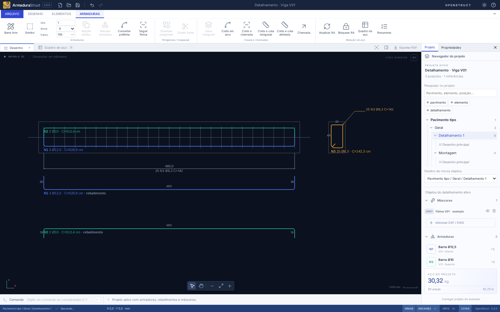

# ArmaduraStruct

**Desenhar. Detalhar. Quantificar.**

CAD 2D de armaduras do ecossistema [OpenStruct](https://openstruct.com.br), com barras paramétricas, estribos, rebatimentos e quadro de aço automático. Desenvolvido por Ricardo Corsini e colaboradores.



[](https://github.com/ricardocorsini/armadura-struct/actions/workflows/ci.yml)

**Versão 0.2.0 — ambiente CAD compacto e ferramentas de detalhamento.** Aplicação desktop Tauri para Linux e Windows, também executável no navegador para desenvolvimento. Os arquivos e os cálculos são processados localmente.

## Recursos

- Hierarquia por pavimento, elemento estrutural e detalhamento composto, com IDs estáveis, pesquisa, transferência de objetos e expansão persistente da árvore.
- Gerenciador de pranchas com folhas A0–A4, orientação, revisão, notas, ordenação, duplicação de layout e vistas vinculadas; abas de folhas e desenhos com navegação independente.
- Inserção e atualização seletiva de detalhamentos por JSON, comparação antes/depois, identificação pela origem, mapeamento de posições, reassociação de vínculos e preservação das vistas.
- Pacotes abertos `openstruct.detail/2` (`.osdetail.json`), com leitura de v1, para intercâmbio de um detalhamento, unidades, origem, repetição, propriedades físicas e vínculos; reimportação propõe atualizar. [Contrato e exemplos para produtores OpenStruct](docs/AS-09.md).
- [Repetição por detalhamento](docs/AS-03.md), com nomes/título automático e quantidade base × fator = quantidade efetiva. Reunião assistida de detalhes idênticos conserva uma definição física e reassocia vistas/vínculos, sem somar cópias ao multiplicador.
- [API TypeScript de domínio](docs/AS-51.md), sem React, para criar/editar/excluir posições, associar representações/faixas e executar lotes atômicos. A interface e o exemplo executável usam as mesmas operações e validações.
- Interpretação assistida de contornos/textos das máscaras CAD, com atribuição e confirmação explícitas de bitola, quantidade, categoria de aço e diâmetro de dobra; a referência CAD é preservada.
- Agrupamento semântico com seleção do conjunto e edição isolada por duplo clique; navegação e conclusão mantêm os demais detalhamentos protegidos e o quadro global vinculado.
- Faixa de comandos compacta, painel lateral único com abas Projeto/Propriedades/Pranchas, recolhimento dos painéis e modo Foco no CAD. Fundo claro/escuro, pan, zoom, enquadramento e grade.
- Barras livres por vértices; estribos retangulares com ganchos de 135°, bitola, mandril, quantidade e dimensões editáveis.
- Comandos pelo mouse ou teclado, coordenadas absolutas/relativas/polares, ortogonal e encaixes em extremidades e pontos médios.
- Seleção por clique ou janela, edição de vértices por alças, mover, copiar, girar, espelhar, excluir e desfazer/refazer.
- Ferramenta **Seguir fôrma**: desloca uma linha/polilinha da máscara pelo cobrimento mais meio diâmetro; permite editar os vértices e conferir as terminações.
- Rebatimentos vinculados à posição original, sem duplicar quantidades no quadro de aço.
- Polilinhas de desenho e conversão de contornos próprios ou importados em barras editáveis.
- Repetição gráfica de estribos e faixa ortogonal por espaçamento máximo, com as duas extremidades incluídas e quantidade vinculada à posição.
- Divisão de barras em trechos retos com traspasse informado pelo projetista; união geométrica de duas poligonais compatíveis com extremidades coincidentes.
- Cotas ortogonais/alinhadas, cortes gráficos retos/em arco e chamadas com identificação vinculada à posição; edição, movimentação e exportação DXF/PDF.
- Relação de aço automática ou bloqueada para conferência, atualização explícita e renumeração mantendo os vínculos.
- Espaço de papel em mm, folhas A0–A4/personalizadas, margens, reserva de selo e vistas com escala/rotação próprias; PDF vetorial fiel à composição e validação de transbordamento.
- Máscaras **DXF ASCII e DWG**, com escala, unidade, posição, rotação, opacidade, camadas e relatório de importação.
- Quadro com posição, elemento, aço, bitola, quantidade, comprimento unitário/total e peso teórico.
- Projeto `.armstruct.json` com máscaras incorporadas, recuperação automática local e exportação DXF, PDF vetorial das folhas e CSV.

## Executar

Requer **Node.js 22 LTS**, npm e, para desktop, Rust estável e os [pré-requisitos do Tauri 2](https://v2.tauri.app/start/prerequisites/).

```bash
git clone https://github.com/ricardocorsini/armadura-struct.git
cd armadura-struct
npm ci
npm run desktop:dev
```

No Ubuntu 22.04/24.04, os pacotes de desenvolvimento incluem:

```bash
sudo apt update
sudo apt install build-essential libwebkit2gtk-4.1-dev libssl-dev libayatana-appindicator3-dev librsvg2-dev patchelf
```

No Windows, instale Visual Studio Build Tools com ferramentas C++, Rust MSVC e WebView2, conforme a documentação do Tauri.

Para desenvolver somente a interface:

```bash
npm run dev
```

Abra `http://127.0.0.1:1420`. O `npm ci` copia o leitor WebAssembly para `public/wasm`; não há download do leitor durante a utilização.

## Primeiros passos

1. Abra o exemplo incluído ou crie um projeto.
2. Importe sua fôrma com **Importar máscara**. Confira a unidade no painel e uma distância conhecida com **Medir**.
3. Use **Barra livre**, **Estribo** ou **Seguir fôrma**. As coordenadas e propriedades geométricas são em **mm**.
4. Selecione a posição para editar aço, bitola, quantidade e geometria. Ajuste o mandril e os ganchos para o projeto.
5. Crie rebatimentos, faixas, cotas e chamadas. O quadro é atualizado a cada alteração, a menos que esteja bloqueado para conferência.
6. Em **Pranchas**, crie folhas, coloque desenhos e abra suas vistas com duplo clique para editar. Duplicar folhas/vistas reutiliza os dados de aço.
7. Salve o projeto e exporte os desenhos e quantitativos.

Veja [o guia de comandos e convenções](docs/GUIA.md), os [contratos da composição em escala](docs/AS-05.md) e os [contratos da atualização seletiva](docs/AS-08.md).

## Convenções e limites desta versão

- É um editor de detalhamento. Não dimensiona estruturas nem verifica automaticamente normas, ancoragem, emendas, cobrimento ou diâmetros mínimos de dobra.
- O comprimento usa o **eixo físico da barra**, com arcos de dobra: raio de eixo = (mandril + bitola)/2. Cotas gráficas entre vértices teóricos são em cm; comprimentos do quadro são em m. Confira a convenção de cotagem do seu processo de fabricação.
- Ganchos dos estribos têm prolongamento reto configurável depois da curva. O desenho 2D pode sobrepor as duas pontas; não representa o afastamento em profundidade.
- Fôrmas fechadas geram um contorno deslocado; ganchos, aberturas e ancoragens precisam ser definidos pelo projetista. A ferramenta não mantém um vínculo paramétrico com futuras alterações da máscara.
- DWG é lido pelo LibreDWG. A compatibilidade depende da versão e das entidades do arquivo. Há suporte a entidades 2D comuns e blocos; **não é uma reprodução integral do AutoCAD**. Confira os avisos. Xrefs externas, objetos proxy, hachuras, splines, sólidos 3D, estilos e layouts de impressão não são integralmente reproduzidos. Apenas o espaço de modelo é usado.
- Limites de importação: 30 MB por máscara, 100 mil entidades expandidas, até 20 máscaras. Projetos de até 100 MB; até 500 vértices por barra. Desenhos grandes devem ser simplificados para uso como referência.
- DXF de saída contém entidades CAD simples e curvas discretizadas, sem os vínculos paramétricos próprios do `.armstruct.json`. Não há exportação DWG.
- O intercâmbio OpenStruct é um contrato JSON, sem leitura nativa de `.PRJ`/`.CAD` ou conexão proprietária com outros editores. Linhas/textos CAD não criam aço automaticamente; entidades fora do suporte do leitor continuam indicadas nos avisos de omissão/simplificação.
- O PDF exporta a folha ativa ou todas as folhas na ordem do gerenciador, com formatos/orientações próprios e escala declarada por vista. Uma barra de 1000 mm mede 20 mm em 1:50 e 10 mm em 1:100; mudar a escala não altera o modelo ou o peso. Imprima em tamanho real (100%). Transbordamento da área útil/do quadro ou sobreposição à reserva do selo bloqueia a exportação. O selo tem campos básicos; modelos CAD de carimbo personalizados e quadros de aço colocados na folha ficam para tarefas futuras. DXF e CSV continuam globais.
- Distribuições com mais de 200 peças mostram uma vista abreviada com marcas nas posições reais. A quantidade e o espaçamento informados permanecem exatos. A exportação de estribos completos aceita até 2.000 peças por faixa; acima disso, use a representação por traços. Não há otimização de corte nem percentual automático de perdas.
- O traspasse é inserido manualmente e acrescentado ao comprimento total das duas peças; não é dimensionado a partir do concreto ou da aderência. A divisão deve ocorrer inteiramente em uma perna reta, fora das dobras.
- Cotas/cortes são anotações gráficas, sem geração automática de seções de concreto. O vínculo atualiza a identificação da barra; os pontos da anotação são posicionados pelo usuário.
- Projetos nos formatos 1–6 são migrados ao abrir, preservando objetos, coordenadas, IDs, rebatimentos e quantitativos. O formato salvo é `armadurastruct/7`, com repetição por detalhamento, contexto da RA bloqueada, origens, composição e vínculos validados. Aplicativos antigos não abrem esse formato. A quantidade armazenada na barra é por elemento; o quadro aplica o fator uma única vez.
- O salvamento automático guarda o último projeto neste dispositivo. Use **Salvar projeto** para manter cópias independentes.

## Verificar e compilar

```bash
npm run check
npm run build
npx playwright install chromium
npm run test:e2e
npm run format:check
npm run desktop:build -- --bundles deb,appimage  # Linux
npm run desktop:build -- --bundles nsis          # Windows
```

O workflow [Validate and build](.github/workflows/ci.yml) executa os testes e compila os instaladores Linux/Windows. Os pacotes ficam nos artefatos da execução do GitHub Actions. A distribuição pelo Launcher usa o publicador central e o catálogo assinado, conforme [RELEASES.md](docs/RELEASES.md).

Os testes cobrem comprimentos analíticos de dobras, estribos, pesos, offsets, validação do arquivo, exportação/reimportação DXF e fluxos reais de edição e leitura DWG em navegador. A execução do aplicativo nativo e o comportamento de cada arquivo de produção devem ser conferidos nos sistemas de destino.

## Arquitetura

| Camada              | Implementação                                                         |
| ------------------- | --------------------------------------------------------------------- |
| Interface           | React 19, TypeScript, Vite, Inter, Lucide                             |
| Editor 2D           | SVG, coordenadas cartesianas em mm, comandos e histórico transacional |
| Modelo de armaduras | TypeScript independente da interface; validação Zod                   |
| Importação          | Worker, dxf-parser e LibreDWG Web/WASM                                |
| Documentação        | DXF ASCII, jsPDF e CSV                                                |
| Desktop             | Tauri 2, diálogos nativos e acesso a arquivos selecionados            |
| Persistência        | JSON versionado + IndexedDB                                           |

`src/domain` concentra geometria e quantitativos; `src/cad` normaliza as máscaras; `src/components` contém o editor; `src/lib` cuida de arquivos/exportações. O modelo pode evoluir para bibliotecas de peças, formas especiais e integração com ConsoloStruct/MolaStruct sem depender do renderizador.

## Contribuir

Abra uma issue descrevendo o caso de uso e, para problemas geométricos, inclua dimensões e resultado esperado. Para importação, anexe somente arquivos que você pode compartilhar. Antes de enviar um PR, execute formatação, verificações e testes. Alterações de comprimento ou quantitativos devem incluir uma referência analítica reproduzível.

Próximas etapas: testes com desenhos reais do escritório, refinamento de comandos CAD, composição de pranchas, biblioteca de detalhes e ferramentas adicionais de edição geométrica.

## Licença

GPL-3.0-or-later. Consulte [LICENSE](LICENSE) e [THIRD_PARTY_NOTICES.md](THIRD_PARTY_NOTICES.md), especialmente a dependência GPL usada para leitura de DWG.

## Instalação pelo Launcher

Instale pelo [Struct Launcher](https://openstruct.com.br/launcher). Os pacotes assinados de Windows e Linux ficam no [hub de distribuição](https://github.com/ricardocorsini/openstruct-catalog/releases/tag/armadurastruct-v0.2.0). O código permanece neste repositório, sob a tag correspondente. Consulte [o fluxo de publicação](docs/RELEASES.md).

## Identidade

Hefesto trabalhando uma armadura, em gravura preta e marfim sobre fundo âmbar. Os formatos utilizados pelo aplicativo estão em `public/brand` e `src-tauri/icons`.
