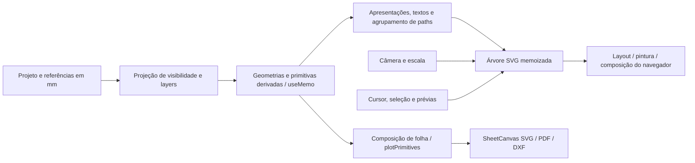
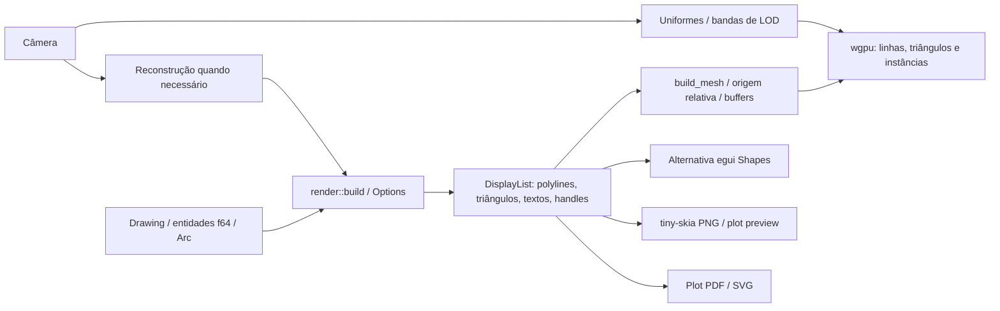

# Análise dos renderizadores CAD 2D — ArmaduraStruct e CADCraft

## 1. Decisão recomendada, versões e limites

**Recomendação: manter SVG em produção e priorizar origem visual local para coordenadas grandes, rasterização de máscaras densas e invalidação granular.** A análise encontrou e reproduziu um defeito de apresentação a 1e8; o experimento de origem local é só diagnóstico em DOM, não uma correção entregue. Aproveitar a separação entre cena e câmera do CADCraft como referência arquitetural; não portar a aplicação nem adotar Rust/wgpu apenas por linguagem ou publicidade. Um backend acelerado deve ser uma prova de conceito separada, condicionada a resultados em GPU física e à manutenção do contrato vetorial.

Esta entrega da #148 contém diagnóstico, protocolo, scripts e evidências. Não muda `src/`, ferramentas, interface, domínio de armaduras, quantitativos, schema ou renderizador de produção. Nenhuma recomendação é um ganho já implementado.

### Legenda das afirmações

- **[C] Confirmada no código:** comportamento ou contrato localizado nas fontes permanentes.
- **[D] Documentada:** declaração do próprio projeto, sem convertê-la em resultado desta investigação.
- **[M] Medida:** observação desta execução, nas condições e com os limites abaixo.
- **[H] Hipótese:** explicação/benefício a validar por experimento.
- **[NV] Não verificada:** falta execução, instrumento ou comparação equivalente; não fundamenta ganho quantitativo.

| Aplicação/fonte                         | Revisão efetivamente analisada                                                                                                    | Situação                                                                                                                            |
| --------------------------------------- | --------------------------------------------------------------------------------------------------------------------------------- | ----------------------------------------------------------------------------------------------------------------------------------- |
| ArmaduraStruct 0.6.0                    | [`d402139`](https://github.com/ricardocorsini/armadura-struct/tree/d402139)                                                       | `master` sincronizado antes da investigação; build de produção local com sourcemaps; mesmas fontes nos testes                       |
| CADCraft 0.20.1                         | [`7526dc62c14e71b3c8d46e73bbf1fa29ef506af1`](https://github.com/storytold/cadcraft/tree/7526dc62c14e71b3c8d46e73bbf1fa29ef506af1) | fonte da release oficial e artefato web correspondente executado                                                                    |
| CADCraft `main` consultado inicialmente | [`ca87680fb0f9d7803d3e64c808d0a3f7a196fdaa`](https://github.com/storytold/cadcraft/tree/ca87680fb0f9d7803d3e64c808d0a3f7a196fdaa) | os diretórios `crates/render`, `gpu.rs` e `canvas/rebuild.rs` não diferiam da release no `git diff`; não é o hash do binário medido |
| Referências da issue                    | ArmaduraStruct `d81527b`, CADCraft `2410a1f`                                                                                      | pontos de partida históricos; os números abaixo não são benchmarks dessas revisões                                                  |

**Limite decisivo [M]:** Chromium headless usa **SwiftShader/SwANGLE por software**, com composição/rasterização por software reportadas pelo navegador. O contador `renderer: gpu` do CADCraft identifica o caminho de código, não uma GPU física. Os dados não permitem classificar qual aplicativo é mais rápido em computadores de usuários. Os retângulos úteis dos canvases e algumas políticas visuais (grid, penas mínimas e layout da UI) também diferem, embora navegador, viewport, DPR e DXF sejam comuns; não são um teste isolado e normalizado de dois backends intercambiáveis.

**Plataformas:** os ensaios são web/Linux. O desktop Tauri/WebView do ArmaduraStruct e os desktops eframe do CADCraft não foram executados. Não havia `cargo` instalado; não foi compilado um executável Rust local nem utilizado um binário desktop. Não se declara um bloqueio de todas as opções de execução nativa: esse experimento permanece pendente. Nenhum resultado web foi rotulado como resultado nativo.

## 2. Pipelines e contratos confirmados

### 2.1 ArmaduraStruct: SVG/React com caches existentes

**[C] Modelo versus visual:** coordenadas do domínio são `number` (dupla precisão JavaScript); barras mantêm retas/arcos analíticos. Máscaras importadas entram por `parseDxf → normalizeCad`; símbolos derivam da definição compartilhada e instâncias. `visibilityProjection(detailEditorView(...))` filtra contexto, visibilidade e captura. Isso não é descarte espacial pela câmera. [A1][A2]

**[C] Construção:** `CadCanvas` memoiza máscaras, símbolos, anotações, geometrias de barras, apresentações, representações, distribuições e pontos de captura. `barGeometries` é um `Map` recalculado quando muda `source.bars`; não é um cache incremental por barra. Apresentações e máscaras dependem também de `source`, por causa de estilos, vínculos e textos. Uma edição pequena pode invalidar esses conjuntos; reaproveitamento durante navegação não prova reaproveitamento por edição. [A1]

**[C] Agrupamento já entregue:** `drawable` agrupa subpaths de máscaras por `[layer, resolvedStyle, closed]`. Logo, 20 mil linhas de mesma aparência não significam 20 mil elementos SVG. O ensaio comum confirma apenas sete descendentes no SVG para essas cenas de máscara, incluindo elementos auxiliares. Não recomendar “fazer batching” como se não existisse; investigar a granularidade e o custo de pintar o path grande. [A1]

**[C] Por câmera:** pan altera o `transform` externo; curvas físicas, legendas e inserções não precisam ser reconstruídas a cada movimento. `maskContent` e `objectContent` têm árvores memoizadas. Zoom altera o fator `stroke = 1/escala` e elementos com tamanho em tela; isso invalida dependências visuais, embora não recalcule toda a geometria física. O wheel limita a escala a `1e-6 … 20`; ajuste à tela e controles de zoom têm seus próprios caminhos. Não tratar esse limite de wheel como limite numérico universal do modelo. [A1]

**[C] Temporários:** cursor, snaps/guias, seleção, alças e prévias vivem no mesmo canvas, com seus próprios estados; alguns alteram dependências da árvore de objetos. O índice espacial de snaps serve à captura, não a um culling de pintura. Arrastar/pan tem caminhos de interação próprios. Custos de `onPointerMove`, captura e React devem ser separados do backend; não redesenhar os comandos para esta análise. [A1]

**[C] Curvas e precisão:** barras analíticas podem usar arcos SVG. Máscaras nativas têm círculo/arco analítico, mas `nativePoints` gera pontos com erro de corda de até **0,05 mm locais**, limitado a 100 mil pontos; transformação/escala da máscara muda o erro em coordenadas de mundo. A normalização de ARC/CIRCLE importados usa passos angulares de cerca de **5°**, com mínimo oito segmentos; elipses usam 96 intervalos. `drawable` desenha os pontos da máscara, sem retesselar segundo o zoom. O erro do importador não deve ser atribuído ao rasterizador SVG, nem confundido com o comprimento analítico de uma barra física. [A2][A3]

**[C] Folha e saída:** `SheetCanvas` memoiza `composeSheet`, quadros e linhas, e `PaperLines` é `memo`. `composeSheet`/`plotPrimitives` resolvem escala de papel, espessura, tracejado, inclusão e estilos; PDF/DXF usam primitivas compartilhadas, não uma captura de tela. SVG mínimo de tela e espessura em mm na impressão podem diferir intencionalmente. DXF conserva ARC quando a primitiva carrega arco analítico; não recupera analiticidade perdida na importação. PDF resolve fontes para as famílias base suportadas e informa substituição quando aplicável; não presumir a mesma métrica de fonte do navegador. [A4][A5][A6]

**[C/NV] Memória e GPU:** os caches locais mantêm Maps, pontos, strings de paths e árvores React/DOM enquanto o canvas vive. Nas fontes inspecionadas não há orçamento global/LRU dessas representações nem worker de construção da cena CAD. O navegador decide pintura, tesselação e aceleração; SVG não significa necessariamente “tudo na CPU”, e seu custo GPU/VRAM não foi isolado aqui. Não foi encontrado culling por viewport da cena desenhada em `CadCanvas`.

### 2.2 CADCraft: display list, malha e apresentação

**[C] Separação real:** o crate `render` não depende de egui/wgpu. `build` resolve estilos, linhas, hachuras, preenchimentos, blocos, dimensões e texto em `DisplayList`; o armazenamento inclui `DPrim`, vértices f64, triângulos, cores e handles. O contrato é visual, não um substituto do modelo de entidades. Blocos são expandidos com orçamento compartilhado (`MAX_BLOCK_EXPANSION = 2.000.000`), e truncamento fica explícito. [C1][C2]

**[C] Tesselação/LOD:** `Options` contém tolerância no mundo, detalhe mínimo de tracejados, visibilidade de textos/fills, espessuras, transparência, janela e cancelamento. `ensure_list` usa bandas de escala em potências de dois, tolerância nominal de até aproximadamente meio ponto lógico/px CSS na banda (até um pixel de dispositivo em DPR2) e detalhe de tracejado por tamanho em tela. Hachuras de tela são geradas dentro de uma janela com margem e têm limites de trabalho; plotagens usam detalhe e janelas próprios. Não extrapolar isso para culling universal de todas as entidades. O caminho CPU interativo testa bounds de polylines e recorta primitivas; o GPU usa scissor/stencil e buffers, mas a inspeção não demonstrou um índice espacial GPU que rejeite toda geometria fora da tela. [C1][C3][C4]

**[C] Invalidação:** `ListKey` inclui identidade/revisão do documento, banda de tesselação/LOD, modos de espessura/transparência, identidade `Arc` e viewport. Geração de fontes invalida a lista. `same_content` distingue mudança de câmera de conteúdo. Seleção tem um índice por handle/generation e malha de realce separada; drag usa slots e transformações próprias. Uma edição de documento reconstrói a lista de forma síncrona; não é uma display list toda incremental por entidade. [C3][C5]

**[C] Nativo versus web:** em navegação nativa, mudança de banda/janela pode gerar trabalho em uma thread, mantendo a lista anterior válida na tela. `Job::drop` sinaliza cancelamento; resultados verificam identidade/conteúdo e fontes; falha do worker força reconstrução na UI. O cancelamento é cooperativo, não preempção instantânea. O modelo é compartilhado por `Arc`, mas lista velha/nova e malhas podem coexistir e elevar pico de memória. A geração paralela por Rayon para espaços elegíveis é nativa. **WASM não usa essas threads e reconstrói sincronicamente.** Os comentários que relatam pausas antigas de 2–3 s são **[D]**, não medições desta entrega. [C1][C3][C6]

**[C] Precisão e buffers:** posições são subtraídas de uma origem f64 antes da conversão para f32. `choose_origin` usa o centro da cena ou da vista conforme a razão extensão/altura; não basta converter coordenadas absolutas para f32. A UI guarda malhas e slots, e `CanvasCallback::prepare` reutiliza buffers pela chave. O uniforme contém transformação/câmera; linhas, triângulos e quads podem ser divididos em batches, preservando quebras de ordem. Um uniforme de cinco `vec4<f32>` corresponde a 80 bytes de dados, mas o número real de uploads/draw calls por frame não foi instrumentado. A expressão de origem relativa é uma boa referência para um backend novo; não implica mover o aço no modelo. [C5]

**[C] Qualidade/fallback:** o pipeline customizado usa mistura premultiplicada e `MultisampleState { count: 1 }`; não afirmar superioridade automática de antialiasing. Sem o canvas GPU customizado, o desenho usa **egui Shapes preparados na CPU**, ainda apresentado pelo backend da UI. Isso é diferente de `tiny-skia`, usado para rasterização offscreen/PNG/preview de plot. `?cpu` não é promessa de funcionamento sem qualquer suporte gráfico. Erros/perda de dispositivo alimentam aviso e recuperação/autosave nativa; isso não prova troca automática e transparente de todo o aplicativo para outro backend. A web não recebe o autosave nativo desse caminho. [C4][C5][C7]

**[C] Texto e impressão:** o renderer resolve fontes, layout e outlines; harfrust/skrifa/Unicode bidi entram na dependência de fontes. Há limites de cache/carregamento de fontes, por exemplo 256 MiB de fontes carregadas e limites de nomes/caracteres; isso não é um orçamento de memória total da cena. Tiny-skia e os writers de plot reutilizam a display list, mas com opções de exportação, recortes, penas e fontes próprias. O documento de arquitetura **[D]** descreve essa intenção e está datado: não tomar contagens/tempos históricos como medidos no commit atual. [C1][C8]

## 3. Matriz de diferenças e relevância

| Aspecto                  | ArmaduraStruct                                                                         | CADCraft confirmado                                                  | Evidência/diferença e relevância                                                                                                                               |
| ------------------------ | -------------------------------------------------------------------------------------- | -------------------------------------------------------------------- | -------------------------------------------------------------------------------------------------------------------------------------------------------------- |
| Cena persistente         | Maps, primitivas e árvores SVG memoizadas                                              | Display list e malhas chaveadas                                      | **[C]** Ambos já têm reaproveitamento; aperfeiçoar chaves/granularidade, não começar com “sem cache”                                                           |
| Pan estático             | Transform externo; navegador repinta/compõe                                            | Uniforme de câmera com buffers reutilizados                          | **[C/M]** Caso grande AS degrada; pipeline GPU é candidato a experimento, não ganho demonstrado em hardware                                                    |
| Zoom                     | Dependências de stroke/tamanho em tela; máscara discretizada fixa                      | Bandas de tesselação/tracejado; rebuild por banda                    | **[C]** Separar atualização visual de geometria física é transferível sem trocar de backend                                                                    |
| Edição local             | Arrays/projeto podem invalidar conjuntos inteiros                                      | Revisão nova reconstrói lista síncrona                               | **[C]** Nenhum é inteiramente incremental por entidade; hipótese de cache granular deve ser medida                                                             |
| Curvas                   | Barra analítica ≠ máscara importada de pontos                                          | Curvas tesselladas conforme tolerância de vista                      | **[C/M]** Círculo importado R300 tem erro geométrico calculável; corrigir origem do erro antes de mudar rasterização                                           |
| Espessuras/tracejados    | Estilo comum, mínimo visual em tela, papel em mm                                       | Resolução de penas e detalhe mínimo de dashes; linhas/quads GPU      | **[C]** Políticas diferentes; comparar em pixels e em papel, não só nomes de lineweight                                                                        |
| Fill/hachura             | Fill simples e linhas importadas; importador avisa padrões complexos não interpretados | Triangulação/fill, hachuras com limites, janela e LOD                | **[C]** Catálogo não é benchmark de backend. Fixture usa 200 LINEs densas e um fill simples; não implementa novos HATCHs                                       |
| Texto                    | SVG nativo, família CSS; substituição PDF declarada                                    | Layout/outlines próprios, fallback de fontes, caches                 | **[C/M]** Texto pequeno/acentuado/rotacionado está nas capturas; métricas de fontes e equivalência tipográfica total **[NV]**                                  |
| Blocos/símbolos          | Definições e instâncias derivadas; importação expande INSERT                           | Expansão de blocos na lista, orçamento e recorte XCLIP               | **[C]** Não afirmar instancing GPU de blocos apenas porque há buffers de instâncias de quads                                                                   |
| Coordenadas grandes      | Dupla no domínio; transform SVG e rasterização do navegador                            | f64 no domínio; origem relativa antes de f32                         | **[C/M]** A 1e8 o AS não exibe os traços; rebasing apenas no SVG os restaura. CADCraft mantém traços visíveis. Não equivale a certificação da geometria física |
| Transparência/ordem      | Opacidade da máscara, estilo/fill e ordem SVG                                          | Alfa premultiplicado, quebras entre batches, wipeout e layers        | **[C]** Batching futuro não pode reordenar conteúdo transparente; equivalência quantitativa **[NV]**                                                           |
| Recortes e fora da vista | Visibilidade/layers/contexto; sem culling espacial do desenho identificado             | Janela de hatch, scissor/stencil, recortes geométricos e culling CPU | **[C]** Oportunidade de tiles/partições em SVG; não confundir com índice de snap                                                                               |
| Temporários/seleção      | Estados e dependências na árvore SVG                                                   | Malhas/slots de drag e realce separados                              | **[C]** Separação de overlays é ideia aproveitável; não criar novos comandos                                                                                   |
| Folha/PDF/DXF            | Primitivas/plot e políticas de escala compartilhadas                                   | Display list de plot e writers próprios                              | **[C]** Contrato vetorial precisa sobreviver ao backend; fonte e pena podem diferir legitimamente                                                              |
| Memória                  | Arrays/strings/DOM e caches locais                                                     | Modelo/lista/malhas/VRAM e caches de fontes                          | **[M/C]** Heap e backing storage parciais registrados; RSS, VRAM e pico completo **[NV]**                                                                      |
| CPU/GPU/plataformas      | Browser/WebView decide aceleração                                                      | wgpu no UI, caminho egui alternativo; worker nativo, web síncrona    | **[C/M]** Software gráfico deste ambiente inviabiliza promessa de ganho por GPU/Rust                                                                           |

## 4. Experimentos, dados e limites de medição

### 4.1 Ambiente e protocolo

**[M]** Debian GNU/Linux 13 (trixie), kernel Linux 6.18.57, x86_64; 3 vCPUs AMD EPYC 9V74 expostas ao contêiner; 10.452.459.520 bytes de RAM reportados ao Node. Chromium **156.0.8078.79**, Node **24.22.1**, headless com `--no-sandbox`, viewport **1600 × 1000**, DPR **1** nas séries de desempenho. Não foram usados flags de frames ilimitados; a cena vazia observa rAF próximo de 60 Hz, sem demonstrar a sincronização de um monitor/WebView nativo. SwiftShader/SwANGLE driver **5.0.0**, sem GPU física medida. O ambiente é compartilhado/virtualizado; turbo, carga externa, clocks e latência física do monitor não são controlados.

Build AS: `npm run build -- --sourcemap`, produção Vite; sourcemaps usados para atribuição de amostras V8. CADCraft: ZIP web oficial v0.20.1, SHA-256 **300e870c50b66d371055915ba95e3ddbfd4c45431466d5214743b5dcab95a0e1**, conferido contra `SHA256SUMS.txt` da mesma release (integridade de download, não verificação independente de assinatura/reprodutibilidade do build).

Séries sequenciais, sem executar os dois benchmarks simultaneamente: pausa de **1 s** após abertura/fontes/recuperação e pequena pausa entre repetições; **3 repetições × 60 eventos** por ação. Não foi descartada uma primeira repetição como aquecimento estatístico. O intervalo dos eventos é condicionado ao processamento do navegador/Playwright; os frames não são amostras independentes e o trabalho total/tempo de cada ação pode diferir. A conclusão usa medianas por repetição e não inventa intervalo de confiança com três repetições.

- **Frames [M]:** intervalos de `requestAnimationFrame` do documento, não timestamp de apresentação efetiva de cada frame do renderer. No CADCraft o renderer pode redesenhar sob demanda; o callback de observação também funciona sem novo desenho. Não equivaler esse número a FPS útil sem inspeção da cena.
- **Latência [M]:** `event.timeStamp → dois requestAnimationFrame`; proxy de oportunidade de atualização, não input-to-photon, scanout ou latência física. Eventos globais incluem o caminho de entrada e não isolam pintura.
- **CPU [M]:** deltas CDP `ScriptDuration`, `TaskDuration`, `LayoutDuration`, `RecalcStyleDuration`; perfil V8 do benchmark existente. São durações de tarefas e de execução na main thread, podendo incluir bloqueios; não são porcentagem de CPU nem ciclos. Não representam CPU total de todos os processos nem tempo de shader/GPU.
- **Memória [M]:** `Runtime.getHeapUsage` registra V8, embedder e backing storage antes das interações. WASM/DOM/caches/driver têm domínios distintos; não somar indiscriminadamente nem chamar isso de RSS/VRAM. Sem pico de VRAM, contadores de uploads ou draw calls medidos.
- **Abertura [M]:** `startupProxyMs` e `openToReadyProxyMs` incluem bootstrap, transporte, parse/validação, camada de controle e dois frames. Não são tempo puro de construção nem primeira imagem física. No CADCraft, `ui.inspect.perf.buildMs/meshMs/drawMs` oferece contadores internos separados; no AS não há instrumento equivalente para build isolado no browser.

A medição representativa usa o benchmark existente sem mudá-lo. Uma tentativa piloto com `switch-drawing` parou em `.hierarchy-drawing` na cena vazia (30 s): não se publicou tempo dessa ação. A série válida usa `cursor-no-snap,pan,zoom`. As correções de seletor zero-altura em paths horizontais e posicionamento do cursor no ensaio de zoom ficaram apenas no harness de pesquisa. Navegação não foi creditada como custo de importação/autosave: ambos ficam fora dos trechos cronometrados; o benchmark registra escritas IndexedDB.

### 4.2 Cenas determinísticas e equivalência

Gerador próprio: [render148-scenes.mjs](../scripts/research/render148-scenes.mjs). O harness normaliza a máscara AS comum para opacidade 1, em vez do default 0,45 de importação; a cena representativa mantém sua opacidade 0,5. As políticas de lineweight das UIs continuam próprias, registradas nos dados, e não sustentam um ranking visual de espessuras. Todos os DXFs usam mm, mesmas coordenadas e hashes do conteúdo; os `.dxf.gz` são dados sintéticos próprios, não arquivos de terceiros. Os IDs de tabelas/camadas gerados pelos leitores podem variar; a geometria do DXF e suas contagens são determinísticas.

| Cena                               | Conteúdo de entrada                                                                                                                                                             | Normalização AS                                                                    | Uso                                                       |
| ---------------------------------- | ------------------------------------------------------------------------------------------------------------------------------------------------------------------------------- | ---------------------------------------------------------------------------------- | --------------------------------------------------------- |
| `small`                            | 100 LINEs                                                                                                                                                                       | 100 primitivas / 200 pontos                                                        | curva de escala comum                                     |
| `medium`                           | 2.000 LINEs                                                                                                                                                                     | 2.000 / 4.000                                                                      | curva de escala comum                                     |
| `large`                            | 20.000 LINEs                                                                                                                                                                    | 20.000 / 40.000                                                                    | curva de escala comum; batching por estilo já existente   |
| `quality`                          | 236 entidades top-level: linhas finas/espessas e tracejada, CIRCLE R300, ARC, 6 TEXTs com acentos/rotação, 20 INSERTs de bloco próprio, 200 LINEs densas e HATCH sólido simples | 296 primitivas / 715 pontos; INSERTs expandidos; sem aviso do leitor nesta fixture | qualidade, não ranking de entidades semânticas            |
| `precisionOrigin` / `precisionFar` | 100 linhas idênticas, deslocadas de (0,0) para (1e8,1e8); vetores (3,2) mm                                                                                                      | 100 / 200 em cada                                                                  | apresentação em coordenadas grandes                       |
| representativa `large`             | 400 barras (80 estribos), 400 representações, 20.000 segmentos de máscara                                                                                                       | 40.000 pontos da máscara; 5.127 descendentes SVG                                   | uso específico AS, sem equivalente físico CADCraft        |
| representativa `large-no-mask`     | mesmas barras/representações, sem máscara                                                                                                                                       | 5.125 descendentes SVG                                                             | ablação diagnóstica, não prova isolada de custo de pintar |
| `empty`                            | projeto vazio                                                                                                                                                                   | cinco descendentes SVG                                                             | piso do ambiente/entrada                                  |

**Não equivalentes/excluídos do comparativo direto:** armaduras paramétricas, relação do aço e suas legendas não têm modelo físico equivalente no CADCraft; hachuras de padrão com ilhas complexas, XCLIP de bloco e imagens raster não foram equiparados; a fixture densa é LINE, não valida semântica de HATCH de padrão. Transparência de máscara não é o mesmo que transparência por entidade/bloco; nenhum resultado de desempenho foi creditado a “falta” desses recursos.

### 4.3 Resultados medidos

<!-- RESULTADOS-GERADOS -->

Os valores seguintes são **[M]**, em ms. Mediana das medianas e mediana dos p95 das três repetições; long tasks são a soma das contagens, não uma duração somada.

**Cena representativa do ArmaduraStruct** (800 objetos físicos/gráficos com e sem a máscara):

| Cena          | Ação           | Frame mediano | p95 frame | p95 proxy 2 frames | Long tasks (3 rep.) | Tarefas main thread / rep. |
| ------------- | -------------- | ------------- | --------- | ------------------ | ------------------- | -------------------------- |
| empty         | cursor-no-snap | 16,7          | 16,7      | 33,5               | 0                   | 131,0                      |
| empty         | pan            | 16,7          | 16,8      | 33,0               | 0                   | 174,6                      |
| empty         | zoom           | 16,7          | 16,8      | 49,2               | 0                   | 173,0                      |
| large         | cursor-no-snap | 16,7          | 16,7      | 40,0               | 0                   | 974,8                      |
| large         | pan            | 200,0         | 266,7     | 507,3              | 170                 | 12086,2                    |
| large         | zoom           | 16,8          | 183,4     | 317,5              | 50                  | 5241,8                     |
| large-no-mask | cursor-no-snap | 16,7          | 16,8      | 34,9               | 0                   | 534,1                      |
| large-no-mask | pan            | 16,7          | 49,9      | 62,4               | 2                   | 1283,5                     |
| large-no-mask | zoom           | 16,7          | 33,4      | 128,3              | 25                  | 3678,5                     |

A máscara adiciona só **dois nós** ao SVG (5.125 → 5.127), mas amplia muito o custo do caso representativo. Isso refuta uma explicação baseada apenas em quantidade de nós DOM. No perfil V8 do primeiro pan grande, `(program)` responde por cerca de 12 s e ScriptDuration fica abaixo de 100 ms por repetição; `(program)` não nomeia Paint/Raster. A hipótese de custo de pintura/composição exige a evidência de tracing complementar, não apenas essa categoria.

**Mesmo DXF de linhas, aplicações completas** (não um ranking de GPU física; canvases, grid/estilos e caminhos de entrada próprios):

| Aplicação | Linhas | Ação | Frame mediano | p95 frame | p95 proxy 2 frames | Long tasks (3 rep.) |
| --------- | ------ | ---- | ------------- | --------- | ------------------ | ------------------- |
| armadura  | 100    | pan  | 16,7          | 16,7      | 33,0               | 0                   |
| armadura  | 100    | zoom | 16,7          | 16,7      | 46,3               | 0                   |
| armadura  | 2000   | pan  | 16,7          | 16,7      | 32,8               | 0                   |
| armadura  | 2000   | zoom | 16,7          | 16,7      | 51,3               | 0                   |
| armadura  | 20000  | pan  | 33,3          | 50,0      | 90,1               | 0                   |
| armadura  | 20000  | zoom | 33,3          | 33,5      | 139,0              | 0                   |
| cadcraft  | 100    | pan  | 416,7         | 483,3     | 988,5              | 194                 |
| cadcraft  | 100    | zoom | 416,7         | 483,4     | 1879,4             | 531                 |
| cadcraft  | 2000   | pan  | 450,0         | 483,4     | 979,7              | 194                 |
| cadcraft  | 2000   | zoom | 449,9         | 500,0     | 1993,7             | 515                 |
| cadcraft  | 20000  | pan  | 466,6         | 550,0     | 1102,7             | 194                 |
| cadcraft  | 20000  | zoom | 450,0         | 499,9     | 1926,0             | 536                 |

**Abertura e memória parcial**, uma observação por cena (não medianas de três aberturas):

| Aplicação/cena  | Proxy abertura até ready (ms) | Build/mesh interno (ms) | V8 usado (MiB) | Backing storage CDP (MiB) | Canvas útil (CSS px) |
| --------------- | ----------------------------- | ----------------------- | -------------- | ------------------------- | -------------------- |
| armadura/small  | 329,4                         | não instrumentado       | 10,8           | 1,3                       | 1348 × 777           |
| armadura/medium | 531,5                         | não instrumentado       | 14,6           | 1,9                       | 1348 × 777           |
| armadura/large  | 2753,0                        | não instrumentado       | 54,5           | 5,7                       | 1348 × 777           |
| cadcraft/small  | 4670,7                        | 6,1 / 0,1               | 3,4            | 0,2                       | 1072 × 892           |
| cadcraft/medium | 4555,6                        | 15,2 / 0,1              | 4,0            | 0,4                       | 1072 × 892           |
| cadcraft/large  | 5461,3                        | 42,1 / 0,6              | 4,1            | 2,1                       | 1072 × 892           |

**Não comparar os heaps como memória total das aplicações:** estruturas Rust/WASM e recursos de driver não são medidos pelo heap V8. Os contadores internos CADCraft medem preparação/enfileiramento na CPU, não conclusão física da GPU. O resultado muito lento do caminho wgpu neste ambiente não demonstra superioridade de SVG em hardware: [snapshot de processos](performance/render148/software-process-snapshot.json) registra cerca de 193% de CPU média acumulada no processo gráfico por software, enquanto o canvas reporta `renderer: gpu`.

Dados brutos: [representativa](performance/render148/armadura-representative.json), [comum AS](performance/render148/common-armadura.json), [comum CADCraft](performance/render148/common-cadcraft.json). Arrays de frames/eventos e long tasks estão nos arquivos comuns; o benchmark representativo guarda estatísticas por repetição e resumo do perfil, não um perfil V8 completo. Os três DXFs comuns foram carregados sem exceção JavaScript, e o CADCraft confirmou 100, 2.000 e 20.000 entidades/primitivas, sem truncamento.

<!-- /RESULTADOS-GERADOS -->

**[M] Edição local exploratória:** [armadura-edit.json](performance/render148/armadura-edit.json), uma repetição de 30 movimentos de alça na cena grande: frame mediano **16,7 ms**, p95 **33,3 ms**, máximo **433,4 ms**, uma long task de **443 ms**, `ScriptDuration` **737,5 ms**, sem escrita IndexedDB no trecho. O perfil inclui `objectSnaps.ts:tree` (146,1 ms self) e outro quadro do mesmo índice (73,5 ms), além de GC; logo, atribuir esse custo ao rasterizador seria incorreto. Arrastar uma alça faz prévia/edição e captura adjacente, diferente de pan; a fase de commit não foi isolada com marca própria e a série de uma repetição não pode ser comparada como distribuição estatística às três de navegação.

### 4.4 Evidência visual, precisão e consistência

- Cenas próprias em ambos os aplicativos: [AS qualidade](performance/render148/armadura-quality-dpr1.png), [CADCraft qualidade](performance/render148/cadcraft-quality-dpr1.png); após resize para 1366 × 768: [AS](performance/render148/armadura-quality-resize-dpr1.png), [CADCraft](performance/render148/cadcraft-quality-resize-dpr1.png).
- Coordenadas: [AS origem](performance/render148/armadura-precisionOrigin-dpr1.png), [AS 1e8](performance/render148/armadura-precisionFar-dpr1.png), [CADCraft origem](performance/render148/cadcraft-precisionOrigin-dpr1.png), [CADCraft 1e8](performance/render148/cadcraft-precisionFar-dpr1.png). São capturas com UI/retângulos úteis próprios, não imagens para subtração pixel a pixel.
- [DXF de saída AS](performance/render148/armadura-quality-export.dxf) e [PDF AS](performance/render148/armadura-quality-export.pdf) foram gerados da mesma fixture. Gerar arquivos e passar regressões vetoriais não equivale a validar toda a impressão rasterizada ou fontes em um leitor PDF externo; essa comparação completa permanece **[NV]**.
- **[M/C] Erro geométrico independente:** círculo R300 importado tem 72 intervalos/73 pontos. A flecha máxima é `300 × (1 − cos(π/72)) = 0,2855335254 mm`. Isso excede 0,05 mm; o limite de 0,05 é de outro gerador, não contrato desse importador. Em zoom de 20 px/mm, esse erro corresponderia a **5,7107 px CSS**, se esse arco estiver sob esse zoom. É uma projeção matemática, não uma captura que mediu 5,7107 px de defeito. Comprimentos de fabricação não foram recalculados a partir dessa máscara.
- **[M] Coordenadas grandes, experimento controlado:** no SVG AS original, `getTotalLength()` retornou **503,764526 mm**, contra **360,555128 mm** esperados para 100 vetores (3,2). O bbox lido pelo SVG foi 96 × 96, enquanto os dados têm 93 × 92 mm; a CTM reportada também mudou na transformação grande. Com pontos visuais relativos e transformação compensada, a leitura passou a **360,555206 mm**, bbox 93 × 92, e os traços reapareceram. [Dados antes/depois](performance/render148/precision-diagnostic.json), [original](performance/render148/armadura-precisionFar-original.png), [representação rebased](performance/render148/armadura-precisionFar-rebased.png). Isso localiza uma limitação de quantização/transformação no caminho SVG deste Chromium, sem atribuí-la à precisão `number` do modelo. `getTotalLength()` é uma API de apresentação, não base para corte/massa. O experimento não verifica outros navegadores nem todas as grandezas.
- As capturas CADCraft usam o default `settings.lwdisplay = false`, registrado no JSON, enquanto o AS apresenta os estilos de referência. Essa diferença de configuração exclui uma comparação quantitativa direta de lineweights; o suporte CADCraft a espessuras é confirmado no código, e o ensaio visual com a opção ligada fica pendente.
- **[M] Inspeção visual:** curvas, preenchimento, blocos repetidos e os acentos `çãé` aparecem nas duas capturas. Na fonte usada pelo CADCraft para o TEXT da fixture, o travessão `—` aparece como um quadrado; isso é evidência dessa fonte/fixture/release, não de suporte Unicode geral. A densidade das 200 linhas e as políticas de pena/AA fazem o conjunto se fundir em certas escalas, sem autorizar inferir perda de entidades.
- **[M] DPR2 e zoom:** [AS DPR2](performance/render148/armadura-quality-dpr2.png), [CADCraft DPR2](performance/render148/cadcraft-quality-dpr2.png) e [registro](performance/render148/common-quality-dpr2.json). Após resize e 12 eventos de zoom-in, não houve exceção JS; AS registrou escala 20 no transform, CADCraft altura de vista aproximadamente 6,276e-6. Isso exercita limites de câmera; não prova legibilidade/correção em todos esses níveis. A memória linear WASM observada nessa cena CADCraft foi **16.121.856 bytes**, fora da interpretação simplista do heap V8. Campos `extremeZoom` das execuções iniciais DPR1 tinham cursor fora do canvas e não são ensaios de zoom; usar o registro DPR2 corrigido.
- **Tolerâncias para ensaio futuro:** comparar pontos de controle em mundo com erro ≤1e-6 mm em coordenadas locais; apresentação com erro de corda ≤0,5 px CSS em todos os DPRs; limites de impressão por escala/política atual. Esses são critérios propostos para uma PoC, não tolerâncias estruturais/normativas nem aprovação retroativa de todos os desenhos. Diferenças de fonte/AA exigem inspeção de métricas, legibilidade e continuidade, não identidade de pixels.

**[M] Tracing complementar separado:** [trace Chrome comprimido](performance/render148/armadura-pan-trace.json.gz) e [sumário](performance/render148/trace-summary.json) registram 30 movimentos de pan na cena representativa. `RasterTask` soma **5.555,867 ms** num worker e **204,550 ms** em outro; na main thread, Paint soma **243,521 ms**, PrePaint **70,729 ms**, Layout **7,842 ms** e Layerize **145,264 ms**. As categorias são aninhadas/paralelas: não somar RasterTask + Playback + DisplayItemList nem tratá-las como wall time ou utilização total de CPU. O tracing tem overhead e não foi misturado aos quantis sem tracing. Ainda assim, identifica rasterização como trabalho relevante e dá suporte à investigação de representação por regiões/camada estática, sem atribuir todo `(program)` do perfil à pintura.

### 4.5 Lacunas e experimento necessário

| Informação                                                        | Estado e próximo experimento                                                                                                                                      |
| ----------------------------------------------------------------- | ----------------------------------------------------------------------------------------------------------------------------------------------------------------- |
| Backend em GPU física, VRAM, chamadas e uploads                   | **[NV]** repetir em GPU integrada e dedicada, registrar adapter/driver, tempo GPU e bytes por rebuild/frame; comparar canvas útil e câmera iguais                 |
| Desktop AS Linux/Windows e CADCraft nativo                        | **[NV]** builds release nas mesmas máquinas, medir WebView separado do Chromium e worker/Rayon separados do WASM; sincronização nativa pode diferir por SO        |
| Primeiro pixel útil real                                          | **[NV]** marca de fim de build/presentação + tracing/frame capture; para latência física, câmera de alta velocidade/instrumento externo                           |
| CPU total/RSS/pico durante rebuild                                | **[NV]** profiler do SO por processo, memória do processo GPU, amostras ao longo de abertura/edição, sem confundir V8 com WASM                                    |
| Cena parcialmente fora da tela e recorte complexo equivalente     | **[NV]** mosaico com frações visíveis 1/10/100%, teste de z-order/transparência e clipping de folha; não adicionar entidade nova para paridade                    |
| Hachuras de padrão, raster, alfa por entidade, fontes específicas | **[NV]** corpus comum dentro dos recursos existentes e métricas de visual/consumo; excluir o que não tiver semântica comparável                                   |
| Quantificação de todos os traços fora do JavaScript               | **[M]** tracing parcial foi feito e identifica rasterização; **[NV]** atribuição completa, tempo GPU físico e repetição em hardware                               |
| Troca de desenho e tempo puro de edição local                     | instrumentos/fluxos existentes têm limites; regressão funcional de caches cobre navegação/edição/histórico/projeto, mas não substitui tempo isolado de cada etapa |
| Zoom extremo/rápido, DPR2 e recortes de saída                     | usar os registros complementares e distinguir simples ausência de exceção de prova de correção; expandir tolerâncias automatizadas na PoC                         |

## 5. Licenças e possibilidades de integração

### 5.1 Inspiração versus reaproveitamento

**[C]** ArmaduraStruct declara **GPL-3.0-or-later** e inclui GPL do leitor DWG/WASM, além de dependências permissivas e fonte Inter OFL. CADCraft declara **MIT OR Apache-2.0**, com arquivos `LICENSE-MIT`, `LICENSE-APACHE`, `NOTICE` e atribuições. Conceitos de display list, cache por revisão, origem relativa e bandas de zoom podem orientar implementação independente. Nesta entrega **não foi copiado código do CADCraft para produção**: os scripts de pesquisa são próprios e acionam a API pública do artefato web. [L1][L2]

MIT/Apache-2.0 são, em princípio, compatíveis com incorporação em uma distribuição GPLv3 observadas suas condições, mas a alternativa escolhida precisa ser documentada; manter copyright/licença, NOTICE aplicável, indicações de modificações e cláusulas/patentes da opção Apache. Não concluir que o conjunto inteiro pode ser copiado por causa da licença do workspace.

**Checagem transitiva limitada, não auditoria completa:** `Cargo.lock` foi conferido para versões e fontes; metadados versionados de crates.io para nove dependências estão em [dependency-licenses.json](performance/render148/dependency-licenses.json). A evidência desses nove itens é o campo de licença dos metadados, não revisão de todos os arquivos vendorizados/transitivos. Forks egui/winit/craft-libs são pinned por Git e demandam revisão desses commits, não só da versão crates.io.

| Item conferido                    | Licença indicada  | Consequência                                                                                                                                                             |
| --------------------------------- | ----------------- | ------------------------------------------------------------------------------------------------------------------------------------------------------------------------ |
| tiny-skia 0.12.0                  | BSD-3-Clause      | avisos/condições próprios; caminho de raster CPU, não wgpu                                                                                                               |
| lyon_tessellation 1.0.23          | MIT OR Apache-2.0 | candidato isolável, sem importar UI/comandos                                                                                                                             |
| wgpu 30.0.1                       | MIT OR Apache-2.0 | ainda requer closure de backends/shaders/plataformas                                                                                                                     |
| harfrust 0.14.0                   | MIT               | texto traz dependências/dados adicionais                                                                                                                                 |
| skrifa 0.48.0                     | MIT OR Apache-2.0 | verificar fontes reais usadas, não só a biblioteca                                                                                                                       |
| icu_segmenter 2.3.0               | Unicode-3.0       | aviso de dados/código específico; não omitir por ser transitiva                                                                                                          |
| rayon 1.12.0; unicode-bidi 0.3.18 | MIT OR Apache-2.0 | Rayon nativo não torna o WASM automaticamente paralelo                                                                                                                   |
| acadrust 0.6.6                    | MPL-2.0           | também explicitado em NOTICE; bridge DWG separado, não necessário para comparar/usar apenas render; examinar obrigações por arquivo se houver redistribuição/modificação |

**Assets/fontes [C]:** a fonte de traço, padrões e ícones gerados são atribuídos pelo projeto; fontes opcionais `craft-fonts` têm lista e OFL próprias, e egui também fornece entradas de fontes. `NOTICE` cita fontes de ícones MIT e perfis ICC CC0 transitivos do PDF. Nomes/logos de ArtCraft em `docs/brand` são marcas, **fora** da licença geral. Não transferir marcas, fontes binárias, amostras ou assets por arrasto. As imagens deste relatório são capturas próprias de fixtures sintéticas; não são um pacote de assets para reutilização. [L2]

**Gate antes de reutilizar qualquer código:** definir exatamente crate/arquivos, gerar closure/SBOM com Cargo.lock, revisar licenças/avisos dos forks e dependências de build/plataforma, fonts/ICC/shaders e arquivos gerados; escolher opção de licença e atualizar os avisos AS. Esta revisão parcial não autoriza reutilização irrestrita.

### 5.2 Matriz de viabilidade

Esforços abaixo são **[H] estimativas de engenharia**, não horas já executadas nem garantia de velocidade. Confiança significa força da justificativa nesta evidência, não probabilidade contratual de prazo.

| Alternativa/oportunidade                                                | Benefício esperado e evidência                                                                               | Esforço / confiança                                                      | Dependências, risco, manutenção e memória                                                                                                                 |
| ----------------------------------------------------------------------- | ------------------------------------------------------------------------------------------------------------ | ------------------------------------------------------------------------ | --------------------------------------------------------------------------------------------------------------------------------------------------------- |
| **A0 — origem local na representação SVG**                              | restaura traços a 1e8 no experimento DOM **[M]**, sem mudar aço/modelo                                       | 2–5 dias, alta confiança no defeito e média na solução entre plataformas | manter coordenadas de entrada/captura em mundo e transformações inversas corretas; testar browser/WebView; custo de cópia/cache precisa de orçamento      |
| **A1 — manter SVG; medir e particionar paths de máscara por regiões**   | limitar geometria pintada no pan; batching existente, mas ablação grande degrada **[M]**                     | 3–8 dias, média                                                          | bounds por tile/estilo, margem para curva/texto/pena; preservar ordem/alfa; pode aumentar DOM/strings e invalidar o ganho; fallback para path atual       |
| **A2 — cena derivada + overlays e invalidação granular, ainda SVG**     | reduzir reconstrução em edição/zoom; dependências amplas **[C]**, resultado de edição isolado ainda **[NV]** | 1–3 semanas, média                                                       | gerações de estilos/fontes/layers/contexto e identidade física; LRU/orçamento e descarte de projeto; risco alto de cache obsoleto se usar apenas ID       |
| **A2a — LOD de representação com erro em pixels**                       | evitar superdetalhe/lacunas de curvas; importador e geradores distintos **[C/M]**                            | 4–10 dias, média                                                         | começar onde já há geometria analítica; não inventar dados perdidos nem alterar corte; políticas de papel separadas; risco de flicker em bandas           |
| **A3 — PoC Canvas/WebGL/WebGPU com modelo visual comum**                | testar redução de custo DOM/pintura com buffers/origem relativa **[H]**                                      | 2–4 semanas de PoC; 2–4 meses para integração robusta, baixa/média       | texto, clipping, dashes, seleção, z-order, perda de dispositivo, WebView; caches e buffers podem duplicar memória; manter SVG/saídas vetoriais e fallback |
| **A3b — reutilizar crates render/geom/fontes do CADCraft em Rust/WASM** | reuso de tesselação/layout, **não ganho medido**                                                             | 4–8 semanas de spike, baixa                                              | modelo Drawing difere de Bar/Primitive; adaptador, cópias, serialização/ABI, fontes e licenças; não trazer engine/comandos/UI por dependência acidental   |
| **Migração total do app / UI egui**                                     | não necessária para render 2D da issue                                                                       | fora do escopo; não recomendada                                          | risco desproporcional sobre ferramentas, Tauri, persistência e domínio; nenhuma medição exige isso                                                        |

**React/Tauri/web [C/H]:** extrair uma cena visual imutável não exige Rust. Worker JS pode preparar geometria transferível se os custos reais justificarem; validar que cópia/serialização não supera o trabalho poupado. Rust/WASM exige build/distribuição/depuração adicionais e ABI explícita; `Vec`/JSON através da fronteira pode copiar duas ou mais vezes, e fontes podem aumentar download/memória. Worker nativo, Rayon e `Arc` não atravessam automaticamente para WASM single-thread. WebGPU em WebViews/GPUs/driver deve ter detecção por recurso e fallback testado; nenhum caminho pode contaminar o cálculo físico.

## 6. Priorização e condições mensuráveis

### Curto esforço: diagnosticar e conservar o que já funciona

**Primeiro, correção de precisão visual em issue separada:** implementar origem local no caminho derivado onde foi reproduzida a falha, com captura/seleção/zoom e transformações testados em Chrome e WebViews. Sucesso: desenho em 1e8 visível com posição/desenvolvimento de apresentação coerentes, erro visual ≤0,5 px CSS, dados físicos/IDs/quantitativos inalterados; não usar comprimento de path SVG como oráculo de fabricação.

1. **Instrumentar regiões de Paint/Raster/Compositor e custos de preparação** em cena grande, no navegador e WebViews release. Sucesso: mais de 90% do intervalo cronometrado explicável por categorias/processos, contadores de rebuild/caption/bytes e ausência de autosave no trecho. Se pintura não dominar, não iniciar tiles apenas por suposição.
2. **Experimento SVG por tiles apenas em máscara densa**, com modo atual como controle. Sucesso proposto: p95 de pan ≤33 ms em hardware de referência, redução ≥30% no caso grande, memória de representação ≤1,25× e regressão ≤10% nas cenas pequenas; erro visual ≤0,5 px CSS, sem buracos/ordem errada. Descartar se multiplicação de DOM/caches anular o ganho. Estes números são gates futuros, não resultados desta entrega.
3. **Curvas/estilos:** primeiro teste analítico e inspeção de onde a informação foi perdida; abrir issue independente para política de representação analítica já existente. Não converter um erro de normalização em pedido genérico de trocar SVG.

### Médio esforço: contratos e invalidação

4. **Cena visual com revisões explícitas e overlays separados.** Testar edição de uma barra, mudança de quantidade/texto/layer/fonte, bloqueio/visibilidade, undo/redo e troca rápida de projeto. Sucesso: objetos físicos não afetados sem retesselação; alterações globais invalidam tudo que depende delas; nenhum frame com ID/revisão de outro projeto; memória retorna a até 10% do patamar após fechar/reabrir cenas repetidamente.
5. **LOD com bandas e orçamento de caches.** Medir zoom contínuo/extremo, DPR1/2 e papel. Sucesso: erro de corda ≤0,5 px CSS na tela, sem alteração de segmentos/quantitativos físicos e com saídas vetoriais idênticas semanticamente. Toda degradação por limite precisa de diagnóstico explícito.

### Maior esforço: backend acelerado somente após o gate

6. Avançar A3 só se A1/A2 não atingirem os alvos e tracing ainda identificar custo que um backend reduz. Em GPU integrada e dedicada, comparar mesma cena, câmera e canvas, com texto/curvas/clipping/alfa; exigir p95 melhor ≥30% no caso limitante, sem piorar pequenos desenhos >10%, sem crescimento de memória sem limite e com recuperação testada de indisponibilidade/perda de GPU.
7. Avaliar Rust/WASM separado do backend: comparar custo de preparação puro **incluindo** conversão/transferência/serdes, tamanho comprimido do módulo, tempo de bootstrap e pico de memória. Rejeitar adoção se só o microbenchmark interno melhorar e a latência ponta a ponta piorar. Manter exports/fabricação no contrato analítico e SVG como referência/fallback durante o experimento.

## 7. PoC mínima e sugestões de issues separadas

**PoC proposta, não implementada:** contrato visual versionado com LINE/polylines, arcos analíticos já disponíveis, fill simples e texto suportado, gerado do projeto atual sem criar entidades novas. Backend atual como referência; módulo experimental recebe geometria em coordenadas relativas, estilos e câmera separados. Dois planos: estático e overlays. Orçamento de cache, contador de invalidações/bytes/uploads, identificação de revisão/projeto e fallback fazem parte da PoC desde o início. Impressão/PDF/DXF continuam pelas primitivas/plot existentes.

Sugestões para o mantenedor abrir, sem criar novas issues automaticamente:

- “Preservar representação de máscaras em coordenadas grandes com origem visual local”.
- “Instrumentar preparação, paint/raster e memória do CAD em build release”.
- “Avaliar tiles SVG para máscaras densas preservando estilo e ordem”.
- “Separar dependências de geometria, apresentação e overlays com invalidação por revisão”.
- “Definir orçamento de erro visual de curvas já analíticas por zoom/DPR”.
- “Comparar backend acelerado experimental com fallback e saída vetorial inalterada”, condicionado aos resultados anteriores.

A opção de **não trocar o renderizador** permanece válida. A evidência atual justifica investigar um gargalo específico e adotar boas ideias de cache/precisão; não comprova que a arquitetura inteira do CADCraft seja superior ou diretamente transplantável.

### Verificações desta entrega

Além das séries de pesquisa, `npm run check` passou com **1.160 testes unitários em 78 arquivos**, seis testes de distribuição e validação do plugin de exemplo; o build de produção com sourcemaps e `npm run format:check` passaram. Dez fluxos Playwright de `cadPerformance`, `layers`, `plotting` e `sheetSchedule` passaram: navegação/edição/undo/redo/troca de projeto e invalidação de cache, visibilidade de layers, estilo e saída vetorial, composição de folha e preservação do aço. Esses fluxos comprovam os cenários exercitados, não ausência universal de stale frames ou equivalência pixel a pixel entre produtos. O teste de cache usa instrumentação de contadores; seus tempos de teste não entraram no benchmark.

### Reprodução e rastreabilidade

O roteiro executável e as ressalvas de ambiente estão em [scripts/research/README.md](../scripts/research/README.md). Os helpers não fazem parte do bundle de produção. Atributo documentado `data-host="page"` habilita a ponte oficial CADCraft para abrir o DXF sintético; o WASM baixado não é alterado. [Manifesto do artefato](performance/render148/artifact.json).

| Fonte                                   | Função/trecho inspecionado                                                                                                                                                                                                                                         |
| --------------------------------------- | ------------------------------------------------------------------------------------------------------------------------------------------------------------------------------------------------------------------------------------------------------------------ |
| CadCanvas.tsx                           | `drawable` 314–340; caches 377–491; `maskContent` 1354 e `objectContent` 1445; câmera/transform 1620–1647; `move` 1114–1127 retorna antes do snap durante pan                                                                                                      |
| cad/import.ts                           | `parseDxf` 18; discretização `arc` 40; `normalizeCad` ARC/CIRCLE 226 e expansão de INSERT 185                                                                                                                                                                      |
| SheetCanvas.tsx / paper.ts              | `composition` 89 e `PaperLines` 418; `composeSheet` em paper.ts 302                                                                                                                                                                                                |
| plotting.ts / exports.ts / textStyle.ts | `plotPrimitives` 71; DXF 150 e loop PDF 595; `resolveTextFont` 115 e `textFontNotice` 155                                                                                                                                                                          |
| CADCraft pipeline.rs / display.rs       | `Options` 11, `build`/`build_plot` 83+, `build_space` 108, caminho paralelo 147; contratos de primitivas/lista em display.rs                                                                                                                                       |
| CADCraft canvas/list.rs / canvas.rs     | `ensure_list` 84, geração de fontes 80, `ListKey` em canvas.rs 92; slots e geração da lista no estado                                                                                                                                                              |
| CADCraft canvas/rebuild.rs              | `Job::drop` 73, `run` 100, `spawn` 136; variante wasm retorna None                                                                                                                                                                                                 |
| CADCraft gpu.rs                         | `build_mesh` 183, `choose_origin` 301, MSAA 576, `CanvasCallback::prepare/paint` 698–780                                                                                                                                                                           |
| CADCraft fontes e plot                  | [limites de fontes](https://github.com/storytold/cadcraft/blob/7526dc62c14e71b3c8d46e73bbf1fa29ef506af1/crates/fonts/src/ttf.rs#L124); [plotter](https://github.com/storytold/cadcraft/blob/7526dc62c14e71b3c8d46e73bbf1fa29ef506af1/crates/io/src/plotter.rs#L95) |

### Fontes permanentes

[A1]: https://github.com/ricardocorsini/armadura-struct/blob/d402139/src/components/CadCanvas.tsx#L206
[A2]: https://github.com/ricardocorsini/armadura-struct/blob/d402139/src/cad/import.ts#L18
[A3]: https://github.com/ricardocorsini/armadura-struct/blob/d402139/src/domain/nativeMasks.ts#L38
[A4]: https://github.com/ricardocorsini/armadura-struct/blob/d402139/src/components/SheetCanvas.tsx#L89
[A5]: https://github.com/ricardocorsini/armadura-struct/blob/d402139/src/domain/plotting.ts#L71
[A6]: https://github.com/ricardocorsini/armadura-struct/blob/d402139/src/lib/exports.ts#L150
[C1]: https://github.com/storytold/cadcraft/blob/7526dc62c14e71b3c8d46e73bbf1fa29ef506af1/crates/render/src/pipeline.rs#L11
[C2]: https://github.com/storytold/cadcraft/blob/7526dc62c14e71b3c8d46e73bbf1fa29ef506af1/crates/render/src/display.rs#L1
[C3]: https://github.com/storytold/cadcraft/blob/7526dc62c14e71b3c8d46e73bbf1fa29ef506af1/crates/ui-egui/src/canvas/list.rs#L84
[C4]: https://github.com/storytold/cadcraft/blob/7526dc62c14e71b3c8d46e73bbf1fa29ef506af1/crates/ui-egui/src/canvas/draw.rs#L85
[C5]: https://github.com/storytold/cadcraft/blob/7526dc62c14e71b3c8d46e73bbf1fa29ef506af1/crates/ui-egui/src/gpu.rs#L1
[C6]: https://github.com/storytold/cadcraft/blob/7526dc62c14e71b3c8d46e73bbf1fa29ef506af1/crates/ui-egui/src/canvas/rebuild.rs#L1
[C7]: https://github.com/storytold/cadcraft/blob/7526dc62c14e71b3c8d46e73bbf1fa29ef506af1/crates/ui-egui/src/autosave.rs#L141
[C8]: https://github.com/storytold/cadcraft/blob/7526dc62c14e71b3c8d46e73bbf1fa29ef506af1/docs/architecture.md#L64
[L1]: https://github.com/ricardocorsini/armadura-struct/blob/d402139/THIRD_PARTY_NOTICES.md
[L2]: https://github.com/storytold/cadcraft/blob/7526dc62c14e71b3c8d46e73bbf1fa29ef506af1/NOTICE
