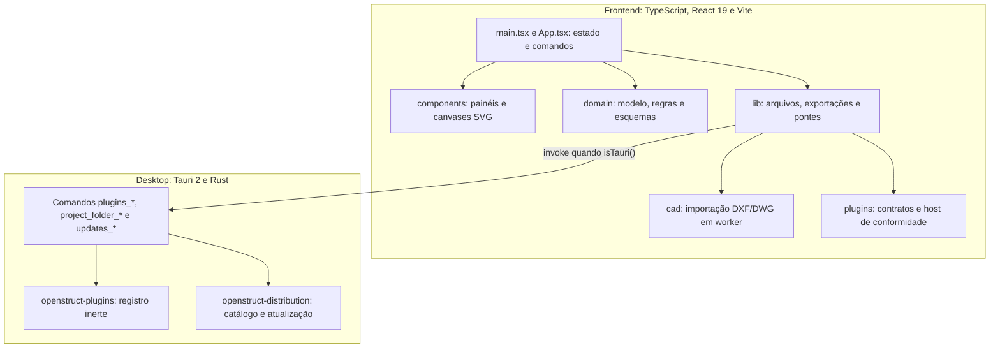

# Arquitetura

Mapa do código para quem vai alterá-lo. Os comportamentos para o usuário estão nos guias por recurso (índice em [docs/README.md](README.md)); a plataforma de plugins tem documento próprio em [plugins/ARCHITECTURE.md](plugins/ARCHITECTURE.md). Regras de trabalho: [AGENTS.md](../AGENTS.md) e [CONTRIBUTING.md](CONTRIBUTING.md).

## Visão geral

O mesmo frontend roda no navegador (`npm run dev`, E2E, `vite preview`) e no desktop. Fora do Tauri, `lib/` usa os fallbacks web (download/`File`, File System Access, IndexedDB). Os E2E exercitam o caminho web; o caminho nativo é coberto pelos testes Rust e pelo build desktop do CI.

## Frontend

### Estado e histórico (`src/App.tsx`)

- Um único `Project` imutável por documento. O estado é `History = { past, present, future }` em `useState`, espelhado em `historyRef` para callbacks.
- `commit(change)` é o ponto único de escrita: recebe `Project -> Project`, valida (visibilidade, layers, `validateRebarChange`, isolamento de detalhamento via `assertDetailEdit`), completa a posse hierárquica (`completeOwnership`) e empilha no histórico (até 40 passos).
- Operações compostas (lançar estribo, aplicar lote, inserir símbolo) usam **uma** chamada a `commit`, para um único Desfazer.
- Comandos interativos (mover, espelhar, medir, texto livre, biblioteca de símbolos…) são **sessões** em `useState`/`useRef`: guardam um instantâneo do `Project` e só escrevem no documento ao confirmar. Elas se descartam se `historyRef.current.present` mudar (comparação por identidade).
- Navegação por documento (modelo ou prancha) usa `documentKey` e `sessions` (câmeras, abas abertas), persistidos como preferência local por projeto (`readDocumentWorkspace` em `lib/files.ts`).
- Diálogos grandes são carregados com `lazy` (Plugins, Novo projeto, CSV, Layers, Plotagem…).
- Comandos e ferramentas: o tipo `Tool` está em `domain/types.ts`; `Action` e o catálogo de atalhos/aliases em `domain/shortcuts.ts` (`shortcutCatalog`); a faixa de comandos em `components/Ribbon.tsx`.

### Componentes (`src/components`)

- `CadCanvas.tsx`: editor 2D em SVG do modelo (seleção, encaixes, prévias).
- `SheetCanvas.tsx`, `SheetManager.tsx`: espaço de papel (pranchas).
- `Panels.tsx`, `HierarchyNavigator.tsx`, `LayerManager.tsx`, `Mask*.tsx`: painéis laterais, árvore de projeto, layers e ferramentas de máscara.
- `*Dialog.tsx`, `*LaunchPanel.tsx`, `*Criteria*.tsx`: critérios e lançamento por família de armadura (estribo, grampo, helicoidal, tela soldada).
- `BarCutMemory.tsx`: consulta das parcelas do comprimento de corte; `LinkedProjectFiles.tsx`: lista e ações dos arquivos vinculados à pasta autorizada.

### Domínio (`src/domain`)

Lógica sem dependência de React. Principais blocos:

| Área                                        | Arquivos principais                                                                                          |
| ------------------------------------------- | ------------------------------------------------------------------------------------------------------------ |
| Formato e validação do projeto              | `model.ts` (`decodeProject`, esquema Zod, `schedule`), `types.ts`                                            |
| Hierarquia pavimento → grupo → detalhamento | `hierarchy.ts`, `projectSetup.ts`, `detailEditing.ts`                                                        |
| Geometria e comprimento                     | `geometry.ts`, `segments.ts`, `vertices.ts`, `transforms.ts`, `alignment.ts`                                 |
| Famílias de armadura                        | `stirrups*.ts`, `beamClamp*.ts`, `helix*.ts`, `weldedMesh*.ts`, `followForm.ts`                              |
| Cotagem e memória de corte                  | `barDimensions.ts`, `barDimensionLabels.ts`, `barDevelopment.ts`                                             |
| Arquivos vinculados                         | `linkedProjectFiles.ts`, com autorização da sessão em `lib/projectFolder.ts`                                 |
| Quantitativos e fabricação                  | `detailQuantities.ts`, `fabrication.ts`, `sheetSchedule.ts`, `scheduleScopes.ts`, `numbering.ts`, `marks.ts` |
| Edição                                      | `editing.ts`, `detailRepetition.ts`, `detailTransfer.ts`, `maskManipulation.ts`, `maskOffset.ts`             |
| CAD e máscaras                              | `drafting.ts`, `maskCad*.ts`, `maskDrawing.ts`, `nativeMasks.ts`, `objectSnaps.ts`, `symbols.ts`             |
| Layers, visibilidade, plotagem              | `layers.ts`, `layerProfiles.ts`, `visibility.ts`, `plotting.ts`                                              |
| Prancha e saída gráfica                     | `paper*.ts`, `sheets.ts`, `drawingPrimitives.ts`                                                             |
| Intercâmbio                                 | `detailPackage.ts` (`openstruct.detail/NN`), `rebarApi.ts`                                                   |

Pontos de projeto que atravessam vários arquivos:

- **Formato versionado.** `Project.schema` é um literal em `types.ts` (na master desta revisão, `armadurastruct/35`); leitura/validação e migração em `decodeProject`. Dado de recurso novo em arquivo de formato antigo é recusado. Veja [CONTRIBUTING](CONTRIBUTING.md#alterações-de-formato).
- **Primitivas de desenho compartilhadas.** `drawingPrimitives.ts` gera a geometria que canvas, PDF de pranchas e DXF consomem; evita três implementações divergentes.
- **Compatibilidade de formato.** As duas variantes de desenvolvimento de `armadurastruct/34` são migradas para 35 sem perder `linkedFiles` ou convenções de cotagem. O pacote atual é `openstruct.detail/23`, com contrato em [JSON Schema v23](openstruct-detail-v23.schema.json); os contratos de versões anteriores permanecem publicados.
- **API de armaduras.** `rebarApi.ts` (`REBAR_API_VERSION = '1.0'`) executa lotes de comandos validados sobre o `Project`, sem React nem DOM, e é a base do exemplo de plugin e dos scripts em `scripts/examples/`.
- **Relação de aço.** `schedule(project)` (`model.ts`) calcula o quadro. Com `scheduleLock` o quadro vem da fotografia guardada, não do cálculo ao vivo.

`src/pluginApi.ts` é a fachada pública (tipos e funções) para produtores externos; reexporta partes de `domain/`, `plugins/` e `public/plugins/v1/types.ts`.

### `src/lib`

- `files.ts`: abrir/salvar, importação de máscara (`importMask` via worker), recuperação automática em IndexedDB (`autosave`/`restore`), preferências de documento.
- `projectFolder.ts`: pasta de projeto autorizada (`save-v1/projeto.armstruct.json`), com ponte Tauri ou File System Access, e operações sobre vínculos explícitos. `Project.linkedFiles` guarda caminhos relativos; a autorização de acesso permanece na sessão. Consultar vínculos é permitido na edição isolada, mas vincular/desvincular e o histórico respeitam o guard de `src/domain/detailEditing.ts`.
- `exports.ts`: DXF, CSV, PDF vetorial; `scopedCsv.ts`: CSV por escopo.
- `recentProjects.ts`, `shortcutPreferences.ts`, `appUpdates.ts`, `plugins.ts`: preferências locais e pontes (`invoke`) para os comandos nativos.

### Importação CAD (`src/cad`)

`import.worker.ts` roda em Web Worker: DXF por `dxf-parser`, DWG por LibreDWG (WASM em `public/wasm`, copiado por `scripts/prepare-wasm.mjs` no `postinstall`). `import.ts` normaliza as duas entradas para `Mask`. Limites e avisos de importação estão no [README](../README.md).

### Plugins (`src/plugins`, `public/plugins/v1`)

Contratos JSON Schema, tipos TS, validação de manifesto/catálogo (`contracts.ts`), proveniência e sessão de conformidade (`host.ts`), inspeção de `.osplugin` (`package.ts`). Nesta versão não há execução de código de terceiros. Detalhes em [plugins/ARCHITECTURE.md](plugins/ARCHITECTURE.md).

## Desktop (`src-tauri`, `crates`)

| Local                                 | Papel                                                                                                            |
| ------------------------------------- | ---------------------------------------------------------------------------------------------------------------- |
| `src-tauri/src/lib.rs`                | Monta o app, registra os comandos `invoke` e bloqueia o fechamento da janela durante atualização em andamento.   |
| `src-tauri/src/project_folder.rs`     | Acesso **somente** à pasta escolhida no seletor nativo (`cap-std`, tokens opacos, escrita atômica).              |
| `src-tauri/src/plugins.rs`            | Adaptador IPC estreito para o serviço de plugins; o frontend nunca envia caminhos.                               |
| `src-tauri/src/updates.rs`            | Adaptador IPC para consulta e atualização consentida.                                                            |
| `src-tauri/capabilities/default.json` | Permissões da janela `main` (diálogos e `fs` de leitura/escrita explícitas).                                     |
| `crates/openstruct-plugins`           | Registro de plugins: pacote, inventário, instalação atômica, catálogo online validado. Sem runtime de terceiros. |
| `crates/openstruct-distribution`      | Núcleo vendorizado do launcher: modelo, inventário, plataforma e atualizador. Ver `UPSTREAM.md` do crate.        |

A CSP está duplicada em `tauri.conf.json` e no `preview` de `vite.config.ts`; mantenha as duas coerentes.

## Persistência

| Dado                           | Onde                                                                                          | Observação                                                              |
| ------------------------------ | --------------------------------------------------------------------------------------------- | ----------------------------------------------------------------------- |
| Projeto                        | `.armstruct.json` (download, arquivo ou `save-v1/projeto.armstruct.json` na pasta autorizada) | Um JSON `Project` com máscaras incorporadas                             |
| Recuperação automática         | IndexedDB (`projects`, chave `current`)                                                       | Grava o mesmo JSON; volta por `decodeProject`                           |
| Preferências de UI             | `localStorage`                                                                                | Câmera/abas por projeto, recentes (`armadurastruct.recent.v1`), atalhos |
| Intercâmbio de um detalhamento | `.osdetail.json` (`openstruct.detail/23`)                                                     | Exemplos em `docs/examples`                                             |
| Plugins instalados             | Diretório de dados do Tauri                                                                   | Gerido pelo crate Rust                                                  |

## Build, testes e entrega

- `npm run build` = `tsc -b && vite build` (saída em `dist/`; alvo `es2022`/`safari15`).
- `npm run check` (tipos + Vitest + teste do release + validação do plugin de exemplo) e E2E Playwright sobre `vite preview` na porta 1420. Pipeline completo em `.github/workflows/ci.yml`.
- Desktop: `npm run desktop:build` (Tauri). Publicação e assinatura são feitas fora deste repositório, conforme [RELEASES.md](RELEASES.md).
- `scripts/`: validação e empacotamento de plugins (`plugins.mjs`), benchmark CAD (`cad-benchmark.mjs`), versão e pedido de release, e exemplos de API (`scripts/examples`).
