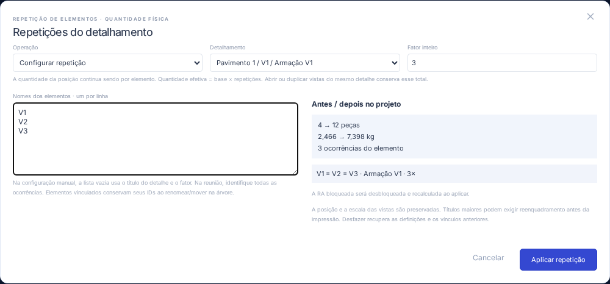

# AS-03 · Repetição de detalhamentos e quantitativos

Atualização AS-54: formato nativo atual **`armadurastruct/8`**, pacote **`openstruct.detail/3`** (leitura v1/v2) e posições de fabricação compartilhadas entre ocorrências. O quadro soma as contribuições reais sem fundir elementos estruturais. Consulte [AS-54](AS-54.md) para o contrato, as novas operações da API e as regras de equivalência; referências de versões anteriores abaixo documentam a evolução histórica.

O detalhamento existente da AS-01 recebe um fator de repetição e a identificação dos elementos representados. Há uma definição de aço, várias ocorrências do elemento e quantas vistas/rebatimentos forem necessários. A repetição não altera coordenadas ou a quantidade base armazenada nas posições.

| Situação                        | Base da posição | Fator do detalhe | Quantidade efetiva |
| ------------------------------- | --------------: | ---------------: | -----------------: |
| Um elemento                     |               4 |                1 |                  4 |
| V1 = V2 = V3                    |               4 |                3 |                 12 |
| Duas vistas desse mesmo detalhe |               4 |                3 |                 12 |
| Repetição removida              |               4 |                1 |                  4 |

## Uso

Em **Elementos → Repetições do detalhamento**, escolha o detalhe, informe um fator inteiro de 1 a 10000 e os nomes, um por linha. Se informar nomes, identifique todas as ocorrências; uma lista totalmente vazia usa o nome base do detalhe e o fator. O título combina os nomes representados, o nome base e o fator. A prévia mostra o total de peças/peso do projeto antes e depois.

**Aplicar repetição** confirma uma única transação. Uma RA bloqueada é desbloqueada/recalculada. **Cancelar/Esc** não altera o projeto. **Remover repetição** elimina o multiplicador e a identificação de ocorrências; não muda os dados ou a geometria da barra. Desfazer/Refazer recupera a configuração anterior. Conclua a edição isolada antes de configurar a repetição, pois ela afeta o levantamento e pode consolidar outros detalhes.

A propriedade **Quantidade** da barra continua por elemento. A legenda complementar, o navegador, os rótulos e o quadro mostram a relação base × fator = efetiva. A faixa de distribuição desenha o elemento típico, usando a quantidade base. Não gera três faixas para representar três elementos nem multiplica o aço pelo número de vistas.



## Reunir cópias existentes

Escolha **Reunir detalhes idênticos existentes**, selecione o representante que será conservado e marque os candidatos. O comparador usa um multiconjunto das posições físicas: família, geometria local de corte, bitola, aço, mandril, quantidade base e extensão da distribuição. Marcas, descrições, cores, nomes e posicionamento gráfico não estabelecem equivalência. A comparação é conservadora: não tenta reconhecer automaticamente toda poligonal equivalente por inversão, simplificação ou transformação de vértices.

Antes de aplicar, confira os nomes de todas as ocorrências, o fator resultante e os totais antes/depois. O fator é a soma das repetições dos detalhes escolhidos. Se um candidato já tinha repetição sem nomes, é preciso completar sua identificação para reunir. Uma seleção incompatível ou incompleta não produz alteração.

A operação:

- Conserva os IDs das posições físicas e dos gráficos do representante.
- Retira as definições físicas dos outros detalhes e seus gráficos internos. O aviso identifica que somente notas, máscaras, polilinhas, cotas e rebatimentos internos do representante serão conservados.
- Reassocia referências externas às posições equivalentes do representante, preservando seus pontos; um rebatimento externo recebe a compensação de origem local necessária.
- Mantém IDs de desenhos e vistas, redirecionando os desenhos para o representante. Posição, escala, rotação e quadro no papel permanecem.
- Quando há translação uniforme entre layouts, compensa `modelOrigin` para manter o desenho na mesma posição do papel. Layouts diferentes recebem aviso para conferência/reenquadramento.
- Conserva pavimentos e elementos estruturais da árvore. Nomes vinculados a esses elementos acompanham renomeações/mudanças de pavimento; homônimos são qualificados pelo pavimento/ID.
- Guarda as origens absorvidas para impedir que uma cópia reunida volte como uma nova definição de aço por importação.

A prévia confere que a quantidade total permanece igual e que o peso permanece dentro da tolerância numérica relativa de `1e-8`. O resultado usa uma definição física vezes o fator, sem manter as cópias somadas ao multiplicador. Uma RA bloqueada é invalidada. Aplicar gera uma etapa do histórico; desfazer recupera definições, gráficos, vínculos e vistas anteriores.

**Remover o multiplicador não recria as cópias consolidadas.** A restauração das cópias é feita por Desfazer enquanto houver histórico. A revisão individual de uma origem absorvida é bloqueada: restaure/separe explicitamente as ocorrências antes de atualizá-la. Não há expansão automática de uma repetição em vários elementos independentes nesta tarefa.

## Contratos do modelo e levantamento

O formato nativo passa a **`armadurastruct/7`**. Projetos 1–6 são migrados mantendo IDs dos objetos, barras, máscaras, anotações, rebatimentos, coordenadas, quantidades e snapshots antigos. A ausência de repetição significa fator 1. Um arquivo antigo que tente conter a nova semântica é recusado, evitando interpretação ambígua por versão.

```ts
type DetailRepetition = {
  factor: number;
  elements: { name: string; elementId?: string }[];
  absorbedOrigins?: DetailOrigin[];
};
```

`DrawingDetail.repetition` contém esse contrato. `elementId` é uma referência à entidade estrutural da AS-01, não a um layer CAD. O nome armazenado é um fallback; quando há vínculo, o título resolve o nome atual do elemento/pavimento. Editar um nome livremente na lista cria um alias, sem renomear silenciosamente outra entidade. Nomes podem ter até 500 caracteres para transportar qualificações de homônimos. Vínculos inexistentes, repetição do mesmo ID de elemento e aliases duplicados são recusados. Um elemento vinculado não pode ser excluído da árvore sem resolver a referência.

`Bar.quantity` continua sendo base. `barQuantities(project, bar)` retorna base, fator e efetiva. `schedule(project)` aplica o fator do detalhe dono uma única vez: `ScheduleRow.baseQuantity`, `repetitions` e `quantity` (efetiva). Comprimentos e pesos usam a efetiva; o comprimento unitário e a geometria física permanecem iguais. Todos os resumos continuam consumindo esse levantamento central.

`scheduleLock.quantities` congela o fator/título por posição junto com as barras da RA bloqueada. Snapshots legados sem esse campo usam fator 1. A criação/atualização manual de RA usa `createScheduleLock`; `scheduleChanged` compara os dados físicos e o contexto quantitativo. Renomear um elemento vinculado, quando a RA está bloqueada, sinaliza alterações pendentes; **Atualizar RA** renova o snapshot, conforme o fluxo existente. Configurar/remover/reunir repetições já invalida o bloqueio para recalcular diretamente.

Agrupar posições de uma mesma repetição transmite seu fator ao novo detalhe; desagrupar visualmente conserva os dados. Agrupar posições de repetições incompatíveis ou mover aço para um detalhe com outro fator é recusado antes de alterar o total. Configure uma repetição compatível no destino para transferir posições. Mover o elemento/detalhe na hierarquia mantém sua identidade e seus próprios dados de repetição.

## Integração com AS-08, AS-09 e AS-51

A revisão de uma definição física pode conservar a repetição local quando o arquivo de origem não traz esse campo. Uma repetição explícita recebida transporta os dados quantitativos e nomes. Origens absorvidas são reconhecidas pelo comparador e não podem ser inseridas como aço adicional nem atualizadas individualmente sem resolver a reunião.

O pacote de saída passa a **`openstruct.detail/2`**, com `context.detail.repetition`. A quantidade de cada barra no pacote continua base; os nomes vinculados são exportados como aliases qualificados, sem referências a entidades que não estejam no pacote. O v2 preserva também as origens consolidadas. Veja o [JSON Schema v2](openstruct-detail-v2.schema.json) e o [exemplo de 4 × 3 = 12](examples/repeated-v2.osdetail.json).

O leitor continua aceitando pacotes v1 sem repetição. Um v1 contendo repetição é recusado. O identificador de versão permite que um consumidor antigo recuse v2 em vez de descartar o fator silenciosamente. Definições externas continuam exigindo a decisão explícita da AS-08: uma dependência importada pertence ao detalhe de destino e segue seu fator; vincular uma posição externa existente conserva o fator do seu dono.

A fachada da AS-51 também exporta:

```ts
const repeated = setDetailRepetition(project, detailId, {
  factor: 3,
  elements: [{ name: 'V1' }, { name: 'V2' }, { name: 'V3' }],
});
const candidates = repetitionCandidates(repeated, representativeId);
const plan = previewMergeRepetitions(repeated, representativeId, selectedIds);
if (!plan.issues.length) {
  const next = applyMergeRepetitions(repeated, plan);
  // Confirme next no histórico uma única vez.
}
```

Os resultados não alteram o projeto de entrada. Aplicar uma prévia de reunião calculada sobre outra instância é recusado. Não há um cadastro de grupos paralelo nem uma segunda fonte de quantidade no aplicativo.

## Desenhos e exportações

Títulos automáticos aparecem na árvore, no CAD, nos desenhos e nas vistas/PDF, com os nomes e o fator atuais. Títulos personalizados das vistas recebem a identificação automática complementar. Quantidades maiores não alteram escala, comprimentos ou posição das barras.

CSV acrescenta colunas explícitas **Quantidade base**, **Repetições** e **Quantidade efetiva**; integrações devem selecionar colunas por cabeçalho. DXF, o PDF de quadro legado e os rótulos das pranchas também distinguem base e multiplicador. O PDF de composição continua com as vistas colocadas na folha, sem criar páginas adicionais de RA. Títulos maiores podem ultrapassar um quadro; a validação de transbordamento continua bloqueando a exportação até o ajuste.

## Verificação e arquivos alterados

Os testes cobrem 4 × 3 = 12, duas vistas com 12, remoção restaurando 4, peso analítico, nomes/fator/títulos/CSV/DXF/PDF, RA congelada, migrações 1–6, pacotes v1/v2, revisão com repetição local, agrupamento/movimentação, comparação e escolha do representante, referências externas, compensação de vistas, homônimos e bloqueio de reimportação duplicada. A reunião é pura até confirmar; cancelar e plano obsoleto preservam o projeto. Os fluxos Playwright verificam aplicação, nomes/exportação, reunião, desfazer/refazer e reabertura.

Validações: `npm run check`, `npm run build`, `npm run format:check` e `npm run test:e2e`. A execução funcional foi verificada no modo web/Chromium. Builds Linux/Windows seguem pela CI e não substituem testes de execução nativa.

| Arquivos                                                                                                                                                                                                         | Responsabilidade                                                                                 |
| ---------------------------------------------------------------------------------------------------------------------------------------------------------------------------------------------------------------- | ------------------------------------------------------------------------------------------------ |
| `src/domain/types.ts`, `src/domain/model.ts`, `src/domain/detailQuantities.ts`                                                                                                                                   | Repetição, versão 7, levantamento efetivo e snapshots quantitativos.                             |
| `src/domain/detailRepetition.ts`, `src/domain/hierarchy.ts`, `src/domain/detailEditing.ts`                                                                                                                       | Configuração, comparação/reunião, vínculos, nomes e preservação de quantitativos na organização. |
| `src/domain/detailTransfer.ts`, `src/domain/detailPackage.ts`, `src/domain/rebarApi.ts`, `src/api.ts`                                                                                                            | Compatibilidade entre revisão, intercâmbio e operações de domínio.                               |
| `src/App.tsx`, `src/components/DetailRepetitionDialog.tsx`, `src/components/Ribbon.tsx`, `src/styles.css`                                                                                                        | Comando compacto, prévia, decisões e transação única no histórico.                               |
| `src/components/Panels.tsx`, `src/components/HierarchyNavigator.tsx`, `src/components/CadCanvas.tsx`                                                                                                             | Títulos, base/fator/efetiva e resumo na interface.                                               |
| `src/domain/drafting.ts`, `src/domain/drawingPrimitives.ts`, `src/domain/paper.ts`, `src/lib/exports.ts`                                                                                                         | Rótulos, títulos e saídas CSV/DXF/PDF.                                                           |
| `tests/detailRepetition.test.ts`, `tests/e2e/detailRepetition.spec.ts`                                                                                                                                           | Casos quantitativos, persistência, reunião e fluxos de uso.                                      |
| `tests/detailTransfer.test.ts`, `tests/drafting.test.ts`, `tests/hierarchy.test.ts`, `tests/paper.test.ts`, `tests/sheets.test.ts`, `tests/e2e/detailPackage.spec.ts`, `tests/e2e/hierarchy.spec.ts`             | Expectativas de salvamento atualizadas para os novos formatos.                                   |
| `docs/AS-03.md`, `docs/GUIA.md`, `docs/AS-09.md`, `docs/AS-51.md`, `docs/openstruct-detail-v2.schema.json`, `docs/examples/repeated-v2.osdetail.json`, `docs/detail-repetition.png`, `README.md`, `CHANGELOG.md` | Contrato, uso, compatibilidade, schema, exemplo e captura.                                       |

## Limites reais

A reunião é por identidade da definição física suportada atualmente e exige escolha do usuário. Não determina automaticamente se dois elementos estruturais podem receber a mesma armadura por critérios de cálculo. Notas e desenhos diferentes dos candidatos não são fundidos; somente os do representante ficam no detalhe reunido, conforme aviso da comparação. A separação posterior em cópias não é automática. Nenhum critério de dimensionamento, norma ou tabela de aço foi alterado.

A [referência AltoQi](https://suporte.altoqi.com.br/hc/pt-br/articles/360053485153) foi usada como referência de fluxo; os contratos e as proteções de quantidade são próprios do modelo OpenStruct.
