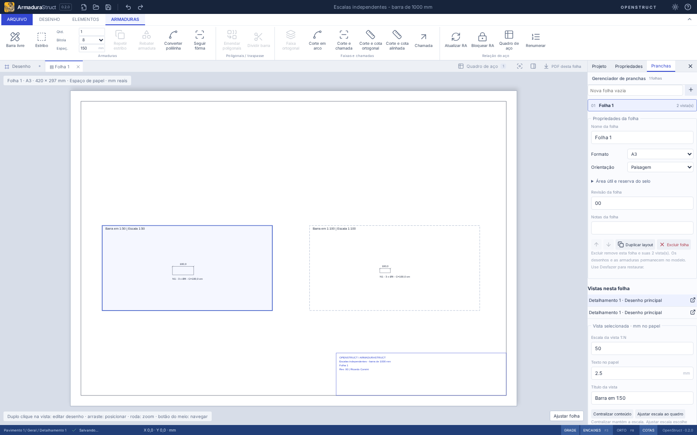

# AS-05 · Composição de folhas em escala

A composição reutiliza as folhas, desenhos, posicionamentos e abas da AS-04. As definições físicas continuam únicas no modelo e a edição de desenhos mantém as proteções da AS-02. O uso está no [guia](GUIA.md#folhas-vistas-e-abas).

## Modelo e papel

O arquivo salvo passa a `armadurastruct/5`. `Sheet` inclui formato A0–A4 ou `custom`, orientação, dimensões personalizadas, quatro margens, reserva de selo e propriedades. O formato personalizado aceita lados entre 50 e 5.000 mm; a orientação determina a direção do lado maior. A reserva do selo fica no canto inferior direito da área útil.

`SheetPlacement.scale` é o denominador N da escala 1:N. `modelOrigin` é o ponto físico colocado em `origin`, que é medido em mm de papel. O mapeamento é:

```text
papel = origin + rotação((modelo - modelOrigin) / scale)
```

`frame` define o quadro da vista; redimensioná-lo não altera a escala. `textHeight` é o tamanho tipográfico mínimo em mm no papel (padrão 2,5; intervalo 2–10), aplicado às identificações e anotações gráficas. Títulos incluem a escala real e têm tamanho mínimo de 3 mm. Os valores das cotas são calculados nas coordenadas físicas. A tipografia usa Helvetica; o conjunto latino e símbolos como Ø/° são suportados, e caracteres incompatíveis são apontados antes da exportação.

**Centralizar conteúdo** altera apenas `modelOrigin`. **Ajustar escala ao quadro** escolhe explicitamente uma escala que acomode geometria e textos legíveis. O enquadramento inicial é calculado ao colocar um desenho, mas alterações posteriores de papel, escala, quadro e conteúdo não são compensadas silenciosamente.

## Validação e exportação

`composeSheet` calcula uma representação em papel compartilhada pelo SVG e pelo PDF. Valida quadros e conteúdo na área útil, conteúdo no quadro de cada vista, invasão da reserva do selo e capacidade dos textos do selo. As verificações consideram rotações e limites dos textos. Guias de seleção/quadro e mensagens são auxiliares da edição, sem impressão.

Problemas permanecem visíveis no editor e bloqueiam o PDF antes de abrir a gravação. Não há recorte de conteúdo, redução automática de escala ou truncamento silencioso das notas. O papel/quadro precisa ser ampliado, a vista reposicionada ou sua escala ajustada explicitamente.

`toSheetPdf(project, sheetIds?)` gera uma página vetorial por folha selecionada, com formato/orientação próprios e sem rasterizar o CAD. O botão da aba exporta a folha ativa; o painel e o comando fora de uma folha exportam todas na ordem do projeto. **Imprimir em tamanho real (100%)** é necessário para conservar as escalas físicas. DXF, CSV e RA continuam globais.

O exportador antigo `toPdf` permanece como API de compatibilidade para o desenho geral A3 com RA; a interface de pranchas usa `toSheetPdf`. O campo legado `drawing.scale` continua preservado no arquivo, sem controlar as vistas novas.

## Migração

Formatos 1/2 continuam recebendo a hierarquia padrão; 1/2/3 recebem uma folha inicial. Folhas e vistas da versão 4 mantêm IDs, nomes, ordem, origem em papel, rotação, quadro e referências. A prévia ajustada ao quadro é convertida para escala fixa com `modelOrigin` explícita e textos legíveis. A escala antiga, que não controlava a prévia da AS-04, fica em `legacyScale` para rastreabilidade.

Barras, rebatimentos, máscaras, polilinhas, anotações, quantidades e RA bloqueada não são transformados. Vistas legadas fora das margens ou cujo quadro seja pequeno demais ficam sinalizadas para correção, sem descartar objetos. Folhas sem vistas e projetos sem folhas continuam válidos para edição.

## Verificação

- Testes medem a mesma barra de 1000 mm como **20 mm em 1:50** e **10 mm em 1:100**, tanto nas primitivas de papel como nos operadores vetoriais reais do PDF, sem alteração do levantamento.
- Formatos A0–A4/personalizado em ambas as orientações têm `MediaBox` conferido em mm; um fluxo cobre páginas ISO e personalizada no mesmo arquivo.
- Rotações, âncoras, cotas, alturas tipográficas, selo, transbordamentos, mudanças A3/A1/A4, migração e reabertura são verificados. RA bloqueada e desatualizada continua impedindo exportação.
- Fluxos Playwright exercitam controles, medição SVG, salvar/reabrir, desfazer, seleção de folhas e exportação/bloqueio de PDF, além das regressões anteriores.
- O PDF do caso de 1000 mm foi renderizado com Poppler e inspecionado; a medição independente com pdfplumber confirmou A3 de 420 × 297 mm, segmentos de 20/10 mm e ausência de imagens rasterizadas.

Execute `npm run check`, `npm run build`, `npm run format:check` e `npm run test:e2e`. Os testes de navegador geram a captura abaixo e um PDF temporário em `test-results/paper-composition.pdf` para inspeção.



## Arquivos alterados

| Arquivos                                                                                                    | Alteração                                                                                                 |
| ----------------------------------------------------------------------------------------------------------- | --------------------------------------------------------------------------------------------------------- |
| `src/domain/types.ts`, `src/domain/model.ts`                                                                | Composição e migração/validação do formato 5.                                                             |
| `src/domain/paperFormat.ts`, `src/domain/sheets.ts`                                                         | Tamanhos, margens, selo e operações das vistas.                                                           |
| `src/domain/paper.ts`                                                                                       | Transformações, texto em papel, enquadramento, composição e transbordamento compartilhados.               |
| `src/domain/drawingPrimitives.ts`, `src/domain/drafting.ts`                                                 | Representações com textos e anotações legíveis por escala, mantendo a geometria física.                   |
| `src/lib/exports.ts`                                                                                        | PDF vetorial da composição, tamanhos por página e validação antes de gravar.                              |
| `src/components/SheetCanvas.tsx`, `src/components/SheetManager.tsx`, `src/components/PaperFields.tsx`       | Espaço de papel, controles e sinalização da composição.                                                   |
| `src/App.tsx`, `src/components/Panels.tsx`, `src/styles.css`                                                | Exportação de folha/conjunto, retirada do controle global de escala da interface e apresentação compacta. |
| `tests/paper.test.ts`, `tests/e2e/paper.spec.ts`                                                            | Medidas reais no SVG/PDF, formatos, rotação, quantitativos, legibilidade, persistência e transbordamento. |
| `tests/sheets.test.ts`, `tests/hierarchy.test.ts`, `tests/drafting.test.ts`, `tests/e2e/hierarchy.spec.ts`  | Expectativas de migração/salvamento atualizadas para a versão 5.                                          |
| `README.md`, `CHANGELOG.md`, `docs/GUIA.md`, `docs/AS-04.md`, `docs/AS-05.md`, `docs/paper-composition.png` | Uso, contratos, compatibilidade e captura da composição.                                                  |

## Limites reais

O selo é básico e usa os campos existentes; esta entrega não inclui modelos de carimbo CAD, logotipos, campos personalizados ou colocação do quadro de aço na folha. O PDF de composição contém somente as folhas/vistas colocadas, sem páginas extras automáticas de RA. A colisão entre vistas distintas não é distribuída ou resolvida automaticamente; o usuário organiza seus quadros. A impressão física também depende de manter 100% no visualizador e no driver da impressora.

A geometria curva continua sendo representada por segmentos vetoriais conforme o desenhista/exportador existente; os comprimentos físicos permanecem analíticos no levantamento. Não houve mudança no dimensionamento estrutural.

Verificação funcional em Chromium no modo web. Os instaladores Linux/Windows são compilados pela CI; o comportamento nativo e o processo de impressão devem ser conferidos nos sistemas de destino.
