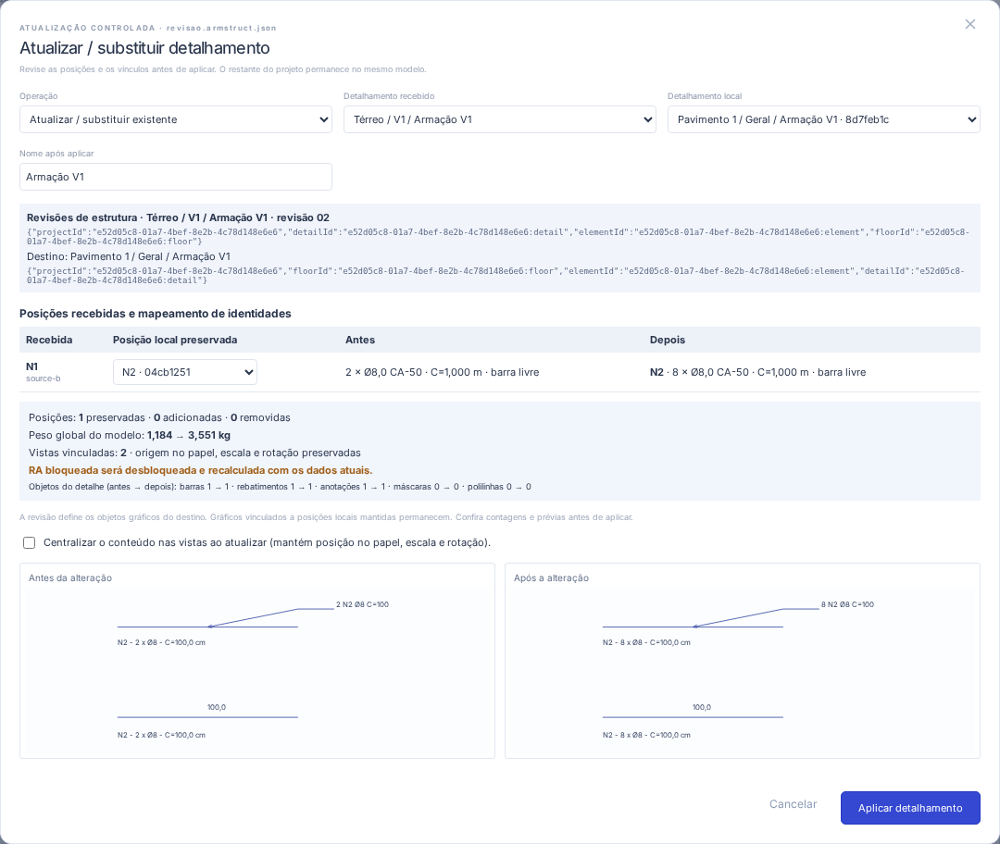

# AS-08 · Inserção e atualização seletiva de detalhamentos

O fluxo usa as entidades da AS-01, a edição isolada da AS-02, o gerenciador da AS-04 e a composição da AS-05. Inserir/atualizar um detalhe não troca o projeto aberto. O uso está no [guia](GUIA.md#inserir-ou-atualizar-um-detalhamento).

## Identidade e persistência

O formato salvo passa a `armadurastruct/6`. Detalhamentos importados registram `DrawingDetail.source`: identidade do projeto/pavimento/elemento/detalhamento de origem, nome do projeto, caminho e revisão do arquivo recebido. Nomes e marcas não são chaves de equivalência.

`ProjectHierarchy.objectOrigins` associa IDs locais a `{ projectId, objectId }` de origem. A associação permite atualizar objetos mantendo os IDs locais, mesmo quando a marca local foi alterada para evitar colisões. A origem acompanha um objeto movido para outro detalhe e é removida quando o objeto é excluído. Importar um detalhe que já foi importado em outro projeto preserva a identidade original, sem depender de nomes intermediários.

Arquivos 1–5 são migrados para 6 sem transformar barras, rebatimentos, anotações, máscaras, polilinhas, folhas ou posições existentes. A versão 5 já tem papel em escala e não passa novamente pelo enquadramento da migração da AS-05. A versão 6 exige o registro de origens, mesmo vazio; referências de origem sem objeto local são recusadas.

## Comparação e transação

`previewDetailTransfer(target, source, options)` é uma operação pura. Retorna mapeamentos, posições preservadas/adicionadas/removidas/mantidas, vínculos a decidir, contagens de objetos, peso global antes/depois, vistas afetadas, avisos de enquadramento e a invalidação da RA. Não altera os dois projetos nem o histórico. A interface mostra as posições e duas prévias com o mesmo enquadramento de modelo.

`applyDetailTransfer(current, plan)` aceita apenas um plano sem pendências, ainda baseado na mesma instância do projeto que foi comparada. A aplicação passa pela transação existente do editor e produz uma única etapa de Desfazer/Refazer. Cancelar ou pressionar Esc não altera o projeto ou o comando CAD pendente. A leitura assíncrona verifica novamente projeto/contexto antes de abrir a comparação, e importar revisões fica bloqueado durante edição isolada.

A tela de comparação é carregada sob demanda. A abertura normal de um projeto continua estrita. Somente a leitura para transferência aceita temporariamente chamadas/rebatimentos sem definição de posição, para permitir uma resolução explícita; nenhum resultado com referências órfãs é persistido.

## Inserir e substituir

Inserir cria um detalhe/desenho local e importa apenas os objetos pertencentes ao detalhe recebido. O usuário escolhe o elemento local e, opcionalmente, uma folha existente. Não são copiados os demais pavimentos, elementos, folhas ou detalhamentos do arquivo. IDs novos são gerados sem colisão local; marcas já usadas recebem uma identificação N livre, mostrada na comparação.

Uma origem já presente é recusada como nova inserção: para outra representação, o usuário coloca uma vista do desenho existente. Para substituir, uma correspondência automática exige uma única identidade completa de origem. Origens distintas exigem seleção e confirmação explícitas. Uma posição física da origem já localizada em outro detalhe local não é duplicada ou sobrescrita automaticamente: transfira-a ao destino adequado primeiro.

O mapeamento de posições pode preservar IDs/marcas locais ou criar novas posições. Duas recebidas não podem usar a mesma posição local. Se várias posições locais tiverem a mesma identidade de origem, o mapeamento exige escolha explícita. Uma posição ausente na revisão é removida, salvo retenção explícita ou uso por vínculo recebido; a retenção preserva seus gráficos vinculados.

Máscaras, polilinhas, cotas, chamadas e rebatimentos do destino seguem o conteúdo da revisão. Objetos gráficos reconhecidos pela origem mantêm IDs locais. Objetos locais ausentes na revisão são removidos, exceto gráficos vinculados às posições locais mantidas. As contagens e prévias mostram essa substituição; notas gráficas soltas a conservar devem ser movidas para outro detalhe antes de atualizar.

## Vínculos e dependências

Chamadas/cotas e rebatimentos de entrada podem referenciar posições de outro detalhe. A comparação permite vinculá-los a uma posição recebida ou local, importar explicitamente uma dependência, desvincular uma anotação ou remover o objeto gráfico. Posições externas não entram no levantamento por mera referência. A importação explícita de uma dependência a inclui uma única vez, mesmo com várias chamadas; se já pertence ao destino, sua atualização preserva o ID. Posições de outro detalhe local são reassociadas, sem duplicação ou edição física implícita.

Referências de outros detalhes locais a uma posição removida precisam ser reassociadas ou resolvidas explicitamente. Desvincular uma chamada/corte sem texto próprio fixa sua identificação anterior como texto; cotas conservam seu valor geométrico e todas mantêm suas coordenadas. Um rebatimento requer uma posição válida ou remoção explícita. A remoção gráfica não converte uma barra física em desenho.

## Vistas e relação de aço

Na atualização, o detalhe, desenhos lógicos e referências das vistas mantêm seus IDs. Posição no papel, escala, rotação, quadro e origem no modelo permanecem inalterados por padrão. A centralização opcional muda somente `modelOrigin`. Todas as vistas passam a consultar a mesma definição atualizada, sem acrescentar posições físicas ao levantamento.

Uma revisão maior ou reposicionada pode causar transbordamento mantendo a escala. A comparação mostra os avisos; o PDF continua recusando transbordamento conforme a AS-05. A importação não escolhe silenciosamente uma escala nova.

Alterações físicas ou dos dados da RA invalidam o bloqueio existente, devolvendo a RA ao cálculo automático com os dados atuais. A soma inclui cada posição física uma vez. Alterações apenas gráficas mantêm o bloqueio, inclusive um bloqueio que já estivesse desatualizado; a importação não aprova implicitamente uma RA antiga. Desfazer restaura dados, origens, vistas e bloqueio anteriores.

## Verificação

Os testes de domínio e os fluxos Playwright verificam:

- Inserção seletiva, colisões de IDs/marcas e imutabilidade dos projetos durante a comparação/cancelamento.
- Revisão com quantidade/geometria novas, IDs preservados, várias vistas em folhas distintas e RA bloqueada recalculada uma vez.
- Homônimos de pavimentos diferentes, origem divergente, duplicação de origem, mapeamentos repetidos e posições já pertencentes a outro detalhe.
- Referências de entrada sem definição, vínculos locais afetados por remoção, reassociação, desvinculação e remoção gráfica explícitas.
- Dependências externas importadas uma única vez e atualizadas no próprio destino sem duplicação física.
- Preservação de máscaras/polilinhas por identidade, retenção de posições locais e origem de objetos movidos.
- Migração 5→6, reabertura, proveniência transitiva, rejeição de plano desatualizado, Desfazer/Refazer e bloqueio durante edição isolada.

Execute `npm run check`, `npm run build`, `npm run format:check` e `npm run test:e2e`.

## Arquivos alterados

| Arquivos                                                                                                                          | Responsabilidade                                                                                                 |
| --------------------------------------------------------------------------------------------------------------------------------- | ---------------------------------------------------------------------------------------------------------------- |
| `src/domain/types.ts`, `src/domain/model.ts`                                                                                      | Origem de detalhes/objetos, migração para o formato 6 e leitura seletiva com referências pendentes.              |
| `src/domain/hierarchy.ts`, `src/domain/detailEditing.ts`                                                                          | Ciclo de vida das origens, preservação ao mover/excluir e proteção dos dados externos durante edição isolada.    |
| `src/domain/detailTransfer.ts`                                                                                                    | Comparação, identidade, mapeamento, dependências, resolução de referências, vistas, RA e aplicação transacional. |
| `src/lib/files.ts`                                                                                                                | Leitura de projetos, limite de arquivo e separação entre abertura estrita e transferência seletiva.              |
| `src/App.tsx`, `src/components/Ribbon.tsx`                                                                                        | Comandos, seleção de arquivo Linux/Windows/web, guardas assíncronas e integração ao histórico/contexto.          |
| `src/components/DetailTransferDialog.tsx`, `src/styles.css`                                                                       | Diálogo compacto, comparação, decisões de vínculo, prévias e carregamento sob demanda.                           |
| `tests/detailTransfer.test.ts`, `tests/e2e/detailTransfer.spec.ts`                                                                | Casos de aceite e regressão dos fluxos de atualização.                                                           |
| `tests/drafting.test.ts`, `tests/hierarchy.test.ts`, `tests/paper.test.ts`, `tests/sheets.test.ts`, `tests/e2e/hierarchy.spec.ts` | Expectativas de salvamento atualizadas para a versão 6.                                                          |
| `README.md`, `CHANGELOG.md`, `docs/GUIA.md`, `docs/AS-05.md`, `docs/AS-08.md`, `docs/detail-transfer.png`                         | Uso, contratos, compatibilidade e captura de revisão.                                                            |

## Limites reais

O intercâmbio usa arquivos JSON do ArmaduraStruct, não formatos proprietários do Eberick/TQS nem vinculação on-line. Projetos 1/2 recebem IDs derivados do arquivo; se a revisão mudar esses IDs de origem, será necessária seleção explícita do destino/troca de origem e mapeamento manual de posições. Arquivos atuais com IDs estáveis permitem reconhecimento automático.

A substituição é de um detalhamento por operação; não é uma fusão automática de vários projetos ou uma comparação normativa de armaduras. Notas e desenhos locais ausentes seguem a política descrita acima. As prévias não substituem a conferência de enquadramento e de fabricação. Os limites já existentes do projeto e de exportação continuam aplicados.

Validação funcional em Chromium no modo web. A compilação dos instaladores Linux/Windows é feita pela CI; o comportamento nativo deve ser conferido nos sistemas de destino.
