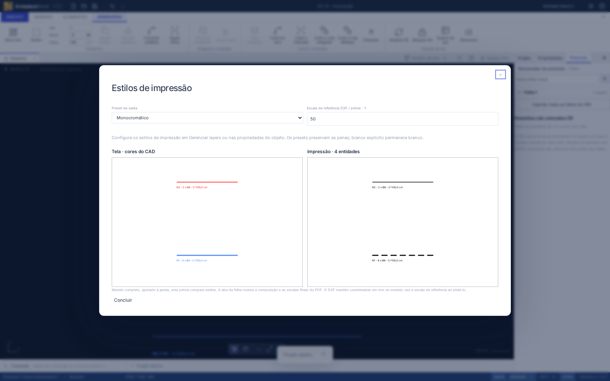

# AS-21 — Estilos de impressão

Atualização AS-24: formato nativo **`armadurastruct/18`** (leitura 1–17) e pacote **`openstruct.detail/10`** (leitura 1–9), com orientação de estribos/inserções e referencial de cotas preservados. Consulte [AS-24](AS-24.md) e o [JSON Schema v10](openstruct-detail-v10.schema.json). Os registros abaixo são históricos.

Atualização AS-22: formato nativo **`armadurastruct/17`** (leitura 1–16), com ocultação e isolamento por objeto nos mesmos contextos de layers. O pacote de detalhe permanece v9. Consulte [AS-22](AS-22.md); os registros abaixo documentam versões anteriores.

O estilo de tela de AS-19 continua independente. Barras azuis podem ser entregues em preto com pena de 0,35 mm, sem mudar a aparência do CAD, a geometria, as posições de fabricação ou o quadro de aço.

## Uso

1. Abra **Desenho → Gerenciar layers** (`LAYERS`). Selecione um ou vários layers e expanda **Estilo de impressão**. Defina cor, cor de preenchimento, pena em mm no papel, tipo/escala do traço e inclusão na saída. Clique em **Aplicar aos layers selecionados**. A operação aplica somente campos alterados e preserva diferenças nos demais campos.
2. Para um objeto, selecione barra, inserção, polilinha, anotação ou máscara; abra **Layer e estilo → Estilo de impressão** nas propriedades. Cada campo pode herdar ou definir um override. **Restaurar herança de impressão** remove os overrides; **Restaurar estilo ByLayer** continua a atuar somente na tela.
3. Abra **Arquivo → Estilos de impressão** (`PLOT` / `PLOTAGEM`). Escolha **Colorido**, **Monocromático** ou **Tons de cinza**. As prévias lado a lado comparam estilos do modelo completo. O CAD mantém suas cores. O preset é salvo e participa de Desfazer/Refazer.
4. Na aba da folha, confira a composição final com suas escalas. **Prancha PDF** usa as mesmas primitivas vetoriais e o mesmo estilo da prévia da folha. **Desenho DXF** usa o mesmo resolvedor de plotagem no espaço do modelo.



As prévias do diálogo são ajustadas à janela; não representam tamanho físico do monitor. O diálogo limita a apresentação a 5.000 entidades por painel e avisa quando houver mais; a exportação não recebe esse limite. A aba da folha contém a prévia da composição completa.

## Herança, escalas e inclusão

| Propriedade           | Regra                                                                                                            |
| --------------------- | ---------------------------------------------------------------------------------------------------------------- |
| Cor de tela           | Catálogo `DrawingStyle` + override `style` do objeto; não consulta `plot`                                        |
| Cor de impressão      | Cor de tela resolvida → `layer.plot` → `object.plot` → preset                                                    |
| Pena                  | Mesma precedência; sempre mm no papel, independente da escala da vista                                           |
| Traço explícito       | `plot.lineType.pattern` em mm no papel; segmentos positivos e intervalos negativos                               |
| Traço herdado da tela | Padrão de AS-19 em mm do modelo, normalizado pela referência fixa 1:50; o multiplicador `lineScale` é preservado |
| Inclusão              | Layer e objeto precisam permitir a impressão; um objeto não força a saída de um layer não imprimível             |
| Quantitativos         | Visibilidade e impressão nunca retiram armadura do levantamento                                                  |

O padrão Tracejada usa 2 mm de traço / 1 mm de intervalo. A barra de 1.000 mm mede 40 mm em 1:25 e 10 mm em 1:100; a pena de 0,35 mm e o padrão 2/1 mm são idênticos nas duas vistas. Os padrões já importados para o catálogo de tela permanecem intactos; defina um padrão de impressão para controlar diretamente seu tamanho no papel.

Os presets modificam cores e preservam a hierarquia das penas (padrões: armadura 0,35; rebatimento 0,25; cotas/textos/fôrma 0,18 mm). Monocromático converte cores para preto e mantém branco explícito, inclusive fundos de preenchimento. Tons de cinza usa luminância RGB ponderada (0,2126 R + 0,7152 G + 0,0722 B). Os preenchimentos sólidos existentes permanecem vetoriais.

Uma máscara pode usar override de impressão do conjunto, além dos estilos dos seus layers de origem. No PDF da folha, os estados de exibição da vista de AS-20 continuam válidos. No DXF, exporta-se o modelo completo, filtrando os estados de impressão; Exibir/Capturar/Editar continuam controles do ambiente CAD. Layers bloqueados também protegem alterações de estilo de impressão; a edição isolada mantém sua proteção sobre os layers globais.

O layer **QUADRO_ACO** controla o quadro acrescentado pelo DXF e pelo PDF A3 de compatibilidade. Desabilitar sua impressão omite a tabela da entrega e mantém todos os dados físicos disponíveis no aplicativo/CSV. Textos de uma tabela importada como máscara obedecem aos seus próprios layers de origem.

## DXF e limites reais

O DXF exportado contém coordenadas físicas em mm no modelo, cores resolvidas, tipos de linha simples, penas CAD e preenchimentos HATCH sólidos. A **escala de referência DXF**, padrão 1:50, converte os padrões de papel em comprimentos de modelo: em 1:100, 2/1 mm vira 200/100 mm. Use essa escala ao plotar o DXF no aplicativo de destino. Ela não altera coordenadas, textos físicos, comprimentos ou pesos e não muda as escalas das vistas do PDF.

O exportador DXF atual não cria layouts de papel nem arquivos CTB/STB. Um único DXF de modelo usa uma escala de referência para seus tracejados; use o PDF de pranchas para combinar várias escalas com penas/traços idênticos no papel. Penas fora dos valores padronizados do DXF são recusadas com mensagem, sem arredondamento silencioso. O PDF aceita as penas do domínio (0–2,11 mm).

DXF é uma entrega dos estilos resolvidos: não transporta a separação original entre tela e impressão, os presets ou os IDs do modelo nativo. Preserve o `.armstruct.json` editável. As limitações anteriores de fontes e padrões de linha complexos continuam válidas. Não houve alteração no empacotamento desktop; a verificação local executa o modo web de produção e as regras de domínio compartilhadas.

## Persistência e API

O formato nativo **`armadurastruct/16`** lê versões 1–15 e migra sem criar overrides de impressão. Versões antigas mantêm cores/estilos e dados físicos; o novo padrão de traço de impressão tem a convenção 1:50 descrita acima. A presença de dados novos em um arquivo rotulado com versão antiga é recusada.

O pacote **`openstruct.detail/9`** lê 1–8 e transporta `plot` por layer e por objeto. Nos pacotes em cm/m, a geometria e o padrão de tela são convertidos; `plot.lineType.pattern` e `plot.lineWidth` continuam em mm de papel. Preset e escala DXF são configurações locais do projeto e não são transportados no detalhe. [JSON Schema v9](openstruct-detail-v9.schema.json); regras semânticas adicionais continuam necessárias.

As operações `bar.create/update` e `representation.create/update` aceitam `plot`, com validação atômica e erros estruturados da API. Cópias profundas preservam os estilos e remapeiam os vínculos de AS-53. A assinatura de fabricação ignora estilos de tela/impressão.

```ts
import {
  editLayerPlotStyles,
  setPlotSettings,
  executeRebarBatch,
} from './src/api';

project = editLayerPlotStyles(project, ['layer:ARMADURAS'], {
  color: '#000000',
  lineWidth: 0.35,
  lineType: { name: 'DASHED', pattern: [2, -1] },
});
project = setPlotSettings(project, {
  preset: 'monochrome',
  referenceScale: 100,
});
const batch = executeRebarBatch(
  project,
  [
    {
      type: 'bar.update',
      id: project.bars[0].id,
      patch: { kind: 'free', plot: { color: '#000000', include: true } },
    },
  ],
  { units: 'mm' },
);
// Aplique batch somente se batch.ok; na UI o lote é um passo do histórico.
```

## Validação

Verificação local em 07/11/2026: **309 testes de domínio/importação**, **6 testes de distribuição**, **54 testes de navegador**; `npm run check`, `npm run build` e formatação aprovados. Uma auditoria independente com ezdxf encontrou **0 erros e 0 correções** no DXF sintético. A leitura vetorial do PDF com PyMuPDF mediu **40,000002 mm / 9,999993 mm**, penas **0,35 mm** e padrões equivalentes a **2/1 mm** nas vistas 1:25/1:100. O PDF renderizado e as duas prévias foram inspecionados.

Os testes cobrem herança/remoção de overrides, presets, preenchimento branco, penas e dashes extraídos dos PDFs vetoriais em 1:25/1:100, geometria DXF, layers/objetos não imprimíveis, RA preservada, quantidades, assinatura de fabricação, migração 1/2/14/15, pacotes mm/cm/m, clone, validação atômica e bloqueio de layers. Os testes do navegador exercitam as propriedades, os presets, as duas prévias, downloads PDF/DXF, salvar/reabrir e Desfazer/Refazer.

Referências de fluxo: [níveis de desenho AltoQi](https://suporte.altoqi.com.br/hc/pt-br/articles/360007849633), [cor de impressão](https://suporte.altoqi.com.br/hc/pt-br/articles/360043314113), [configurações somente na impressão](https://suporte.altoqi.com.br/hc/pt-br/articles/115004844993).
