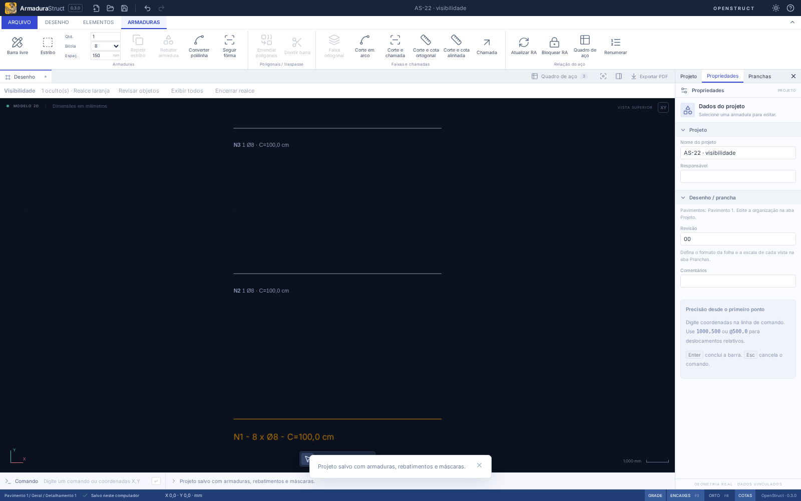

# AS-22 — Ocultar, isolar e recuperar objetos por vista

Atualização AS-24: formato nativo **`armadurastruct/18`** (leitura 1–17) e pacote **`openstruct.detail/10`** (leitura 1–9), com orientação de estribos/inserções e referencial de cotas preservados. Consulte [AS-24](AS-24.md) e o [JSON Schema v10](openstruct-detail-v10.schema.json). Os registros abaixo são históricos.

A visibilidade de objetos usa os mesmos contextos de desenho/vista dos perfis de layers de AS-20. Ela é uma configuração de apresentação: não exclui armaduras nem altera posições, comprimentos, quantidades ou peso. As definições físicas continuam completas para as representações vinculadas e o quadro de aço.

## Uso no CAD

Na guia **Desenho → Visibilidade**, use:

| Comando            | Linha CAD        | Comportamento                                                                        |
| ------------------ | ---------------- | ------------------------------------------------------------------------------------ |
| Ocultar seleção    | `OCULTAR`        | Oculta os objetos selecionados neste contexto                                        |
| Isolar seleção     | `ISOLAR`         | Mostra somente o conjunto selecionado, respeitando as ocultações e layers existentes |
| Sair do isolamento | `SAIRISOLAMENTO` | Remove o filtro de isolamento e recupera as ocultações anteriores                    |
| Exibir todos       | `EXIBIRTODOS`    | Remove ocultações de objetos e isolamento; não liga layers nem máscaras              |
| Mostrar ocultos    | `MOSTRAROCULTOS` | Ativa o realce laranja e abre a lista para pesquisa e recuperação                    |

Os objetos realçados não participam de captura, seleção, encaixes ou edição por alças. A árvore também não seleciona objetos ocultos. Comandos de edição em lote rejeitam a alteração de objetos ocultos no contexto informado. Recupere o objeto antes de editá-lo.

A barra compacta **Visibilidade** indica o número de ocultações explícitas, isolamento e realce. **Revisar objetos** reabre a lista; **Encerrar realce** volta à apresentação normal. Desfazer/Refazer recupera as opções e os vínculos.

O gerenciador lista o motivo: ocultação do objeto, fora do isolamento, layer desligado, máscara desligada ou layers de origem desligados. Desmarque **Somente objetos com ocultação** para escolher objetos ainda visíveis, inclusive em uma vista da folha. É possível ocultar/isolar vários escolhidos ou recuperar um a um.

Recuperar remove a ocultação explícita e, se houver isolamento, acrescenta somente o objeto escolhido ao conjunto isolado. Um layer desligado continua desligado e seu motivo permanece na lista. Use **Gerenciar layers** para decidir se deve ligá-lo. Uma máscara desligada continua desligada; seus controles próprios e seus layers de origem não são modificados pela recuperação.

## Vistas na folha e impressão

Na aba da folha, **selecione primeiro a vista**. Abra **Mostrar ocultos**, desmarque o filtro de ocultos e escolha as posições/objetos para ocultar ou isolar. As demais instâncias do mesmo desenho conservam seus próprios estados. O realce aparece sobre a vista selecionada e não integra o PDF.

Cada contexto é independente: **Modelo**, **desenho aberto** e **instância de vista na folha**. Abrir um desenho por duplo clique edita sua definição e usa o ambiente desse desenho; não altera automaticamente as ocultações particulares das suas instâncias. Dentro da folha, a escolha de objetos para visibilidade é feita pela lista; o clique no papel continua selecionando/posicionando a vista.

Por padrão, o **PDF da vista respeita suas ocultações e isolamento**. No gerenciador, a opção **Imprimir objetos ocultos desta vista** inclui os objetos ocultos e os que estão fora do isolamento. Ela continua respeitando os layers desligados e os estilos não imprimíveis de AS-21. **Restaurar impressão da vista** desmarca essa opção, sem perder ocultações ou ligar layers.

O realce laranja é exclusivo da tela: nunca é enviado ao exportador, nunca modifica o estilo de impressão e não participa da validação de transbordamento da folha. Ao incluir objetos ocultos no PDF, o conteúdo real volta a participar da validação de limites. O PDF vetorial e a aba da folha usam a mesma projeção de impressão.

O **DXF de modelo** e o **CSV do quadro** continuam exportando o modelo completo (o DXF respeita os estilos de impressão de AS-21). Eles não representam o estado de uma instância particular da folha. Múltiplas vistas e ocultações não multiplicam nem retiram aço do levantamento.



## Persistência e integração

O projeto usa **`armadurastruct/17`**, com leitura das versões 1–16. A migração mantém os objetos e não cria ocultações. Os dados ficam em `layerEnvironment.contexts[contexto].visibility`: `hiddenIds`, `isolation.ids`, `showHidden` e `printHidden`. Não há um segundo catálogo de contextos.

O isolamento armazena um filtro separado de `hiddenIds`: trocar ou encerrar o isolamento não sobrescreve as ocultações anteriores. Alterações deliberadas de ocultação feitas durante o isolamento continuam válidas ao sair. Aplicar ou salvar um perfil de layers não apaga os estados de objetos.

Duplicar uma vista ou folha copia seu ambiente por valor, com novos IDs de vista; mudanças posteriores são independentes. Excluir objetos/vistas ou mover objetos para outro desenho limpa suas referências de apresentação. Desfazer recupera o snapshot anterior. IDs de contextos inexistentes e referências obsoletas de arquivos são normalizados ao abrir. IDs duplicados e dados inválidos são recusados.

O pacote **`openstruct.detail/9`** permanece inalterado: ocultações, perfis e isolamento são ambiente local e não são enviados como dados físicos do detalhe. Reimportar um detalhe não usa a visibilidade para decidir seu quantitativo.

```ts
import {
  hideObjects,
  isolateObjects,
  endObjectIsolation,
  restoreObjects,
  visibilityProjection,
  setVisibility,
} from './src/api';

import { detailEditorView } from './src/domain/detailEditing';

const view = project.hierarchy.placements[0];
const definition = project.hierarchy.drawings.find(
  (d) => d.id === view.drawingId,
)!;
const key = `view:${view.id}`;
const barId = project.bars[0].id; // objeto pertencente ao desenho dessa vista
project = hideObjects(project, key, [barId]);
// Projeção apenas para desenhar: use project completo para schedule/persistência.
const drawing = visibilityProjection(
  detailEditorView(project, definition.detailId),
  key,
  'visible',
);
project = restoreObjects(project, key, [barId]);
project = isolateObjects(project, key, [barId]);
project = endObjectIsolation(project, key);
project = setVisibility(project, key, { printHidden: false });
```

As operações são imutáveis e a UI aplica cada comando como um passo do histórico. A API executável continua recebendo o projeto físico completo; passe `layerContext` para proteger objetos ocultos durante um lote de edição nesse ambiente.

## Validação e limites

Validação local em 07/11/2026: `npm run check` (**325 testes de domínio/importação + 6 de distribuição**), `npm run build` e formatação aprovados. A regressão completa de navegador passou em **57 fluxos**; os **4 fluxos AS-22** foram reexecutados após a proteção de limite gráfico, totalizando **58 cenários distintos** validados.

Os testes cobrem duas vistas independentes, repetição de isolamento, recuperação seletiva, layers/máscaras desligados, troca de perfis, proteção de seleção/edição, RA bloqueada, peso, representações, PDF, DXF/CSV completos, duplicação de vistas/folhas, exclusão, migração e salvar/reabrir. Os fluxos de navegador exercitam os comandos, realce, gerenciador, impressão e histórico.

O controle individual é para os objetos nativos e a máscara como conjunto. Entidades internas da máscara continuam controladas pelos seus layers de origem; não se criam IDs físicos de aço para linhas importadas. A recuperação seletiva é feita na lista; o realce no desenho serve para conferência e não permite editar diretamente os ocultos. As limitações anteriores de fontes e geração de grandes distribuições gráficas continuam válidas. Se uma distribuição ultrapassar o limite de geração do realce, o editor exibe um aviso e mantém a lista de recuperação acessível, sem fechar o projeto. Não foram alterados os empacotamentos Linux/Windows; as verificações locais usam o modo web e o domínio compartilhado.

Referência de fluxo: [AltoQi — Como ocultar/exibir elementos](https://suporte.altoqi.com.br/hc/pt-br/articles/4403543493655).
