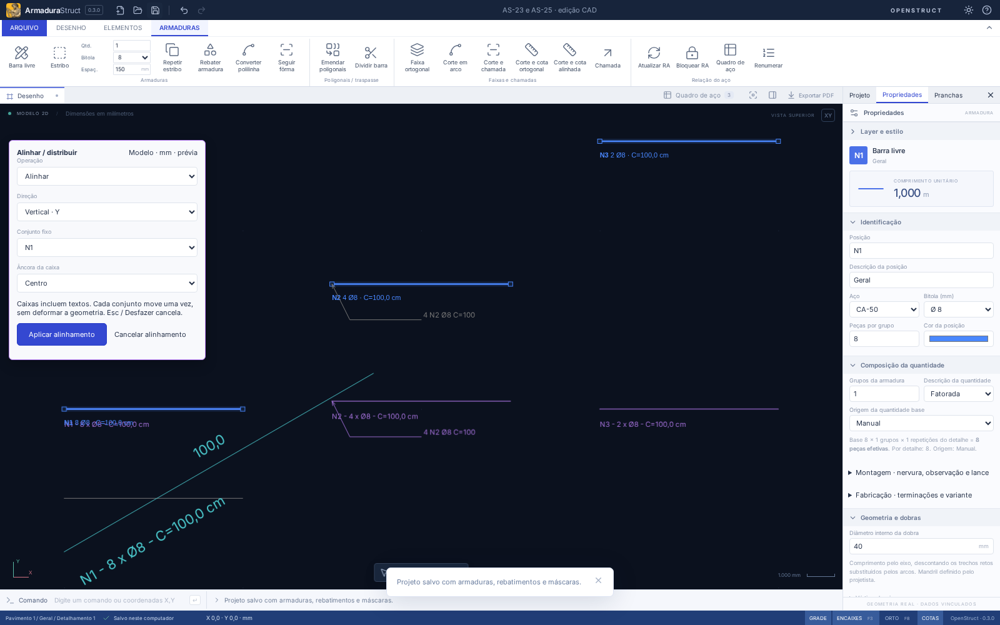

# AS-23 — Alinhar objetos, detalhamentos e vistas

## Usar no desenho

1. Selecione dois ou mais objetos com Shift/clique, janela ou árvore. Detalhamentos agrupados são tratados como conjuntos; dentro da edição isolada, seus objetos podem ser alinhados individualmente.
2. Abra **Elementos → Editar → Alinhar / distribuir…**, o menu contextual da seleção ou digite **`ALINHAR`**.
3. Escolha **Horizontal · X**, **Vertical · Y** ou **Linha de referência**; escolha também o **conjunto fixo**.
4. Em **Alinhar**, use borda mínima, centro ou borda máxima da caixa gráfica. X mínimo/máximo significa esquerda/direita; Y mínimo/máximo significa inferior/superior no modelo.
5. Em **Afastamento uniforme**, informe a distância livre entre as caixas, em mm. A ordem segue a projeção espacial atual; empates usam o ID. O conjunto fixo conserva sua posição, inclusive quando está no meio da sequência.
6. Confira a prévia roxa e aplique. **Cancelar**, **Esc** ou **Desfazer** cancelam a prévia. Depois de aplicar, um Desfazer reverte o conjunto inteiro, e Refazer o restaura.

Na referência por linha, informe dois pontos pelos campos X/Y ou **Escolher referência por pontos**. No desenho também são aceitas coordenadas `x,y` na linha CAD, encaixes e Orto. Alinhar desloca perpendicularmente à linha até a borda/centro projetado tocar a referência; distribuir usa a direção da linha como eixo. O conjunto fixo **permanece onde está**, mesmo que não esteja sobre a linha escolhida. A operação não gira os objetos. Pontos de referência coincidentes são recusados.



## Usar na folha

Abra uma folha com ao menos duas vistas e clique em **Alinhar vistas…** na barra do documento, ou use o comando da guia Elementos. Inicialmente todas as vistas da folha participam; ajuste **Vistas participantes** e escolha um conjunto fixo que participe da operação. Os campos e os cliques de referência usam **mm de papel**. A folha não possui linha de comando CAD.

As caixas incluem molduras, títulos e conteúdo das vistas. Apenas a origem das vistas muda: escala, rotação e geometria física permanecem iguais. A prévia não é gravada; arrastar/abrir vistas fica suspenso enquanto ela está ativa. As validações existentes de margem, selo e transbordamento continuam indicando problemas de composição e bloqueando PDFs inválidos.

## Vínculos e proteções

- Um grupo semântico move seus membros juntos, incluindo inserções, cotas, polilinhas e máscaras; cada objeto recebe uma única translação.
- Anotações e auxiliares exclusivos das barras selecionadas, pertencentes ao mesmo detalhamento, acompanham o movimento. Selecionar a chamada e sua barra não move a chamada duas vezes.
- Auxiliares compartilhados entre conjuntos, com barras não selecionadas ou pertencentes a outro detalhe permanecem no lugar se não forem selecionados explicitamente. Inserções independentes também só mudam de posição quando incluídas na seleção/grupo.
- Comprimentos, dobras, quantidades, repetições, posições de fabricação e peso permanecem iguais. A RA bloqueada continua válida.
- Um membro a mover que esteja oculto, em layer protegido ou fora do detalhe isolado impede a aplicação completa. Um objeto protegido usado apenas como referência fixa não precisa ser alterado.
- Uma alteração concorrente do projeto invalida a prévia; reinicie a operação sobre o novo estado.

## API e contrato comum

`AlignmentItem` contém `id`, `label`, `ids` dos membros e `points` que delimitam o conteúdo. `planAlignmentItems(items, options)` calcula deslocamentos imutáveis, sem React e sem depender do tipo de entidade. Novas entidades de prancha podem fornecer seus pontos e aplicar a translação devolvida. `modelAlignmentItems` e `paperAlignmentItems` adaptam o modelo e as vistas existentes ao mesmo contrato.

```ts
import {
  executeRebarBatch,
  applyRebarBatch,
  modelAlignmentItems,
} from './src/api';

const ids = project.bars.slice(0, 3).map((b) => b.id);
const items = modelAlignmentItems(project, ids);
const result = executeRebarBatch(
  project,
  [
    {
      type: 'selection.align',
      ids,
      options: {
        mode: 'align',
        axis: 'y',
        anchor: 'center',
        fixedId: items[0].id,
        gap: 100,
      },
    },
  ],
  { units: 'mm', layerContext: 'model' },
);
if (result.ok) project = applyRebarBatch(project, result);
```

Para papel, forneça `sheetId`, IDs das colocações e um `fixedId` da seleção. Para afastamento uniforme, use `mode: 'distribute'` e `gap`. Para referência, use `axis: 'reference', reference: { start, end }`. Dentro de edição isolada, passe `scopeDetailId` tanto ao adaptador de itens quanto à API. O lote inválido retorna o projeto original. A transformação rígida comum também aceita `selection.transform` com `{ kind: 'translate', delta }`.

Não há novos campos persistentes: o projeto continua em **armadurastruct/18**, com as migrações anteriores; pacotes permanecem em **openstruct.detail/10**. Salvar/reabrir preserva as posições resultantes.

## Validação e limites

Validação local aprovada: `npm run check` (**366 testes de domínio/importação + 6 de distribuição**), `npm run build`, `npm run format:check` e **67 cenários de navegador** em `npm run test:e2e`. As duas tarefas acrescentam 23 testes de domínio e 6 fluxos de navegador.

Os testes cobrem três detalhes agrupados, seleção mista de barras/cotas/polilinhas, extensão de textos, centros/bordas, referência oblíqua, afastamento com fixo intermediário, proteções, atomicidade, quantidades, RA bloqueada, três vistas com escalas distintas e persistência. Os fluxos de navegador exercitam prévia/cancelamento, papel, coordenadas, histórico e reabertura. Veja também [AS-25](AS-25.md).

As caixas de texto no modelo usam a estimativa conservadora já adotada pelo CAD; no papel usam as métricas do compositor PDF. Não há medição exata de cada glifo da fonte instalada. A distribuição usa caixas projetadas, sem resolver colisões 2D automaticamente. Textos/tabelas/imagens futuros precisam fornecer seu adaptador; esta entrega não cria tipos de entidade que ainda não existem. Validação executada no modo web e no domínio compartilhado; os instaladores Linux/Windows não foram empacotados nesta tarefa.

Referência de interação: [AltoQi — alinhamento de objetos](https://suporte.altoqi.com.br/hc/pt-br/novo-conhe%C3%A7a-a-atualiza%C3%A7%C3%A3o-2025-11-do-altoqi-builder-0).
