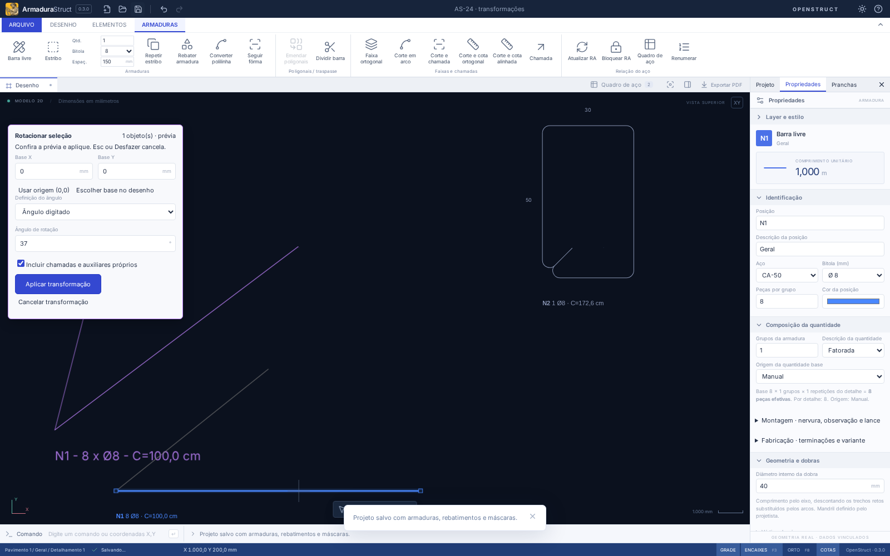

# AS-24 — Menu contextual e transformações por base comum

O botão direito abre ações para o objeto sob o cursor ou para a seleção existente quando o CAD está em Selecionar/Pan. Durante o lançamento de barras/polilinhas, ele continua concluindo o desenho. Não abre o menu no meio de um comando.

## Menu e interação

- **Propriedades** abre o inspetor do objeto/seleção.
- **Mover**, **Copiar**, **Rotacionar…**, **Espelhar por eixo…** e **Excluir** usam a seleção atual, respeitando layers, visibilidade e edição isolada.
- Em vazio, sem seleção, aparecem propriedades do projeto e enquadramento. Objetos de layers protegidos oferecem propriedades, sem ações de alteração.
- Se o objeto clicado não pertence à seleção atual, passa a ser o alvo, respeitando os agrupamentos semânticos. Clicar com o botão direito em um membro já selecionado preserva a seleção múltipla.
- As setas/Home/End navegam pelo menu; Esc/Tab ou clique fora fecham. Copiar continua usando o grafo de AS-53; os bloqueios de edição de grupos continuam válidos para esse comando.

## Rotacionar

1. Selecione os objetos; use o menu contextual ou **Elementos → Editar → Rotacionar…** (`ROTACIONAR` / `GIRAR`). Um grupo selecionado pode ser transformado como conjunto.
2. Clique no **ponto base comum**. Alternativamente, informe **Base X/Y** ou use **Usar origem (0,0)**. Coordenadas do modelo usam mm.
3. Em **Ângulo digitado**, informe, por exemplo, **37°**. Valores positivos giram no sentido anti-horário do modelo. Após definir a base, a linha CAD aceita também um número com ponto decimal como ângulo.
4. Em **Referência e direção por pontos**, escolha a base, um ponto que define a direção de referência e um ponto da direção final. A prévia acompanha o cursor após a referência. A linha CAD aceita as coordenadas `x,y` nesses passos.
5. Confira a prévia roxa e clique em **Aplicar transformação**. A gravação e o histórico recebem uma única operação.

O desenho original e o quantitativo permanecem intactos durante a prévia. **Esc**, **Cancelar transformação** ou **Desfazer** cancelam a operação pendente preservando a seleção. Depois de aplicar, Desfazer/Refazer reverte/restaura o conjunto. Uma alteração concorrente do projeto invalida a prévia; reinicie a transformação para aplicar sobre o novo estado.



## Espelhar e preservar vínculos

Use **Espelhar por eixo…** (`ESPELHAR`). Defina a base e um segundo ponto do eixo, por clique ou pelas coordenadas **Eixo X/Y**. Confira a prévia e aplique. Pontos coincidentes são recusados. Duas reflexões pelo mesmo eixo recuperam a geometria.

| Objeto                            | Comportamento                                                                                                         |
| --------------------------------- | --------------------------------------------------------------------------------------------------------------------- |
| Barra física                      | Transforma a origem, orientação e geometria local, sem mudar ID, bitola, quantidade ou comprimento                    |
| Faixa de distribuição             | Transforma início e fim pelo mesmo movimento, preservando comprimento/contagem                                        |
| Estribo                           | Permanece paramétrico; largura, altura, mandril e ganchos são preservados, com orientação espelhada persistente       |
| Inserção/rebatimento              | Tem transformação própria, sem criar aço; é possível espelhar uma inserção mantendo a definição física                |
| Barra e sua inserção selecionadas | O traçado da inserção recebe o movimento uma vez; a mudança física não é reaplicada como uma segunda reflexão gráfica |
| Cota ortogonal                    | Seu referencial acompanha a transformação, preservando a medida e seus pontos de referência                           |
| Máscara                           | Move o conjunto e transforma suas entidades, preservando catálogo/layers, unidades e estilos                          |

Os textos acompanham os pontos/ângulos, sem refletir seus glifos. Rótulos e cotas automáticos de uma barra continuam sendo gerados a partir da peça atualizada; não são convertidos em desenhos soltos. As demais inserções de uma peça refletem qualquer mudança da definição física e preservam suas posições na folha.

**Incluir chamadas e auxiliares próprios** vem habilitado: inclui anotações/polilinhas vinculadas exclusivamente às barras selecionadas e pertencentes ao mesmo detalhamento. Um objeto já selecionado não recebe o movimento duas vezes. Auxiliares compartilhados com barras não selecionadas ou pertencentes a outro detalhamento permanecem no lugar e são indicados no painel; selecione-os explicitamente para incluí-los. Não são movidas outras armaduras silenciosamente. Inserções só mudam sua posição quando selecionadas.

Layers protegidos, objetos ocultos e objetos de outro detalhamento isolado impedem a aplicação, inclusive quando estão entre os auxiliares incluídos. Ajuste a seleção/opção de auxiliares ou recupere o objeto para executar a operação. Se a RA bloqueada exigir uma alteração global durante edição isolada, conclua a edição ou desbloqueie a RA antes de executar. O espelho pode separar posições de fabricação antes equivalentes, segundo a política de AS-54; os IDs das ocorrências e suas contribuições quantitativas permanecem estáveis. Se houver mudança física que desatualize a RA bloqueada, ela é desbloqueada e recalculada; uma rotação rígida não muda comprimentos/pesos.

## Persistência e API

O projeto usa **`armadurastruct/18`**, lendo 1–17. Os dados novos são `Bar.stirrupMirrored`, `BarRepresentation.mirrored` e `Annotation.frameRotation`; sua ausência mantém a aparência antiga. O pacote **`openstruct.detail/10`**, lendo 1–9, preserva os campos em mm/cm/m, com ângulos em graus. [JSON Schema v10](openstruct-detail-v10.schema.json). Arquivos rotulados com versões antigas que contenham essas propriedades são recusados.

As operações executáveis reutilizam a fachada de AS-51. Unidades da API são mm; IDs não são reescritos:

```ts
import { executeRebarBatch, applyRebarBatch } from './src/api';

const result = executeRebarBatch(
  project,
  [
    {
      type: 'selection.transform',
      ids: [project.bars[0].id],
      transform: { kind: 'rotate', base: { x: 500, y: 200 }, angle: 37 },
      associated: true,
    },
  ],
  { units: 'mm', layerContext: 'model' },
);

if (result.ok) project = applyRebarBatch(project, result);
```

Para o espelho, use `transform: { kind: 'mirror', base, axisEnd }`. `angleByPoints(base, reference, target)` calcula o ângulo orientado. `transformSelection` é a operação imutável de domínio usada também pela prévia. Um lote inválido preserva o projeto de entrada. O comando legado `bar.transform` continua disponível; os novos comandos de seleção são os usados pela interface para transformações com base comum.

## Validação e limites reais

Validação local em 07/11/2026: **343 testes de domínio/importação + 6 de distribuição**, `npm run check`, `npm run build` e formatação aprovados. A regressão de navegador passou em **61 cenários**, com os fluxos de transformação revalidados após os ajustes finais de cancelamento e tolerância numérica.

Os testes verificam rotação analítica de 37°, distâncias entre objetos, faixas, estribos/ganchos, duas reflexões, inserção independente ou selecionada com a peça, cotas ortogonais, máscaras, auxiliares próprios/compartilhados, layers/ocultação/edição isolada, lotes atômicos, quantitativos, migração e pacotes mm/cm/m. Os fluxos de navegador verificam menu por alvo, prévia sem gravação, cancelamento/histórico, rotação por pontos, espelho, bloqueios e conclusão de polilinha pelo botão direito.

O menu é do espaço do modelo/desenho. Na folha, abra o desenho para transformar seus objetos; posicionamento/rotação de vistas continua no gerenciador de pranchas. Não há escala geométrica neste comando. A seleção de um grupo inteiro pode conter objetos protegidos, que precisam ser tratados antes de aplicar. A visualização da prévia usa os mesmos geradores gráficos do domínio, com seus limites anteriores de distribuições. As verificações locais exercitam o modo web e o domínio compartilhado; não alteram os empacotamentos Linux/Windows.

Referência de interação: [AltoQi — edição de armadura e rotação pelo botão direito](https://suporte.altoqi.com.br/hc/pt-br/articles/21138382657431).
