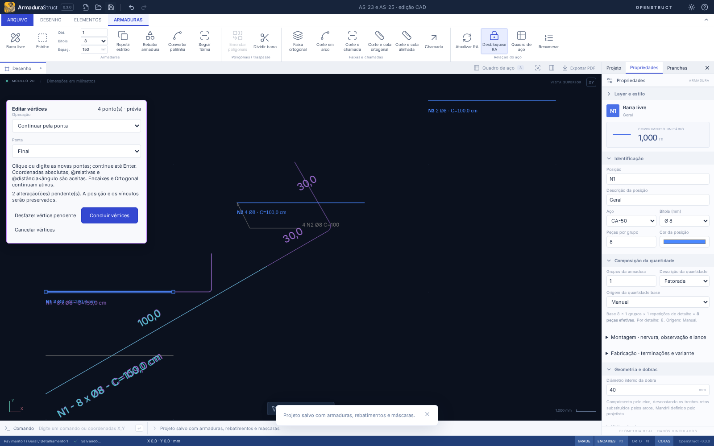

# AS-25 — Inserir, continuar e remover vértices

## Usar

Selecione **uma barra livre ou polilinha**. Abra **Elementos → Vértices**, o menu contextual ou a seção **Vértices** das propriedades. Selecione a armadura física para editar uma peça exibida por inserções; uma inserção gráfica sozinha não é uma nova armadura. Dentro de um detalhe agrupado, abra a edição isolada antes de editar seus objetos.

| Operação             | Comando CAD      | Resultado                                                 |
| -------------------- | ---------------- | --------------------------------------------------------- |
| Inserir vértice      | `INSERIRVERTICE` | Insere o ponto informado no segmento teórico mais próximo |
| Continuar pela ponta | `CONTINUAR`      | Acrescenta pontos na ponta inicial ou final escolhida     |
| Remover vértice      | `REMOVERVERTICE` | Remove o vértice mais próximo do ponto indicado           |

Clique ou digite coordenadas **em mm do modelo**: `1300,0` é absoluto, `@300,0` é relativo e `@300<90` é polar, em graus anti-horários. Na continuação, a referência relativa acompanha a ponta escolhida a cada passo; na inserção, começa no primeiro vértice e acompanha o último ponto inserido; na remoção, usa o primeiro vértice restante. Os encaixes existentes e **Orto/F8** continuam ativos para cliques. Coordenadas digitadas são explícitas e não são corrigidas pelo Orto.

Continue até **Enter**, botão direito ou **Concluir vértices**. As alterações ficam em prévia roxa até concluir; salvar durante a prévia grava o projeto anterior. **Desfazer vértice pendente** retira apenas o último passo. **Esc**, **Cancelar vértices** ou Desfazer do projeto cancelam a sessão pendente. Após concluir, todo o conjunto de passos é uma operação no histórico.



Para acrescentar uma perna de 300 mm a uma reta de 1000 mm orientada em X, selecione-a, digite `CONTINUAR`, depois `@300<90` e Enter. O vértice teórico é acrescentado sem recriar o ID/posição. O desenvolvido inclui o arredondamento da dobra: com φ=8 mm e Dm=40 mm, R=24 mm e C=1300−48+12π≈1289,699 mm. Uma inserção colinear não muda o comprimento.

## Geometria, vínculos e quantitativos

- O ID da barra/polilinha, a marca e os vínculos por `barId`/`barIds` permanecem estáveis. Inserções atualizam o traçado a partir da mesma armadura; não adicionam peças ao levantamento.
- Curvas, comprimentos, rótulos automáticos, quadro e exportações reutilizam os geradores atuais. Quantidade base, multiplicador, repetição e faixa não são recriados.
- Uma alteração física que desatualize a RA bloqueada a desbloqueia e recalcula ao concluir. Uma subdivisão colinear preserva a RA. Se esse desbloqueio exigir alteração global durante edição isolada, conclua a edição ou desbloqueie a RA antes de executar.
- Permanecem ao menos **dois pontos** em caminhos abertos e **três** nos fechados, com limite de 500. Pontos consecutivos coincidentes, retornos de 180° e pernas sem espaço para as dobras são recusados, mantendo o último estado válido da prévia.
- Polilinhas fechadas aceitam inserção inclusive no fechamento e remoção, mas não têm ponta para continuar. Estribos permanecem paramétricos e não são convertidos silenciosamente.
- Layers, visibilidade e edição isolada continuam protegendo os objetos. Nenhuma alteração parcial é aplicada em um lote inválido.

As referências existentes identificam a armadura, não segmentos persistentes. Cotas e auxiliares desenhados manualmente mantêm seus pontos; seus vínculos de identificação continuam funcionando. Ao remover um nó, o painel avisa para conferir as cotas independentes. Não se inventa uma ligação geométrica que não existia no arquivo.

## API e remapeamento da topologia

As novas operações são aditivas à API 1.0 e aparecem em `REBAR_CAPABILITIES.operations`. Unidades internas são mm. UI e geradores usam o mesmo domínio, sem React:

```ts
import { executeRebarBatch, applyRebarBatch } from './src/api';

const result = executeRebarBatch(
  project,
  [
    {
      type: 'vertices.edit',
      id: project.bars[0].id,
      edit: { kind: 'extend', end: 'end', point: { x: 1000, y: 300 } },
    },
  ],
  { units: 'mm', schedule: 'invalidate-lock' },
);

if (result.ok) {
  const topology = result.receipt.operations[0].topology;
  // topology.vertexMap: índice antigo -> novo índice ou null (removido).
  // topology.segmentMap: segmento antigo -> lista de novos segmentos.
  // topology.warnings: cotas independentes a conferir após remoção.
  project = applyRebarBatch(project, result);
}
```

Também são aceitos `edit: { kind: 'insert', segment: 0, point }` e `edit: { kind: 'remove', vertex: 1 }`. Índices começam em zero; pontos de entrada estão no **mundo**, mesmo para barra girada. Um lote com vários passos é atômico. Cada mapa refere-se ao estado imediatamente anterior àquela operação, portanto integrações que guardam referências de segmentos devem compor os mapas na ordem do lote. Segmento dividido mapeia para dois índices; segmentos fundidos mapeiam para o mesmo; segmento eliminado na ponta mapeia para `[]`. Não remapeie índices antigos como se todos os mapas partissem do estado inicial.

`editVertices(project,id,edit,context)` é o helper imutável da prévia e retorna `project`, `vertexMap`, `segmentMap`, `warnings`. Ele valida geometria/proteções; use o lote da API para aplicar também a política de RA, validar o projeto completo e detectar mudanças de fabricação. `editablePath` fornece os vértices teóricos em coordenadas do mundo. Os mapas são recibos da operação, não dados duplicados no projeto.

O formato permanece **armadurastruct/18** e o pacote **openstruct.detail/10**: as alterações usam a geometria já existente e não exigem migração adicional. Projetos antigos continuam sendo migrados pelo leitor atual.

## Validação e limites

Validação local aprovada: `npm run check` (**366 testes de domínio/importação + 6 de distribuição**), `npm run build`, `npm run format:check` e **67 cenários de navegador** em `npm run test:e2e`. As duas tarefas acrescentam 23 testes de domínio e 6 fluxos de navegador.

Testes analíticos cobrem a perna de 300 mm, raio da dobra/comprimento/peso, subdivisão colinear, ponta inicial de barra girada, remoção/fusão/mapas circulares, geometria impossível, mínimo de pontos, bloqueios, rollback, RA, inserções e pacotes mm/cm/m. Os testes de navegador verificam prévia, coordenadas absolutas/relativas/polares, continuidade, cancelamento, histórico e reabertura. Veja também [AS-23](AS-23.md).

Inserir escolhe o segmento mais próximo e usa o ponto indicado; um ponto fora da reta cria um novo canto, sem projeção silenciosa. Remover escolhe o nó mais próximo; confira a prévia antes de concluir. Não há novo dimensionamento normativo, cálculo de gancho ou ajuste automático das cotas manuais. A validação local exercita o navegador e o domínio compartilhado; não inclui novos instaladores Linux/Windows.

Referência de interação: [AltoQi — edição de armadura e inserção de vértices](https://suporte.altoqi.com.br/hc/pt-br/articles/21138382657431).
