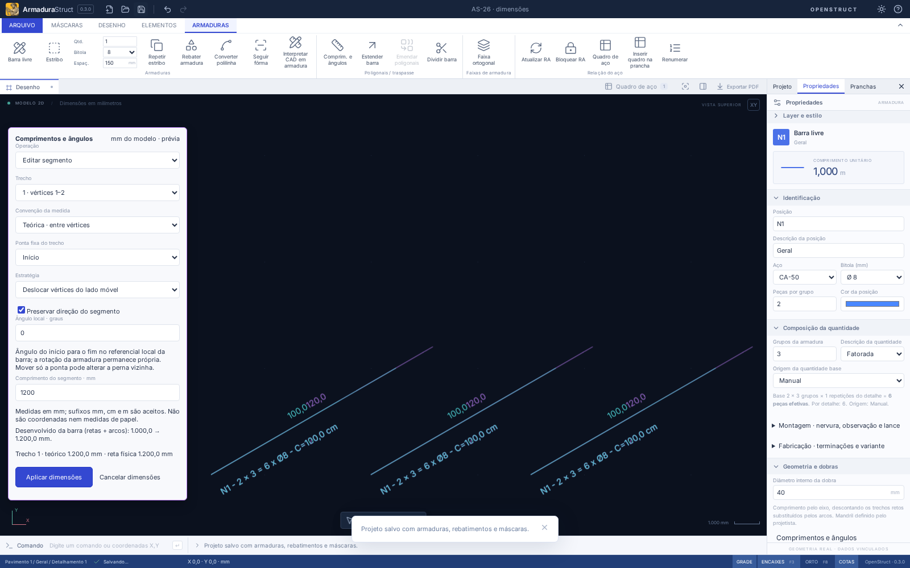
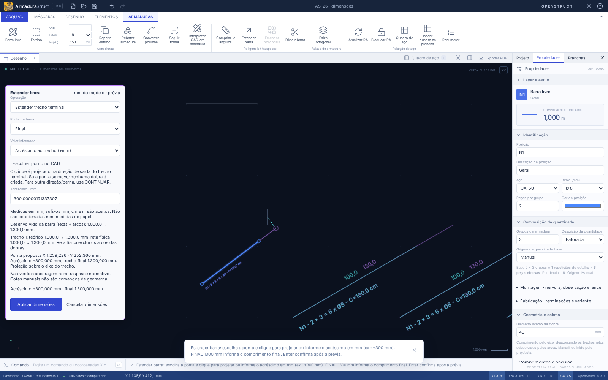
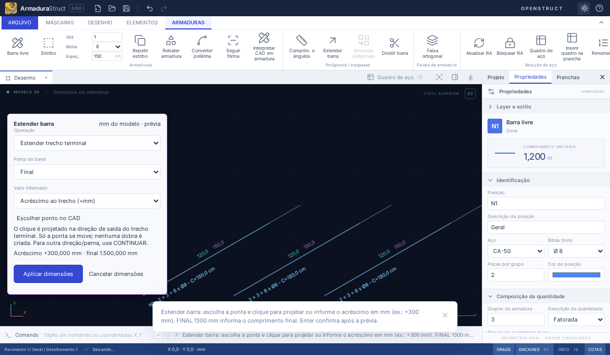

# AS-26 — Comprimentos, ângulos e extensão de barras

## Acessar e confirmar

Selecione **uma armadura física de barra livre**. Em **Propriedades → Geometria e dobras**, use **Comprimentos e ângulos** ou **Estender barra**. Os mesmos comandos estão em **Armaduras → Poligonais / traspasse**, no menu contextual e na linha CAD: `SEGMENTOS` e `ESTENDER` (`ESTENDERBARRA`). Abra a edição isolada de um detalhamento agrupado antes de alterar suas peças; na prancha, abra o desenho da vista.

O painel conserva um rascunho e desenha a prévia roxa da peça e de suas inserções. **Aplicar dimensões**, Enter no campo ou entrada vazia na linha CAD confirmam uma operação de histórico. Esc, **Cancelar dimensões**, Desfazer com a sessão aberta e troca de projeto/desenho descartam a prévia. Salvar durante a prévia guarda o projeto anterior. Campos inválidos mostram a causa e impedem aplicar. Campos têm rolagem; o resumo de medidas e Aplicar/Cancelar permanecem visíveis. Use pan com o botão do meio para afastar uma ponta que esteja atrás dele.

## Segmentos e convenções

Escolha o trecho pelo par de vértices. Seu ângulo é **absoluto no referencial local da barra**, anti-horário a partir de X, do início para o fim do trecho. A rotação global da barra continua própria. **Preservar direção do segmento** mantém a direção atual; desmarque para informar outro ângulo.

| Medida                | Significado                                                | Edição                                |
| --------------------- | ---------------------------------------------------------- | ------------------------------------- |
| Teórica               | Distância entre vértices ideais                            | Ambas as estratégias                  |
| Reta física           | Pelo eixo, entre tangências das dobras, excluindo os arcos | Exige deslocar vértices do lado móvel |
| Desenvolvido da barra | Soma das retas físicas e dos arcos de toda a peça          | Exibido para conferência              |

Na reta física, o domínio calcula as tangências com o novo ângulo e o mandril existente e soma as deduções à medida teórica. É um cálculo direto: a estratégia de cadeia preserva as direções das pernas vizinhas. Uma tentativa de reta física com ponta única recebe mensagem explicando a estratégia necessária.

| Estratégia                      | Início fixo do trecho                                            | Fim fixo do trecho                                                 |
| ------------------------------- | ---------------------------------------------------------------- | ------------------------------------------------------------------ |
| Deslocar vértices do lado móvel | Move o fim e todos os vértices posteriores pela mesma translação | Move o início e todos os vértices anteriores pela mesma translação |
| Mover somente a ponta do trecho | Move apenas o fim do trecho                                      | Move apenas o início do trecho                                     |

Na ponta única, a perna vizinha pode mudar de comprimento e direção. A ponta fixa mantém sua coordenada original. A barra completa é validada: pontos coincidentes, retorno de 180° e espaço insuficiente para as dobras são recusados. Cotas textuais sobrescritas permanecem anotações, sem controlar a geometria.

Exemplo: **1000 → 1200 mm**, início fixo, move a ponta final em 200 mm. Em um L, a estratégia de cadeia também translada a perna posterior. Com φ=8 e Dm=40, o raio do eixo é 24 mm: uma perna teórica de 1000 mm com uma dobra de 90° tem 976 mm de reta física. Informar 1100 mm de reta física produz 1124 mm teóricos, preservando a direção da outra perna na estratégia de cadeia.



## Estender por valor ou clique

Escolha a ponta **Inicial** ou **Final**. ESTENDER move somente o vértice extremo na direção atual do trecho terminal, preservando a outra ponta e o restante do caminho. Funciona com barras inclinadas, giradas ou dobradas; não insere vértices colineares nem cria outra dobra.

| Entrada                                       | Interpretação                                                       |
| --------------------------------------------- | ------------------------------------------------------------------- |
| Acréscimo: `300` ou `+300 mm`                 | Acrescenta 300 mm ao trecho terminal                                |
| Comprimento final: `1300`                     | Faz o trecho terminal medir 1300 mm                                 |
| Linha CAD: `ESTENDER`, depois `+300 mm`       | Prepara explicitamente um acréscimo                                 |
| Linha CAD: `ESTENDER`, depois `FINAL 1300 mm` | Prepara explicitamente o comprimento final                          |
| Número simples `300` na linha CAD             | Usa o tipo de medida exibido no painel, em mm; não é uma coordenada |

O valor na linha CAD prepara a prévia; confirme com Enter novamente ou **Aplicar dimensões**. Os campos admitem vírgula/ponto decimal e sufixos `mm`, `cm`, `m`. Na linha CAD, use ponto decimal para medida escalar; `X,Y`/`X;Y`, `@relativas` e `@distância<ângulo` continuam sendo coordenadas do modelo quando a escolha por ponto está ativa. Ângulos das coordenadas polares são globais, como no restante do CAD.

**Escolher ponto no CAD** está ativo ao iniciar ESTENDER. O cursor oferece a prévia; o clique fixa a proposta sem gravá-la. O ponto é projetado na semirreta de saída do trecho terminal. A prévia informa a posição resultante, o acréscimo e o comprimento final, e um círculo destaca a ponta proposta. Clique lateral não muda a direção. Ponto atrás da ponta, incremento zero/negativo e comprimento final menor/igual ao atual são recusados.

O snap pode fornecer o ponto a projetar. Neste comando, o trecho terminal já restringe a direção, portanto Orto não o substitui por um eixo global; a preferência F8 permanece guardada. Comprimentos são do modelo, independentes de zoom, escala gráfica e escala da vista. **1000 + 300 = 1300 mm** conserva dois vértices; estender uma barra com 500 conserva 500.



O [CONTINUAR da AS-25](AS-25.md) permanece distinto: acrescenta um vértice e pode criar uma perna; `CONTINUAR` e `@300<90` acrescentam uma perna vertical de 300 mm. Polilinhas mantêm as operações anteriores de vértices. Máscaras, estribos, cortes gráficos e inserções isoladas não são convertidos silenciosamente em aço.

## API e vínculos

A API 1.0 reutiliza **`vertices.edit`**, com novos tipos discriminados, anunciados em `REBAR_CAPABILITIES.segmentDimensions`. O validador e as proteções são compartilhados com AS-25. Os mapas de vértices/segmentos são identidades: a topologia não muda.

```ts
import { executeRebarBatch, applyRebarBatch } from './src/api';

const result = executeRebarBatch(
  project,
  [
    {
      type: 'vertices.edit',
      id: barId,
      edit: { kind: 'lengthen', end: 'end', amount: 300 },
    },
  ],
  { units: 'mm', schedule: 'invalidate-lock' },
);
if (result.ok) project = applyRebarBatch(project, result);
```

Para uma dimensão de segmento, use a mesma operação com:

```ts
const edit = {
  kind: 'segment' as const,
  segment: 0, // índice baseado em zero
  length: 1200,
  angle: 37, // local; omitir preserva a direção atual
  fixed: 'start' as const, // ou end
  strategy: 'chain' as const, // ou endpoint
  convention: 'theoretical' as const, // ou straight, com chain
};
```

`barSegments(bar)` fornece medidas locais e tangências. `terminalExtensionAt(bar,end,worldPoint)` projeta um ponto do mundo e retorna o incremento, a ponta e o afastamento lateral. O incremento alimenta `kind: 'lengthen'`. A entrada histórica `kind: 'extend', point` continua significando CONTINUAR, com ponto no mundo.

IDs, origem, rotação, quantidade base, origem manual/faixa, multiplicadores e repetição continuam próprios. Comprimento desenvolvido, peso, rótulos e inserções são recalculados a partir da peça física. Três inserções não geram três peças. Uma ocorrência que deixe de ser equivalente segue a política AS-54 de separação da fabricação. Cotas independentes conservam seus pontos; confira-as após editar.

Layers, ocultação e isolamento usam as proteções atuais. A UI usa `schedule: 'invalidate-lock'`: mudança física desbloqueia a RA bloqueada. Na API, `preserve-lock` mantém a conferência e sinaliza que ficou desatualizada. Se o desbloqueio global for incompatível com edição isolada, a transação é recusada; conclua o isolamento ou desbloqueie a RA antes. Lotes inválidos retornam o projeto original; uma prévia de projeto substituído não é aplicada.

O formato permanece **armadurastruct/20** e o pacote **openstruct.detail/11**. Só são gravados os pontos existentes da barra; não há migração nova ou persistência da sessão de ferramenta. Estender não verifica ancoragem nem garante traspasse normativo; não acrescenta ganchos ou luvas automaticamente.

## Verificação

`tests/segments.test.ts` cobre contas analíticas, ambas as pontas, barra girada/inclinada, projeção equivalente ao valor, L e deduções de duas dobras, ângulo local, estratégias, inválidos, famílias incompatíveis, limites, rollback, permissões, RA, fabricação, quantitativos e persistência. Contas do domínio são verificadas a até 1e-10 mm nos casos analíticos. O clique no navegador tolera 0,001 mm para matriz SVG/coordenadas de entrada; o projeto conserva o número calculado sem arredondamento adicional.

`tests/e2e/segments.spec.ts` verifica propriedades, prévia, comandos, projeção, cancelamento, desfazer/refazer, reabertura, convenções, RA, layers e a distinção para CONTINUAR.

Validação local aprovada: **423 testes de domínio/importação + 6 de distribuição** em `npm run check`, build de produção e formatação. Foram verificados **82 fluxos existentes e 6 novos de navegador**: a bateria completa, a reexecução final dos 16 fluxos de segmentos/AS-25/interface compacta, incluindo teclado/rolagem em 1200 × 700.



A validação local usa Chromium/web em Linux. A interface nativa Tauri Linux/Windows não foi executada neste ambiente; o código e os formatos permanecem compartilhados. Não há dimensionamento estrutural ou ajuste automático de cotas manuais.

Referência de interação: [AltoQi — inserir segmento e editar propriedades da armadura](https://suporte.altoqi.com.br/hc/pt-br/articles/21138382657431).
