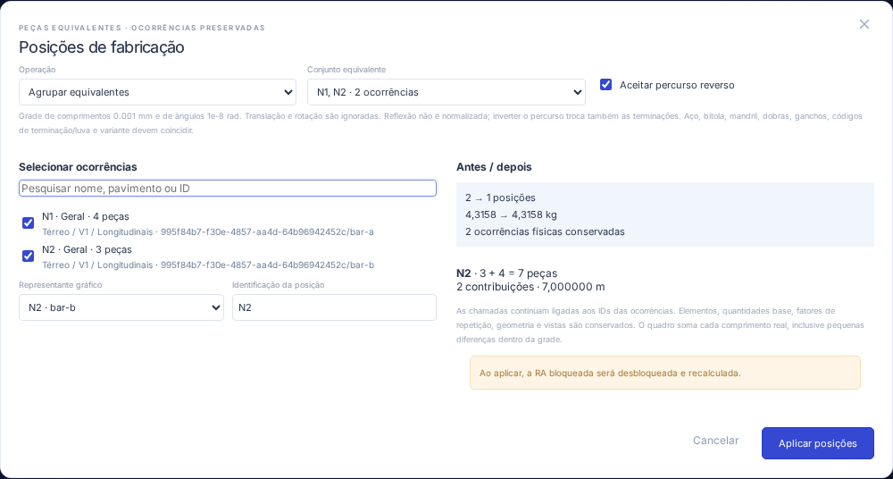

# AS-54 · Posições de fabricação e ocorrências

Atualização AS-56: o formato nativo atual é **`armadurastruct/9`** e o pacote é **`openstruct.detail/4`** (leitura v1/v2/v3). A quantidade efetiva é base × multiplicador da armadura × repetição do detalhe. Metadados de nervura/lance/observação não acrescentam aço. Consulte [AS-56](AS-56.md); as versões anteriores abaixo registram a evolução histórica.

Uma posição de fabricação pode identificar várias ocorrências físicas equivalentes. Cada barra conserva seu `Bar.id`, dono na hierarquia, quantidade base, localização, faixa e vínculos de chamadas/rebatimentos. Nenhum elemento estrutural é fundido. A repetição da AS-03 continua sendo um fator aplicado ao detalhe; vistas e rebatimentos continuam sem acrescentar aço.

## Uso

1. Abra **Elementos → Posições de fabricação**, fora da edição isolada.
2. Em **Agrupar equivalentes**, escolha um conjunto encontrado pela assinatura física. A pesquisa filtra a lista visível; não retira automaticamente ocorrências já selecionadas. Marque as ocorrências desejadas, escolha o representante gráfico e informe a identificação compartilhada. Para usar a identificação de uma posição já compartilhada, inclua todos os seus membros ou escolha outra identificação.
3. Confira posições, contribuições, peso antes/depois e a política de percurso reverso. **Cancelar** ou **Esc** conserva o projeto. **Aplicar posições** cria uma única operação de histórico e recalcula/desbloqueia a RA.
4. No **Quadro de aço**, expanda **ocorrências · origens** para consultar IDs, pavimento/elemento/detalhe, linhagem de importação, quantidade base, repetição, quantidade efetiva, comprimento e peso de cada contribuição. Os botões de ID selecionam a ocorrência original.
5. Para separar peças, use **Desagrupar posição** e selecione uma ou todas as ocorrências. Os nomes novos evitam colisões; nenhuma peça ou chamada é apagada. Desfazer/refazer e salvar/reabrir conservam posições e vínculos.

Alterar bitola, aço, mandril, ganchos, poligonal, terminações ou variante de **uma ocorrência** separa essa peça quando sua assinatura muda. A posição e os dados dos outros membros permanecem. Mover, girar, mudar cor, quantidade ou faixa conserva a associação quando a definição de fabricação continua equivalente. Uma cópia física começa em posição independente e só entra em um grupo mediante ação explícita. A renumeração enumera posições, mantendo as marcas compartilhadas.

Em **Propriedades → Fabricação · terminações e variante**, informe um código de especificação para início/fim. O código novo assume luva; depois é possível escolher luva, rosca ou cabeça. Limpar o código libera a ponta. A variante e os códigos são sensíveis a maiúsculas/minúsculas. Ganchos continuam definidos pela geometria da barra/estribo.



## Equivalência explícita

| Critério                              | Regra implementada                                                                                                                                                                                         |
| ------------------------------------- | ---------------------------------------------------------------------------------------------------------------------------------------------------------------------------------------------------------- |
| Unidades                              | Geometria interna e assinatura sempre em mm, inclusive em pacotes cm/m.                                                                                                                                    |
| Comprimentos, bitola, mandril, gancho | Grade fixa de **0,001 mm**, arredondamento ao inteiro mais próximo. Estar próximo não basta: os valores devem cair na mesma célula. Essa regra evita equivalência não transitiva.                          |
| Forma                                 | Família, sequência completa de comprimentos dos trechos e giros assinados; não apenas comprimento desenvolvido. Mandril global participa da assinatura e determina os arcos de dobra.                      |
| Ângulos                               | Grade de **10⁻⁸ rad** para giros entre trechos.                                                                                                                                                            |
| Orientação                            | Translação e rotação ignoradas. Percurso reverso aceito por padrão e desativável na prévia; ao inverter, trocam-se as especificações das duas pontas.                                                      |
| Espelhamento                          | A reflexão não é normalizada. Peças assimétricas com giros espelhados ficam separadas. Uma figura simétrica pode coincidir por rotação/percurso reverso.                                                   |
| Aço e especificações                  | Aço, tipo/código das duas terminações e variante devem coincidir; ausência/terminação livre são equivalentes. Campos desconhecidos da barra são recusados na leitura, não descartados para tentar agrupar. |
| Representações                        | Origem, rotação global, escala de vista, cores, descrições, marca, quantidades e faixas não definem equivalência.                                                                                          |

A geometria física não é arredondada pelo agrupamento. O quadro soma **os comprimentos e massas reais de cada contribuição**; não multiplica o comprimento do representante cegamente por toda a quantidade. `unitLengthRange` informa mínimo/máximo, e o quadro mostra `*` quando há diferença. O CSV inclui esse intervalo, fórmula da quantidade, ID da posição e contribuições em JSON. DXF e PDF usam as linhas consolidadas do mesmo levantamento; o comprimento unitário mostrado é o do representante.

`ScheduleRow.baseQuantity` é a soma das quantidades base das contribuições. Quando os fatores diferem, `ScheduleRow.repetitions` é `null`; use `contributions` ou `scheduleQuantityLabel` para a composição exata, sem atribuir um fator único inexistente.

Por exemplo: quatro peças num detalhe repetido três vezes e três peças em outro detalhe repetido duas vezes produzem **4×3 + 3×2 = 18**, numa única posição. Alterar o número de vistas conserva 18.

## Contrato e persistência

- Projeto **`armadurastruct/8`**. Leitura dos formatos 1–7 cria posições individuais determinísticas sem alterar IDs, geometria, quantidade ou rebatimentos. Não se infere agrupamento de marcas repetidas nos arquivos legados.
- `fabricationPositions[] = { id, mark, barIds, reverse, signature }`. O ID da posição pertence ao seu próprio namespace. `barIds` referencia ocorrências; o primeiro membro é o representante. `Bar.mark` é uma projeção de compatibilidade da marca compartilhada, validada contra a entidade. Identificações só se repetem em barras explicitamente associadas à mesma posição equivalente.
- A ausência do cadastro em objetos TypeScript legados/não confirmados permite inferir posições individuais; a fronteira de transação materializa o cadastro. O arquivo v8 exige a coleção. IDs/identificações de posições e associações duplicadas/órfãs ou grupos não equivalentes são recusados.
- `Bar.manufacturing` transporta especificações de ponta (`plain`, `coupler`, `threaded`, `headed`, com `code`) e `variant`. Ponta livre tem código vazio; outros tipos exigem código. Não existem acréscimos de comprimento implícitos.
- RA bloqueada congela barras, posições, contexto de repetição e origens. Uma edição física posterior mantém a RA congelada e a sinaliza como pendente até atualizar/desbloquear. Agrupar/desagrupar explicitamente desbloqueia e recalcula, com aviso na prévia.
- Pacote **`openstruct.detail/3`**, com leitura de v1/v2. Exporta somente os membros incluídos no detalhe e nas dependências declaradas; não exporta aço de outros detalhes por compartilhar uma posição. A importação remapeia IDs, conserva a associação entre membros efetivamente importados e evita colisões locais. Nenhuma posição é reunida apenas por nome. Contratos antigos com campos de fabricação v3 são recusados. [JSON Schema v3](openstruct-detail-v3.schema.json).

## API executável

A fachada React independente da AS-51 mantém a versão compatível `1.0` e anuncia duas operações adicionais em `REBAR_CAPABILITIES.operations`:

```ts
const result = executeRebarBatch(
  project,
  [
    {
      type: 'fabrication.group',
      ids: ['occurrence-a', 'occurrence-b'],
      representativeId: 'occurrence-a',
      mark: 'N1',
      reverse: true,
    },
  ],
  { units: 'mm' },
);
const next = applyRebarBatch(project, result);
// Separar uma contribuição:
const split = executeRebarBatch(
  next,
  [{ type: 'fabrication.ungroup', ids: ['occurrence-b'] }],
  { units: 'mm' },
);
```

A prévia da interface usa essa mesma implementação. Erro em qualquer operação reverte o lote inteiro. Aplicar resultado antigo é recusado. Organizar posições exige sair do contexto isolado. Também estão exportados `fabricationSignature`, `fabricationPositions`, `fabricationCandidates`, `previewFabrication`, `groupFabrication`, `ungroupFabrication` e `FABRICATION_RULES` para consumidores de domínio; use a fachada transacional para coordenar lotes e recibos.

O [exemplo executável](examples/fabrication.ts) cria duas ocorrências com luva, uma representação e uma posição com sete peças. Execute `npm run example:fabrication -- /caminho/exemplo.armstruct.json` e abra o arquivo na interface. O script confere o levantamento e reabre o JSON antes de gravar.

## Validação e limites

Validação local desta entrega: `npm run check` (201 testes de domínio/importação e 6 de distribuição), `npm run build`, `npm run format:check`, 36 fluxos de navegador e o exemplo executável (2 ocorrências, 1 posição, 7 peças e 7 m).

Os testes cobrem massa analítica de barras Ø10, formas com mesmo comprimento desenvolvido, aço/mandril/gancho/luva/terminação/variante distintos, reversão com troca de pontas, reflexão assimétrica, grade de equivalência, totais reais, grupos entre detalhes repetidos, identidade das chamadas, separação individual, renumeração, cópia/exclusão/corte, snapshots, lotes inválidos e antigos, migração 1–7 e pacotes mm/cm/m. Os fluxos de navegador cobrem prévia/cancelamento, representante, pesquisa, consolidação/origens, proteção das outras ocorrências, desfazer/refazer, persistência e desagrupamento.

A implementação compara apenas as famílias existentes: barras livres poligonais e estribos retangulares com mandril global. Não normaliza vértices redundantes, inícios cíclicos de contornos fechados ou formas de famílias diferentes; isso pode deixar equivalências reais para conferência manual, sem unir peças diferentes. Não modela mandris por vértice nem geometrias 3D. Valores fora da faixa inteira segura da grade não são elegíveis ao agrupamento. Luvas/roscas/cabeças são especificações identificadas por código: não geram sólidos, acréscimos de corte, verificações de ancoragem ou resistência. Ao cortar, só as pontas externas conservam as especificações; a união de peças com terminações especiais/variantes é bloqueada para exigir revisão explícita.

Trata-se de detalhamento e levantamento, sem dimensionamento estrutural. A referência conceitual é a [API Ferros Inteligentes da TQS](https://docs.tqs.com.br/Docs/Details?id=1474000011&language=pt-BR), especialmente nomenclatura/controle de posições. Não há interoperabilidade proprietária demonstrada nem adoção de seus critérios históricos como norma vigente. Os testes locais cobrem o modo web e o domínio; empacotamento desktop Linux/Windows permanece a cargo da CI do projeto.

## Arquivos alterados

| Área                     | Arquivos                                                                                                                                                                                                 |
| ------------------------ | -------------------------------------------------------------------------------------------------------------------------------------------------------------------------------------------------------- |
| Modelo e equivalência    | `src/domain/fabrication.ts`, `types.ts`, `model.ts`, `hierarchy.ts`                                                                                                                                      |
| Edição/API e integrações | `src/domain/rebarApi.ts`, `editing.ts`, `detailRepetition.ts`, `detailTransfer.ts`, `detailPackage.ts`, `src/api.ts`                                                                                     |
| Interface e saídas       | `src/App.tsx`, `src/components/FabricationDialog.tsx`, `Panels.tsx`, `Ribbon.tsx`, `src/styles.css`, `src/lib/exports.ts`                                                                                |
| Verificação              | `tests/fabrication.test.ts`, `tests/e2e/fabrication.spec.ts`; expectativas de versão e invariância física ajustadas nos testes existentes, separando a nova rastreabilidade de origem dos totais físicos |
| Exemplos e documentação  | `docs/examples/fabrication.ts`, `scripts/examples/fabrication.mjs`, `package.json`, contrato v3, este documento/captura, guia, README e histórico                                                        |
