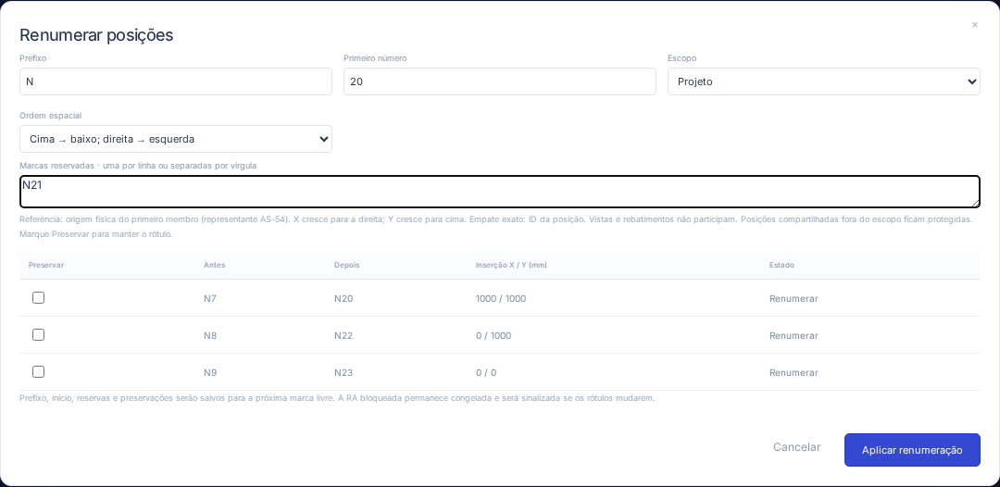

# AS-55 · Renumeração espacial e faixa de marcas

Use **Renumerar** na faixa de armaduras para abrir a prévia. Informe prefixo, primeiro número, escopo, ordem e marcas reservadas (uma por linha ou separadas por vírgula/ponto e vírgula). A tabela mostra antes/depois e a inserção usada. Marque **Preservar** nas posições que devem manter o rótulo. Cancelar/Esc não altera o projeto; aplicar é uma operação de desfazer/refazer.



## Regras

- A unidade é a posição de fabricação da AS-54. Todos os seus membros recebem a mesma marca; IDs de barras, posições, chamadas, detalhes e vistas são mantidos.
- Referência espacial: `origin` em mm do **primeiro membro da posição**, o representante explícito da AS-54. É a inserção física, independente dos vértices locais, da escala da folha, de faixas, vistas ou rebatimentos. Para posições individuais, usa-se a própria ocorrência.
- Y cresce para cima e X para a direita. Há quatro ordens: cima→baixo com direita→esquerda; cima→baixo com esquerda→direita; direita→esquerda com cima→baixo; esquerda→direita com cima→baixo. A primeira direção é a chave principal, a segunda desempata. Coordenadas são comparadas exatamente; empate completo usa comparação lexical dos IDs estáveis das posições, sem dependência do idioma ou ordem dos arrays. Não há agrupamento automático por linhas ou tolerância visual.
- Escopos: projeto, pavimento/elemento/detalhamento ativos ou posições inteiramente selecionadas. Nos escopos hierárquicos, uma posição só entra quando **todas** as ocorrências pertencem ao escopo. Uma posição compartilhada com outro detalhe fica protegida; para renumerá-la, amplie o escopo. A seleção parcial também não renumera o grupo inteiro implicitamente.
- Posições preservadas e fora do escopo ocupam suas marcas. As antigas marcas das posições que serão renumeradas são liberadas na simulação, permitindo trocas sem colisões intermediárias. Marcas reservadas são comparadas por texto exato, com distinção de maiúsculas/minúsculas; `N020` e `N20` são diferentes. Reservar não preserva automaticamente a posição que já usa aquela marca: use a caixa Preservar quando quiser conservá-la.
- Prefixo: até 20 caracteres, iniciando por letra ou `_`, seguido de letras/números/`_`/`-`. Primeiro número: 1 a 999.999.999. A numeração não preenche zeros à esquerda. Faixa esgotada ou configuração inválida bloqueia a aplicação.
- Prefixo, início, reservas e IDs preservados são gravados em `Project.numbering`. A busca da próxima marca livre usa a mesma função e evita marcas ocupadas/reservadas em criação, cópia, divisão, separação de equivalência e remapeamento de importação. Uma marca explicitamente fornecida à API não pode ocupar reserva nova; um rótulo existente reservado pode permanecer.

Exemplo: com início N20, as posições em (1000,1000), (0,1000) e (0,0) recebem N20/N21/N22 na ordem padrão, independentemente da criação. Reservando N21, passam a N20/N22/N23. Duplicar uma vista conserva as mesmas três posições.

## API e persistência

```ts
const options = {
  policy: {
    prefix: 'N',
    start: 20,
    reserved: ['N21'],
    preservedPositionIds: [],
  },
  order: 'top-right' as const,
  scope: { kind: 'project' as const },
};
const plan = previewRenumber(project, options);
// Conferir plan.rows: before, after, x, y, barId, positionId, status.
const next = applyRenumber(project, plan);
// Ou executar pela fachada transacional usada na interface:
const result = executeRebarBatch(project, [{ type: 'bar.renumber', options }], {
  units: 'mm',
});
const applied = applyRebarBatch(project, result);
```

`applyRenumber` e a fachada recusam resultados de um projeto anterior. Lote inválido reverte integralmente. Durante edição isolada, conclua a edição antes de renumerar. Descrições automáticas, chamadas e quadros leem as marcas pelos vínculos existentes; textos manuais livres não são reescritos por busca/substituição. Quantidades, fatores e geometrias são preservados. A RA bloqueada conserva seu snapshot e sinaliza atualização pendente quando as marcas mudarem; atualize/desbloqueie antes da exportação.

O projeto salvo passa a **`armadurastruct/10`**, com leitura dos formatos 1–9 sem renumeração automática. Arquivos antigos sem política continuam usando N1 como ponto inicial da busca livre. Uma política nova não é aceita sob uma versão antiga. O pacote de detalhamento permanece **v4**: as marcas são transportadas como antes, mas a política global do projeto de origem não sobrescreve a política do destino. Preservações cujas posições foram excluídas ficam inativas; não impedem excluir aço nem reservam rótulos novos.

## Verificação e limites

`npm run check` verifica 240 testes de domínio/importação e 6 de distribuição; `npm run build` e a formatação também são verificados. Os testes específicos cobrem ordenação independente dos arrays, desempate por ID, quatro sentidos, início N20, reservas/preservações, próximo número, escopo compartilhado, erros, faixa esgotada, persistência, migração 1–9, RA congelada e lote atômico. A suíte completa de navegador passou em **41 fluxos**. O fluxo específico confere prévia/cancelamento, aplicação, desfazer/refazer, reabertura e invariância de geometria/peso.

A ordem usa coordenadas do modelo, não uma leitura das posições gráficas em diferentes pranchas. Não acrescenta dimensionamento estrutural. A [API Ferros Inteligentes da TQS](https://docs.tqs.com.br/Docs/Details?id=1474000011&language=pt-BR), em Controle de posições/GlobalRebar (`firstMark`, `FreeMark`), serve como referência conceitual; não se adota comportamento proprietário não demonstrado nem critérios históricos como norma vigente. Domínio e modo web são verificados localmente; pacotes Linux/Windows seguem a CI.

## Arquivos alterados

- `src/domain/marks.ts`, `numbering.ts`: política comum, próxima marca livre, escopos, ordenação, prévia/aplicação.
- `src/domain/model.ts`, `types.ts`, `editing.ts`, `rebarApi.ts`, `fabrication.ts`, `detailTransfer.ts`, `detailPackage.ts`, `src/api.ts`: persistência/migração e integração com todas as operações de marcas.
- `src/components/NumberingDialog.tsx`, `src/App.tsx`, `src/styles.css`: prévia compacta, foco, cancelamento e histórico.
- `tests/numbering.test.ts`, `tests/e2e/numbering.spec.ts`: casos de aceite; expectativas de formato atual e ordem padrão ajustadas nos testes anteriores.
- Este documento/captura, `docs/GUIA.md`, `README.md`, `CHANGELOG.md`: uso, regras, arquivos e limitações.
