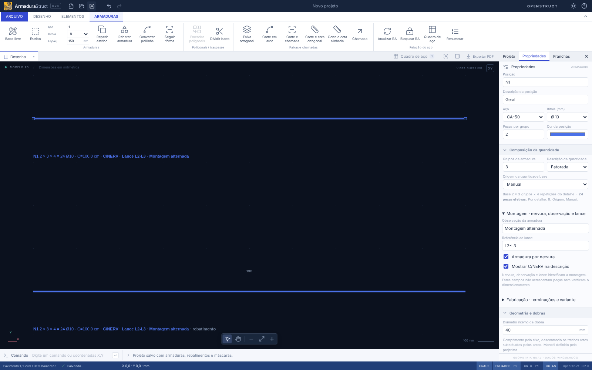

# AS-56 · Quantidade por grupo e dados de montagem

A quantidade de cada ocorrência tem três fatores independentes: **peças por grupo × grupos da armadura × repetições do detalhamento**. Duas peças, três grupos e quatro repetições resultam em **24 peças**. Uma segunda vista ou rebatimento representa a mesma ocorrência e conserva 24; os fatores não são incorporados novamente à base na importação ou na composição das folhas.

## Uso

1. Selecione uma barra e abra **Propriedades**. **Peças por grupo** é a quantidade base (o campo mantém o nome acessível `Quantidade`).
2. Em **Composição da quantidade**, informe **Grupos da armadura**: inteiro de 1 a 10.000. A composição exibe base, multiplicador, repetição do detalhe, quantidade por detalhe e quantidade efetiva. Para retirar este fator, volte a 1. A repetição do detalhe continua em **Elementos → Repetições do detalhamento** (AS-03), sem alterar o multiplicador da armadura.
3. Escolha a **Origem da quantidade base**. **Manual** utiliza a base informada. Quando há uma faixa vinculada, também estão disponíveis **Faixa · quantidade fixa** e **Faixa · espaçamento máximo**. No último modo, edite **Espaçamento máximo** em Distribuição vinculada; a base fica protegida contra edição direta. Troque a origem para manual/quantidade fixa para voltar a editá-la.
4. **Descrição da quantidade** alterna entre fatorada e total efetivo no CAD, rebatimentos e chamadas automáticas. O quadro sempre permite conferir a composição, independentemente dessa preferência gráfica.
5. Expanda **Montagem · nervura, observação e lance**. Informe a observação, a referência textual do lance e, quando aplicável, **Armadura por nervura**. A descrição inclui `C/NERV` somente quando também estiver marcado **Mostrar C/NERV na descrição**. Esses dois campos não acrescentam grupos ou peças.
6. A pesquisa da árvore e dos conjuntos de fabricação também localiza observação e lance. No quadro, expanda **ocorrências · origens** para consultar os fatores, a origem da base e os dados de montagem de cada contribuição. A forma, os IDs e as chamadas continuam ligados à ocorrência original.



Remover uma distribuição preserva a última base calculada e muda sua origem para manual. Alterar só a representação da faixa, mover/copiar a barra ou editar sua apresentação conserva os fatores e o limite de espaçamento registrado. Em uma faixa por quantidade fixa, mudar o comprimento mantém a base; em uma faixa por espaçamento, a base acompanha a extensão. As duas extremidades são incluídas. O desenho repete apenas as peças da **base**, representando um grupo; não desenha novamente todos os grupos ou todas as repetições do detalhe.

## Contrato de dados

| Campo/resultado                         | Significado e regra                                                                                                                                                                                                                          |
| --------------------------------------- | -------------------------------------------------------------------------------------------------------------------------------------------------------------------------------------------------------------------------------------------- |
| `Bar.quantity`                          | Base inteira de 1 a 100.000 peças por grupo. Não contém multiplicador ou repetição herdada. Uma distribuição exige pelo menos duas peças.                                                                                                    |
| `Bar.multiplier`                        | Inteiro de 1 a 10.000 grupos desta armadura; padrão 1.                                                                                                                                                                                       |
| `Bar.quantitySource`                    | `{kind:'manual'}`, `{kind:'distribution',mode:'quantity'}` ou `{kind:'distribution',mode:'spacing',spacing:number}`. No último caso, o espaçamento máximo é guardado em mm e a base é derivada da faixa existente.                           |
| `Bar.quantityDisplay`                   | `factored` (padrão) ou `total`. É uma preferência gráfica, não outro fator.                                                                                                                                                                  |
| `Bar.comment`                           | Observação, até 500 caracteres.                                                                                                                                                                                                              |
| `Bar.ribbed`, `Bar.showRibbed`          | Classificação de montagem por nervura e opção de mostrar a indicação; independentes do cálculo de quantidade.                                                                                                                                |
| `Bar.columnLevel`                       | Referência textual ao lance, até 100 caracteres; não é a identidade de um pavimento e não cria um subsistema de lances.                                                                                                                      |
| `hierarchy.details[].repetition.factor` | Repetição do detalhamento da AS-03, aplicada uma única vez depois dos fatores da armadura.                                                                                                                                                   |
| `barQuantities(project,bar)`            | Retorna `baseQuantity`, `multiplier`, `quantitySource`, `perDetailQuantity=base×multiplier`, `repetitions` e `quantity=perDetailQuantity×repetitions`.                                                                                       |
| `ScheduleContribution`                  | Preserva os fatores e os metadados de cada ocorrência, além de seu ID, dono, origem, comprimento real e massa.                                                                                                                               |
| `ScheduleRow`                           | Soma as contribuições da posição de fabricação. `baseQuantity` e `perDetailQuantity` são somas; `multiplier` e `repetitions` ficam `null` quando não há um valor comum. Use as contribuições/`scheduleQuantityLabel` para expressões mistas. |

A base por espaçamento segue `ceil(extensão/espaçamento)+1`, com tolerância relativa numérica de 10⁻¹² na divisão para evitar uma peça extra por ruído de conversão de unidades. Essa tolerância não é critério de dimensionamento ou tolerância de fabricação. O cache `Bar.quantity` precisa coincidir com o resultado ao abrir um arquivo; um valor adulterado/desatualizado é recusado. As edições executam o recálculo na fronteira comum de transação.

A equivalência de fabricação da AS-54 continua considerando a peça de corte/dobra. Quantidade, multiplicador, origem da base, observação, nervura e lance não tornam duas peças geometricamente distintas: barras equivalentes continuam compartilhando posição, com cada contribuição discriminada. A reunião de elementos da AS-03 é mais conservadora e exige fatores e dados de montagem compatíveis, para não apagar informações ao retirar definições duplicadas. A união de poligonais exige igualdade de base, multiplicador e dados de montagem; a divisão preserva esses campos nas peças resultantes.

## Persistência, intercâmbio e relação de aço

- Formato nativo **`armadurastruct/9`**. A leitura dos formatos 1–8 preserva IDs, coordenadas, bases, representações e totais, acrescentando multiplicador 1 e origem manual quando ausentes. Faixas antigas não registravam o modo/limite original: a migração não tenta deduzi-los de sua geometria. Campos novos não neutros em versões antigas são recusados para evitar perda silenciosa em outro leitor.
- Pacote **`openstruct.detail/4`**, com leitura de v1/v2/v3. Transporta as bases e fatores separados. A repetição permanece no contexto do detalhe. Ao converter mm/cm/m, somente os comprimentos, incluindo `quantitySource.spacing`, são escalados; contagens e multiplicadores não são escalados. O mapeamento de IDs e atualização da mesma origem continuam usando AS-08/AS-09. [JSON Schema v4](openstruct-detail-v4.schema.json).
- RA bloqueada congela barras, composição e metadados. Uma mudança posterior informa atualização pendente; o quadro congelado conserva seu snapshot até atualizar/desbloquear. Mudar apenas a apresentação fatorada/total não suja o levantamento. Uma revisão importada que modifica seus fatores/metadados invalida o bloqueio conforme o fluxo AS-08.
- CSV acrescenta multiplicador, quantidade antes da repetição, origem da base, observação, nervura e lance, além do JSON das contribuições. CAD, chamadas, DXF e PDF vetorial usam a mesma composição/descrição. Textos longos podem exigir novo enquadramento da vista antes de exportar; a validação de transbordamento continua ativa.

## API e exemplo executável

A API de domínio 1.0 recebe os campos novos em `bar.create.definition`/`bar.update.patch`. A mesma implementação atende a interface. Exemplo de edição em um detalhe que já tem fator 4:

```ts
const result = executeRebarBatch(
  project,
  [
    {
      type: 'bar.update',
      id: 'bar-id',
      patch: {
        kind: 'free',
        quantity: 2,
        multiplier: 3,
        quantitySource: { kind: 'manual' },
        quantityDisplay: 'factored',
        ribbed: true,
        showRibbed: true,
        comment: 'Montagem por nervura',
        columnLevel: 'L2',
      },
    },
  ],
  { units: 'mm' },
);
const next = applyRebarBatch(project, result); // 2 × 3 × 4 = 24
```

Para calcular a base pela faixa, use `distribution.set` com `count:{mode:'spacing',spacing:200}`. `mode:'quantity'` representa quantidade fixa da faixa; o modo adicional `manual` mantém uma faixa gráfica com base manual. Esse comando altera somente a base e sua origem, conservando o multiplicador. Se a base estiver controlada pelo espaçamento, um `bar.update` de `quantity` sem mudança explícita da origem retorna erro estruturado por campo/objeto. Um lote inválido reverte todas as suas operações.

A API anuncia os limites e fontes em `REBAR_CAPABILITIES.armatureQuantities`. A fachada também exporta os tipos e auxiliares de composição, apresentação e metadados. Para criar faixa em um novo gerador, crie primeiro a barra com base manual e, no mesmo lote, use `distribution.set`; não declare origem por faixa antes de existir uma faixa vinculada.

O [exemplo TypeScript](examples/armature-quantities.ts) cria a barra de 1000 mm, base 2, multiplicador 3, detalhe repetido 4 vezes, um rebatimento e duas vistas. Execute:

```bash
npm run example:quantities -- /caminho/armature-quantities.armstruct.json
```

O script valida, reabre e grava o projeto nativo e um pacote `.osdetail.json`, conferindo **24 peças e 14,7969013984 kg** para Ø10, comprimento de 1 m por peça e densidade de 7.850 kg/m³. Há também um [pacote v4 pronto para importar](examples/armature-quantities.osdetail.json).

## Verificação e limites

Validação local desta entrega: **230 testes de domínio/importação, 6 de distribuição e 40 fluxos no navegador**, além de `npm run check`, `npm run build`, `npm run format:check` e do exemplo executável.

Os testes cobrem a composição 2×3×4 e remoção independente dos fatores, massa analítica, independência de vistas/rebatimentos, base por faixa manual/fixa/espaçamento, recálculo de extensão e preservação do limite em alterações gráficas, metadados sem efeitos físicos, pesquisa/descrições, associação AS-54 com fatores diferentes, divisão/união, snapshots de RA, validações/lotes inválidos, migração 1–8 e pacotes mm/cm/m. Os fluxos de navegador exercitam edição, consulta, apresentação, faixa controlada, valores inválidos, desfazer/refazer e reabertura.

O editor continua com **uma faixa vinculada por ocorrência**, conforme o contrato já existente; múltiplas faixas independentes não são acrescentadas nesta tarefa. Lance é uma referência textual de montagem. Marcar nervura não determina quantas nervuras existem: informe esse número no multiplicador quando for essa a intenção. Não há análise de lajes nervuradas, dimensionamento de armaduras ou cálculo de lance de pilar. O domínio e o modo web são verificados localmente; os pacotes desktop Linux/Windows seguem a CI do projeto.

A referência conceitual é a seção Dados gerais da [API Ferros Inteligentes da TQS](https://docs.tqs.com.br/Docs/Details?id=1474000011&language=pt-BR), com `multiplier`, `ribbed`, `showRibbed`, `comment` e `columnLevel`. O contrato OpenStruct e o uso textual do lance são adaptações próprias; não se presume interoperabilidade proprietária nem se adotam critérios históricos da documentação como norma vigente.

## Arquivos alterados

| Área                           | Arquivos                                                                                                                                                                                                                              |
| ------------------------------ | ------------------------------------------------------------------------------------------------------------------------------------------------------------------------------------------------------------------------------------- |
| Quantidades e persistência     | `src/domain/detailQuantities.ts`, `types.ts`, `model.ts`, `hierarchy.ts`                                                                                                                                                              |
| API e edição                   | `src/domain/rebarApi.ts`, `editing.ts`, `detailRepetition.ts`, `fabrication.ts`, `detailTransfer.ts`, `detailPackage.ts`, `src/api.ts`                                                                                                |
| Interface, descrições e saídas | `src/App.tsx`, `src/components/Panels.tsx`, `HierarchyNavigator.tsx`, `FabricationDialog.tsx`, `CadCanvas.tsx`, `src/domain/drafting.ts`, `drawingPrimitives.ts`, `src/lib/exports.ts`, `src/styles.css`                              |
| Validação                      | `tests/armatureQuantities.test.ts`, `tests/e2e/armatureQuantities.spec.ts`; expectativas de versão atual nos testes existentes, preservando os casos históricos                                                                       |
| Exemplos e documentação        | `docs/examples/armature-quantities.ts`, `.osdetail.json`, `scripts/examples/armature-quantities.mjs`, `package.json`, JSON Schema v4, este documento/captura, guia, README, histórico e notas de atualização dos contratos anteriores |
