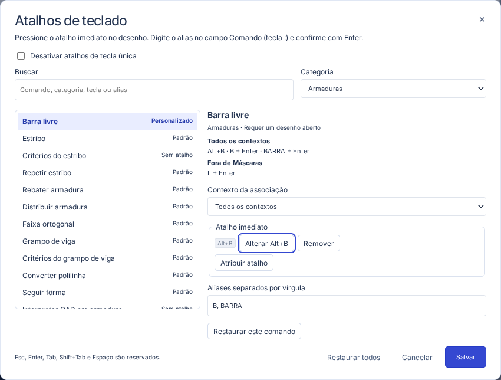
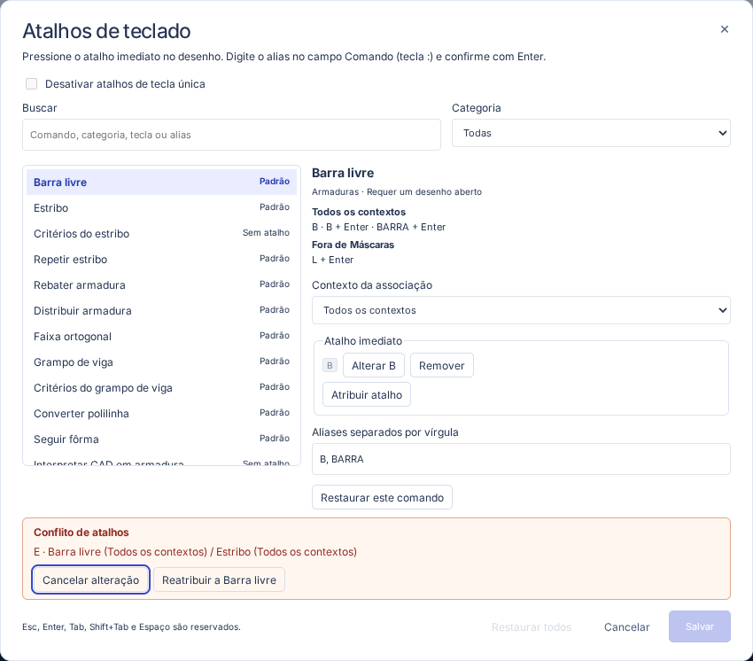
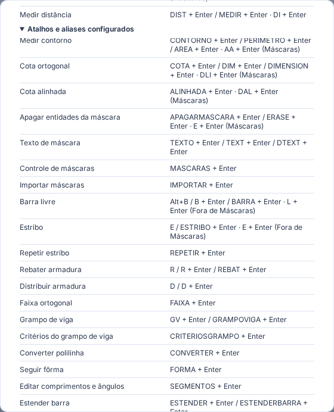

# Atalhos de teclado

Em **Configurações → Atalhos**, busque pelo nome, pela categoria, pela tecla ou pelo alias. Selecione um comando e o contexto em que a associação deve funcionar. **Todos os contextos** se aplica tanto em **Máscaras** quanto **Fora de Máscaras**.

- Pressione o **atalho imediato** no desenho.
- Para executar um **alias**, clique no campo **Comando** ou pressione **:**, digite o alias e confirme com **Enter**. O contexto aparece ao lado do campo. A entrada pendente precisa ser redigitada se o contexto ou o alvo mudar.
- A aba **Máscaras** seleciona o contexto de Máscaras. As demais abas de trabalho usam **Fora de Máscaras**. Abrir **Configurações** preserva o contexto de trabalho e a máscara ativa.

## Padrões de Máscaras

| Alias + Enter | Comando                                         |
| ------------- | ----------------------------------------------- |
| L             | Linha                                           |
| PL            | Polilinha de máscara                            |
| REC           | Retângulo                                       |
| C             | Círculo                                         |
| M             | Mover entidades da máscara                      |
| CO, CP        | Copiar entidades da máscara                     |
| RO            | Rotacionar entidades da máscara                 |
| MI            | Espelhar entidades da máscara                   |
| O             | Offset / paralelas                              |
| TR            | Aparar                                          |
| EX            | Estender                                        |
| MA            | Copiar propriedades                             |
| SC            | Ajustar escala pelos dois pontos                |
| DI            | Medir distância                                 |
| AA            | Medir comprimento, perímetro e área de contorno |
| DLI           | Cota ortogonal                                  |
| DAL           | Cota alinhada                                   |
| E             | Apagar entidades da máscara                     |

Os aliases explícitos **LINHA**, **CIRCULO**, **MPL**, **MOVERMASCARA** e **APAGARMASCARA** continuam disponíveis em ambos os contextos. Selecione e ative a referência no grupo **Referências**. Os comandos usam as mesmas regras de alvo, visibilidade e bloqueio dos botões.

| Entrada                   | Em Máscaras                     | Fora de Máscaras       |
| ------------------------- | ------------------------------- | ---------------------- |
| L + Enter                 | Linha                           | Barra livre            |
| C + Enter                 | Círculo                         | Copiar elementos       |
| M + Enter                 | Mover entidades da máscara      | Mover elementos        |
| PL + Enter                | Polilinha de máscara            | Polilinha de elementos |
| E + Enter                 | Apagar entidades da máscara     | Estribo                |
| MOVER + Enter             | Mover entidades da máscara      | Mover elementos        |
| ROTACIONAR, GIRAR + Enter | Rotacionar entidades da máscara | Rotacionar elementos   |
| ESPELHAR + Enter          | Espelhar entidades da máscara   | Espelhar elementos     |

**B/BARRA**, **ESTRIBO**, **COPY**, **MOVE** e **POLILINHA** mantêm seus destinos explícitos em ambos os contextos. **E** imediato inicia **Estribo** em qualquer aba de trabalho. **E + Enter** na linha de comandos de Máscaras inicia **Apagar entidades da máscara**. **M/C** imediatos continuam acionando a edição de elementos.

## Atalhos imediatos padrão

| Tecla                          | Comando                                                                                     |
| ------------------------------ | ------------------------------------------------------------------------------------------- |
| B, E, R, D                     | Barra livre, Estribo, Rebater, Distribuir                                                   |
| V, H, F                        | Selecionar, Pan, Enquadrar                                                                  |
| M, C, Delete                   | Mover, Copiar, Excluir seleção                                                              |
| Ctrl/Cmd+S, Ctrl/Cmd+O         | Salvar, Abrir                                                                               |
| Ctrl/Cmd+Z                     | Desfazer                                                                                    |
| Ctrl/Cmd+Shift+Z ou Ctrl/Cmd+Y | Refazer                                                                                     |
| F3, F8                         | Encaixes, Ortogonal                                                                         |
| F4                             | Painel lateral                                                                              |
| Ctrl/Cmd+F1                    | Faixa de comandos                                                                           |
| Ctrl/Cmd+0                     | Foco no CAD. Se o navegador reservar a combinação para o zoom, use o botão **Foco no CAD**. |

**Esc**, **Enter**, **Tab/Shift+Tab** e **Espaço** ficam reservados à interação, incluindo cancelar, confirmar, navegar entre controles e deslocar temporariamente o desenho. As associações usam a tecla lógica do layout atual, sem distinção entre maiúsculas e minúsculas. **Ctrl/Cmd** representa Ctrl ou Command. AltGr, teclas mortas e composição de texto são preservados. Se o sistema ou navegador interceptar uma tecla antes da aplicação, use o botão correspondente ou atribua outra combinação.

## Personalizar e restaurar

1. Escolha o comando e o contexto. Use **Atribuir atalho** ou **Alterar** e pressione a combinação. **Esc** cancela a captura, e **Tab** avança para outro controle. Use **Remover** para apagar uma combinação.
2. Edite **Aliases separados por vírgula**. Um alias começa com letra. Caixa e acentos são normalizados. Limpar o campo remove os aliases do contexto selecionado. Enter ou a mudança de foco aplica o valor ao rascunho.
3. Um conflito indica os dois comandos e contextos. **Cancelar alteração** recupera o rascunho anterior. **Reatribuir** transfere a associação. **Restaurar este comando** passa pela mesma verificação. **Restaurar todos** pede confirmação e repõe os padrões no rascunho.
4. Use **Salvar** para gravar as preferências neste dispositivo e atualizar a ajuda dos botões e do **Guia de uso**. **Cancelar** ou fechar descarta o rascunho. As preferências acompanham o perfil local da aplicação e são independentes dos arquivos de projeto.

A opção **Desativar atalhos de tecla única** suspende as teclas sem modificadores, inclusive teclas de função. Os aliases e os botões continuam disponíveis.

