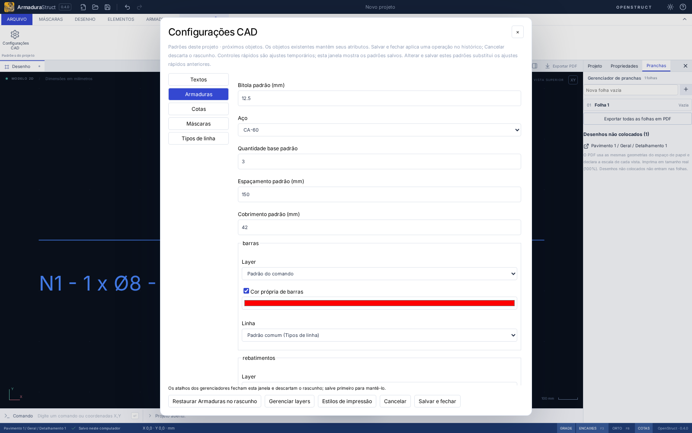
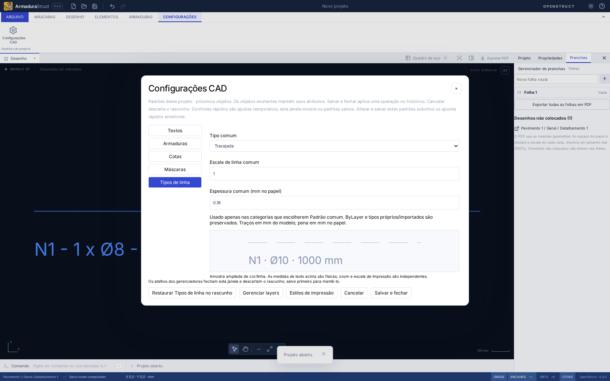
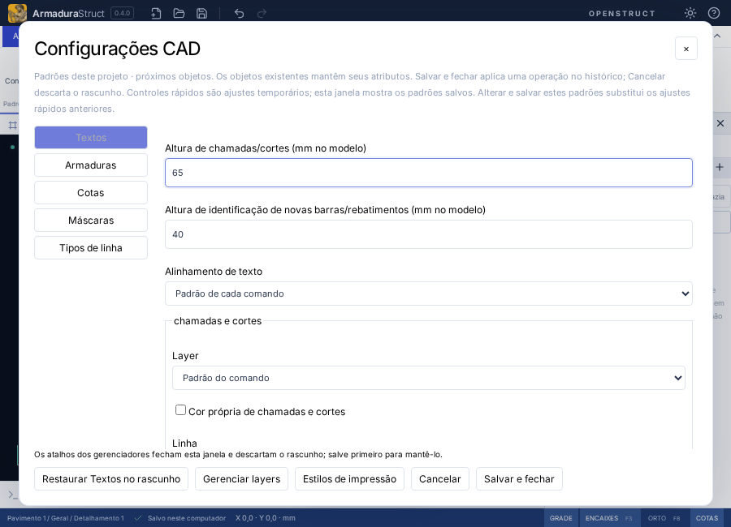

# Configurações CAD

Abra **CONFIGURAÇÕES → Configurações CAD**. A janela reúne **Textos**, **Armaduras**, **Cotas**, **Máscaras** e **Tipos de linha**. Abrir/consultar não cria histórico nem muda os objetos. A navegação permite novas seções no ribbon e novas categorias nesta janela, sem um segundo gerenciador de layers.

1. Escolha a categoria e confira o alcance indicado.
2. Edite os padrões. Campos numéricos indicam mm do modelo ou do papel; cor e tipo de linha têm amostra visual ampliada.
3. **Salvar e fechar** valida e aplica os padrões deste projeto em uma operação de histórico. **Cancelar**, Esc e × descartam o rascunho ainda não salvo.
4. **Restaurar [categoria] no rascunho** restaura só a categoria aberta. A mudança só vale depois de Salvar e fechar.

## Alcance e controles rápidos

São padrões **do documento**, salvos no JSON e na recuperação automática. Não há template pessoal, conta, preset externo ou sincronização nesta entrega. Projetos novos sem configuração usam os valores de fábrica; abrir projeto A depois de B carrega os padrões de A.

Os controles rápidos de Armaduras representam **ajustes temporários** de lançamento. Inicializam a partir dos padrões salvos, usam os mesmos campos (bitola, quantidade, espaçamento e cobrimento) e preservam o comportamento de sessão por desenho. Alterar o controle rápido não grava um novo padrão. Alterar e salvar padrões na janela reinicia os controles rápidos com os novos valores, conforme aviso na própria janela; desfazer/refazer padrões restaura seus valores. Aço vem do padrão do projeto; ajustes específicos de famílias, mandril e premissas continuam nos comandos existentes.

A janela mostra os padrões salvos, e o ribbon mostra os valores temporários efetivos. Uma barra selecionada nunca fornece marca, origem, ID, quantidade de ocorrências ou fatores de repetição à configuração.

| Categoria      | Campos e consumidores                                                                                                                                                                                                                                                            |
| -------------- | -------------------------------------------------------------------------------------------------------------------------------------------------------------------------------------------------------------------------------------------------------------------------------- |
| Textos         | Altura de novas chamadas/cortes e textos de faixas de novas barras (50 mm de fábrica); identificação de novas barras/rebatimentos (40 mm); alinhamento padrão ou o próprio de cada comando; aparência separada das chamadas e identificações. Textos importados são preservados. |
| Armaduras      | Bitola (8 mm), aço (CA-50), quantidade base (1), espaçamento (150 mm) e cobrimento (30 mm) de fábrica; aparência separada de novas barras e rebatimentos. Os valores são parâmetros de edição, não prescrições normativas.                                                       |
| Cotas          | Altura de novas cotas ortogonais/alinhadas (50 mm); cotas automáticas de novas barras/rebatimentos (40 mm); aparência. Unidades, precisão e arredondamento avançados permanecem no escopo AS-28/29.                                                                              |
| Máscaras       | Opacidade de novas máscaras nativas (1); aparência da máscara inteira e de suas novas entidades, separadas; layer e preenchimento sólido/nenhum de entidades fechadas. O desenho local novo em DXF/DWG usa o padrão de entidade.                                                 |
| Tipos de linha | Contínua, Tracejada, Pontilhada e Traço-ponto; escala do padrão e espessura no papel. Usados nas categorias que escolhem **Padrão comum**. Tipos próprios/importados válidos são preservados pelo contrato existente.                                                            |

Cada aparência permite **Padrão do comando** ou um layer por ID, cor própria opcional, **ByLayer**, padrão comum ou um tipo próprio, e pena/escala próprias opcionais. O preenchimento usa o mesmo contrato 2D existente. O padrão de fábrica preserva as cores e heranças anteriores. Não há fonte/peso sem suporte, editor de descrições, novo editor de cotas ou aplicação retroativa em lote.

## Herança e objetos existentes

Salvar padrões não edita layers compartilhados nem as barras, cotas e máscaras já existentes. Quantidade, geometria, comprimento, massa, vínculos, RA e CSV permanecem iguais nessa operação.

Na criação, somente os atributos escolhidos são materializados no novo objeto. Um layer escolhido continua ligado por ID, e os atributos sem override continuam ByLayer. Quando a categoria escolhe padrão comum, os atributos comuns são copiados para aquele novo objeto, preservando sua apresentação ao mudar o padrão depois. As alturas/alinhamentos de apresentação são guardados no objeto. Cópia, duplicação profunda e edição preservam esses dados; não reinterpretam a peça com preferências novas. A API pública usa o mesmo caminho de criação e respeita propriedades explicitamente fornecidas pelo produtor.

Alterar a aparência do **próprio layer** continua sendo outra operação: pode atualizar todos os objetos que o herdam, preservando overrides. **Gerenciar layers** e **Estilos de impressão** abrem os gerenciadores existentes e fecham a configuração, descartando seu rascunho ainda não salvo. Para manter mudanças, salve primeiro. Layers referenciados nos padrões precisam ser reassociados nas Configurações CAD antes de serem removidos; IDs de layers renomeados continuam válidos.

Máscaras importadas não recebem automaticamente opacidade, cor, layer ou preenchimento do padrão nativo. Unidade, escala, posição e rotação não são estilos e não mudam junto dos padrões. O arquivo DXF/DWG externo permanece intacto. A máscara inteira mantém a precedência existente: overrides explícitos do objeto máscara prevalecem sobre os da entidade; a amostra de uma categoria mostra seus próprios atributos. Máscaras/layers ocultos ou bloqueados não são desbloqueados; uma configuração que escolha destino protegido pode impedir a criação, com a orientação das ferramentas existentes. Opacidade zero mantém a proteção contra desenhar num alvo invisível.

## Tela, papel e exportação

`cadDefaults` concentra resolução/validação. `drawingPrimitives`, `drafting`, representações, composição e exportadores compartilham as alturas e estilos materializados. Alturas e padrões de traços são em mm do modelo; espessuras são em mm no papel. Zoom não altera dados. A **altura de papel por vista** existente continua prevalecendo na composição; não se aplica escala duas vezes.

Os estilos de impressão existentes continuam independentes: presets monocromático/cinza e overrides de plotagem podem substituir cores/penas na saída, sem mudar o CAD. Opacidade de máscara segue a visualização CAD existente; a saída vetorial usa as penas/cores do exportador atual. Não se acrescentou exportação DWG nem fidelidade de fontes/blocos além do suporte existente.

A validação reutiliza os limites físicos e de estilos existentes: números finitos, alturas positivas (até 10.000 mm, como o contrato de anotação), bitola/quantidade válidas, cor hexadecimal, escala de linha positiva e penas CAD suportadas pelo DXF. Um erro mantém o rascunho e indica o campo/categoria; tipos personalizados válidos não são trocados por linha contínua.

## Persistência e integração

O projeto salva em **armadurastruct/22**, lendo/migrando versões 1–21. `Project.cadDefaults` é opcional; ausência conserva o comportamento anterior. `LayerBinding.drafting` registra apenas a apresentação dos novos objetos. Uma declaração antiga que inclua novos campos é recusada com indicação de versão; os dados não são descartados silenciosamente. Trocar de projeto fecha o rascunho. Se o estado do projeto mudar durante a janela, a confirmação fica inválida e orienta reabertura, evitando sobrescrever o estado novo.

O pacote **openstruct.detail/13** lê versões 1–12 e leva as alturas, alinhamentos, bindings e estilos materializados nos objetos. Converte unidades e remapeia layers pelo merge existente. **Os padrões globais do produtor não são enviados nem substituem os do destino**; a aparência dos objetos transferidos continua portável.

Arquivos principais: `src/domain/cadDefaults.ts`, `layerSchema.ts`, `types.ts`, `model.ts`, `rebarApi.ts`, `nativeMasks.ts`, `maskDrawing.ts`, `layers.ts`, `detailPackage.ts`, `drafting.ts`, `drawingPrimitives.ts`, `representations.ts`; `src/components/CadSettingsDialog.tsx`, `Ribbon.tsx`, `CadCanvas.tsx`; `src/App.tsx`, `src/api.ts` e `src/styles.css`. Testes em `tests/cadDefaults.test.ts` e `tests/e2e/cadSettings.spec.ts`, além das regressões existentes e atualização das expectativas de versões.

As verificações interativas disponíveis usam Chromium web em Linux. Tauri Linux/Windows compartilha o domínio/interface, mas não foi executado interativamente neste ambiente.

## Validação da entrega — 08/11/2026

`npm run check`: **466 testes de domínio/importação e 6 de distribuição aprovados**. `npm run build` e `npm run format:check` aprovados. A suíte completa de navegador aprovou **120 cenários**; os quatro fluxos de configurações também foram reexecutados após os ajustes finais de interface e apresentação.

As verificações cobrem criação nas cinco categorias, rascunho/erro/restauração, histórico, recuperação, troca de projeto, snapshots, fábrica, referências ByLayer/overrides, tipo customizado, geometria/CSV invariantes, unidades de intercâmbio mm/cm/m, alturas de papel 1:50 e 1:100, Foco/janela compacta e cancelamento por teclado. As capturas são dos fluxos automatizados. Os instaladores nativos não foram executados interativamente neste ambiente.
