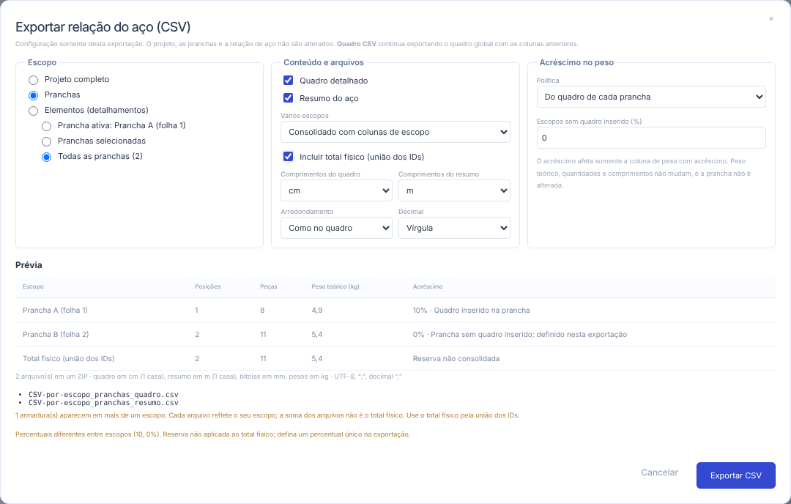

# CSV da relação do aço por escopo

**Arquivo → Exportar → CSV por escopo** exporta o quadro detalhado e/ou o resumo do aço do projeto completo, de pranchas ou de elementos selecionados. A configuração vale somente para a exportação: não altera o projeto, as pranchas, a relação de aço, o estado de salvo nem o histórico. Cancelar fecha o diálogo sem efeito. O foco permanece no diálogo e os atalhos globais de edição ficam bloqueados; durante a gravação, aguarde ou cancele o seletor de arquivo para voltar às opções.

**Quadro CSV** continua exportando o quadro global anterior, com as mesmas colunas e semântica.



## Escopos

| Escopo                    | O que entra                                                                                                                                                                                                                              |
| ------------------------- | ---------------------------------------------------------------------------------------------------------------------------------------------------------------------------------------------------------------------------------------- |
| Projeto completo          | Todas as armaduras físicas do projeto.                                                                                                                                                                                                   |
| Pranchas                  | A mesma fonte do [quadro da folha](QUADRO-NA-PRANCHA.md): armaduras dos detalhamentos colocados e as exibidas por inserções nesses detalhamentos, **uma vez por ID físico**. Prancha ativa, pranchas selecionadas ou todas.              |
| Elementos (detalhamentos) | Armaduras **pertencentes** ao detalhamento (vínculo `hierarchy.objectDetails`). Uma inserção de barra de outro detalhamento não transfere aço. Lista identificada por pavimento › grupo › detalhamento; seleção por ID, nunca pelo nome. |

Vistas repetidas, inserções da mesma barra, visibilidade, zoom, escala de impressão e ocultação gráfica não alteram o quantitativo. Pranchas e elementos com nomes iguais permanecem separados (por exemplo, **Térreo › Vigas › V1** e **Superior › Vigas › V1**); nomes ainda idênticos recebem o início do ID.

Os quantitativos usam o motor atual da relação do aço, restrito aos IDs do escopo. Quantidade base, multiplicador da armadura e repetição do detalhamento são aplicados uma única vez. Uma posição de fabricação compartilhada mantém o mesmo ID e identificação e soma apenas as contribuições do escopo. Posições e grupos de fabricação não são renumerados.

**Detalhamento repetido** (por exemplo, V1 = V3 = V5 · 3×) sai como conjunto: a quantidade efetiva já inclui o fator, e a coluna _Repetição do detalhamento_ informa que não há rateio por elemento. O modelo não guarda contribuições individuais de cada elemento representado, então o aplicativo não inventa uma divisão.

## Vários escopos e total físico

- **Arquivos separados por escopo** ou **consolidado com colunas de escopo** (tipo, nome, contexto e ID estável).
- Quadro e resumo são arquivos distintos, com cabeçalhos próprios. Com mais de um arquivo, o download é um **ZIP**.
- Uma armadura pode aparecer em várias pranchas. Cada arquivo reflete a sua folha, e a prévia avisa que **a soma dos arquivos não é o total físico**.
- **Incluir total físico (união dos IDs)** acrescenta um escopo calculado pela união dos IDs físicos antes de agregar.

## Acréscimo no peso

O resumo mostra separadamente **peso teórico**, **acréscimo (%)**, a **origem do acréscimo** e o **peso com acréscimo**. Quantidades e comprimentos nunca mudam: 100 kg com 10% resultam em 110 kg.

- **Do quadro de cada prancha** (padrão): pranchas com quadro inserido usam o percentual configurado naquela folha. Pranchas sem quadro, elementos e o projeto usam o valor informado no diálogo (padrão **0%**). A origem aparece no arquivo; não há 10% implícito.
- **Mesmo valor para todos**: sobrescreve somente nesta exportação; a prancha não é alterada.
- **Sem acréscimo**: 0% em todos os escopos.

No total físico, o acréscimo só é aplicado quando todos os escopos usam o mesmo percentual. Com percentuais diferentes, o total físico mostra o peso teórico e informa que a reserva não foi consolidada.

## Unidades e formato

- Comprimentos do quadro em **cm** (padrão) ou m; do resumo em **m** (padrão) ou cm. Bitolas em mm e pesos em kg. As unidades estão nos cabeçalhos.
- **Como no quadro (0,1)** usa as mesmas casas do quadro visual da prancha; com unidades iguais, os valores conferem. **Ampliado** usa 0,01 cm, 0,001 m e 0,001 kg. O cálculo usa precisão completa e só a apresentação é arredondada.
- Comprimentos variáveis informam _Comprimento variável = Sim_, a faixa (`100,0-120,0`), mínimo, máximo e as contribuições, sem sugerir peças idênticas.
- UTF-8 com BOM, separador `;`, CRLF e decimal vírgula (ou ponto, se escolhido), inclusive na coluna de acréscimo percentual. Todos os campos ficam entre aspas, aspas são duplicadas, e textos iniciados por `=`, `+`, `-`, `@`, tabulação ou retorno recebem `'` para não virarem fórmula. Não há macros nem dados externos.
- Nomes: `<projeto>_<escopo>_<quadro|resumo>.csv`, sem acentos ou caracteres inválidos, e `<projeto>_relacao-aco_<pranchas|elementos|projeto>.zip`.

## Bloqueios e mensagens

A exportação usa os mesmos bloqueios do CSV global: RA bloqueada e desatualizada, geometria inválida e anotações inválidas. Sem seleção, com prancha ativa ausente, item removido ou escopo sem armaduras, a prévia mostra a mensagem e o botão fica desativado. Nunca se exporta outro escopo no lugar. As seleções guardam IDs do projeto aberto; trocar de projeto recria o diálogo e descarta as seleções anteriores.

## Colunas

**Quadro:** tipo/nome/contexto/ID do escopo, posição, ID da posição de fabricação, elemento, aço, bitola, quantidade base, multiplicador, quantidade por detalhe, repetições, quantidade efetiva, fórmula, comprimento variável, comprimento unitário/mínimo/máximo/total, peso teórico, origem da quantidade, observação, nervura, C/NERV, lance, repetição do detalhamento, detalhamentos de origem, IDs dos detalhamentos, IDs físicos e contribuições (JSON).

**Resumo:** escopo, linha (_Bitola_ ou _Total do aço_), aço, bitola, comprimento total, peso teórico, acréscimo (%), origem do acréscimo e peso com acréscimo.

## API

```ts
import { resolveScopes, buildScopedSchedule } from './src/api';

const { scopes, issues } = resolveScopes(project, {
  kind: 'sheets',
  mode: 'all',
  sheetIds: [],
});
const data = buildScopedSchedule(
  project,
  scopes,
  { mode: 'scope', percent: 0 },
  { physicalTotal: true },
);
```

A serialização (`planScopedCsv`, `packageCsvFiles`) fica em `src/lib/scopedCsv.ts`. PDF e DXF não mudam.
