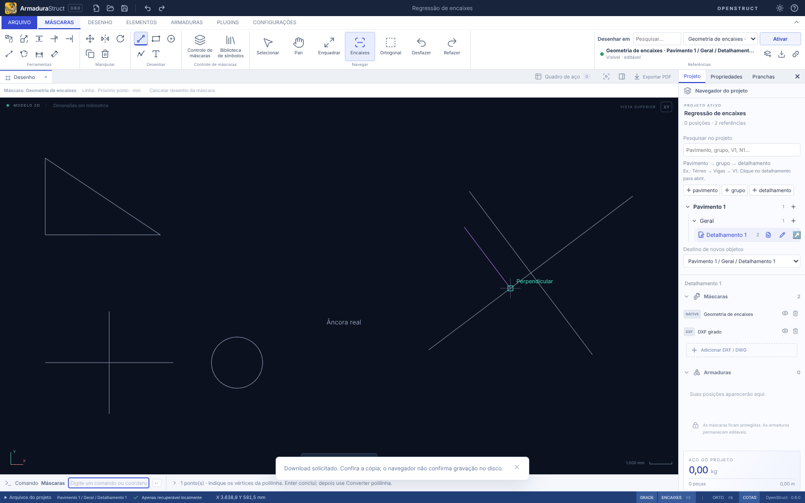
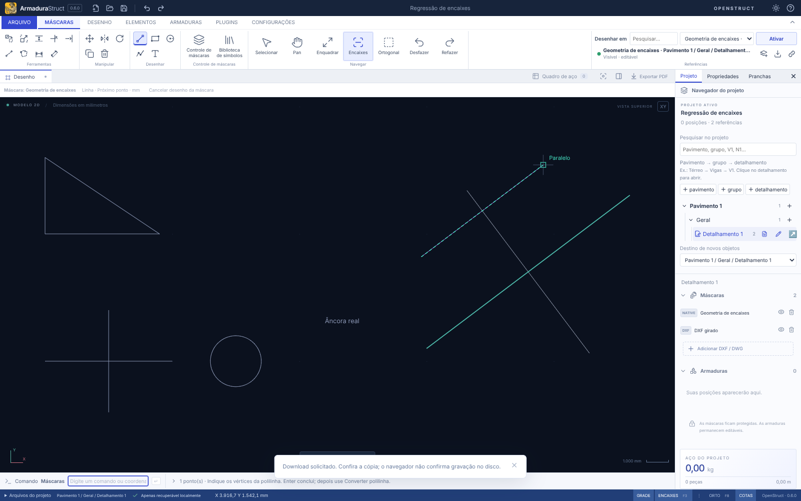

# Encaixes de objetos no CAD 2D

Abra **CONFIGURAÇÕES → Preferências → Modos de encaixe**, use o botão **⋮** junto de **ENCAIXES** na barra inferior ou digite `OSNAP` / `MODOSENCAIXE`. Marque os modos e escolha **Aplicar modos**. Cancelar descarta o rascunho da janela; Restaurar padrões deixa apenas Extremidade e Ponto médio ligados.

As escolhas valem para a sessão do aplicativo, sem alterar o projeto, o histórico ou seu formato. O comando **Encaixes**, disponível nos acessos anteriores e com atalho padrão **F3**, continua ligando/desligando a captura inteira. A tecla pode ser reatribuída na central de atalhos. Os novos modos começam desativados.

O marcador mostra o modo e o ponto efetivamente capturado. Prévia e clique usam a mesma resolução, em coordenadas do modelo, com abertura de **10 pixels** convertida pelo zoom. **ORTO conserva a precedência anterior**: se a restrição deslocar o ponto mais de 0,001 mm, o marcador é suprimido e o ponto aplicado é o ortogonal.

## Modos por pontos e curvas — #163

| Modo               | Geometria elegível                                                   | Limites                                                                                                                    |
| ------------------ | -------------------------------------------------------------------- | -------------------------------------------------------------------------------------------------------------------------- |
| Extremidade        | Vértices e pontos já capturáveis das cadeias existentes              | Preserva a semântica anterior, inclusive pontos amostrados; não os converte em Nó.                                         |
| Ponto médio        | Meio dos trechos já disponíveis                                      | Mesmos trechos e ordem de desempate da implementação anterior.                                                             |
| Centro             | Círculo ou arco analítico                                            | Não infere centros de polilinhas amostradas.                                                                               |
| Centro geométrico  | Contorno fechado válido ou círculo analítico                         | Centro de área, não média de vértices. Contornos abertos, degenerados, autocruzados ou sobrepostos não oferecem candidato. |
| Quadrante          | Círculo ou arco analítico                                            | Direções dos eixos do modelo a 0°, 90°, 180° e 270°; em arcos, apenas dentro da varredura.                                 |
| Interseção         | Trechos finitos e curvas analíticas disponíveis                      | Sem prolongamento; sobreposições colineares e círculos coincidentes não produzem um ponto arbitrário.                      |
| Ponto mais próximo | Geometria efetivamente disponível                                    | Projeção limitada ao trecho/arco; em importações amostradas, usa a aproximação retida.                                     |
| Inserção           | Âncora preservada de texto nativo ou texto normalizado da importação | Não usa o centro da caixa do texto nem tenta reconstruir inserções de blocos expandidos.                                   |
| Nó                 | Entidade de ponto identificável                                      | O formato/importador atuais não expõem essa entidade. O modo não oferece candidatos a partir de vértices ou de amostras.   |
| Perpendicular      | Segmento finito ou círculo/arco analítico                            | Exige base efetiva e pé dentro da geometria; não prolonga implicitamente um segmento.                                      |
| Tangente           | Círculo/arco analítico                                               | Exige base exterior; soluções fora da varredura não participam.                                                            |
| Extensão           | Segmento ou arco analítico com extremo adquirido                     | Continua para fora do extremo durante o comando; não se aplica a círculo fechado ou arco perdido na amostragem.            |
| Paralelo           | Direção adquirida de segmento capturável                             | Exige base e comando que crie trecho linear; a referência pode estar rotacionada e ser somente de leitura.                 |

Os pontos discretos dentro da abertura têm prioridade sobre Ponto mais próximo. Entre eles vence a menor distância ao cursor; empates mantêm a ordem estável da cena, com os pontos extras dos comandos antes das cadeias antigas. Interseções usam ordem determinística dos pares. Um centroide de polígono importado descreve a **área da aproximação retida**, não o centro analítico de uma curva perdida.

### Máscaras, captura e proteção

As máscaras têm origem, escala e rotação aplicadas uma única vez. Centros, quadrantes e cruzamentos são resolvidos no referencial do modelo, independentemente de pan e zoom. Novos modos compartilham a elegibilidade de captura do canvas: objetos/camadas indisponíveis não participam. Capturar uma referência somente de leitura não a torna editável.

O DXF/DWG pode conter apenas cadeias amostradas após a normalização. Nesses casos não há centro, quadrante ou outra informação analítica reconstruída. Blocos expandidos não recebem âncoras inventadas. Não houve alteração no importador nem migração do arquivo de projeto.

## Perpendicular e tangente — #164

Ative **Perpendicular** ou **Tangente**, inicie um comando que peça pontos e escolha primeiro sua base. Aproximar o cursor da referência oferece a relação válida mais próxima. Sem base não há candidato desses modos. No círculo, o cursor distingue as duas tangências possíveis; em um arco só participam as soluções dentro da varredura. Uma base interior ou sobre a curva não gera uma tangente de comprimento nulo.

A perpendicular de um segmento precisa cair dentro dele; o modo não prolonga a referência. Em curvas circulares, usa a direção radial válida, sem escolher uma direção arbitrária se a base coincidir com o centro. Tangência exige círculo ou arco analítico, inclusive quando o desenho local analítico pertence a uma máscara importada.

A base vem dos pontos efetivos do comando: desenho de linhas/polilinhas/barras, medição/cotagem e etapas de dois pontos já encaminhadas ao canvas, como calibração e manipulação de máscaras. Transformações fornecem a base escolhida explicitamente. Edições de vértices/comprimentos que projetam a entrada não usam essas novas relações; suas capturas anteriores permanecem. Esc, troca ou reinício de comando descartam a base contextual. ORTO mantém a mesma precedência.

## Extensão e paralelo — #165

As referências adquiridas ficam realçadas em verde. A guia aparece tracejada apenas quando o cursor se aproxima de sua continuação, dentro da mesma abertura de **10 pixels** dos demais encaixes. O marcador identifica o modo, e a prévia e o clique usam exatamente sua coordenada.

**Extensão:** ative o modo, inicie um comando que peça pontos e passe o cursor junto do extremo desejado de um segmento ou arco analítico. Afaste o cursor acompanhando o prolongamento: um segmento continua para fora do extremo adquirido; o arco continua sua circunferência e o sentido de varredura naquele extremo. No extremo inicial, a continuação segue o sentido oposto ao percurso original. A extensão do arco não volta sobre o trecho original. Círculos fechados não têm extremos. Não é necessário clicar na referência, nem alterá-la.

**Paralelo:** ative o modo, inicie um comando que crie um trecho linear, como Linha, Polilinha ou Barra, e escolha a primeira ponta. Passe o cursor sobre um segmento capturável para adquirir sua direção. Leve o cursor próximo da paralela que passa pela base escolhida e confirme a segunda ponta. Uma máscara rotacionada fornece a direção já transformada no modelo. Sem base ou em comandos de círculo/retângulo não há guia paralela.

Não há guia sem aquisição. Afastar o cursor conserva a referência apenas durante a etapa do comando; Esc, troca/reinício de comando, F3 desligado, mudança de base ou indisponibilidade da referência descartam a aquisição. Ocultar a máscara ou desativar sua captura exige adquiri-la novamente ao recuperá-la. Pan e zoom mantêm a referência válida, com abertura visual constante. A guia não entra no histórico, no arquivo, nas pranchas ou nas exportações. ORTO continua tendo precedência; se deslocar o resultado, o marcador e a guia desse candidato são suprimidos.

## Cena densa

Os índices espaciais são preparados quando a cena muda e reutilizados durante movimento do cursor e navegação. A busca de interseções considera somente as curvas junto da abertura de captura. Em uma abertura excepcionalmente saturada, o limite de 250 mil comparações interrompe a busca de interseções e informa para aproximar o zoom; um vencedor parcial dessa busca não é mostrado como se fosse definitivo. Os outros modos continuam disponíveis.

## Conferência

[Resultados completos dos testes e comparação na cena densa](VALIDACAO-ENCAIXES-CAD.md).

Os testes de domínio incluem os casos numéricos literais das issues, comparação com o resolvedor antigo, curvas finitas, contornos inválidos, âncoras, transformações e uma cena de 20 mil entidades. As regressões de navegador verificam marcador, prévia e coordenada gravada em dois zooms, F3, ORTO, captura protegida e ausência de mudanças no projeto ao configurar modos. A calibração por dois pontos permanece coberta por sua suíte existente.

Referência de comportamento: [modos de encaixe da Autodesk](https://help.autodesk.com/cloudhelp/ENU/AutoCAD-Web-Help/files/Drafting-and-Creating/AutoCAD_Web_Help_Drafting_and_Creating_Osnap_html.html). A entrega é limitada ao CAD 2D; não implementa interseção aparente por profundidade nem rastreamento F11.
