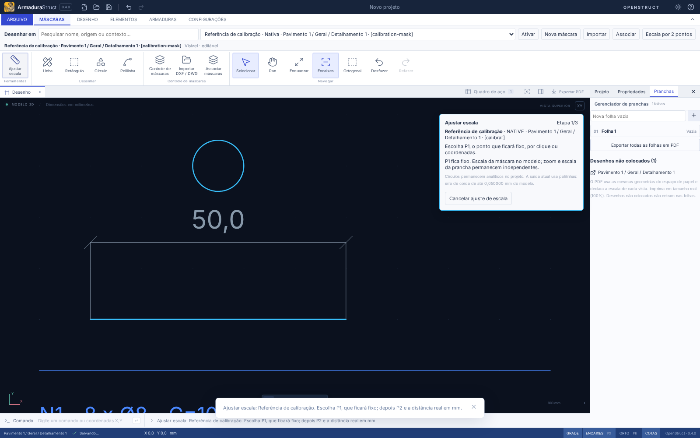
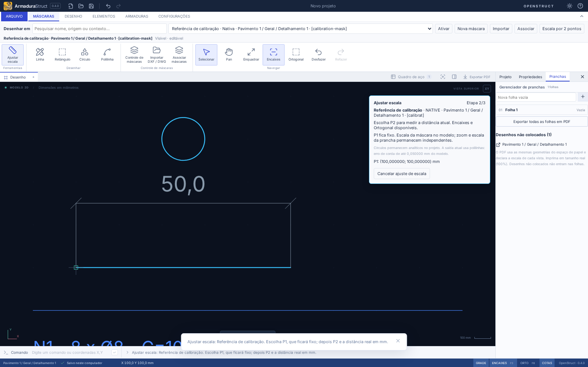
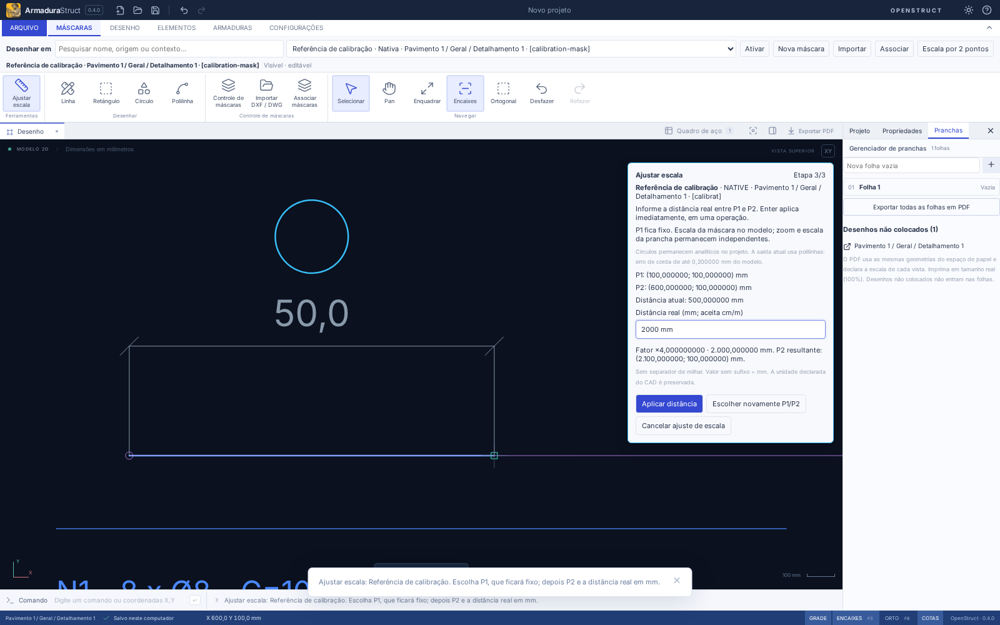
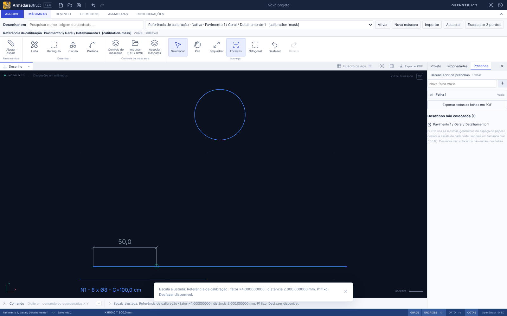
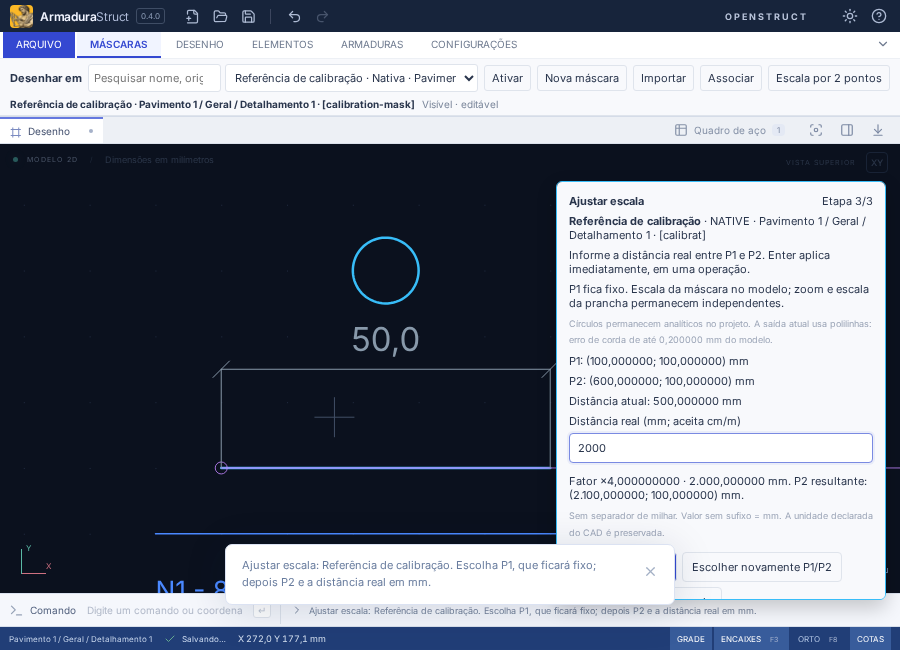

# Ajustar escala da máscara por dois pontos

## Uso

1. Na aba **Máscaras**, escolha e **ative** a referência desejada. Abra seu desenho/detalhamento quando estiver em outra vista ou na prancha.
2. Use **Ferramentas → Ajustar escala**. O atalho **Escala por 2 pontos**, junto ao destino da máscara, continua acessível em modo Foco e com a faixa recolhida. O comando CAD é `CALIBRARMASCARA`.
3. Confira nome, origem, caminho e ID do alvo no painel. Clique em **P1**, que ficará fixo. Aceita os encaixes existentes e coordenadas do modelo pelo campo Comando CAD.
4. Escolha **P2**, com encaixes e Ortogonal quando ligados. Coordenadas absolutas, relativas e polares usam o mesmo fluxo do CAD. Exemplo: P1 `100,100`, P2 `600,100`, ou P2 relativo `@500,0`.
5. Confira a distância atual em **mm do modelo**. Informe a distância real, por exemplo `2000`, `2000 mm`, `200 cm` ou `2 m`. Decimal pt-BR é aceito: `2,5 m` = 2500 mm. Não use separador de milhar; `1.000,0` é rejeitado para evitar ambiguidade.
6. **Enter no campo de distância**, **Aplicar distância** ou uma medida no Comando CAD aplica imediatamente em uma transação. Não é necessário abrir propriedades nem confirmar outra janela. O resultado informa fator e medida; **Desfazer/Refazer** restaura a transformação inteira.

O Controle de máscaras também oferece **Ajustar escala desta máscara por 2 pontos** para a referência explicitamente escolhida e aberta no contexto correto. Esse acesso não redefine silenciosamente a máscara ativa para desenho nativo. Selecionar uma barra não a transforma em alvo de calibração.

## O que muda

Todos os pontos medidos já estão no espaço físico do modelo, em milímetros. Para distância atual `d` e distância real `D`, o fator é `f = D/d`. A aplicação é uniforme:

`P' = P1 + f × (P − P1)`

O contrato existente permite implementar isso alterando apenas:

- `mask.scale' = mask.scale × f`;
- `mask.origin' = P1 + f × (mask.origin − P1)`.

A rotação permanece a mesma. A unidade/fator de importação já aplicado participa da distância medida e não é multiplicado novamente. `sourceUnit` continua registrando a unidade declarada original; a calibração não a reescreve.

No caso P1=(100,100), P2=(600,100), D=2000 mm, o fator é 4. P1 permanece (100,100), P2 passa a (2100,100). Para uma máscara com origem (0,0) e escala 1, a nova origem é (−300,−300) e a escala é 4.

IDs, geometria local, estilos, layers, proporções, avisos, origem de intercâmbio e associação ao detalhamento são preservados. Círculos nativos mantêm centro/raio analíticos locais; seu raio físico é o raio local multiplicado pela nova escala. Textos acompanham a transformação pela mesma infraestrutura já usada na máscara. Não se criam entidades de aço nem se alteram barras, cotas externas, outras máscaras, RA/CSV ou colocações na folha.

Zoom e pan só mudam a câmera. As escalas 1:50 e 1:100 das vistas continuam próprias: uma linha calibrada para 2000 mm mede 40 mm e 20 mm no papel. Se a máscara maior extrapolar o quadro, o validador existente aponta o transbordamento e bloqueia o PDF, sem recorte silencioso. Revise a composição da vista explicitamente quando necessário.

## Prévia, proteção e cancelamento

O alvo recebe realce temporário e a referência P1/P2 aparece na captura. Distância, fator e P2 resultante podem ser conferidos antes de aplicar. Nada disso é salvo como geometria de desenho.

- Esc cancela nas três etapas. Cancelar, escolher novamente P1/P2 ou sair para outra ferramenta não cria objetos parciais.
- Trocar projeto, desenho/detalhamento, máscara ativa, alvo de propriedades, aba ou contexto invalida o comando. Uma alteração concorrente do documento também o cancela. A confirmação verifica novamente projeto, identidade do alvo e proteções.
- Layers desligados, sem captura ou bloqueados, ocultação da máscara e camadas internas protegidas não são liberados automaticamente. Como o fator transforma a máscara inteira, reexiba/libere explicitamente as camadas que precisam participar.
- Distância inválida conserva os pontos e o campo para correção. P2 coincidente/abaixo da tolerância conserva P1 e pede outro P2.
- Medida igual à atual (incluindo apenas erro de máquina até 8 × epsilon relativo) é neutra: não altera o projeto nem cria histórico. Cliques/Enter repetidos não reaplicam o fator.
- Salvar durante a preparação guarda o projeto original; pontos e distância em rascunho não são persistidos. Salvar/reabrir, recuperação e pacotes de detalhamento guardam a transformação confirmada pelos contratos existentes, sem nova versão de schema.

## Precisão e limites reais

A tolerância mínima entre os pontos e para a distância real é **0,000001 mm**, independente do zoom. Reutiliza-se o envelope de coordenadas das transformações existentes: **±1.000.000.000 mm**, distância até 1.000.000.000 mm e escala positiva até **1.000.000**, já admitida pelo schema da máscara. O resultado é conferido contra perda de precisão relativa de 1e−8; valores que colapsariam por limites numéricos são recusados, em vez de arredondar a geometria. A formatação visual não altera os números armazenados.

A ferramenta transforma as entidades normalizadas que o editor já suporta. Não muda o arquivo DXF/DWG de origem, não reconstrói entidades omitidas pelo importador e não acrescenta suporte a formatos/curvas novos. Curvas importadas mantêm a aproximação já existente. Para círculos nativos, o projeto continua analítico; canvas/PDF/DXF usam o caminho de polilinhas existente, com erro radial de corda de até **0,05 × escala final da máscara mm** no modelo. Esse limite é informado no painel antes da confirmação. Os textos seguem as métricas e a altura mínima de papel configurada da vista, conforme os contratos atuais de composição/exportação.

## Implementação e verificação

| Arquivos                                                             | Responsabilidade                                                                                                              |
| -------------------------------------------------------------------- | ----------------------------------------------------------------------------------------------------------------------------- |
| `src/domain/maskCalibration.ts`                                      | Alvo/proteções, distância física, transformação com P1 fixo, limites e aplicação somente na máscara                           |
| `src/components/MaskCalibrationPanel.tsx`                            | Etapas, medidas/unidades, prévia numérica, confirmação e correção de erros                                                    |
| `src/App.tsx`                                                        | Contexto transitório, captura de pontos, comando CAD, confirmação única, histórico e invalidação                              |
| `Ribbon.tsx`, `MaskDestination.tsx`, `MaskControl.tsx`               | Acessos compartilhados à calibração do alvo explícito                                                                         |
| `CadCanvas.tsx`, `src/styles.css`                                    | Realce temporário da referência, reutilizando snapping e a câmera existentes; painel compacto                                 |
| `tests/maskCalibration.test.ts`, `tests/fixtures/maskCalibration.ts` | Casos analíticos, mm/cm/m, rotação/translação, círculo/texto, bloqueios, intercâmbio, saídas e duas escalas                   |
| `tests/e2e/maskCalibration.spec.ts`                                  | Clique com snap, teclado/decimal pt-BR, confirmação repetida, erros/Esc, proteção/contexto, histórico, recuperação e DXF real |

O teste dimensional central confere 500→2000 mm com P1 fixo e fator 4. Outros casos conferem distâncias inclinadas com fator prévio em cm/m, raio físico do círculo, alturas de texto, RA bloqueada e invariância de barras/CSV. Não se arredondam asserções para esconder diferenças geométricas; tolerâncias de ponto flutuante e da saída são explícitas.

A validação interativa disponível é no Chromium web em Linux. A interface instalada Tauri Linux/Windows não foi executada neste ambiente.

### Resultado desta entrega

`npm run check`: 489 testes de domínio/importação e 6 de distribuição aprovados. `npm run build` e `npm run format:check` aprovados. A regressão completa passou em 136 cenários E2E; os 9 fluxos de calibração foram executados na rodada final, incluindo o acesso pelo Controle de máscaras com outra máscara ativa. Conferidos PDF de modelo, PDF de prancha com alinhamento explícito sem alterar escalas, DXF e intercâmbio; medidas e quantitativos comparados analiticamente. Capturas acima geradas pelos testes no Chromium web em Linux. Interface nativa Tauri Linux/Windows não executada.
