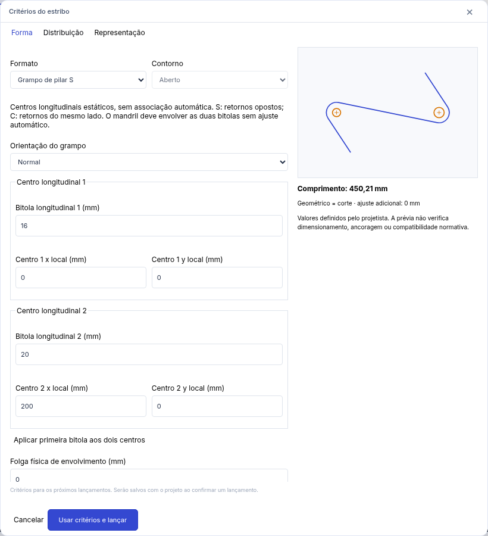
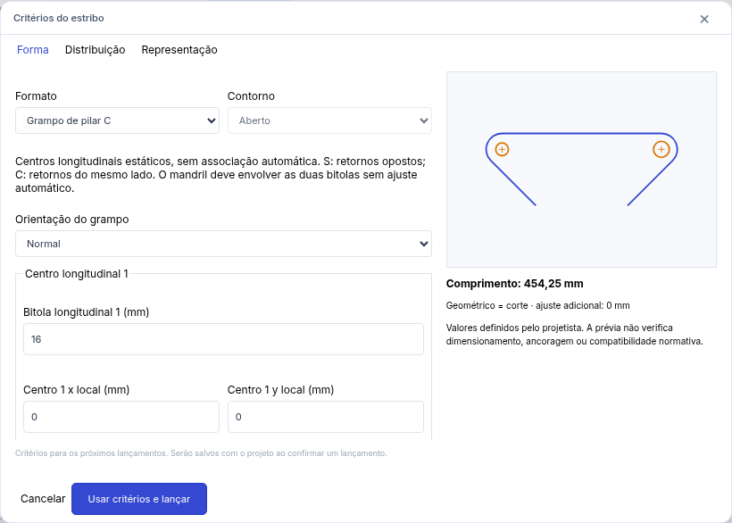

# Grampos de pilar S/C — AS-65

Em **Armaduras → Critérios do estribo**, escolha **Grampo de pilar S** ou **C**. Informe bitola/aço do grampo, mandril interno, bitolas longitudinais independentes, folga física e ganchos. A prévia mostra os círculos físicos e seus centros. O botão de mesma bitola copia o primeiro valor para o segundo; não há inferência pelo tamanho de símbolos.

1. Aceite os critérios e capture o **primeiro centro longitudinal** e o **segundo centro longitudinal**, por snaps ou coordenadas CAD. São dois centros na seção, não extremos de uma faixa. Nenhuma barra longitudinal é criada.
2. Confira a prévia; **Voltar etapa** corrige as capturas. **Editar bitolas / orientação / centros** reabre os parâmetros sem perder o lançamento. Coordenadas locais permitem corrigir ambos os centros; a inserção e a rotação definem seu referencial.
3. Com distribuição, capture separadamente início/fim da faixa e sua identificação. Quantidade manual, passo máximo/fixo e afastamentos seguem as políticas dos estribos.
4. Confira comprimento, quantidade e passo efetivo. **Confirmar lançamento** ou Enter grava uma única operação. Esc descarta a prévia inteira. Enter repetido não duplica a peça; **E** inicia outro lançamento explícito com os últimos critérios.

Selecione uma peça e use **Editar critérios desta posição** para editar seus parâmetros, conservando ID, faixa, multiplicador e quantidade. Todas as representações vinculadas usam a mesma peça. Alterar os critérios gerais configura apenas os próximos lançamentos.

## Convenção geométrica

O par de centros é ordenado. Para orientação normal, o gancho inicial é anti-horário; o final é anti-horário no S e horário no C, medidos no sentido que sai do corpo. Inverter a orientação reflete a peça no eixo que une os centros, preservando a família. Os sentidos aparecem nos critérios e são vinculados à família/orientação; ângulos físicos de 90°, 135° ou 180° e trechos retos permanecem independentes.

Cada curva de envolvimento é centrada na barra correspondente. Ambas usam o raio do eixo **R = (mandril interno + bitola do grampo) / 2**, sem aumento automático. C usa a tangente externa comum dos dois círculos de dobra; S usa a tangente interna. Assim, S tem pontos de tangência em lados opostos e C no mesmo lado. Para distância d entre centros:

- C: trecho de ligação = d.
- S: trecho de ligação = √(d² − 4R²); exige d > 2R.
- Comprimento geométrico = ligação + R × (|θ1| + |θ2|) + dois trechos retos dos ganchos, com θ em radianos.

Exemplo independente: d = 200 mm, grampo Ø8, mandril 32 mm, ganchos de 135° com trechos retos de 30 mm. R = 20 mm. O C mede **354,2477796 mm**; o S mede **350,2069590 mm**. Curvas e extensões são contadas uma única vez pelo motor compartilhado. A discretização gráfica não calcula corte nem valida as interseções: distâncias ao envelope e interseções entre retas/arcos são analíticas.

Bitolas longitudinais diferentes não mudam automaticamente o mandril. Ele deve comportar a maior delas e a folga: R ≥ (Ø longitudinal + Ø grampo)/2 + folga. Uma mudança de bitola pode tornar o lançamento incompatível; isso é informado e impede confirmar. Não se reaplica cobrimento a centros já posicionados. Centros coincidentes, barras sobrepostas, retornos cruzados, mandril insuficiente, medidas inválidas e ganchos sem trecho reto são recusados, sem gravação parcial. Trocar a ordem dos centros troca a identidade das extremidades; para representar a mesma peça, trocar também bitolas e critérios das extremidades, usando a orientação do novo início.

## Referências e fabricação

Esta versão recebe capturas **estáticas de coordenadas**, registradas como `capture: static`, com bitolas manuais. A base não fornece identidade semântica de ocorrência longitudinal neste fluxo. Não há vínculo associativo, reassociação por proximidade ou promessa de atualização após mudança de máscara. Revise os centros após alterações das referências gráficas. As coordenadas locais acompanham mover, girar, espelhar e copiar a peça.

O ajuste adicional de fabricação é **zero**, sem campo de acréscimo nesta entrega. **Comprimento geométrico = comprimento final de corte**. Ganchos ocultos, cotas, escala e novas representações não alteram comprimento nem massa. Canvas, prancha, PDF e DXF usam a mesma cadeia; DXF conserva os arcos analíticos. RA e CSV usam o mesmo comprimento físico. A assinatura de fabricação distingue curvas, sentidos, material, bitola e mandril; não agrupa S/C apenas por comprimento.

Cada lançamento é uma peça física própria com sua quantidade. Para dois grampos por estação, lance as duas peças com suas definições/faixas: **11 × 2 = 22 peças**. Multiplicador 2 e repetição 3 dão **132 peças**, aplicados uma vez. Não há novo sistema de conjuntos; a futura composição de múltiplos ramos pode reutilizar o gerador. A RA bloqueada preserva o snapshot e detecta mudanças de perfil.

## Arquivo e validação

Formato nativo **armadurastruct/31**, pacote **openstruct.detail/20**. A leitura dos formatos nativo /28 e /30 e dos pacotes /17 e /19 é preservada, inclusive grampos de viga e suas vistas vinculadas. As versões /29 e /18 continuam reservadas à contribuição de telas soldadas (#128), ainda não integrada. O [schema JSON v20](openstruct-detail-v20.schema.json) descreve o pacote atual. Projetos antigos mantêm sua geometria; perfis livres/legados não são convertidos em grampos. Pacotes mm/cm/m convertem centros, bitolas longitudinais e folga uma vez; contagens e fatores × bitola permanecem adimensionais.

Os testes cobrem fórmulas independentes, tangências, envelopes, S/C, orientação, ordem, entradas inválidas, 132 peças, RA bloqueada, API, persistência e intercâmbio. Os fluxos Chromium cobrem coordenadas, prévia, correção, confirmação, cancelamento, histórico e recuperação. Capturas: [centros](column-clamp-center-selection.png), [prévia](column-clamp-preview.png), [confirmado](column-clamp-confirmed.png). Validação em navegador não equivale a interação nativa Linux/Windows.

O domínio valida apenas a construção geométrica e os dois envelopes informados. Não verifica todas as interferências da seção, dimensionamento do pilar, ancoragem, confinamento ou conformidade normativa.

## Resultados desta contribuição

- `npm run check`: 59 arquivos, 804 testes unitários aprovados; 6 testes de distribuição e validação do plugin de exemplo aprovados.
- `npm run build`: aprovado.
- `npm run format:check`: aprovado.
- `ARMSTRUCT_CHROMIUM=/usr/bin/chromium ARMSTRUCT_CHROMIUM_ARGS='["--no-sandbox"]' npx playwright test tests/e2e/columnClamps.spec.ts tests/e2e/stirrups.spec.ts`: 6 fluxos aprovados, incluindo janela baixa e regressões retangular/circular/livre.
- Interação nativa desktop Linux/Windows não executada. Capturas e fluxos foram verificados no Chromium.
