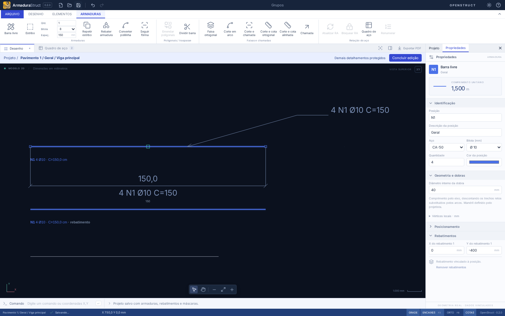
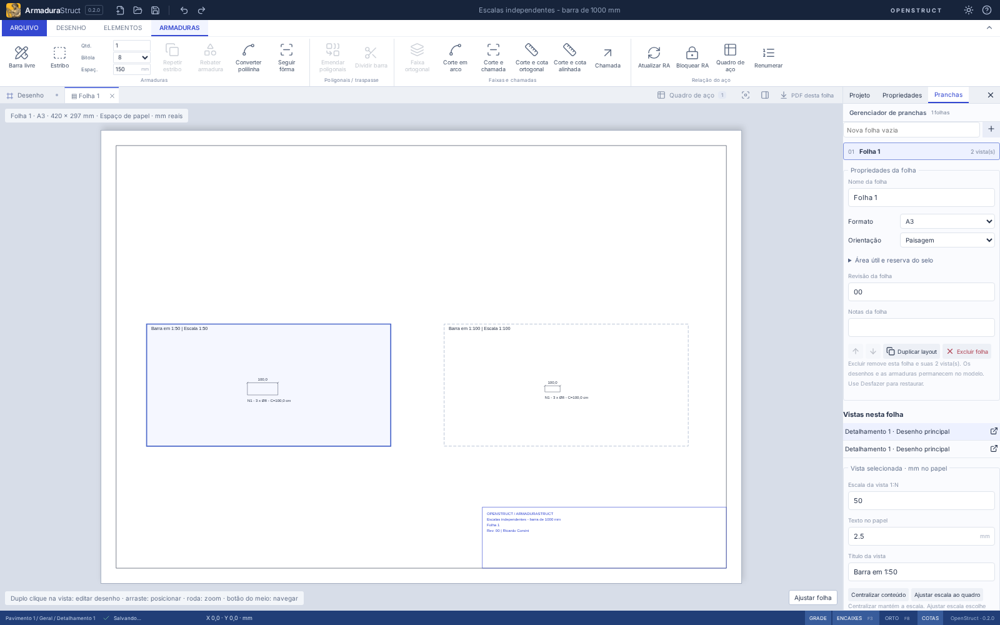
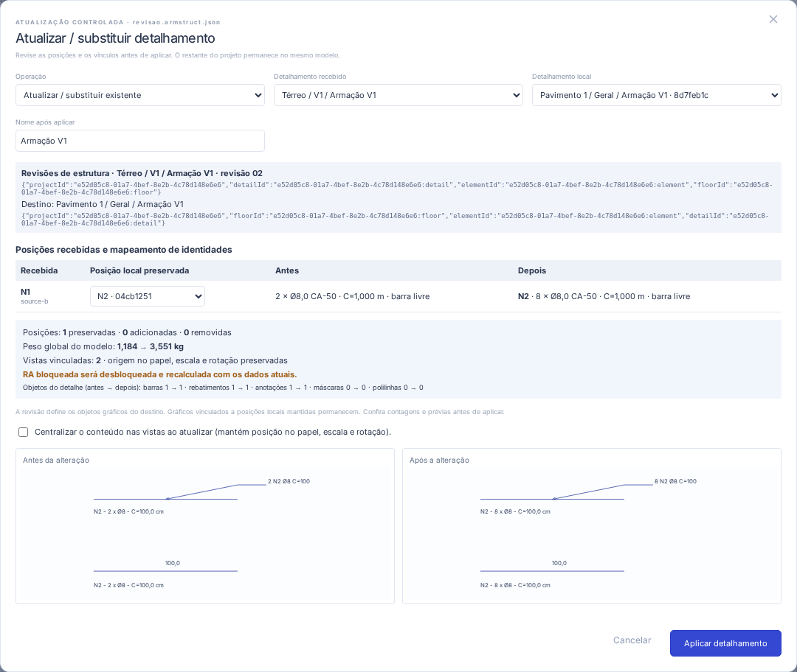

# Guia de uso · ArmaduraStruct 0.2

## Espaço de trabalho

Use a faixa **Armaduras** para criar e detalhar posições. Quantidade, bitola e espaçamento no topo valem para os próximos comandos; para alterar uma posição existente, selecione-a e use **Propriedades**. O painel lateral alterna entre a árvore em **Projeto**, a edição em **Propriedades** e o gerenciador em **Pranchas**.

**F4** recolhe/abre o painel. **Ctrl+F1** recolhe/expande a faixa. **Ctrl+0** alterna o modo Foco no CAD. Os botões no canto da área de desenho também permitem recuperar os painéis. A preferência de recolhimento é preservada neste dispositivo.

## Organização do projeto

Na aba **Projeto**, use **+ pavimento**, **+ elemento** e **+ detalhamento**. Ao criar um pavimento ou elemento, ele fica selecionado como pai do próximo cadastro. O seletor de pai no formulário permite escolher outro destino.

Clique no nome de um nó para editar seu nome; em elementos e detalhamentos, altere também o pai para movê-los. Os vínculos usam IDs, portanto elementos com o mesmo nome em pavimentos distintos continuam independentes. A exclusão só aceita nós vazios; mova os filhos ou objetos antes. O projeto conserva ao menos um pavimento, elemento e detalhamento.

**Destino de novos objetos** define o detalhamento ativo. Barras, polilinhas e máscaras novas entram nele; chamadas vinculadas e rebatimentos herdam o dono da barra. Selecione objetos e volte à aba Projeto para usar **Detalhamento de destino → Mover seleção**. Ao mover uma barra na hierarquia, suas chamadas e rebatimentos acompanham o vínculo, mantendo coordenadas e quantidades. O comando Mover no CAD continua sendo uma transformação geométrica diferente.

A pesquisa localiza pavimentos, elementos, detalhamentos, posições, máscaras e textos de anotações. Clique no detalhamento encontrado para ativá-lo e consultar seus objetos nas listas abaixo. A pesquisa abre temporariamente os ancestrais; limpar a busca recupera a expansão anterior. O estado da árvore e o detalhamento ativo são lembrados por projeto neste dispositivo, inclusive ao alternar as abas laterais.

Na visão geral, **CAD, quadro de aço, DXF e CSV abrangem o projeto inteiro**. Escolher o detalhamento ativo organiza a edição e as listas; entrar na edição isolada restringe apenas a visualização/edição do CAD. O PDF usa as vistas colocadas nas folhas selecionadas para exportação. Pavimento é uma entidade de organização, independente dos layers CAD das máscaras.

### Agrupar e editar isoladamente

Selecione as barras, cotas, polilinhas e chamadas pelo CAD ou por **Shift + clique** nas listas da árvore. Em **Elementos → Agrupar em detalhamento** (comando `AGRUPAR`), informe o nome e o elemento estrutural. O conjunto recebe um detalhamento da hierarquia; os objetos conservam seus IDs, geometria e dados físicos. Rebatimentos e chamadas vinculados às barras selecionadas acompanham a associação.

Na visão geral, clicar num membro seleciona o conjunto; **Shift + clique** alterna sua seleção inteira. A caixa tracejada identifica o grupo. **Mover** desloca suas geometrias juntas. Para alterar, copiar, girar ou espelhar peças individualmente, abra a edição isolada.

Use **duplo clique no conjunto no CAD**, duplo clique no nome do detalhamento na árvore ou o botão de abrir edição ao lado do nome. Também há **Elementos → Editar detalhamento** e o comando `EDITARDETALHE`. O CAD enquadra o detalhe e exibe somente seus objetos. O caminho no topo identifica o contexto; os outros detalhes ficam protegidos contra seleção e alteração. Novos objetos entram no detalhe em edição.

Altere bitola, quantidade ou geometria em **Propriedades**. As representações usam a mesma definição física e são atualizadas sem criar cópias de aço. O quadro permanece global; linhas de outros detalhes são apenas consultáveis durante a edição isolada. Se a RA estiver bloqueada, conclua a edição e use **Atualizar RA** para conferir o levantamento. Renumeração e mudanças globais também exigem concluir a edição.

**Concluir edição** (comando `CONCLUIR`) retorna à visão geral e recupera a câmera anterior. As alterações já integram o modelo, o salvamento e o histórico; não dependem desse botão para serem gravadas. Durante a edição isolada, desfazer/refazer aceita apenas operações que preservem os demais detalhes. Depois de concluir, o histórico geral volta a ficar acessível. O modo isolado é temporário: reabrir o JSON retorna à visão geral, preservando grupos e vínculos.

**Desagrupar seleção** (`DESAGRUPAR`) devolve a seleção individual aos membros e mantém o detalhamento na hierarquia. Não converte barras em linhas, não apaga seus dados e não altera o peso. Excluir objetos físicos é uma operação diferente. O agrupamento visual usa o campo opcional `hierarchy.details[].grouped` nos formatos 3/4; arquivos anteriores sem esse campo continuam com seleção individual.

### Folhas, vistas e abas

Abra **Pranchas** no painel lateral. Digite o nome e use **+** para criar uma folha vazia. Clique em uma folha da lista para abri-la em aba. O gerenciador permite renomear, escolher A0–A4/paisagem/retrato, informar revisão e notas, reordenar pelas setas, **Duplicar layout** e **Excluir folha**. A posição na lista determina a ordem salva e a ordem das abas de folhas.

Em **Colocar desenho**, escolha um desenho existente. Uma vista é uma referência ao desenho do detalhamento, com ID e posição próprios; não cria novas peças. **Duplicar vista** e **Duplicar layout** reutilizam a definição física. **Retirar vista** remove somente essa colocação. Excluir a folha remove suas vistas, mantendo desenhos e objetos no modelo; até a última folha pode ser excluída. **Desfazer/Refazer** restaura as operações. A lista de **Desenhos não colocados** inclui desenhos sem nenhuma vista, inclusive os de detalhes recém-criados.

A folha usa **milímetros reais no espaço de papel**, com origem no canto inferior esquerdo. Arraste o quadro de uma vista ou informe X/Y, largura, altura e rotação. A escala é informada em **Escala da vista 1:N**: uma barra física de 1000 mm mede 20 mm no papel em 1:50 e 10 mm em 1:100. Mudar escala ou papel não altera comprimentos, quantidades ou pesos.

**Centralizar conteúdo** altera apenas a origem do modelo dentro do quadro e mantém a escala. **Ajustar escala ao quadro** escolhe explicitamente uma escala que caiba com textos legíveis. Redimensionar o papel ou o quadro não escolhe outra escala automaticamente. A altura de **Texto no papel** tem padrão 2,5 mm e mínimo 2 mm; cotas conservam seus valores físicos. **Origem no modelo** informa o ponto físico que será colocado na origem da vista no papel, antes da rotação.

Escolha A0–A4 ou **Personalizado**. Neste último, informe os lados A/B (50 a 5.000 mm); retrato/paisagem coloca o lado maior na vertical/horizontal. Em **Área útil e reserva do selo**, ajuste as quatro margens e ative/configure o selo. O selo ocupa o canto inferior direito da área útil e apresenta projeto, folha, autor, revisão e notas. Se os textos não couberem, aumente sua reserva ou reduza as notas.

O painel de validação e o contorno vermelho identificam transbordamento do quadro, da área útil e invasão da reserva do selo. O conteúdo permanece visível para correção; o PDF é bloqueado enquanto houver problemas, sem recorte silencioso. As guias tracejadas/seleção são auxiliares e não são impressas. Roda aplica zoom, botão do meio arrasta a câmera e **Ajustar folha** enquadra o papel; o zoom da tela é independente da escala de impressão.

Use **duplo clique na vista**, o botão de abrir desenho na lista de vistas, um desenho não colocado ou o botão ⌗ na árvore para abrir o desenho em sua própria aba. A edição é isolada no detalhamento original e segue as proteções da AS-02. Alterar bitola, quantidade ou geometria atualiza todas as vistas do desenho. **Concluir edição** retorna à aba de origem; se ela tiver sido excluída, retorna à visão geral.

Cada aba mantém zoom/pan, seleção, detalhamento ativo, modo de edição, ferramenta, pontos do comando em andamento e texto digitado. O quadro de aço continua global e mantém o contexto da aba ao ser consultado. Fechar pelo **×** fecha somente a aba; reabri-la durante a sessão recupera seu estado. Os nomes, a ordem, as propriedades, posições e referências das folhas fazem parte do arquivo JSON. As câmeras e abas abertas são preferências locais; reabrir o aplicativo começa na visão geral, com ferramentas em Selecionar e sem comandos pendentes.

**PDF desta folha** exporta a folha ativa. Fora de uma aba de folha, **Exportar PDF** exporta todas na ordem do gerenciador; também há **Exportar todas as folhas em PDF** no painel. Cada página usa o formato e a orientação da folha, com as mesmas geometrias vetoriais exibidas no espaço de papel. Imprima em **tamanho real (100%)**, desativando ajuste/redução na impressora. Desenhos não colocados não entram nas folhas. O PDF de composição não adiciona páginas automáticas de quadro de aço; CSV/RA e DXF permanecem globais.

### Inserir ou atualizar um detalhamento

Na guia **Elementos**, use **Inserir detalhamento** ou **Atualizar detalhamento** e selecione um arquivo `.armstruct.json`/JSON do ArmaduraStruct. Esse fluxo lê somente a origem para comparação; **Abrir projeto** continua sendo a troca do projeto inteiro. Conclua uma edição isolada antes de importar uma revisão.

Escolha o **Detalhamento recebido** pelo caminho completo. Para inserir, escolha o elemento local e a folha de destino, ou **Não colocar agora**. Somente os objetos do detalhamento selecionado são importados; os outros pavimentos/detalhes do arquivo não entram no modelo. As posições físicas novas entram uma vez no levantamento. Se essa mesma origem já existir, use Atualizar ou coloque outra vista do desenho existente.

A atualização propõe um destino apenas quando há uma correspondência única de IDs de origem: projeto, pavimento, elemento e detalhamento. Nomes iguais, inclusive V1 em pavimentos diferentes, não estabelecem equivalência. Se não houver uma correspondência única, escolha explicitamente o destino. Uma troca de origem diferente exige confirmação no diálogo; posições já pertencentes a outro detalhe local não são duplicadas ou sobrescritas automaticamente.

Em **Posição local preservada**, confira ou altere o mapeamento de cada posição recebida. **Nova posição** cria um novo ID; preservar uma posição mantém seu ID e sua marca local, atualizando os dados recebidos. Não há associação automática por marca/N1. Marcas novas que colidam com posições existentes recebem uma identificação N livre, mostrada na comparação. Posições locais ausentes podem ser removidas ou mantidas com seus gráficos vinculados.

**Vínculos a reassociar** lista chamadas, cotas e rebatimentos que se referem a posições externas ou removidas. Escolha uma posição recebida/local, importe explicitamente uma dependência, desvincule uma anotação ou remova o objeto gráfico. Uma anotação desvinculada conserva sua geometria; chamadas/cortes sem texto próprio conservam a identificação anterior como texto. Um rebatimento precisa de uma posição válida ou de remoção explícita. Importar/atualizar uma dependência afeta o aço e aparece na comparação, uma única vez mesmo que várias chamadas a utilizem. Vincular uma posição local existente não altera seus dados físicos. Nenhum vínculo pendente é gravado.

Antes de **Aplicar detalhamento**, confira quantidades, bitolas, aço, comprimentos/peso, contagens de objetos e prévias antes/depois. A substituição atualiza máscaras, polilinhas, cotas, chamadas e rebatimentos do detalhe segundo a revisão recebida; gráficos locais ausentes serão removidos, exceto os vinculados a posições locais explicitamente mantidas. Para conservar notas/polilinhas soltas, mova-as para outro detalhe antes de substituir.

Os desenhos lógicos e suas vistas permanecem vinculados ao mesmo detalhe local. Posição no papel, escala, rotação e quadros são preservados. **Centralizar conteúdo nas vistas** altera apenas a origem no modelo de cada vista; é opcional e não escolhe outra escala. Confira os avisos de enquadramento: um desenho maior pode exigir ajuste no gerenciador e o PDF mantém sua validação de transbordamento.

Quando houver alteração de dados físicos/da RA, uma RA bloqueada será desbloqueada e recalculada com o modelo atualizado. Alterações somente gráficas preservam o bloqueio; um bloqueio que já estava desatualizado continua precisando de conferência. **Cancelar** não muda o projeto. **Aplicar** produz uma única etapa de Desfazer/Refazer, incluindo vistas, origem e bloqueio da RA. Salvar/reabrir mantém os vínculos de origem para a próxima revisão.

### Formato 6 e compatibilidade

Ao abrir formatos 1/2, o aplicativo cria um pavimento (usa o texto antigo, quando disponível), um elemento Geral e um Detalhamento 1. Os dados das barras, anotações, máscaras, polilinhas, rebatimentos e RA bloqueada são preservados. A antiga descrição textual `Bar.element` continua como **Descrição da posição**, sem funcionar como identidade do elemento estrutural.

No modelo, `hierarchy.details` contém os detalhamentos compostos e `hierarchy.objectDetails` associa os objetos por ID. `details` mantém exclusivamente os rebatimentos gráficos das barras. `hierarchy.drawings` identifica desenhos lógicos dos detalhamentos; `sheets` cadastra as folhas na ordem de documentação e `hierarchy.placements` associa vistas a `sheetId`/`drawingId`, separadas das origens físicas e dos rebatimentos. Um desenho pode existir sem colocação. Projetos 1/2 recebem uma folha inicial e, havendo objetos, uma vista do desenho migrado; projetos 3 mantêm IDs, origens, rotação e escala dos posicionamentos na folha inicial. A migração não move os objetos do CAD. Ao abrir formatos 1–4, o enquadramento antigo recebe uma escala fixa e uma origem no modelo; o valor de escala antigo, que não controlava a prévia da AS-04, fica em `legacyScale` para rastreabilidade. Posições, rotações, quadros e IDs das vistas são mantidos. Vistas antigas fora da nova área útil precisam ser reposicionadas antes da impressão.

Salvar, abrir, recuperação automática e desfazer/refazer incluem toda a hierarquia. Arquivos v3/v4/v5/v6 com vínculos inválidos são recusados, em vez de descartar objetos silenciosamente. Mantenha uma cópia do JSON antigo se precisar abri-lo em uma versão anterior do aplicativo.

## Mouse e seleção

- Roda: zoom no cursor. Botão do meio ou Espaço + arraste: pan. H ativa a ferramenta Pan.
- Clique numa barra ou numa posição na árvore para editar. Shift + clique acrescenta ou remove da seleção.
- Arraste uma janela para selecionar barras inteiramente contidas nela. Alças quadradas editam vértices de barras livres.
- A máscara fica protegida; suas propriedades são alteradas selecionando o arquivo na árvore.
- F enquadra o projeto. F3 alterna encaixes; F8 alterna ortogonal. Botão direito ou Enter conclui a barra; Esc cancela o comando.

## Comandos

| Entrada           | Ação                                                             |
| ----------------- | ---------------------------------------------------------------- |
| B, BARRA, L       | Barra por vértices                                               |
| PL, POLILINHA     | Polilinha de desenho, sem quantidade de aço                      |
| CONVERTER         | Clique numa polilinha própria ou na máscara para criar uma barra |
| REPETIR           | Repetir o estribo selecionado até o ponto final                  |
| FAIXA             | Dois pontos definem uma faixa horizontal ou vertical             |
| COTA / ALINHADA   | Cota ortogonal / alinhada por três pontos                        |
| CHAMADA           | Seta, cotovelo e chegada do texto                                |
| CORTE             | Dois pontos do corte e chegada da chamada                        |
| ARCO              | Primeiro ponto, ponto intermediário e último ponto do arco       |
| DIVIDIR / EMENDAR | Dividir barra / unir duas poligonais compatíveis                 |
| RA / BLOQUEARRA   | Atualizar / alternar bloqueio da relação de aço                  |
| E, ESTRIBO        | Estribo por dois cantos opostos                                  |
| V / H             | Seleção / pan                                                    |
| M / C             | Mover / copiar a seleção; indicar base e destino                 |
| R, REBAT          | Criar rebatimento da posição selecionada                         |
| D                 | Distribuir a posição até o ponto informado                       |
| DIST, MEDIR       | Medir dois pontos                                                |
| FORMA             | Criar barra seguindo uma linha/polilinha da máscara              |
| F, ZOOM           | Enquadrar                                                        |
| U / REDO / DEL    | Desfazer / refazer / excluir                                     |
| Q                 | Quadro de aço                                                    |
| IMPORTAR          | Abrir DXF/DWG                                                    |
| Ctrl+S / Ctrl+O   | Salvar / abrir projeto                                           |
| Ctrl+Z / Ctrl+Y   | Desfazer / refazer                                               |
| :                 | Focar a linha de comando                                         |

Os comandos longos são digitados no campo **Comando**. Atalhos de uma letra funcionam fora dos campos de edição.

Coordenadas em mm: `1000,500` é absoluto; `@500,0` desloca a partir do último ponto; `@1000<30` usa distância e ângulo em graus, no sentido anti-horário. Use ponto decimal: `1250.5,300`. Uma entrada numérica atua sobre o comando que estiver ativo.

## Posições, distribuição e rebatimentos

Cada posição tem uma identificação única, forma, aço, bitola e quantidade. Copiar cria outra posição. Rebatimentos são representações vinculadas: alterar a posição atualiza o detalhe e o quadro. Selecionar um rebatimento seleciona sua posição; para removê-los use **Remover rebatimentos** nas propriedades. A origem de cada rebatimento pode ser ajustada em **Propriedades → Rebatimentos**.

A distribuição parte da origem da barra e inclui o ponto final. Para uma distância L e quantidade n, o espaçamento é L/(n−1). Ao informar um espaçamento máximo s, a quantidade passa a ceil(L/s)+1. Ela representa a quantidade da posição, não um multiplicador adicional. Eixos e marcas de distribuição são simbólicos. **Faixa ortogonal** define início e fim independentes da posição da barra; a direção é horizontal ou vertical, conforme o deslocamento predominante. **Repetir estribo** distribui a geometria completa da posição selecionada, usando o espaçamento máximo do topo. A representação pode ser alternada entre traços e estribos nas propriedades.

O CAD exibe até 200 posições reais por faixa e identifica a vista abreviada quando há mais peças. O DXF/PDF exporta todos os estribos até 2.000 peças por faixa; acima disso, selecione a representação por traços. O quadro sempre usa a quantidade completa uma única vez.

## Polilinhas, cotas e chamadas

Uma polilinha CAD não entra no quantitativo. Use **Converter polilinha** e clique no contorno para transformá-la em uma posição. A conversão usa a bitola e a quantidade do topo. Ao converter um desenho próprio, o contorno é substituído pela barra em uma única operação de desfazer; uma máscara importada permanece protegida.

Cotas usam dois pontos de referência e um terceiro para posicionar a linha. Na cota ortogonal, o terceiro ponto escolhe a projeção horizontal ou vertical; a alinhada mede a distância real. As cotas são exibidas em cm. Se houver uma armadura selecionada, a identificação dela é acrescentada à cota.

Chamadas e cortes podem ser vinculados à posição selecionada. Nas propriedades, escolha outra armadura ou **Sem vínculo**; deixe o texto vazio para a identificação automática ou escreva um texto próprio. Renumerar ou editar a posição atualiza as identificações automáticas. O vínculo é com os dados da barra: os pontos da anotação permanecem onde foram desenhados.

As anotações e polilinhas podem ser selecionadas, movidas, copiadas, giradas, espelhadas ou excluídas. Os três pontos e a altura do texto também são editáveis nas propriedades. Não são peças adicionais de aço nem geram seções estruturais automaticamente.

## Dividir e emendar poligonais

Selecione uma barra livre e use **Dividir barra**. Informe em cm a distância percorrida pelo eixo físico até o corte e o comprimento total do traspasse. A sobreposição é centrada no ponto de corte: metade em cada direção. Ambas as novas posições herdam a quantidade da original; a soma dos comprimentos unitários é o comprimento original mais o traspasse.

O ponto de corte e toda a sobreposição devem caber em um trecho reto, fora das dobras. Remova a distribuição antes de dividir. O sistema **não calcula comprimento normativo de emenda** a partir de resistência do concreto, aderência ou outros parâmetros; esse valor é definido pelo projetista.

Para **Emendar poligonais**, selecione exatamente duas barras com Shift + clique. Elas devem ser livres, ter a mesma bitola, aço, mandril e quantidade, não possuir distribuição e ter extremidades coincidentes. A ferramenta une as geometrias em uma única posição; não cria solda nem traspasse. Para sobreposição física, utilize a divisão com traspasse. Os vínculos das duas posições passam a apontar para a posição resultante.

## Relação de aço e conferência

A relação de aço é automática por padrão. **Bloquear RA** guarda os valores atuais para conferência; edições posteriores permanecem visíveis no desenho e sinalizam a relação desatualizada. Nesse estado as exportações são impedidas para não entregar um desenho com quantitativo anterior. **Atualizar RA** refaz o quadro mantendo o bloqueio; **Desbloquear RA** retorna à atualização automática. O bloqueio é salvo no projeto.

**Renumerar** aplica N1, N2, … na ordem das posições. Rebatimentos e chamadas preservam seus vínculos.

## Comprimento, cotas e peso

O raio no eixo é R=(Dm+φ)/2. Para uma mudança de direção θ, cada reta é reduzida por R·tan(|θ|/2) e o arco acrescenta R·|θ|. O software avisa se as retas não comportarem a dobra e bloqueia as exportações até a correção.

As dimensões informadas são entre vértices teóricos do eixo. O comprimento C é o desenvolvido incluindo as curvas. Peso = comprimento total × πφ²/4 × 7850, com comprimento e diâmetro em metros. Esse peso é teórico; não inclui perdas, tolerâncias ou otimização de corte.

O mandril inicial é apenas um parâmetro geométrico sugerido da ferramenta, não uma determinação normativa. A alteração da bitola não altera automaticamente o mandril. Confira os dois valores para cada posição.

## Importação e entrega

Confira o tamanho da máscara por uma distância conhecida antes de desenhar. `$INSUNITS`/`INSUNITS` é interpretado quando disponível; arquivos sem unidade assumem 1 unidade = 1 mm e geram aviso. O fator de escala pode ser corrigido no painel.

Linhas, polilinhas com bulge, arcos, círculos, elipses, textos básicos, contornos de faces e blocos são convertidos para representação 2D. Objetos incompatíveis são informados no relatório. A fidelidade de fontes, cotas, sólidos, objetos de terceiros e referências externas não é garantida.

O `.armstruct.json` preserva o modelo editável, as folhas/vistas e as máscaras normalizadas; os bytes originais do CAD não são armazenados. Configure formato, margens, selo e escala por vista em **Pranchas**. Guarde o JSON junto dos arquivos de entrega. Arquivos nos formatos 1/2/3/4/5 são migrados ao abrir, e os novos salvamentos usam `armadurastruct/6`. O PDF suporta texto latino e símbolos como Ø/°; caracteres sem suporte são apontados na validação, em vez de serem exportados incorretamente.

## Nota de implementação desktop

O runtime Emscripten/Embind do LibreDWG Web 0.8.4 usa geração de funções JavaScript durante sua inicialização. A CSP permite `unsafe-eval` e `wasm-unsafe-eval` para esse leitor empacotado. Scripts e workers continuam restritos à origem local; não há execução de scripts contidos no desenho nem carregamento de bibliotecas de um CDN. A configuração equivalente é exercitada nos testes do build de produção.
