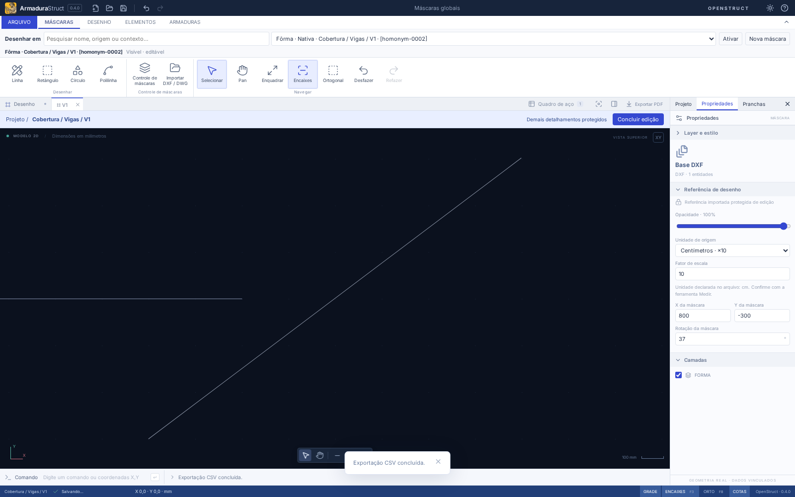
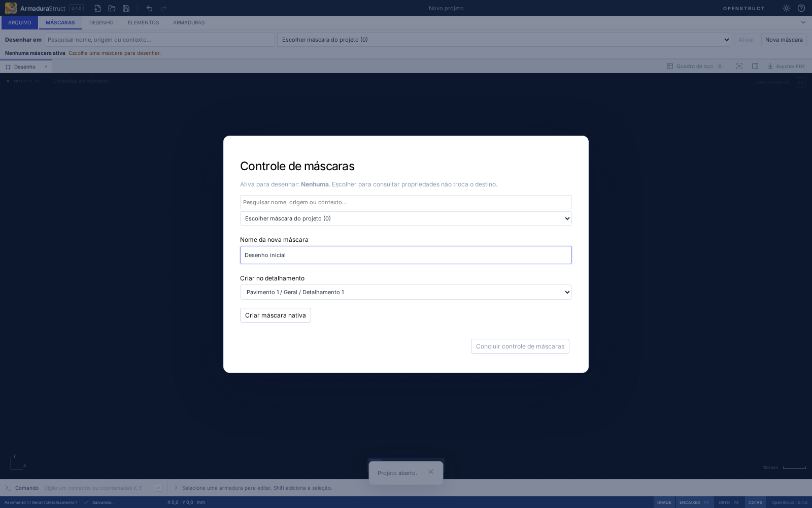
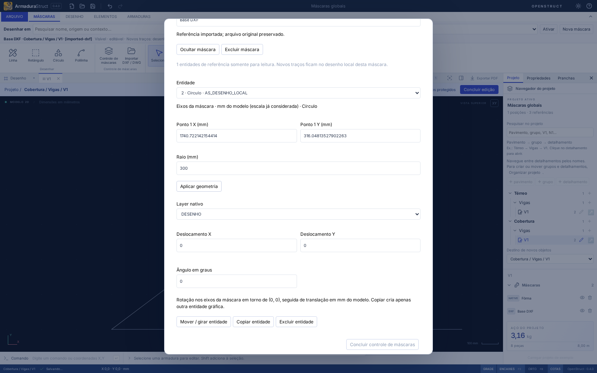

# Escolher a máscara para desenhar

Na aba **Máscaras**, a faixa **Desenhar em** lista todas as máscaras do projeto. Pesquise por nome, origem (Nativa/DXF/DWG/DEMO), pavimento, grupo, detalhamento ou ID. Escolha uma e clique em **Ativar**. O destino ativo, seu caminho, ID e condição de edição permanecem visíveis, inclusive com a faixa recolhida e em Foco.

Escolher um item da lista prepara a ativação; só **Ativar** troca o alvo. A seleção de uma barra, a seleção de uma entidade e a abertura de propriedades de outra máscara não mudam o destino de desenho. Se navegar para outro detalhamento, o destino continua identificado e informa que precisa ser ativado naquele contexto.

## Criar e começar

1. Clique em **Nova máscara**, sem precisar selecionar ou lançar aço.
2. Informe o nome e confira **Criar no detalhamento**, com o caminho completo.
3. Se escolher outro contexto ou estiver numa prancha, use **Abrir contexto de criação**. A mudança de uma edição isolada/prancha pede confirmação. Nada é movido ou reassociado.
4. Confirme **Criar máscara nativa**. O controle fecha, a máscara fica ativa e você pode usar Linha, Retângulo, Círculo ou Polilinha imediatamente.

Abrir, cancelar ou pressionar Esc no formulário não cria objetos. O limite continua sendo 20 máscaras por projeto. Um nome já usado no mesmo detalhamento é recusado, sem sobrescrever. Homônimos em outros detalhamentos são permitidos, com IDs e caminhos distintos. Cada criação confirmada entra uma vez no histórico.

## Desenhar em uma referência importada

Ative o DXF/DWG e desenhe com as mesmas quatro ferramentas. Os novos traços ficam na **própria máscara**, como geometria nativa analítica em **AS_DESENHO_LOCAL**, vinculada ao layer de catálogo **DESENHO** (ou ao fallback existente se ele tiver sido removido). A faixa informa essa decisão antes de desenhar. Não há cópia da referência, outra máscara sobreposta ou conversão em aço.

O formato e a unidade de origem, o ID, a transformação e as primitivas importadas permanecem preservados. Os bytes do arquivo externo não são gravados. As entidades importadas continuam somente para leitura; no **Controle de máscaras**, a lista de entidades editáveis mostra apenas os traços nativos locais. Nome, camadas, visibilidade e transformação da referência continuam no cadastro existente.

O campo Comando CAD e os cliques usam **mm do modelo**. A geometria é convertida para o referencial local da máscara uma única vez, incluindo escala, rotação e origem. Nas propriedades da entidade, os valores são apresentados em mm físicos ao longo dos eixos locais da máscara; a escala já está considerada. Mover/copiar por X/Y também recebe mm físicos nesses eixos. Nenhuma coordenada é arredondada para coincidir com o texto formatado.

## Proteções e histórico

Ocultação por objeto, visibilidade da máscara, camada local desligada, bloqueio/captura de layers e isolamento são respeitados. **Ativar não desbloqueia nem mostra objetos automaticamente.** A faixa orienta recuperar a exibição ou conferir os layers. Uma ativação de outro detalhamento abre seu desenho pelo contrato existente; não permite editar papel ou objetos alheios à edição isolada.

Trocar projeto, desenho, detalhamento, máscara ou aba, remover o alvo ou alterar o projeto durante pontos pendentes invalida a prévia. Antes de confirmar, o comando revalida a identidade, o contexto e o snapshot do projeto/máscara. Enter/cliques repetidos não reaplicam a mesma confirmação. Cada entidade concluída é uma operação de desfazer/refazer. Navegação, consulta, seleção, câmera e ativação não criam histórico nem alteram aço, RA ou CSV.

A escolha ativa é uma **preferência local por ID do projeto**, validada ao reabrir. Ela não integra o arquivo nem o pacote de intercâmbio. Excluir o alvo limpa a escolha e não escolhe outra máscara; desfazer a exclusão não reativa silenciosamente o destino. Ao transferir o arquivo para outro computador, ative uma máscara novamente.

## Persistência e saídas

O formato salvo é **armadurastruct/22**, com leitura/migração de 1–21. A extensão local usa os contratos existentes `Mask.primitives`, identidade e geometria `native`; o formato 21 distingue esse caso de leitores anteriores que só aceitavam nativas em máscaras NATIVE. Projetos anteriores conservam objetos, IDs, ownership e quantitativos. Um arquivo que declara formato 20 ou anterior, mas inclui extensão nativa numa referência, é recusado com indicação de versão.

O pacote **openstruct.detail/13** preserva a extensão e lê versões 1–12, incluindo conversão mm/cm/m. Pacotes anteriores que declarem extensão local sem a versão apropriada são recusados. Canvas, composição de vistas/pranchas, PDF e DXF usam as mesmas primitivas, sem duplicação.

Círculos conservam centro e raio no projeto/pacote. As saídas atuais continuam discretizadas: erro de corda máximo **0,05 unidade local**, multiplicado pela escala da máscara no modelo e dividido pela escala da vista no papel; mínimo de 32 segmentos. Não se anuncia exportação DWG ou CIRCLE/ARC analítica. As penas/cores de plotagem seguem os estilos existentes.

O importador em lote e a reassociação continuam em tarefa própria. Ferramentas/Manipular devem reutilizar `drawingMaskChoice` como destino e `nativeEntity`/seleção da máscara como seleção; são estados distintos. As operações e os estados de validação são compartilhados em `src/domain/maskDrawing.ts` e exportados na API pública.

## Verificação

Testes de domínio cobrem criação, nomes/limites, homônimos, escala/rotação, linha de 1000 mm, retângulo/círculo/polilinha, bloqueios, contexto, concorrência, origem intacta, RA bloqueada, migração, intercâmbio em três unidades e saídas. Os fluxos de navegador cobrem criação sem aço/Foco, seleção independente, todos os contextos, extensão DXF e edição física do raio, cancelamento em isolamento, exclusão, recuperação, pranchas e CSV/DXF.

Resultados em 08/11/2026: `npm run check` aprovou **437 testes de domínio/importação e 6 de distribuição**; `npm run build` e `npm run format:check` aprovados. Foram conferidos **97 cenários E2E**: 96 passaram na execução completa; o restante ainda buscava o placeholder anterior à nomenclatura de grupos. Após usar o nome acessível da pesquisa, os quatro casos de quantidades passaram na reexecução. Os nove fluxos de máscaras também passaram na execução direcionada e na suíte completa. As capturas deste guia foram produzidas pelos testes.

A execução interativa é validada no Chromium web. Linux/Windows compartilham a interface e o domínio; execução nativa interativa não está disponível neste ambiente.
