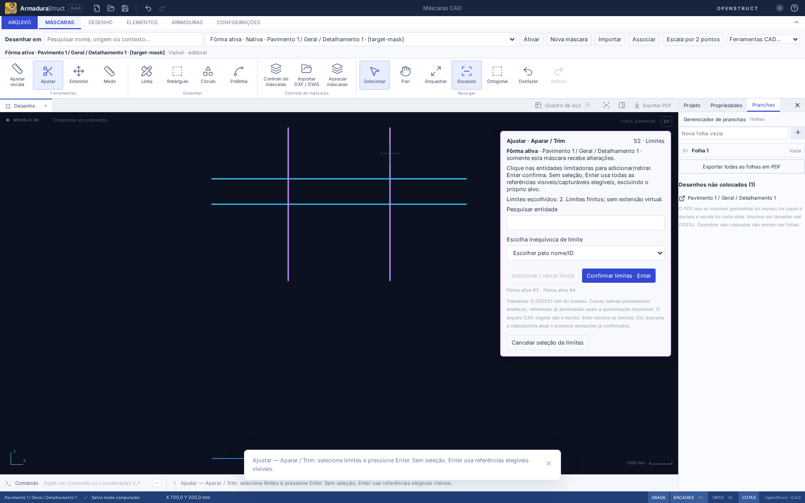
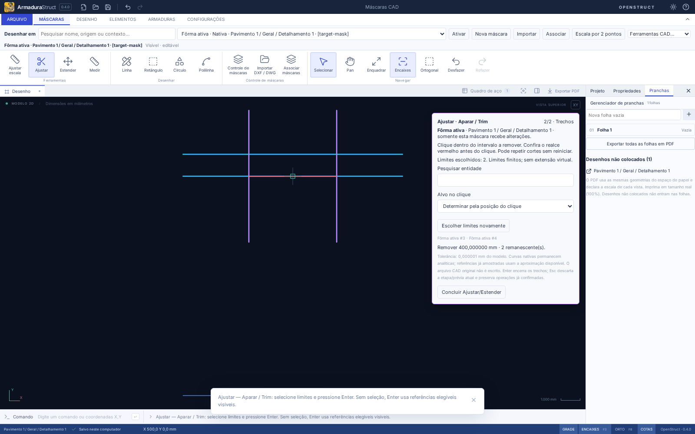
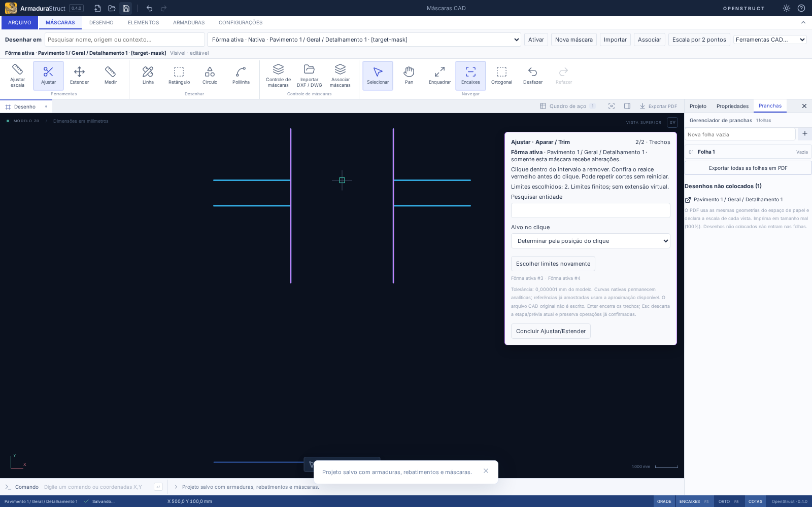
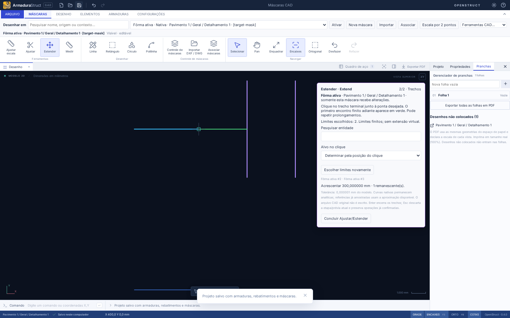
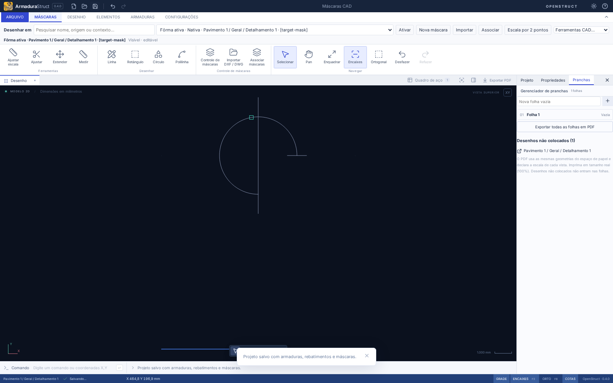
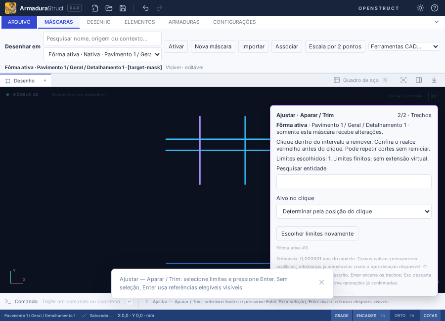

# Ajustar (Aparar / Trim) e Estender (Extend)

Em **Máscaras → Ferramentas**, escolha **Ajustar** ou **Estender**. O tooltip identifica Aparar / Trim, separado de **Ajustar escala**, que calibra a máscara inteira. O destino é sempre a **máscara ativa** exibida no seletor superior. O Controle de máscaras também permite **Usar esta máscara e Ajustar/Estender**; no modo Foco, use **Ferramentas CAD da máscara ativa** junto ao seletor de destino.

## Fluxo comum

1. Ative a máscara no desenho/detalhamento correto. Uma prancha precisa primeiro abrir o desenho da vista. Máscara oculta, sem captura ou bloqueada precisa ser liberada explicitamente nos controles existentes.
2. Inicie a ferramenta. Clique nas entidades limitadoras; clique novamente para retirar uma. Os limites escolhidos ficam roxos. A lista pesquisável permite escolher uma entidade por nome/ID quando há sobreposição. Uma entidade individual previamente escolhida nas propriedades pode iniciar a seleção de limites; selecionar a máscara inteira ou aço não fornece limites implícitos.
3. Pressione **Enter**, ou **Confirmar limites**. Sem limites escolhidos, Enter usa todas as referências suportadas, visíveis e capturáveis, excluindo o próprio alvo em cada operação. Isso não apaga todas as entidades. No modo automático, as referências elegíveis ficam realçadas; a máscara ativa tem cor distinta.
4. Passe o cursor no trecho pretendido e confira a prévia e sua medida. Clique para aplicar. Cada clique válido entra como **uma operação de Desfazer/Refazer**. Pode repetir sem reiniciar a ferramenta.
5. **Enter** conclui. **Esc** abandona a etapa/prévia pendente; alterações já confirmadas permanecem e podem ser desfeitas. **Reescolher limites** volta à primeira etapa. Prévia, pesquisa, câmera e cancelamento não criam histórico.

Os limites são **finitos**, sem prolongamento virtual. Outras máscaras visíveis/capturáveis podem servir de referência, inclusive se bloqueadas para edição. Somente entidades editáveis da máscara ativa recebem alterações. O isolamento restringe também as referências ao detalhamento isolado. Texto e aço não são alvos geométricos destes comandos.

## Ajustar

Clique **dentro do intervalo a remover**, afastado das interseções. O realce vermelho mostra o trecho removido; a medida informada é seu comprimento em mm do modelo. A orientação dos vértices e o zoom não definem o lado removido.

| Caso em mm                                           | Clique                       | Resultado                                                          |
| ---------------------------------------------------- | ---------------------------- | ------------------------------------------------------------------ |
| Linha (0,0)–(1000,0), limite x=400                   | x=800                        | Mantém (0,0)–(400,0)                                               |
| Mesma linha e limite                                 | x=100                        | Mantém (400,0)–(1000,0)                                            |
| Limites x=300 e x=700                                | x=500                        | Mantém 0–300 e 700–1000; remove somente os 400 mm centrais         |
| Retângulo/contorno fechado, dois encontros distintos | Intervalo escolhido          | Abre o contorno e mantém o caminho complementar, sem diagonal nova |
| Círculo com uma secante                              | Um dos intervalos circulares | Mantém um arco analítico com o mesmo centro e raio                 |

Sem interseção interior, encontro somente em ponta ou tangência única de um contorno fechado não definem corte. A ferramenta explica o motivo e preserva a entidade. Limites colineares/sobrepostos ou curvas coincidentes são recusados por ambiguidade. Em caminhos autocruzados, um clique ou interseção com mais de uma posição no percurso também é recusado: escolha um trecho/limite afastado do cruzamento.

## Estender

Clique **no trecho terminal, perto da ponta que deseja alongar**. O realce verde mostra apenas o acréscimo. O prolongamento mantém a direção terminal de uma linha/polilinha e termina no **primeiro encontro positivo adiante** entre os limites finitos. Não acrescenta vértices colineares desnecessários. A outra ponta e os vértices internos permanecem nas mesmas posições.

Uma linha de (0,0)–(400,0), com limites x=700 e x=1000, clicada perto de x=400, termina em x=700: acréscimo de 300 mm. Clicar na ponta contrária não inverte o prolongamento automaticamente. Limite paralelo, atrás da ponta ou fora de sua extensão real não serve. Se a ponta já está em um limite, a operação é neutra; não pula para o próximo. O meio exato de uma linha/arco e vértices intermediários ambíguos exigem outro clique.

Arcos analíticos prolongam sobre a mesma circunferência, mantendo centro, raio e tangência. Não ultrapassam o percurso disponível a ponto de fechar/sobrepor o arco. Círculos, retângulos e polilinhas fechadas precisam ser abertos por um corte antes de Estender. Uma nova autointerseção no prolongamento da polilinha é recusada.

A linha de comandos aceita **AJUSTAR**, **APARAR**, **TRIM**, **EXTEND** e **ESTENDERMASCARA**. **ESTENDER** continua sendo o comando físico **Estender barra** da AS-26; não houve mudança desse atalho. Nenhum destes comandos CAD converte máscara em armadura.

## Geometria, identidade e persistência

- Cálculos e tolerância de encontro usam o modelo em mm: **0,000001 mm**. Zoom afeta somente a tolerância de captura em tela; o clique geométrico é convertido ao modelo sem arredondamento ou snap que troque o intervalo escolhido. As transformações locais/globais preservam escala de importação, rotação e translação.
- Círculos e arcos nativos usam interseções analíticas. O arco guarda `center`, `radius`, `startAngle` e `sweepAngle` em graus, com abertura assinada inferior a 360°. As propriedades permitem corrigir esses valores sem perder a geometria original.
- Canvas/prancha/PDF/DXF continuam usando o caminho compartilhado de primitivas. Curvas nativas são amostradas com erro radial máximo de **0,05 mm locais**, portanto **0,05 × scale mm** no modelo; a prévia usa no máximo 0,05 mm no modelo. Dados analíticos permanecem no projeto/intercâmbio. O DXF atual escreve LWPOLYLINE, não anuncia exportação ARC nem DWG. Uma curva já discretizada pelo importador mantém a precisão disponível da referência, sem reconstrução analítica automática.
- O primeiro remanescente conserva o ID de entidade existente; novos fragmentos recebem novos IDs. Referências sem ID recebem identidade ao serem editadas. `sourceEntityId` registra a linhagem de fragmentação; não é uma referência a outra entidade que precise continuar existindo. Layers, estilos, overrides, origem e ID da máscara permanecem. Não há outros vínculos persistidos para vértices internos de máscara neste contrato.
- Em DXF/DWG, a alteração é **local à referência normalizada**. Formato, unidade, avisos e arquivo externo permanecem intactos. Não é obrigatório converter a referência inteira ou criar outra máscara.
- Projeto atual **armadurastruct/23**, com leitura/migração 1–22; pacote **openstruct.detail/14**, com leitura 1–13. A migração não muda objetos anteriores. Versões antigas não recebem arcos/linhagem falsamente etiquetados como legado. Mantenha cópias para uso em aplicativos antigos. Veja o [JSON Schema v14](openstruct-detail-v14.schema.json).
- Salvar/abrir, recuperação, intercâmbio e histórico transportam arcos e fragmentos. Vistas reaproveitam a mesma máscara: alterar o desenho atualiza as vistas sem duplicar aço. Escala da vista e zoom não são alterados.
- Trocar projeto, desenho, isolamento, aba ou máscara invalida a preparação. Alterações concorrentes exigem recalcular a prévia. Duplo clique/Enter repetido não repete uma operação confirmada. Importação, layers e seleção residual de armadura não contornam as proteções.

Os limites existentes de arquivo/entidades continuam válidos. A operação recusa mais de 250 mil comparações de segmentos, curvas que ultrapassem o orçamento de amostragem, resultados fora de ±1 bilhão de mm ou remanescentes nativos com mais de 500 vértices. Uma polilinha importada maior mantém sua geometria disponível, sem conversão silenciosa em entidade nativa limitada. Selecione menos limites ou simplifique a referência quando houver esse aviso.

## Arquivos e contratos

| Arquivos                                                                                                                                    | Responsabilidade                                                                                                          |
| ------------------------------------------------------------------------------------------------------------------------------------------- | ------------------------------------------------------------------------------------------------------------------------- |
| `src/domain/maskCadGeometry.ts`                                                                                                             | Interseções finitas, intervalos de corte, escolha de ponta, extensão circular/linear e tolerâncias/orçamento de cálculo.  |
| `src/domain/maskCadEditing.ts`                                                                                                              | Resolução de alvo/referências, proteções, conversão local/modelo, prévia pura e aplicação atômica com linhagem.           |
| `src/components/MaskCadPanel.tsx`, `CadCanvas.tsx`, `Ribbon.tsx`, `MaskDestination.tsx`, `MaskControl.tsx`, `src/App.tsx`, `src/styles.css` | Acessos, etapas, escolha por ID/clique, realces, cancelamento e integração ao histórico.                                  |
| `src/domain/nativeMasks.ts`, `types.ts`, `model.ts`, `detailPackage.ts`                                                                     | Arco analítico, validação, migração e intercâmbio versionado.                                                             |
| `maskDrawing.ts`, `maskCalibration.ts`, `followForm.ts`, `MaskCalibrationPanel.tsx`                                                         | Separação entre ferramentas de autoria, calibração de curvas e lançamento físico; arco não é interpretado como face reta. |
| `tests/maskCad.test.ts`, `tests/fixtures/maskCad.ts`, `tests/e2e/maskCad.spec.ts`                                                           | Casos geométricos e fluxos completos; demais testes atualizam a versão esperada sem alterar fixtures históricas.          |
| Guia, README, changelog e JSON Schema v14                                                                                                   | Uso, compatibilidade, capturas e contrato público.                                                                        |

## Validação reproduzível

`tests/maskCad.test.ts` cobre os casos dimensionais, orientação inversa, tangência, retângulo fechado, arcos em ambos os sentidos, ambiguidades, autointerseção, máscaras transformadas, layers/proteção, identidade, persistência/intercâmbio e saídas. As vistas 1:50/1:100 mostram um remanescente de 300 mm com 6/3 mm no papel. RA, CSV e barras permanecem iguais.

`tests/e2e/maskCad.spec.ts` exercita o ribbon, seleção por clique e ID, prévia, cortes sucessivos, extensão, duplo clique, cancelamento, histórico, recuperação, círculo/arco, DXF em cm, limite bloqueado de outra máscara, troca de projeto e modo Foco em 900 × 650. As capturas acima são dessas execuções em build de produção Chromium/Linux.

Resultados: **516 testes de domínio/importação**, **6 de distribuição**, **144 cenários E2E na regressão completa** e **10 fluxos afetados na rodada final**, sem falhas. `npm run build` e `npm run format:check` passaram.

Comandos: `npm run check`, `npm run build`, `npm run format:check` e `npm run test:e2e`. O aplicativo Tauri instalado em Linux/Windows não foi executado neste ambiente; o fluxo web e as integrações desktop simuladas existentes são cobertos pelo navegador. Estas ferramentas editam desenho CAD, sem dimensionamento ou verificação estrutural.
