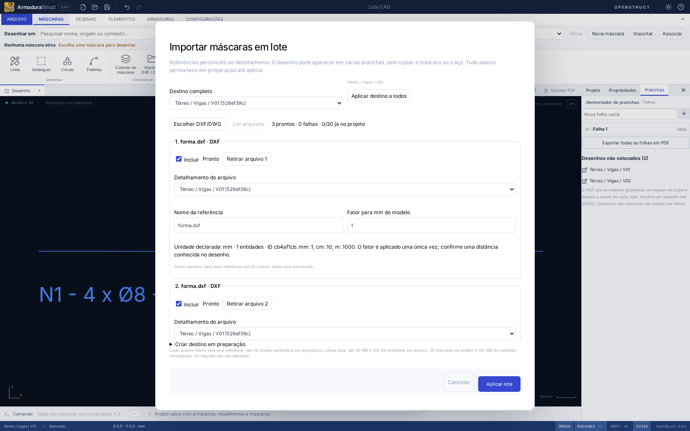
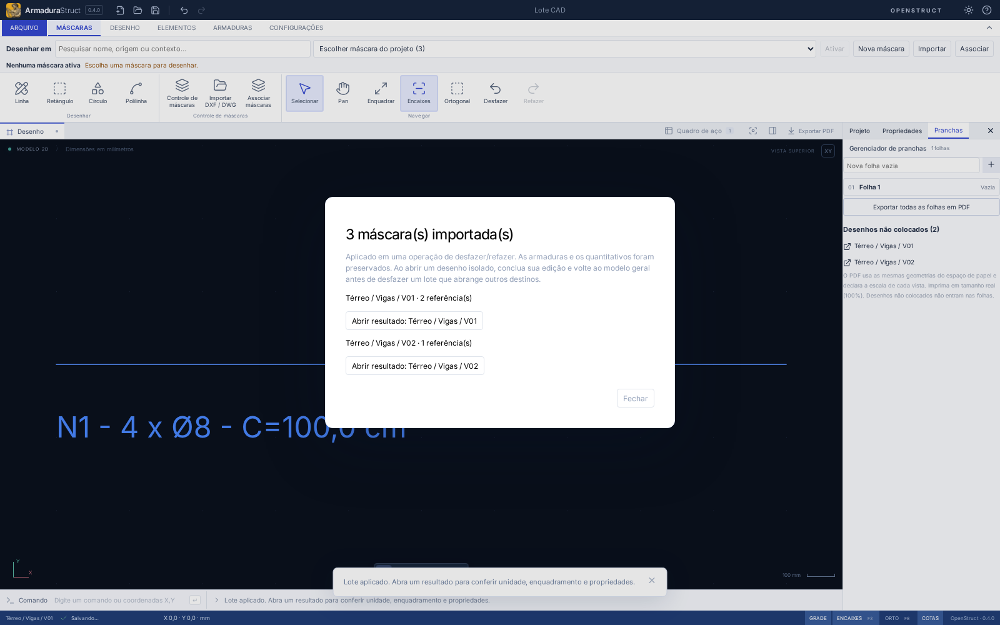
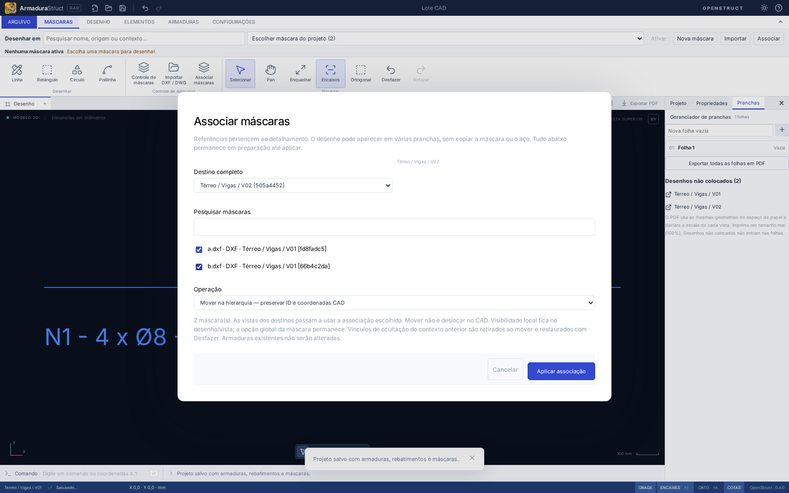
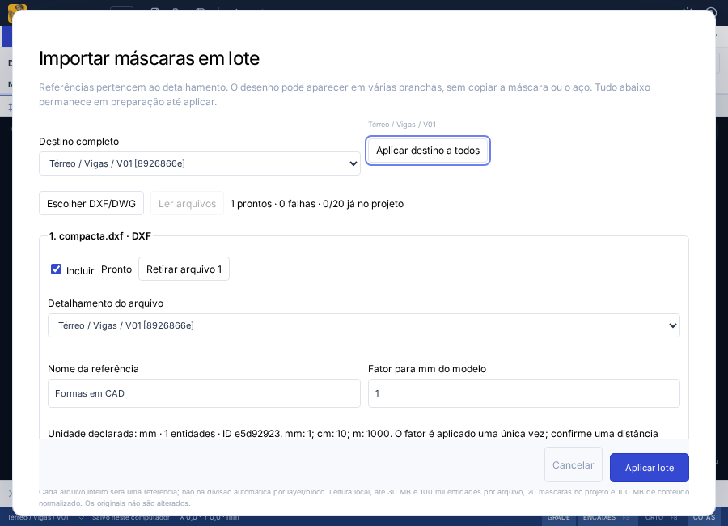

# Máscaras: importação em lote e associação

## Onde a referência pertence

A máscara continua pertencendo a **um detalhamento** (`hierarchy.objectDetails`). Exemplo: **Térreo / Vigas / V01**. O desenho é o documento desse detalhamento; a vista coloca esse desenho na prancha. Duas vistas reutilizam a mesma máscara e o mesmo aço. Excluir uma vista/folha não exclui a referência do modelo.

Isso reaproveita o contrato existente, sem versão nova de schema, cadastro paralelo ou associação exclusiva à folha. Importar várias vezes já era possível; a melhoria é preparar vários arquivos juntos, indicar os destinos e aplicar tudo em uma transação.

## CAD → máscaras → armaduras → prancha

1. No CAD externo, prepare a geometria no **espaço de modelo** e exporte DXF ASCII ou DWG suportado. Prefira declarar a unidade e incluir uma distância conhecida.
2. No ArmaduraStruct, abra **Máscaras → Referências → Importar** (também disponível em Arquivo). **Importar** e **Associar** ficam no grupo Referências; com os comandos recolhidos e em modo Foco, abra **Referências** ao lado das abas. Escolha vários arquivos no seletor. O seletor de projetos/pacotes continua aceitando um único arquivo.
3. Confira o caminho completo do **Destino do lote**. Use **Aplicar destino a todos** ou escolha o **Detalhamento do arquivo** em cada item. O nome do arquivo não determina sua identidade nem seu destino. Homônimos serão referências distintas, sem sobrescrever as anteriores.
4. Se faltar o destino, expanda **Criar destino em preparação**. Cadastre pavimento → grupo de elementos → detalhamento usando as operações de hierarquia existentes. Esses itens ainda não estão no projeto; o detalhamento terá um desenho e nenhuma armadura automática.
5. Clique **Ler arquivos**. Há somente um leitor/worker ativo por vez. Veja formato, unidade declarada, fator para mm, entidades, avisos e falhas. Retire o que não desejar. Para mm/cm/m, os fatores usuais são 1/10/1000. Na ausência de unidade, confira e confirme explicitamente o fator. Alterar o fator não muda a unidade declarada original.
6. Havendo falhas, retire os itens ou marque **Confirmo importar somente os válidos selecionados**. Arquivos pendentes precisam ser lidos ou retirados. **Aplicar lote** confirma os itens incluídos, os novos destinos e os layers em um único passo de histórico. Cliques repetidos não repetem a aplicação.
7. O resumo reúne os resultados por destino. Use **Abrir resultado** para abrir o contexto, enquadrar o desenho e mostrar as propriedades da primeira referência. Outras máscaras ficam disponíveis no controle e no seletor global. Isso não troca silenciosamente a máscara ativa para desenho nativo.
8. Confira uma distância conhecida com **Medir**, revise unidades, posição, rotação e layers. Lance aço por **Barra livre**, **Estribo** ou **Seguir fôrma**. Importação de linhas/textos não cria aço. A interpretação/conversão continua explícita.
9. No gerenciador de pranchas, coloque o desenho como vista e configure sua escala. Uma referência de 1000 mm corresponde a 20 mm no papel em 1:50 e 10 mm em 1:100. A escala da vista não substitui o fator da máscara para mm.

## Prancha e isolamento

Ao iniciar na prancha, a leitura fica bloqueada até **Abrir desenho da vista / destino**. Se houver uma vista selecionada, seu detalhamento é sugerido; sem vista válida, escolha explicitamente um destino. Nenhuma importação usa o último detalhamento invisível ou coordenadas de papel.

Um desenho aberto trabalha no contexto do detalhamento. Para distribuir referências por vários detalhamentos ou preparar novos destinos, use **Trabalhar no modelo geral** e confirme a saída. Não há desbloqueio automático de layers ou bypass de isolamento.

## Reassociar e reutilizar

**Máscaras → Associar máscaras**, também no Controle de máscaras, lista todas as referências do projeto com nome, origem, caminho e trecho do ID. Pesquise e selecione uma ou várias, escolha o destino e a operação:

- **Mover na hierarquia:** preserva IDs, coordenadas, transformação, geometria, layers e avisos. O desenho anterior deixa de exibir a referência e o destino passa a usá-la. Aço já lançado não é movido nem recalculado. Isso é diferente de mover no CAD.
- **Copiar referência:** ação explícita para usar os dados em outro detalhamento de forma independente. Cria outro ID de máscara e novos IDs para suas entidades nativas locais, mantendo geometria/transformação inicial. Não copia armaduras nem introduz sincronização com o arquivo de origem. Consome outra vaga no limite de máscaras.

Objetos/layers protegidos ou ocultos precisam ser liberados no contexto correspondente antes da associação. A visibilidade global da máscara é preservada; perfis e opções locais continuam nos desenhos/vistas. Referências locais de ocultação do contexto anterior são limpas ao mover, pelo saneamento já usado na hierarquia, e voltam com Desfazer. Vistas de um mesmo detalhamento continuam reutilizando a referência; não use cópia apenas para apresentar o mesmo desenho em outra folha.

## Cancelamento, histórico e persistência

- Até aplicar, arquivos, layers e novos destinos ficam em rascunho. **Cancelar**, Esc e fechar descartam tudo, sem histórico/autosave de objetos parciais.
- Troca de projeto/documento/contexto, mudança do modelo ou exclusão do destino invalida a preparação, encerra o worker e impede callbacks tardios de inserir dados. Não existe redirecionamento automático.
- **Interromper leitura** termina o worker atual; o item interrompido fica pendente para nova leitura ou remoção. Itens prontos continuam em preparação. A leitura nativa de bytes já iniciada pode terminar no sistema operacional, mas seu resultado é descartado antes de iniciar outro worker.
- Aplicar lote, mover ou copiar são transações desfazíveis. Refazer usa os mesmos dados/IDs e não relê arquivos. Se você abriu o resultado em desenho isolado, conclua a edição e volte ao modelo geral para desfazer um lote que também altera outros destinos ou cria a própria hierarquia. A proteção de isolamento não é contornada. Salvar/abrir, recuperação automática e intercâmbio continuam usando as máscaras normalizadas existentes, incluindo extensões nativas locais.
- O processamento é local. No desktop, o seletor múltiplo mantém apenas caminhos temporários na preparação, consulta o tamanho e lê os arquivos escolhidos sequencialmente. A capacidade de consultar metadados (`fs:allow-stat`) não adiciona diretórios ou acesso persistente. Não se escreve nos arquivos CAD.

## Limites reais

Continuam valendo **30 MB por arquivo**, **100 mil entidades expandidas por referência**, **20 máscaras por projeto** e **100 MB do projeto JSON normalizado**, limite já usado na abertura. A capacidade é conferida antes da leitura e novamente na confirmação; todo excesso aparece na lista. O orçamento de conteúdo normalizado é compartilhado pelo projeto e pela preparação, com um buffer/worker de arquivo por vez. Os 100 MB medem os bytes UTF-8 do JSON com a mesma indentação de Salvar projeto; a memória de objetos, parser e WebAssembly pode ser maior. Não foi feito benchmark de RAM com vinte arquivos no tamanho máximo.

Um arquivo inteiro é uma referência. Não se separa automaticamente por layer/bloco/posição. Os avisos de entidades omitidas, curvas amostradas e limitações DWG/DXF continuam sendo os do leitor existente. Não há layouts CAD convertidos em pranchas, xrefs externas, regeneração paramétrica do aço ou exportação DWG. PDF/DXF usam os dados e transformações normalizados já compartilhados com canvas e pranchas. Máscaras não entram na RA/CSV.

## Verificação reproduzível

- `tests/maskBatch.test.ts`: lote, homônimos, propriedade, unidades/rotação, intercâmbio, duas escalas, cópia e proteção; invariância de aço e RA bloqueada.
- `tests/maskFiles.test.ts`: cancelamento/timeout/liberação de worker, respostas tardias, limites e seletores desktop múltiplo versus projeto único (APIs simuladas).
- `tests/e2e/maskBatch.spec.ts`: aplicação e histórico, recuperação, falhas/unidade, destinos em rascunho, limite, associação, prancha/isolamento e troca de projeto durante leitura.
- Fluxos existentes de importação DWG real, interpretação DXF, layers e Seguir fôrma passam pela mesma preparação do lote.

O navegador de produção é validado em Chromium no Linux do ambiente de testes. O diálogo nativo Linux/Windows e o WebView Tauri precisam ser conferidos no aplicativo instalado; os testes de API desktop não substituem essa execução.

## Arquivos da implementação

| Arquivos                                                                 | Responsabilidade                                                                                     |
| ------------------------------------------------------------------------ | ---------------------------------------------------------------------------------------------------- |
| `src/domain/maskBatch.ts`                                                | Aplicação atômica, validação, limites e mover/copiar referências com propriedade única               |
| `src/lib/files.ts`                                                       | Seletor múltiplo desktop preguiçoso, leitura sequencial e cancelamento/limpeza do worker existente   |
| `src/components/MaskBatchDialog.tsx`, `MaskBatchResults.tsx`             | Preparação, destinos, criação em rascunho, falhas parciais e resumo por destino                      |
| `src/App.tsx`                                                            | Contexto de projeto/desenho/isolamento, confirmação e histórico                                      |
| `Ribbon.tsx`, `MaskControl.tsx`, `MaskDestination.tsx`, `src/styles.css` | Acessos compartilhados, atalhos em Foco e interface compacta                                         |
| `src-tauri/capabilities/default.json`                                    | Consulta de tamanho dos arquivos escolhidos no diálogo nativo                                        |
| `tests/maskBatch.test.ts`, `maskFiles.test.ts`, `tests/e2e/maskBatch*`   | Geometria, propriedade, persistência, exportação, concorrência, capacidade, cancelamento e interface |
| E2E existentes de editor, layers, pacotes e Seguir fôrma                 | Integração com a preparação obrigatória, incluindo leitura DWG real                                  |

### Resultado desta entrega

`npm run check`: 479 testes de domínio/importação e 6 de distribuição aprovados. `npm run build`, `npm run format:check` e a checagem final de tipos aprovados. Regressão completa: 128 cenários E2E; os 8 fluxos do lote foram reexecutados após os ajustes finais, incluindo RA bloqueada e exportação DXF. Capturas acima produzidas pelos fluxos de navegador. Execução interativa nativa Linux/Windows não realizada neste ambiente.
