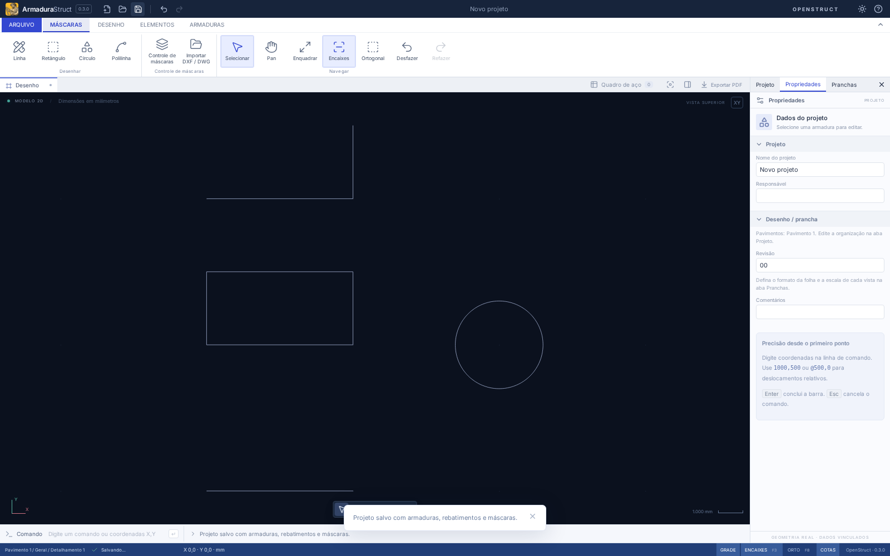
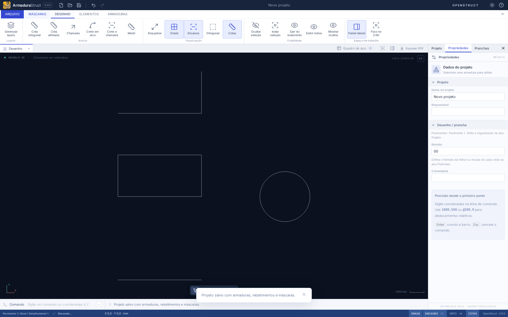
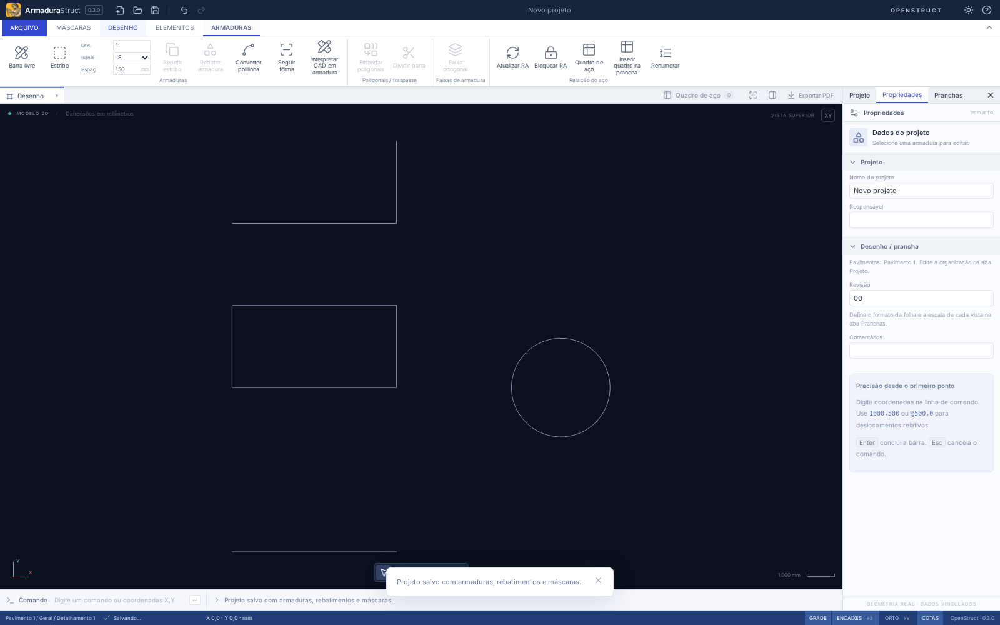

# Máscaras nativas e organização dos comandos

A aba **Máscaras** reúne Linha, Retângulo, Círculo, Polilinha, importação DXF/DWG e Controle de máscaras. **Armaduras** mantém lançamento físico, faixas, rebatimentos, conversão explícita, Seguir fôrma e relação do aço. **Desenho** reúne cotas, chamadas, cortes gráficos, layers e apresentação. Os cortes são anotações, não novas peças físicas.

## Desenhar sem importar

1. Ative o detalhamento de destino na aba Projeto. Em uma prancha, abra primeiro o desenho da vista.
2. Abra **Máscaras → Controle de máscaras**, informe o nome e confirme **Criar máscara nativa**. Selecione uma máscara existente pelo nome/origem. Abrir ou cancelar o controle não cria registros.
3. Conclua o controle e escolha Linha, Retângulo, Círculo ou Polilinha. A faixa de contexto informa a máscara de destino. Se não houver máscara nativa visível/editável selecionada no detalhe ativo, o controle orienta sua escolha/criação; volte à ferramenta após escolhê-la.
4. Linha usa dois pontos; retângulo, cantos opostos; círculo, centro e ponto do raio; polilinha, vários vértices. Enter/botão direito concluem a polilinha aberta; **Fechar polilinha** confirma a fechada. Esc cancela os pontos pendentes. Encaixes, ortogonal e coordenadas absolutas/relativas seguem o CAD existente.
5. Exemplos de coordenadas no campo Comando CAD: linha `0,0` e `1000,0`; retângulo `0,1000` e `1000,1500`; círculo `2000,1000` e `2250,1000` (raio 250 mm). Zoom não altera medidas.

Os comandos `MASCARAS`, `LINHA`, `RETANGULO`, `CIRCULO` e `MPL` oferecem acesso por teclado, inclusive com faixa recolhida/Foco. O comando legado `PL` continua criando a polilinha independente anterior; não migra auxiliares ou desenhos já existentes para máscaras.

## Selecionar e corrigir

Clique em uma entidade nativa no CAD para abrir seu controle e propriedades geométricas. Também é possível escolhê-la na lista **Entidade da máscara**. Edite coordenadas/vértices, fechamento e raio; confirme **Aplicar geometria**. Escolha o layer nativo por entidade ou herde o da máscara. **Mover / girar entidade**, **Copiar entidade** e **Excluir entidade** afetam somente o item escolhido. A transformação local gira em torno de (0,0) e depois aplica X/Y. Um retângulo girado é preservado como polilinha fechada, sem perder os quatro lados.

A árvore lateral continua selecionando a máscara inteira. **Propriedades da máscara** abre o painel, mesmo recolhido ou em Foco: nome, visibilidade, opacidade, posição, escala, rotação e camadas continuam no mesmo cadastro. Unidade de origem e relatório aparecem apenas para referências importadas. Excluir uma máscara inteira pede confirmação e preserva armaduras e outras máscaras. Referências importadas não ganham edição de suas entidades internas e seus arquivos de origem nunca são gravados.

Geometria é armazenada em coordenadas locais; cliques no modelo passam pela transformação inversa antes da gravação. Assim, desenhar dentro de máscara já deslocada, girada ou escalada não aplica sua transformação duas vezes. Mudar projeto, detalhamento, desenho, aba superior ou remover o destino cancela o desenho pendente. Cada confirmação usa o histórico existente; câmera, prévia, seleção e consultas não criam operações.

## Dados, interoperabilidade e limites

O formato **armadurastruct/20** lê e migra projetos 1–19 pelo caminho existente; nenhuma polilinha antiga, barra, auxiliar ou máscara importada é convertida silenciosamente. A origem `NATIVE` é explícita. Cada primitiva nativa tem ID e geometria analítica `native`; `points` é seu cache validado de representação. O decoder rejeita identidades duplicadas ou cache incompatível. Não há cópia em `Project.polylines`. O pacote **openstruct.detail/11** preserva essas entidades e lê versões 1–10; conversão mm/cm/m também escala centro/raio e recompõe o cache.

Círculos conservam centro/raio no arquivo. Canvas, limites, encaixes, pranchas, PDF e DXF usam a representação compartilhada por segmentos: erro radial máximo de corda **0,05 mm local**, portanto até `0,05 × escala da máscara` mm no modelo (e dividido pela escala da vista no papel). O DXF continua usando LWPOLYLINE; não há exportação DWG nem novos blocos. Não se anuncia saída CIRCLE/ARC analítica. A opacidade segue a visualização de máscaras existente; a saída vetorial usa as penas/cores de plotagem existentes.

Limites mantidos: 20 máscaras por projeto, 100 mil primitivas por máscara, importador com seus avisos/limites existentes; uma entidade editável aceita até 500 vértices. Valores não finitos, lados degenerados, pontos consecutivos coincidentes e raio não positivo são rejeitados. O controle não oferece alças de arraste para entidades internas: a correção usa os campos numéricos, vértices e transformações locais. Não inclui trim, extend, offset, hachuras ou blocos.

Máscaras não contêm bitola, marca, quantidade ou comprimento de corte. Desenhar, editar, copiar ou excluir seus gráficos não modifica RA/CSV. Converter ou Seguir fôrma continuam ações explícitas em Armaduras; o resultado é aço independente, sem regeneração automática a partir da máscara.

## Verificação

`tests/nativeMasks.test.ts` verifica dimensões conhecidas, tolerância do círculo, transformação local/modelo, degenerações/limites, IDs/cache, migração, pacotes nas três unidades e independência do aço. `tests/e2e/nativeMasks.spec.ts` cobre criação das quatro famílias, edição de raio, desfazer/refazer, salvar/reabrir, abas reorganizadas, controle sem criação implícita e Foco/janela menor. A regressão existente verifica importação, layers, hierarquia, pranchas, PDF e recuperação. Desktop compartilha o domínio e a interface; instaladores Linux/Windows não são compilados nesta tarefa.

Resultados da entrega: **392 testes de domínio/importação e 6 de distribuição aprovados**, build e formatação aprovados. Foram validados **79 cenários de navegador**, considerando a execução geral e as reexecuções direcionadas após corrigir o acesso antigo à interpretação CAD e a restauração de comandos entre abas. O caso misto com duas máscaras nativas, uma referência DXF e aço confirma independência dos alvos e uma linha de 2000 mm no modelo/DXF após escala e rotação. As capturas acima são do fluxo automatizado.
