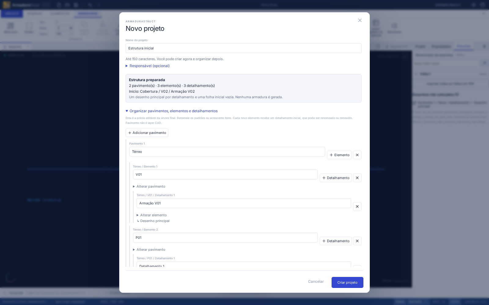

# Novo projeto com organização inicial

O comando **Novo projeto**, na barra de acesso rápido ou na faixa **Arquivo**, abre o mesmo assistente. Ele prepara a estrutura do arquivo antes do desenho. Não gera geometria, armaduras ou quantitativos.

## Criar apenas com o nome

Informe **Nome do projeto** e clique em **Criar projeto**. O responsável é opcional. A estrutura mínima aparece no resumo: **Pavimento 1 → Geral → Detalhamento 1 → Desenho principal**, além de uma **Folha 1** vazia, sem vistas colocadas. Esses itens são renomeáveis; um único pavimento pode representar todo o projeto quando não houver subdivisão por andares.

Se houver um projeto em uso, confira o aviso e marque **Confirmar substituição do projeto atual**. **Salvar cópia do projeto atual** permite guardar um arquivo independente antes de criar. A criação é uma única operação do histórico: **Desfazer** recupera o projeto anterior; a recuperação automática passa a guardar o novo projeto. Pontos e comandos ainda não confirmados são cancelados ao criar e não fazem parte da cópia salva; o aviso informa essa condição.

## Preparar a árvore

Abra **Organizar pavimentos, elementos e detalhamentos**. A própria árvore é a prévia editável do que será criado:

- Renomeie os itens mínimos existentes, evitando acrescentar cópias dos padrões. Por exemplo, renomeie **Pavimento 1** para **Térreo** e **Geral** para **V01**.
- Use **+ Elemento** ao lado do pavimento para acrescentar **P01**. Cada novo elemento recebe um **Detalhamento 1** e um **Desenho principal**.
- Use **Adicionar pavimento** para criar **Cobertura**. Ele começa vazio, sem acrescentar elementos inesperados. Use **+ Elemento** nele e renomeie o novo elemento para **V02**.
- Use **+ Detalhamento** junto ao elemento para preparar outros desenhos. Cada detalhamento recebe um desenho principal; ambos reutilizam as entidades nativas do editor.
- **Alterar pavimento** e **Alterar elemento** permitem mover itens entre pais existentes. O seletor mostra o caminho e a ordem dos itens, inclusive para nomes iguais.
- Escolha o **Detalhamento inicial ativo** pelo caminho completo. Ele será o destino dos próximos objetos.

**Remover** mostra os filhos e desenhos afetados e exige confirmação. Os filhos são removidos apenas do rascunho, sem transferência implícita. Para preservá-los, cancele a remoção e mude seus pais primeiro. A remoção é impedida se eliminar o último pavimento, elemento ou detalhamento do projeto. Pavimentos e elementos vazios são permitidos, desde que a estrutura global mínima continue válida.

Nomes de pavimentos, elementos, detalhamentos e desenhos têm de 1 a 100 caracteres; o projeto e o responsável aceitam até 150. Espaços nas extremidades são normalizados na confirmação. Campos inválidos mostram mensagens próximas; vínculos e IDs também são validados antes de criar. Os limites seguem a persistência nativa: 1.000 pavimentos e 10.000 elementos, detalhamentos e desenhos.

## Rascunho, teclado e continuidade

Até confirmar **Criar projeto**, nenhuma alteração entra no projeto aberto, no histórico ou na recuperação automática. **Cancelar**, **Esc**, o **×** e o clique fora da janela descartam o rascunho. Reabrir começa com novos padrões, sem resíduos. Se o projeto aberto mudar por outro fluxo enquanto o assistente estiver aberto, a criação é bloqueada e é necessário reabrir a janela.

O foco começa no nome. **Tab/Shift+Tab** percorrem os controles dentro da janela; **Esc** fecha sem cancelar um comando CAD pendente no projeto original. **Enter** nos nomes da árvore não cria o projeto acidentalmente. A área central rola em janelas menores e mantém as ações finais acessíveis.

Após criar, a aba lateral **Projeto** é aberta com a hierarquia preparada e um detalhamento válido ativo. Seleções, abas de outros documentos, edição isolada e comandos transitórios são limpos. A árvore lateral continua editando os mesmos IDs e vínculos; não existe cadastro paralelo. Salvar/reabrir preserva essa organização. A seleção do detalhamento ativo é uma preferência local, seguindo a política já existente do aplicativo.

## Contratos e verificação

`src/domain/projectSetup.ts` prepara um `Project` nativo isolado, com validação e operações imutáveis de rascunho. Reutiliza criação/exclusão, nomes e validação de `hierarchy.ts`, e passa pelo `decodeProject` na confirmação. Os auxiliares também são exportados por `src/api.ts`. A aplicação verifica novamente o projeto de origem e confirma o resultado em uma única operação de histórico, protegida contra submissão repetida.

O formato usa **`armadurastruct/20`**, com a migração de máscaras documentada em [Máscaras nativas](MASCARAS-NATIVAS.md). O assistente não exige outra migração ou alteração de projetos antigos, armaduras, pranchas e quantitativos. O assistente não inclui alturas, níveis, cálculo estrutural, templates ou importação.

Verificações automatizadas:

- `tests/projectSetup.test.ts`: padrões, árvore personalizada, IDs, vínculos, nomes/limites, homônimos, remoções, imutabilidade, persistência e destino de uma barra criada pela API.
- `tests/e2e/projectSetup.spec.ts`: Térreo/Cobertura e V01/P01/V02, prévia/final, barra no detalhe ativo, histórico, salvar/reabrir, edição lateral, todas as formas de cancelar, recuperação intacta, comandos pendentes, substituição/cópia, clique duplo, árvore em janela de 600 × 600, teclado/foco e fundos CAD claro/escuro.
- Regressão dos testes existentes, `npm run check`, `npm run build` e `npm run format:check`.

Resultado desta entrega: **383 testes de domínio/importação, 6 de distribuição e 76 fluxos de navegador aprovados**; build e formatação aprovados. O diálogo também foi aberto e cancelado duas vezes no servidor de desenvolvimento com React StrictMode, sem erros de página.

Os fluxos foram exercitados no navegador Chromium. A interface e o domínio são compartilhados com o desktop Tauri; instaladores Linux/Windows não foram compilados nesta entrega. Os limites máximos do formato são validados, mas a árvore do assistente não é virtualizada para cadastros de milhares de itens.
