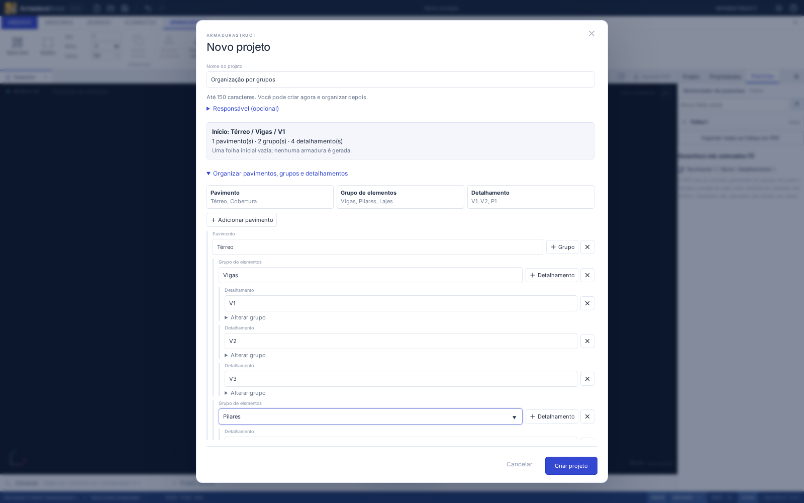
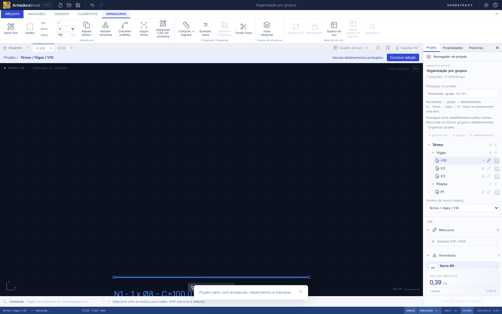
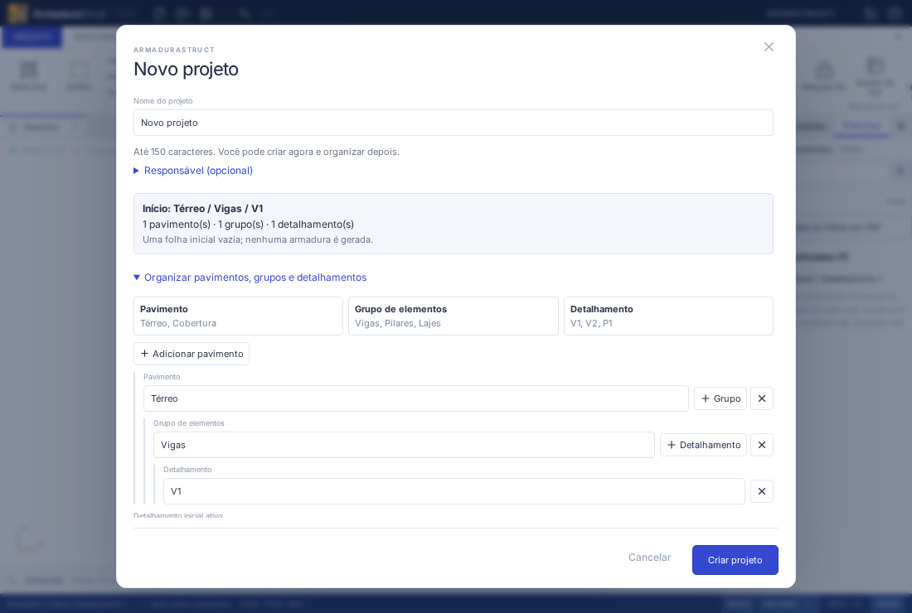

# Pavimento → grupo → detalhamento

A árvore usa três níveis no fluxo comum:

| Nível              | Uso                         | Exemplos                         |
| ------------------ | --------------------------- | -------------------------------- |
| Pavimento          | Nível da obra               | Térreo, Superior, Cobertura      |
| Grupo de elementos | Categoria dos detalhamentos | Vigas, Pilares, Lajes, Fundações |
| Detalhamento       | Conjunto editável da peça   | V1, V2, V3, P1                   |

Exemplo: **Térreo → Vigas → V1** e **Térreo → Pilares → P1**. O cadastro é organizacional: criar pavimentos, grupos ou detalhamentos não gera aço.

## Começar e navegar

**Novo projeto** começa com **Térreo → Vigas → V1**. Você pode informar apenas o nome e criar, ou abrir **Organizar pavimentos, grupos e detalhamentos** para preparar a árvore. Os campos mostram exemplos. Os grupos sugeridos continuam renomeáveis e aceitam categorias próprias.

**+ Detalhamento** em Vigas sugere V2, V3…; em Pilares, P1, P2… Os nomes disponíveis são procurados dentro de cada grupo. Um V1 em outro pavimento tem ID e destino independentes. Adicionar um grupo no assistente prepara seu primeiro detalhamento; adicionar um pavimento prepara um pavimento vazio. Todas essas escolhas aparecem na prévia antes da confirmação.

Na aba **Projeto**, clique em **V1** para abrir seu desenho diretamente. A aba recebe o nome **V1**. A árvore continua visível: clique em V2 para mudar de detalhamento. O lápis ao lado serve para renomear ou mover; o **+** junto ao pavimento/grupo cria um filho naquele contexto. Durante a edição isolada, é possível renomear o detalhamento atual. Para criar/mover grupos e detalhamentos, clique em **Organizar projeto**; isso volta à organização global sem alterar o arquivo ou o histórico. A edição isolada e a seleção do conjunto continuam disponíveis. A expansão dos pavimentos e grupos é preservada.

O fluxo comum não mostra **Desenho principal** como um quarto nível. O registro de desenho continua existindo internamente para manter abas, câmeras, vistas e referências de prancha. Projetos com vários desenhos de um mesmo detalhamento conservam acessos aos desenhos adicionais, com seus nomes próprios.

## Projetos existentes e quantitativos

Não há migração de schema nesta mudança. IDs, nomes já gravados, propriedade dos objetos, posições, vistas e pranchas são preservados. Abrir um arquivo anterior não tenta adivinhar categorias nem reorganiza seu conteúdo. Use o lápis e a mudança de grupo/pavimento se quiser reorganizá-lo.

Os contratos de intercâmbio mantêm os campos históricos `elements`/`elementId`; na navegação, o pai corresponde ao **grupo de elementos**. `Bar.element` continua sendo um metadado da armadura. Não confunda esse texto nem um grupo com a quantidade física.

Novas reuniões de detalhamentos equivalentes propõem os nomes dos detalhamentos (V1/V2), em vez de contar o grupo Vigas como ocorrência. Os nomes são registrados na prévia da reunião; vínculos explícitos de repetição existentes em arquivos anteriores continuam válidos. Renomear um grupo não muda automaticamente os nomes dessas peças. Agrupar, navegar e renomear não alteram o levantamento.

A montagem e a seleção em lote de conteúdo para pranchas ficam para outra entrega. A composição existente continua usando os mesmos IDs de desenhos, posições e escalas; somente os rótulos de desenhos padrão deixam de repetir “Desenho principal”.

## Verificação

- Testes de sugestão de nomes, identidade por grupo/pavimento, rótulos sem mutação, persistência e reunião de peças do mesmo grupo sem alteração de aço.
- Fluxos de navegador para criação Vigas/V1–V3 e Pilares/P1, abertura direta, destino de novas barras, renomeação com histórico, arquivos anteriores com desenhos adicionais e janela compacta nos dois fundos.
- Regressão do assistente, hierarquia, edição isolada e pranchas; `npm run check`, build e formatação.

Resultado: **427 testes de domínio/importação, 6 de distribuição e 17 fluxos de navegador aprovados**, com build e formatação aprovados.

A interface foi exercitada no Chromium web. A execução interativa nativa Linux/Windows não está disponível neste ambiente.
