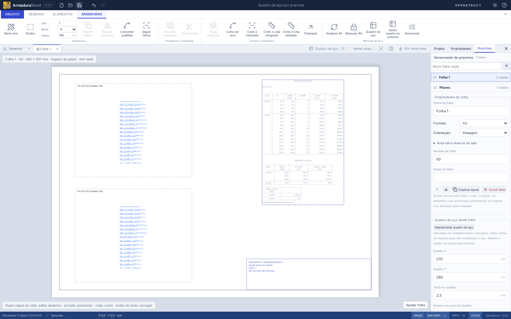

# Quadro de aço vinculado à prancha

Em **Armaduras → Relação do aço** há duas opções:

- **Quadro de aço** mantém a consulta global existente, com todas as posições do projeto e seu estado de bloqueio da RA.
- **Inserir quadro na prancha** abre o papel e coloca uma prévia do quadro no cursor. Clique pelo **canto superior esquerdo** para inserir. Esc ou botão direito cancela; salvar antes do clique não grava a prévia.

Na folha aberta, ela é o destino. Partindo de um desenho, o aplicativo procura uma folha que o contenha; senão usa uma folha aberta ou a primeira cadastrada. O painel permite escolher outra **Prancha de destino**. Sem folhas, o comando orienta a criá-las pelo gerenciador. Conclua a edição isolada antes de alterar a documentação da prancha.

O modelo padrão segue a referência fornecida: nomes dos detalhamentos, **RELAÇÃO DO AÇO** com aço/posição/bitola/quantidade/comprimentos, **RESUMO DO AÇO** por aço e bitola, e peso total por categoria. Comprimentos unitários e totais da relação estão em **cm**; o resumo usa **m e kg**. Os valores exibidos são arredondados; o cálculo utiliza os valores completos.

O texto padrão tem **2,5 mm no papel**, com ajuste de 1,8 a 5 mm. O quadro é uma entidade de papel em tamanho real (1:1), portanto uma vista em 1:25 e outra em 1:100 não mudam seu tamanho nem a quantidade calculada. Não se aplica a escala global de desenho ao quadro.

O resumo aplica **10% de acréscimo ao peso** por padrão, configurável entre 0 e 100%. Isso é uma reserva de apresentação/orçamento, sem acrescentar barras nem alterar o levantamento físico. Com 0%, os pesos do quadro correspondem ao peso teórico líquido. A percentagem utilizada aparece no cabeçalho e na nota do quadro.



## Quais armaduras entram

Entram os IDs físicos das barras pertencentes aos detalhamentos cujos desenhos estão colocados na folha, mais as armaduras exibidas por inserções/rebatimentos nesses detalhamentos. Uma chamada/cota isolada não traz uma armadura estrangeira para o levantamento da folha.

- Várias vistas do mesmo detalhe e várias inserções da mesma barra contam **uma vez por ID físico** naquela folha.
- Ocultar objetos, desligar layers ou alterar estilos de impressão não retira aço do quadro.
- Quantidade base, multiplicador da armadura e repetição do detalhamento são aplicados pelas regras existentes, uma única vez.
- Posições de fabricação compartilhadas somam apenas as ocorrências que participam daquela folha, com suas contribuições preservadas.
- A mesma armadura documentada em duas folhas pode aparecer nos dois quadros. **Somar os quadros das folhas não equivale necessariamente ao levantamento global**; use a consulta global para o total do projeto.
- Uma folha vazia pode receber o quadro vazio. Colocar um desenho depois o preenche automaticamente.

## Atualizar, mover e remover

O quadro acompanha alterações nas armaduras, títulos, fatores de repetição e desenhos colocados/retirados da folha. Não é uma imagem nem uma cópia congelada da tabela. Se a RA global estiver bloqueada e desatualizada, o aplicativo exige **Atualizar RA** ou **Desbloquear RA** antes de inserir/exportar; o desenho do quadro usa o modelo atual e não entrega um PDF com valores antigos.

Depois de inserir, arraste o quadro no papel ou edite **Quadro X/Y** no gerenciador. A origem é seu canto superior esquerdo; X/Y são mm a partir do canto inferior esquerdo da folha, com Y positivo para cima. Ajuste texto e reserva de peso no mesmo painel.

Há um quadro vinculado por folha. Repetir o comando o **reposiciona**, preservando uma única tabela. **Retirar quadro da folha** ou selecionar o quadro e pressionar Delete remove sua apresentação, sem excluir aço. Inserção, movimentação, configurações e remoção participam de Desfazer/Refazer. Duplicar o layout copia a configuração e a posição, sem criar armaduras.

O clique de inserção é recusado se o quadro sair da área útil ou invadir a reserva do selo. Mudanças posteriores de conteúdo/tamanho/posição continuam sendo validadas, e o PDF fica bloqueado se houver transbordamento. Não há recorte nem redução silenciosa para uma fonte ilegível. Para quadros muito altos, aumente a folha, ajuste a composição ou reduza a altura do texto dentro do limite.

## Persistência, exportação e API

O projeto passa a **`armadurastruct/19`**, lendo os formatos 1–18. O campo opcional `sheets[].steelSchedule` contém `origin`, `textHeight`, `allowancePercent`. Arquivos antigos continuam sem quadro até a inserção explícita; IDs, coordenadas e quantitativos são preservados. Um arquivo com esse campo sob cabeçalho antigo é recusado para evitar perda silenciosa. Os pacotes de detalhamento permanecem em `openstruct.detail/10`: o quadro pertence à folha, não ao detalhe.

O **PDF das pranchas é vetorial**, com as mesmas linhas e textos da prévia e os presets de cor existentes. O DXF atual continua sendo exportação do modelo; este recurso não cria um novo layout de papel no DXF.

```ts
import {
  sheetScheduleData,
  sheetScheduleGeometry,
  defaultSheetSchedule,
  setSheetSchedule,
} from './src/api';

const sheetId = project.sheets[0].id;
project = setSheetSchedule(
  project,
  sheetId,
  defaultSheetSchedule({ x: 270, y: 280 }),
);
const data = sheetScheduleData(project, sheetId); // posições e resumo desta folha
const vectors = sheetScheduleGeometry(
  project,
  sheetId,
  project.sheets[0].steelSchedule!,
);
// setSheetSchedule(project, sheetId, undefined) retira o quadro.
```

Essas funções são imutáveis. `sheetScheduleIssues`/`composeSheet`, no domínio de papel, validam a composição antes da inserção/exportação. Não alteram geometrias físicas nem replicam o subsistema de quantitativos.

## Limites e validação

Validação aprovada: `npm run check` (**375 testes de domínio/importação + 6 de distribuição**), `npm run build`, `npm run format:check` e **70 cenários de navegador**. Foram acrescentados 9 testes de domínio e 3 fluxos de navegador para o quadro por folha, incluindo o exemplo real de vigas e pilares.

Há um quadro por folha e não há paginação automática de uma tabela longa, edição individual de suas células ou contagem parcial por recorte gráfico. O escopo usa as definições físicas dos detalhamentos colocados, sem deduzir peças a partir de linhas CAD. Os pesos são teóricos, sem dimensionamento estrutural ou cálculo normativo de perdas. A reserva de 10% é configurável e explícita.

Testes cobrem escopo de duas folhas, vistas/inserções repetidas, vínculos externos, posições compartilhadas, fatores de quantidade, conversão cm/m/kg, reserva, atualização, quadro vazio, migração, persistência, duplicação e remoção, tamanho do texto, PDF vetorial, margem/selo e RA desatualizada. Os fluxos de navegador verificam as duas opções, prévia sem gravação, clique, cancelamento, troca de destino, edição física, reposicionamento/arraste, histórico e reabertura. As verificações são do modo web e do domínio compartilhado; não incluem novos instaladores Linux/Windows.
