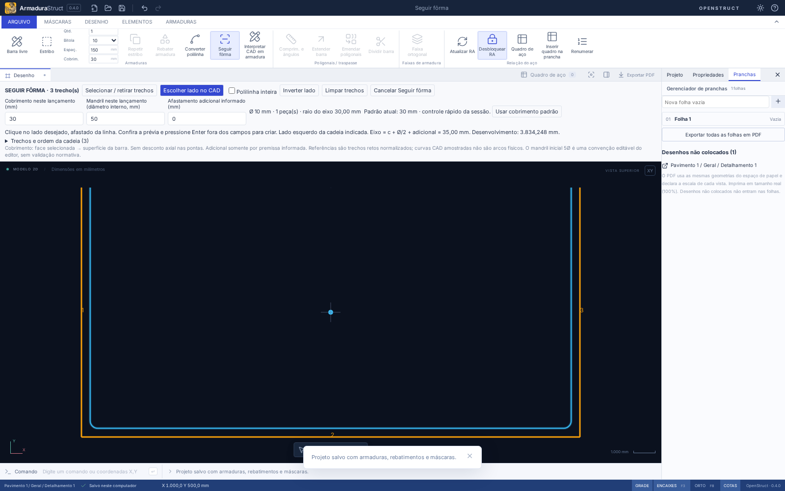
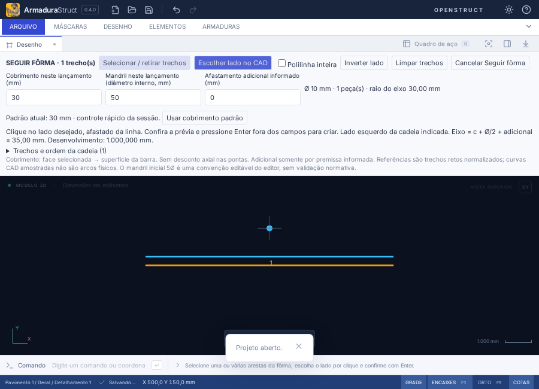
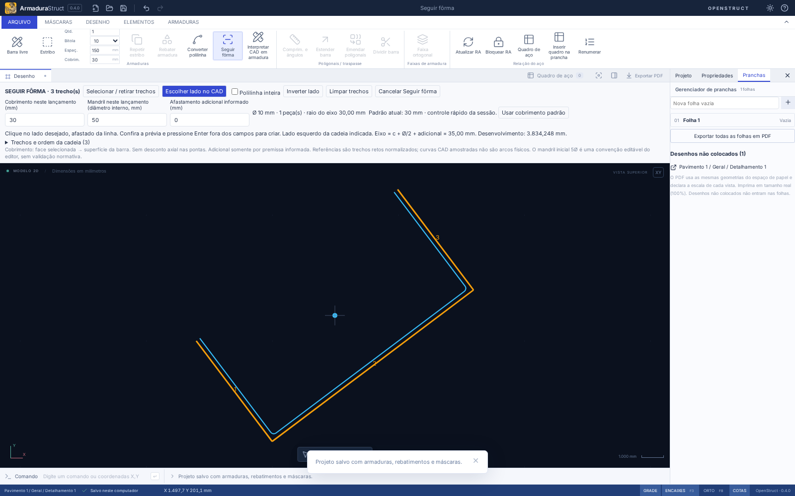

# Seguir fôrma por uma ou várias linhas

Em **Armaduras → Seguir fôrma** (ou comando `FORMA`), selecione as referências diretamente na máscara. O primeiro clique **só seleciona**; não cria barras temporárias. Cada clique seguinte acrescenta uma aresta; clicar numa já selecionada retira essa aresta. O comando não usa os pontos de uma Barra livre nem depende de seleção anterior.

## Sapata: uma barra em U

1. Confira **Bitola**, **Quantidade** e **Cobrim.** nos parâmetros rápidos de Armaduras.
2. Inicie Seguir fôrma e clique no fundo e nas duas laterais. A ordem dos cliques e o sentido original das linhas não determinam o trajeto: a conectividade determina a cadeia, numerada na prévia.
3. Use **Escolher lado no CAD** e clique na região interna da sapata, afastado das linhas. A prévia azul mostra o eixo com suas curvas e o envelope da bitola. O ponto azul indica o clique de lado.
4. Confira cobrimento, diâmetro interno do mandril, raio de eixo, afastamento e desenvolvimento. O ajuste de **Cobrimento neste lançamento** vale só para esta criação. Altere a bitola no controle rápido para atualizar a mesma prévia.
5. Pressione **Enter fora dos campos**. Uma única posição/ocorrência física é criada pela API atômica, com a quantidade indicada. O conjunto pendente é consumido; outro Enter não duplica. Um Desfazer remove a operação inteira e Refazer a recupera.

Em polilinhas, o padrão é selecionar **só a aresta clicada**, inclusive três lados de um contorno fechado. Marque **Polilinha inteira** para selecionar todos os trechos da entidade com um clique; clicar novamente retira o conjunto. Linhas independentes e polilinhas usam a mesma construção física.

**Selecionar / retirar trechos** volta à seleção. **Trechos e ordem da cadeia** lista os itens com botões Retirar. **Limpar trechos** mantém o comando e seus parâmetros, sem aço. Esc/Cancelar abandona todo o lançamento. Retirar ou acrescentar referências pede uma nova escolha explícita de lado.

Enter sem referências orienta a seleção. Com referências, mas sem lado, Enter passa à etapa de escolher lado e pede o clique; não assume interior/esquerda. Uma cadeia inválida permanece selecionada para correção. Enter dentro de um campo não cria aço. A seção tem rolagem para janelas menores e permanece disponível em Foco. Enquadrar, pan e zoom continuam disponíveis durante o comando.

## Cobrimento e padrões existentes

O valor inicial é o **valor vigente de `cover` nos controles rápidos da sessão**, com a restauração entre desenhos já existente. O controle **Cobrim. / Cobrimento padrão de criação** agora torna esse mesmo parâmetro acessível antes de abrir o comando. Não existe uma segunda configuração ou nova hierarquia de defaults. A central **CONFIGURAÇÕES → Configurações CAD → Armaduras** salva o padrão documental; o controle rápido é um ajuste temporário. [Alcance e uso](CONFIGURACOES-CAD.md).

O padrão documental é salvo no JSON; o controle rápido mantém alcance temporário de sessão, sem ser um critério normativo. Sua alteração não modifica barras existentes. Ao iniciar ou reiniciar Seguir fôrma, o comando copia o valor atual. **Usar cobrimento padrão** restaura esse valor no lançamento pendente. Digitar outro valor no campo do lançamento não salva um novo padrão.

O cobrimento é a distância da face selecionada à superfície externa desta barra. O deslocamento do eixo é mostrado separadamente:

`deslocamento = cobrimento + bitola / 2 + adicional informado`

O adicional começa em zero. Se houver uma camada intermediária ou outro afastamento, informe o adicional e sua premissa explicitamente; um adicional positivo sem premissa bloqueia a prévia. Nenhum estribo ou outra camada é deduzido. O adicional, sua premissa e o cobrimento informado no lançamento ficam registrados na observação da barra; esse registro não é um vínculo paramétrico. Não há desconto axial nas pontas: faces de extremidade não selecionadas não encurtam a barra.

O mandril é seu **diâmetro interno**; raio do eixo = `(mandril + bitola) / 2`. O valor inicial 5Ø reaproveita a convenção atual de criação do editor e é editável para este lançamento. Alterar Ø não reduz nem redefine um mandril já mostrado; o raio efetivo é atualizado. Nada disso representa dimensionamento, verificação de ancoragem, traspasse ou aprovação normativa. 30 mm e 5Ø não são apresentados como exigências de norma.

## Cadeia, lado e dobras

As pontas se conectam com tolerância física de **0,1 mm**, após escala, rotação e translação da máscara. Pontas próximas são substituídas pela média determinística do encontro, apenas dentro dessa tolerância; a quantidade de ajustes aparece no painel e os encontros ficam marcados. A máscara original nunca é corrigida. O afastamento é validado contra a cadeia ajustada. Agrupamentos transitivos que ultrapassem a tolerância são recusados.

A ordenação começa pela ponta de menor X/Y, ou pelo vértice de menor X/Y em ciclos, e resolve o sentido pelo vizinho de menor X/Y. Segmentos colineares de avanço são consolidados sem mudar a forma. Duplicatas, sobreposições, ramificações, desconexões, retornos de 180° e autointerseções impedem a confirmação; não se inventam ligações entre linhas.

Em uma cadeia aberta, o clique determina o lado da face mais próxima. Empates com lados incompatíveis e cliques sobre a linha/extensão são recusados. Em contornos fechados, o teste de interior/exterior independe do sentido horário/anti-horário. **Inverter lado** complementa um clique já válido. Clicar a até 0,1 mm da linha é ambíguo.

O offset reutiliza `offsetChain`; o arredondamento reutiliza `geometry`. São conferidos comprimento disponível para tangências, encontros, colapso/inversão, autointerseções e afastamento das faces. A distância entre retas/arcos e faces é calculada analiticamente; a tolerância numérica de comparação do afastamento/envelope é 0,00001 mm. O envelope de trechos não vizinhos também é conferido. Um mandril que invade o afastamento é recusado, sem reduzir raio ou mudar o caminho para caber. Cantos muito agudos continuam sujeitos ao limite do motor de offset existente.

### Contornos fechados

Um quadrado completo permite clique interno **ou externo**. O resultado continua sendo uma barra genérica. Como o contrato atual é uma barra por vértices com duas extremidades, as duas pontas são colocadas no mesmo ponto de um trecho reto, entre suas tangências. Assim, o motor existente produz todas as curvas, inclusive a do fechamento, exatamente uma vez. Os dois segmentos junto ao encontro cobrem partes distintas da mesma perna, sem sobreposição de comprimento. Não foi criada outra família ou um fechamento normativo.

Esse encontro é somente geométrico: não inclui gancho, abertura, solda, ancoragem ou traspasse. As pontas continuam editáveis pelas ferramentas atuais. Não é um estribo paramétrico. A solução não modifica a interpretação de barras antigas e não exige novo schema.

## Referências, proteções e limites

Máscaras nativas, DXF, DWG e referências existentes usam seus trechos retos normalizados. A seleção consulta todas as referências do **detalhamento ativo**, independentemente da máscara ativa para desenhar. Respeita visibilidade, ocultação, captura, layers internos e isolamento. Uma máscara bloqueada pode servir como referência de leitura se sua captura estiver habilitada; criar aço continua sujeito ao layer de destino e às proteções da API.

Escala/unidade da máscara e da prancha não são aplicadas duas vezes. A cadeia e o cobrimento usam mm físicos do modelo. A máscara, seus IDs, camadas, origem e entidades permanecem intactos; alterar essa referência depois não move/regenera a barra.

Círculos nativos não são aceitos como faces retas. Curvas importadas podem já ter sido discretizadas pelo importador; seus trechos normalizados não constituem suporte a arcos físicos nativos nem garantem cobrimento em relação à curva analítica original. Para este comando, selecione faces retas e confira os avisos de importação. Ganchos, arcos físicos nativos, barras variáveis e estribos poligonais continuam nos seus escopos próprios.

Até **496 trechos** podem ser selecionados, respeitando o limite existente de 500 vértices da barra, inclusive o encontro de um contorno fechado. Seleções maiores são recusadas antes de destacar milhares de entidades. Limites de arquivo/máscara do importador são preservados.

Trocar projeto, desenho, detalhamento, isolamento, aba de ferramentas ou página do quadro cancela o conjunto pendente. Alterar o projeto durante a seleção invalida o snapshot. Câmera e consulta não criam histórico. A confirmação revalida projeto, contexto e captura das referências, e usa `bar.create`. Erros de geometria, valores inválidos ou layer de destino bloqueado não deixam aço parcial. Quando há RA bloqueada, a criação usa a política existente `invalidate-lock`, desbloqueando e recalculando o quadro; Desfazer também restaura a RA anterior.

## Conferência analítica e arquivos

Os testes geométricos usam casos de conferência, não prescrições normativas:

| Caso                                            | Resultado                                                                                                                |
| ----------------------------------------------- | ------------------------------------------------------------------------------------------------------------------------ |
| Reta de 1000 mm, c=30 e Ø10                     | Eixo a ±35 mm; comprimento 1000 mm, sem desconto axial                                                                   |
| U de 2000 × 1000 mm, c=30, Ø10, mandril 50      | Vértices `(35,1000)`, `(35,35)`, `(1965,35)`, `(1965,1000)`; raio 30 mm; desenvolvimento `3740 + 30π = 3834,2477796… mm` |
| Quadrado de 1000 mm, mesmos parâmetros, interno | Quatro curvas; desenvolvimento `3480 + 60π mm`                                                                           |
| Mesmo quadrado, externo                         | Quatro curvas; desenvolvimento `4040 + 60π mm`                                                                           |

A prévia usa os mesmos segmentos físicos da barra confirmada. CAD e exportadores continuam consumindo `geometry`/`drawingPrimitives`; o DXF mantém sua discretização existente das curvas, e comprimentos/pesos usam arcos analíticos. Zoom não altera medidas ou o arquivo.

Arquivos principais: `src/domain/followForm.ts` (captura, cadeia, lado e validação); `src/components/FollowFormPanel.tsx` (parâmetros e etapas); `src/components/CadCanvas.tsx` (clique e realce); `src/App.tsx` (sessão, cancelamento e API); `src/components/Ribbon.tsx` (mesmo padrão rápido de cobrimento); `src/api.ts` (helpers públicos). `tests/followForm.test.ts`, `tests/e2e/followForm.spec.ts` e o teste de Seguir fôrma em `tests/e2e/editor.spec.ts` verificam o fluxo. Nenhuma geometria de máscara é copiada para barras sem a confirmação explícita.

O ambiente disponível permite execução web em Chromium/Linux. A interface nativa Tauri no Linux/Windows não foi executada interativamente nesta entrega.

## Resultados da validação — 08/11/2026

- `npm run check`: **453 testes de domínio/importação** e **6 de distribuição** aprovados.
- `npm run build` e `npm run format:check`: aprovados.
- **116 cenários E2E conferidos**, combinando regressão e reexecuções: 114 passaram na suíte completa. O caso compacto usava uma verificação de visibilidade inadequada para um grupo SVG de altura zero contendo uma reta horizontal; a imagem estava correta. O teste passou a medir o caminho SVG. Os **19 fluxos de Seguir fôrma** passaram na execução final, incluindo esse caso, o adicional com premissa persistida e o DXF real importado/exportado.
- Conferidos U em todas as ordens/sentidos, quadrado interno/externo, canto côncavo, tolerância de encontro, trajetos inválidos, máscara em cm/girada/transladada, API/RA bloqueada, salvar/reabrir, histórico, contexto, Foco e janela compacta. Prévia/cancelamento preservam o projeto e a referência; o quadro conta uma peça para a barra de teste.

As capturas deste guia são produzidas pelos fluxos automatizados. A verificação web não substitui execução nativa interativa nos sistemas de destino.
