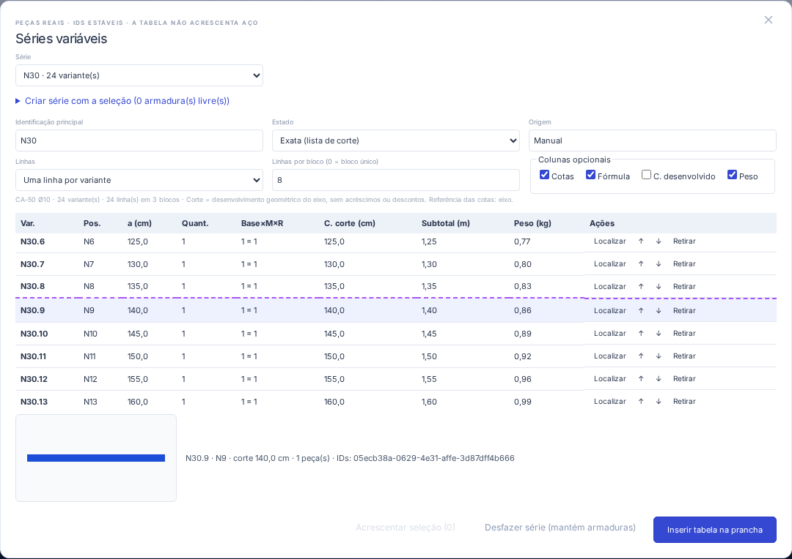
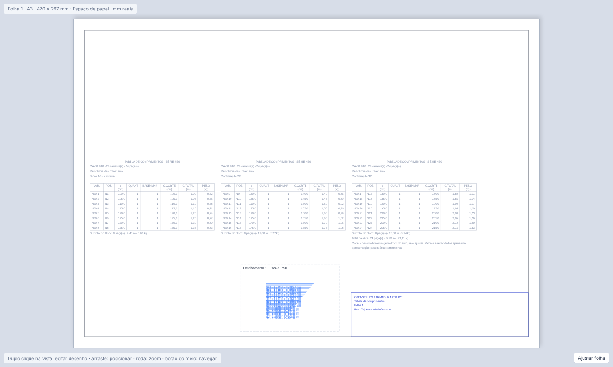

# Séries variáveis e tabela de comprimentos individuais

Em **Armaduras → Relação do aço → Séries variáveis** (atalho `SERIES`) é possível agrupar armaduras reais em uma **série variável**, consultar a lista conferível de cada variante e inserir essa lista como tabela na prancha. A tabela documenta os dados físicos: ela não acrescenta peças, não recalcula a geometria por conta própria e não faz dimensionamento estrutural.



## Série, variante e identidade

- **Série** é a entidade física compartilhada (`Project.barSeries`). Ela guarda a identificação principal (ex.: `N30`), o estado (**exata** ou **estimada**), a origem (manual ou gerador), o total declarado opcional e a lista de variantes.
- **Variante** é uma armadura real (`Bar`) com geometria, quantidade e ID próprios. A série guarda só o vínculo `{ id da variante, id da armadura, estação }`. Comprimentos e quantidades não são copiados para a série: tudo é lido das armaduras, pelo mesmo motor da relação do aço.
- A **ordem** segue a estação física (1…n). A subidentificação exibida é `série.sequência` (`N30.1`, `N30.2`…), e a coluna **Pos.** mostra a posição de fabricação atual da peça. Renumerar posições muda os rótulos exibidos, mas não o ID da variante nem o vínculo da linha.
- Número de variantes, número de peças e número de linhas agrupadas são grandezas diferentes: uma variante com quantidade 3 representa 3 peças; 24 variantes não multiplicam nada por 24.

### Criar e editar

1. Selecione no desenho as armaduras da série (a ordem da seleção define a sequência).
2. Abra **Séries variáveis**, expanda **Criar série com a seleção**, informe a identificação, o estado e, se quiser, o total declarado, e confirme.
3. **Acrescentar seleção** coloca novas armaduras no fim; **↑/↓** muda a sequência; **Retirar** tira a variante da série (a armadura continua no projeto); **Desfazer série** desfaz o agrupamento e retira as tabelas, mantendo armaduras e aço.

Não há edição de números isolados na tabela. **Localizar** seleciona a própria armadura no desenho para editar geometria ou quantidade no painel de propriedades; a tabela atualiza sozinha. Toda alteração passa pelo histórico (Desfazer/Refazer) e respeita a edição isolada: só é possível alterar séries cujas armaduras pertencem ao detalhamento isolado.

## Quantidade, comprimento e corte

Cada linha mostra:

| Coluna               | Conteúdo                                                                                                                                                |
| -------------------- | ------------------------------------------------------------------------------------------------------------------------------------------------------- |
| Var. / Pos.          | Subidentificação na série e posição de fabricação (o ID estável fica na consulta e no CSV)                                                              |
| Cotas (cm)           | Cotas que variam entre as variantes; as constantes aparecem uma vez; a referência de medição (eixo ou face externa) é explícita, por linha quando mista |
| Quant.               | Quantidade efetiva = base × multiplicador da armadura × repetição do detalhamento, aplicada uma única vez                                               |
| Base×M×R             | Fórmula da quantidade (opcional)                                                                                                                        |
| C. desenvolvido (cm) | Desenvolvimento geométrico do eixo da própria peça, com dobras, arcos e ganchos (opcional)                                                              |
| C. corte (cm)        | Comprimento individual de corte                                                                                                                         |
| C. total (m)         | Subtotal = soma das contribuições da RA (quantidade efetiva × comprimento físico)                                                                       |
| Peso (kg)            | Peso teórico, sem reserva (opcional)                                                                                                                    |

**Política de corte:** corte = desenvolvimento geométrico do eixo, sem acréscimos nem descontos implícitos (mesma política da [memória de corte](CONVENCOES-COTAGEM-ARMADURAS.md)). Os valores são arredondados apenas na apresentação; totais usam a precisão completa. A reserva de peso do quadro de aço não altera cortes nem número de peças.

Exemplos verificados nos testes: barras de 1.000/1.250/1.500 mm, uma peça cada, somam **3.750 mm**; com duas repetições, **6 peças e 7.500 mm**; multiplicador 2 e repetição 3, **18 peças e 22.500 mm**. Com quantidades 1/2/3, **6 peças e 8.000 mm**; com multiplicador 2 e repetição 3, **36 peças e 48.000 mm**.

Em séries com aços ou bitolas diferentes, a tabela e a consulta identificam o material por linha. Peças com cotagem por eixo e por face externa mantêm linhas separadas para não misturar referências.

### Agrupar variantes equivalentes

A opção **Agrupar equivalentes** junta apenas variantes com a mesma assinatura de fabricação (forma, aço, bitola, mandril, ganchos e terminações), a mesma regra das posições de fabricação. Mesmo comprimento total ou mesmo texto arredondado não bastam. A linha agrupada conserva os IDs e as quantidades de origem (`N30.1,3`), e a opção **Uma linha por variante** desfaz a apresentação.

### Estimativa, lista incompleta e revisão

- **Série estimada:** uma única armadura é o **representante médio** (variável/representativo). Ela continua sendo a peça contada na RA, nunca uma peça adicional. A linha mostra `méd.` e o aviso **ESTIMATIVA** acompanha a interface, a tabela e o CSV. Não há lista de corte individual.
- **Incompleta:** quando o total declarado é maior que as variantes cadastradas, ou quando uma variante é excluída do projeto (a série guarda o total anterior em vez de encolher em silêncio).
- **Revisar:** alguma variante tem geometria inválida. A inserção e o PDF ficam bloqueados.
- **Lista parcial:** a tabela de uma folha mostra só as variantes documentadas nessa folha e informa quantas são.

## Tabela na prancha

1. Na consulta, escolha as colunas opcionais, o agrupamento e **Linhas por bloco** (0 = bloco único).
2. **Inserir tabela na prancha** abre a folha que documenta a série (ou a ativa) com a prévia no cursor. O painel mostra o destino e o escopo e permite trocar a folha, a altura do texto e a divisão.
3. Clique pelo **canto superior esquerdo**. Esc, botão direito ou **Cancelar** descartam a prévia sem gravar. Desfazer, troca de projeto/folha, exclusão da série e alterações concorrentes do documento também cancelam.



- Cada bloco repete título, série, unidades, cabeçalho e avisos, e indica **Bloco 1/3 - continua** / **Continuação 2/3**. O subtotal de cada bloco é distinto do **Total da série**, que aparece só no último bloco, sem somar totais repetidos.
- As continuações ficam à direita do bloco anterior; arraste qualquer bloco para posicioná-lo. **Reorganizar continuações automaticamente** volta ao arranjo inicial.
- O texto tem altura em mm de papel (1,8 a 5 mm), independente das escalas das vistas. Bloco fora da área útil ou sobre o selo é recusado; não há recorte, redução silenciosa de fonte nem perda de linhas. Se não couber, divida em mais blocos ou mova-os.
- Repetir o comando para a mesma série na mesma folha **reposiciona** a tabela existente; cliques repetidos não duplicam. No gerenciador, **Mostrar tabela da série** oculta/mostra todos os blocos sem apagar a configuração; tabelas ocultas não entram no PDF/DXF. Selecione um bloco e pressione Delete, ou use **Retirar tabela da folha** no gerenciador, para retirar só a apresentação. Duplicar o layout copia a tabela apontando para a mesma série.
- Inserir, mover, dividir, ocultar ou retirar a tabela não altera aço. Várias vistas da mesma série contam uma vez; a tabela segue o mesmo escopo do [quadro de aço da folha](QUADRO-NA-PRANCHA.md) e não traz variantes de outras folhas.
- Com a RA bloqueada e desatualizada, a tabela informa o estado e a inserção/exportação exigem **Atualizar RA** ou **Desbloquear RA**; não se combina tabela atual com resumo congelado.

## Exportação

- **PDF e DXF de pranchas:** a tabela usa as mesmas primitivas vetoriais da tela, com os mesmos valores, rótulos, avisos e blocos. O DXF global do modelo não ganha tabelas de papel.
- **CSV por escopo:** marque **Lista por variante (séries variáveis)** para gerar `<projeto>_<escopo>_variantes.csv` com IDs da série, das variantes e das armaduras, estado, origem, sequência, subidentificação, posição, aço, bitola, cotas e referência, quantidades (base, multiplicador, repetição, efetiva e fórmula), comprimentos desenvolvido e de corte, política, subtotal, peso e as origens agrupadas em JSON. Sem a opção, os arquivos anteriores são idênticos. Escape, proteção contra fórmulas, `;`, UTF-8 e decimal seguem as convenções do [CSV por escopo](CSV-POR-ESCOPO.md).
- **Dados de fabricação:** `seriesFabricationRecords` (domínio) gera um registro por variante (ou por grupo válido) a partir das peças exatas. Séries estimadas, incompletas, com geometria inválida ou com RA desatualizada são bloqueadas com diagnóstico; a média nunca vira peça fabricável. O adaptador BVBS/romaneio industrial não faz parte desta entrega.

## Persistência e compatibilidade

- Séries sem máscaras independentes usam **`armadurastruct/40`**; máscaras sem séries conservam **`/41`**. Ao combinar os dois recursos, o projeto passa a **`/43`**, em qualquer ordem. O `/42` permanece reservado à PR #218; a variante `/41` da PR #217 ainda exige integração separada e seus dados de propriedades personalizadas são recusados explicitamente, sem descarte. Selos, modelos, vínculos e exclusão de recursos não rebaixam a composição. Os contratos anteriores continuam abrindo sem inventar séries nem alterar aço. Dados novos sob cabeçalho incompatível são recusados, inclusive a composição adulterada para `/40` ou `/41`. Mantenha uma cópia antes de salvar em formato novo.
- `Project.barSeries[]`: `id`, `name`, `status`, `provenance`, `variants[]` (`id`, `barId`, `station`), `expectedVariants?`, `representativeBarId?`. `Sheet.seriesTables[]`: `id`, `seriesId`, `origin`, `textHeight`, `rowsPerBlock?`, `blockOrigins?`, `grouping`, `columns`, `visible?`. Não há geometria nem quantitativo duplicados.
- Vínculos inexistentes, IDs repetidos, estação duplicada ou armadura em duas séries são recusados ao abrir.
- Excluir armaduras reconcilia a série (variante retirada, série incompleta) e retira tabelas de séries esvaziadas, sem linhas órfãs.
- **Cópia física** (Duplicar armadura) da série inteira cria uma nova série com novos IDs apontando para as novas peças; cópia parcial gera peças independentes. **Cópia de apresentação** (duplicar layout) aponta para as mesmas peças.
- O **pacote de detalhamento** (`openstruct.detail`) ainda não transporta séries: exportar um detalhamento com série é recusado com orientação, em vez de descartar o agrupamento. Desfaça a série (as armaduras permanecem) ou use o projeto completo.

## API

```ts
import {
  createBarSeries,
  seriesTableData,
  splitSeriesRows,
  setSeriesTable,
  seriesFabricationRecords,
} from './src/domain/barSeries';
import { defaultSeriesTable } from './src/domain/barSeriesSchema';
import { seriesTableGeometry } from './src/domain/seriesTableGeometry';

const { project: p1, id } = createBarSeries(project, {
  barIds: ['b1', 'b2', 'b3'],
  name: 'N5',
});
const data = seriesTableData(p1, id); // linhas, cotas, totais e avisos
const blocks = splitSeriesRows(data.rows, 8); // sem perder nem repetir linhas
const p2 = setSeriesTable(p1, sheetId, 't1', {
  ...defaultSeriesTable('t1', id, { x: 20, y: 280 }),
  rowsPerBlock: 8,
});
const vectors = seriesTableGeometry(p2, sheetId, p2.sheets[0].seriesTables![0]);
const exact = seriesFabricationRecords(p2, id); // ou diagnósticos de bloqueio
```

## Limites

- Não há geração automática de séries por contornos, otimização de corte, novo gerador de estribos variáveis (#138 foi removida do repositório) nem alteração de critérios normativos. Geradores futuros podem criar armaduras reais e chamar `createBarSeries` com `provenance: { kind: 'generator', source }`.
- Uma política de corte diferente da geométrica (arredondamento físico por peça) ainda não existe; quando existir, deve atuar por peça antes da soma, mantendo os valores geométrico e final distinguíveis.
- A tabela não é editável célula a célula; a edição é sempre da armadura.
- Verificações realizadas no modo web (Chrome) e no domínio compartilhado; o aplicativo desktop não foi executado nesta entrega.
