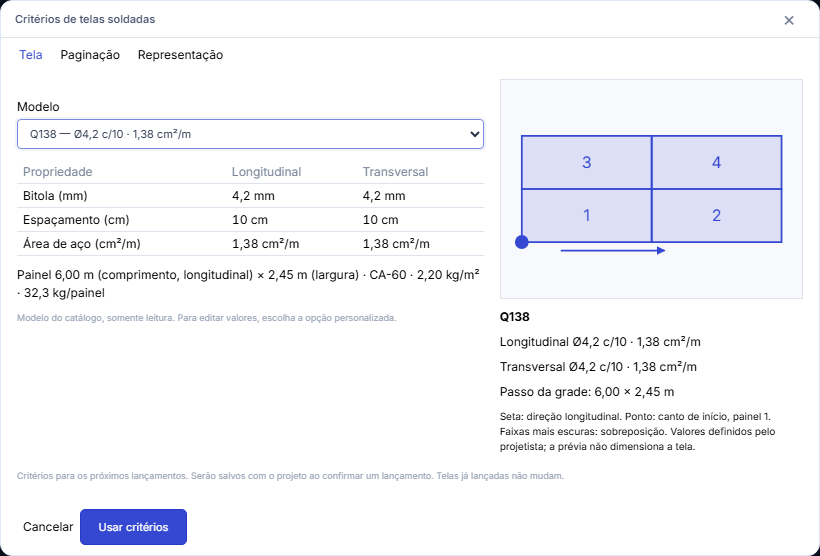
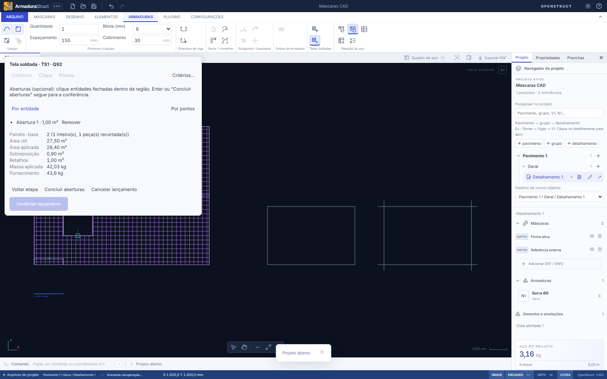
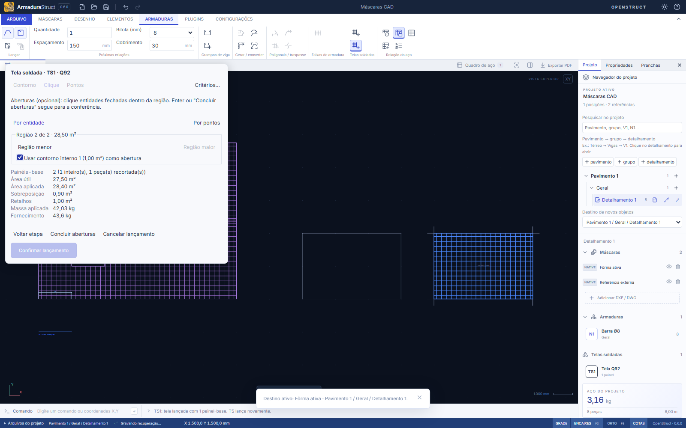
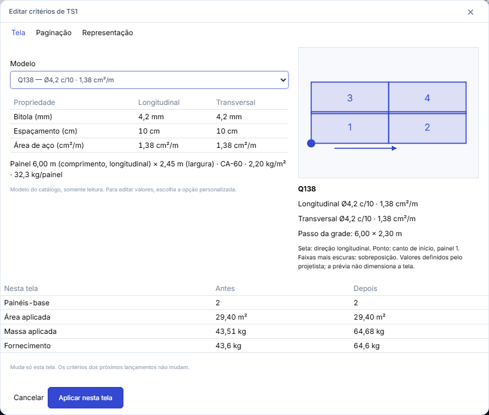
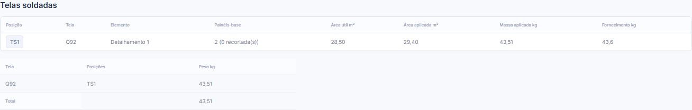
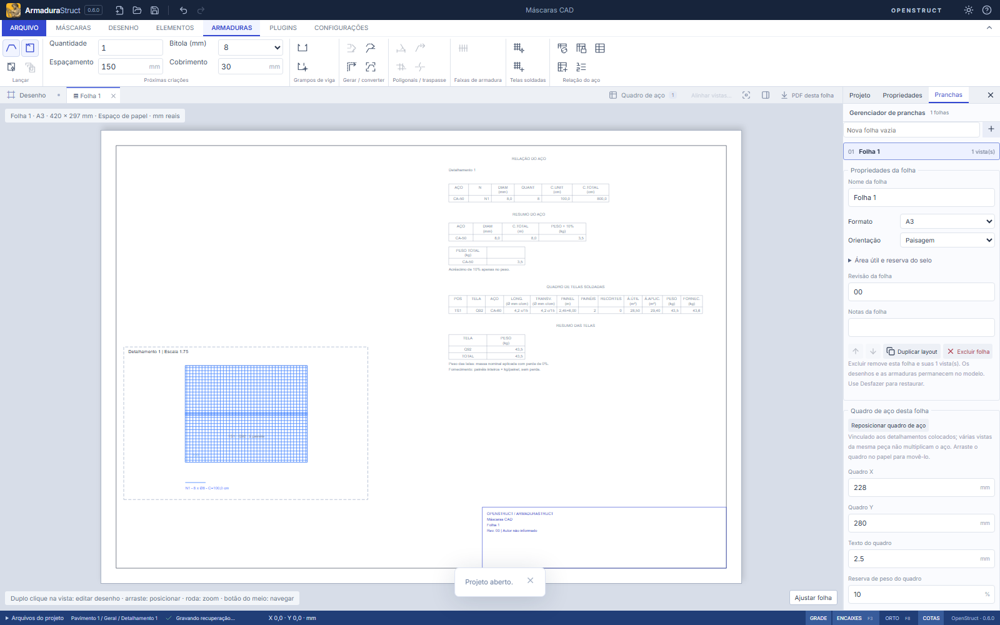

# Telas soldadas — #121

Em **Armaduras → Telas soldadas**, **Critérios de telas** define a tela dos próximos lançamentos e **Lançar tela** (comandos `TS` ou `TELA`) lança uma tela sobre uma região da fôrma. Na primeira vez da sessão, os critérios abrem antes do lançamento.

## Critérios

A janela tem três abas e uma prévia de 2 × 2 painéis, girada pela orientação, com o canto de início, a direção longitudinal e as faixas de sobreposição.

- **Tela:** modelo do catálogo (18 telas CA-60 de 2,45 × 6,00 m, só leitura) ou **Personalizada (a partir de …)**, que copia os valores do modelo atual e fica identificada como "(personalizada)". As propriedades aparecem por direção: Ø em mm, espaçamento em cm, As em cm²/m, painel em m, kg/m² e kg/painel.
- **Paginação:** orientação, canto de início, afastamentos e sobreposições na largura e no comprimento, digitados em mm.
- **Representação:** posição (TS1, TS2…), layer ("Pelo papel (ARMADURAS)" ou uma do projeto) e o que desenhar (contorno das peças, fios e identificação).

## Lançamento

1. **Região**, em um de três modos:
   - **Contorno:** clique numa entidade fechada da máscara (retângulo, polilinha, círculo ou contorno importado).
   - **Pontos:** indique os vértices; Enter fecha e Backspace remove o último.
   - **Clique:** clique dentro da região, na máscara ativa (Máscaras → Referências). O painel mostra as regiões que contêm o ponto, inclusive as formadas por linhas soltas que se cruzam, da menor para a maior ("Região menor" / "Região maior"). Contornos internos aparecem como caixas desmarcadas e só viram abertura se forem marcados.
2. **Aberturas** (opcional): por entidades fechadas ou por pontos.
3. **Conferir:** a prévia no canvas e os números do painel saem das mesmas funções do lançamento confirmado. **Indicar ponto de partida** ancora a paginação num ponto clicado ou digitado. Lacunas fechadas por ajuste exigem marcar a confirmação.

**Confirmar lançamento** grava tudo numa operação, com um único desfazer. Esc descarta sem gravar. Mudar o projeto, o desenho, o detalhamento ou a máscara ativa cancela o lançamento em curso.

## Edição

Uma tela é selecionada com um clique em qualquer linha dela ou pela janela. A aba **Propriedades** mostra "TELA SOLDADA" com os quantitativos.

- **Editar critérios…** abre a janela só para esta tela, com a tabela antes × depois (painéis-base, área aplicada, massa aplicada e fornecimento). **Aplicar nesta tela** não muda os critérios dos próximos lançamentos.
- **Redefinir região…** reabre as etapas de região para a mesma tela, com a linha "Antes:" ao lado da prévia nova. A tela mantém o ID e os critérios.
- Com a janela de critérios aberta, Ctrl+S, Ctrl+O, Ctrl+Z e Ctrl+Y ficam retidos, como nas janelas do estribo e do grampo.
- Mover, girar, copiar e apagar usam os comandos de sempre. Girar soma o ângulo à orientação. Espelhar é recusado, porque inverteria a posição dos fios. Copiar cria uma tela nova, com ID próprio, que soma no quadro.

## Paginação e quantitativos

A grade é ancorada no canto de início, no referencial da tela, ou no ponto de partida informado. O passo é a dimensão do painel menos a sobreposição em cada eixo. Cada célula que toca a região útil é um painel-base, mesmo que gere peças desconexas. Não há reaproveitamento de retalhos nem otimização de corte.

- Área útil = região após os afastamentos.
- Área aplicada = soma das peças, cada camada física uma vez.
- Sobreposição = aplicada − útil.
- Massa nominal aplicada = área aplicada × kg/m².
- Massa de fornecimento = painéis-base × kg/painel, que já inclui os retalhos.

As duas massas ficam separadas e não se somam. Exemplo da issue (caso 2): Q92 numa laje de 6,00 × 4,75 m com 150 mm de sobreposição na largura dá 2 painéis-base, 28,50 m² úteis, 29,40 m² aplicados, 0,90 m² de sobreposição, 43,51 kg aplicados e 43,6 kg de fornecimento.

A malha desenhada é nominal, centrada no painel e recortada pelas peças. Ela não representa a disposição comercial dos fios de borda, e os quantitativos não dependem dela.

## Quadros e perda

- **Quadro de aço:** seção "Telas soldadas" com uma linha por posição, o resumo por tela com o total e um card próprio. Clicar numa linha seleciona a tela.
- **Aba Projeto:** lista "Telas soldadas" do detalhamento ativo e, abaixo do "AÇO DO PROJETO", uma linha com o número de telas e o peso delas.
- **Prancha, PDF, DXF e CSV:** quadro de telas e resumo por tela, à parte das bitolas das barras.

Barras e telas não se somam num número único. A perda das telas é um percentual informado pelo usuário, com padrão 0%. Ela fica no quadro da prancha (campo **Perda das telas**) e no CSV por escopo (do quadro de cada prancha, mesmo valor para todos ou sem perda). A perda incide sobre a massa nominal aplicada e aparece à parte; a massa de fornecimento não recebe perda. O quadro global não aplica perda.

## Arquivo e validação

Telas exigem o formato nativo **armadurastruct/29** e o pacote **openstruct.detail/18**, reservados a esta contribuição. Arquivos /28 e pacotes /17 com telas são recusados; as versões seguintes as aceitam, e os arquivos saem no formato atual. Projetos sem telas mantêm a mesma forma de antes, inclusive nas exportações. Ao abrir o arquivo, cada lançamento é revalidado (critérios, região e plano).

O lançamento guarda uma cópia dos critérios efetivos e a região estática; atualizar a partir da máscara é uma ação explícita. A camada do lançamento é a única fonte da camada da tela. Pacotes, transferência e reunião de repetições levam as telas, com a mesma identidade física (critérios, região e âncora relativos ao primeiro vértice). Um detalhamento só com telas também pode ser reunido, e as vistas absorvidas são reenquadradas pela tela mantida. Mover telas para outro detalhamento exige o mesmo fator de repetição, como nas barras, porque o fator multiplica o quadro.

## Limites

- Não dimensiona a laje nem verifica conformidade normativa, ancoragem ou emendas.
- Sem otimização de corte nem reaproveitamento de retalhos.
- O snap do canvas não oferece interseções; nesses casos, digite as coordenadas ou use o modo Clique.
- No DXF, as telas saem como geometria e quadro em texto, sem entidade semântica de tela; o arquivo nativo preserva todos os dados.

## Resultados desta contribuição

- `npm run check`: 75 arquivos, 1074 testes unitários aprovados; testes de distribuição e validação do plugin de exemplo aprovados.
- `npm run build` e `npm run format:check`: aprovados.
- `npx playwright test`: suíte completa, 294 fluxos aprovados no Chromium, contra o master com a central de atalhos. Inclui critérios, lançamento por contorno, pontos e clique, edição e quadros das telas, os atalhos, e o menu Armaduras compacto em 1000, 1280, 1366 e 1920 px.
- Cada parte do domínio e da interface passou por testes de mutação (alterações propositais no código), todas detectadas pelos testes.
- Interação nativa desktop Linux/Windows não executada. Capturas e fluxos foram verificados no Chromium.
