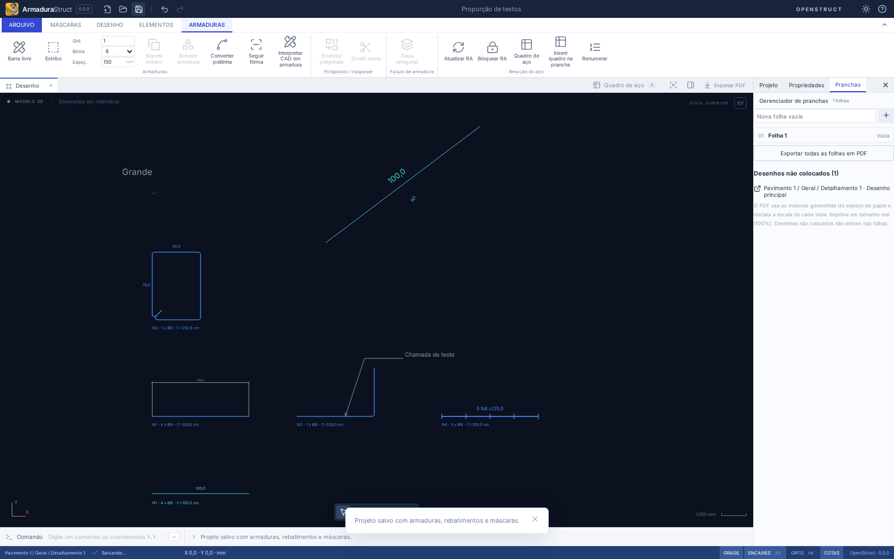
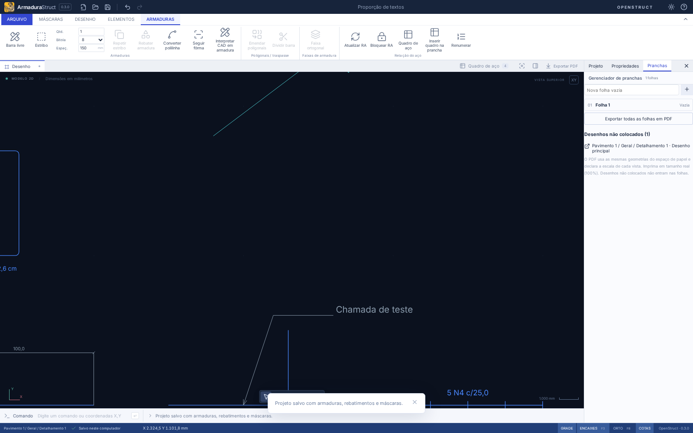
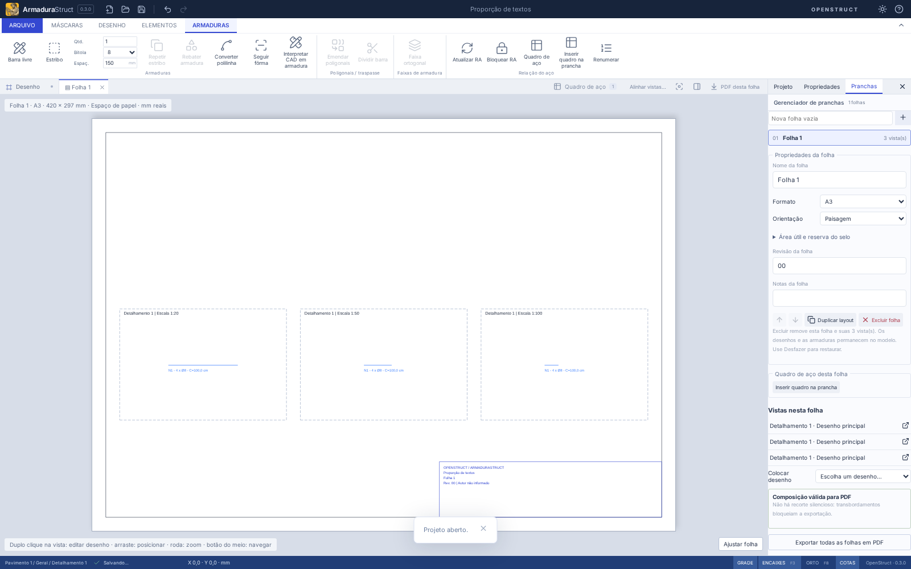

# Proporção dos textos durante o zoom

Os textos do desenho agora aumentam e diminuem com a geometria. Afastar a câmera pode tornar uma identificação ilegível; aproximar recupera sua leitura. Nenhuma altura é compensada para garantir um mínimo de pixels.

## Conteúdo e auxiliares

| Texto                                   | Altura usada no modelo                       | Comportamento anterior corrigido                                |
| --------------------------------------- | -------------------------------------------- | --------------------------------------------------------------- |
| Identificação de barra                  | 40 mm, pelo contrato de primitivas existente | 11 px independentemente do zoom                                 |
| Cotas automáticas do estribo            | 40 mm, compartilhados com a saída            | 9 px e posições diferentes da exportação                        |
| Anotações, chamadas e distribuições     | Altura da primitiva/configuração existente   | Mínimo de 10 px                                                 |
| Rebatimento padrão                      | 40 mm × escala gráfica                       | Altura derivada da câmera e caminho legado separado             |
| Identificação personalizada da inserção | Altura definida × escala gráfica             | Mínimo de 10 px na renderização                                 |
| Texto importado                         | Altura de origem × escala da máscara         | Altura física já correta; precisão de renderização SVG alinhada |
| Rótulo da caixa de agrupamento          | 11 px                                        | Auxiliar de navegação/seleção, continua fixo em tela            |

As caixas de agrupamento e seus rótulos não são primitivas de saída, não têm posição/tamanho de texto persistidos e continuam auxiliares de interação. Cursor, alças, tolerâncias de captura/encaixe, menus e painéis também conservam seus controles em pixels. Não houve substituição global de `1 / view.s`.

`physicalBarTextPrimitives` em `drawingPrimitives.ts` centraliza identificação e cotas de barras. Canvas e exportação usam as mesmas alturas, coordenadas, rotação e alinhamento. Identificações acompanham a rotação física da barra; cotas automáticas do estribo usam as posições e medidas já adotadas na saída. Rebatimentos antigos e novos passam por `representationPrimitives`, incluindo origem, rotação, escala gráfica e identificação personalizada. As poligonais físicas, ganchos, comprimentos e quantidades permanecem intactos.

## Câmera, inserção e papel

- **Zoom:** muda apenas a observação. Por exemplo, uma altura de 40 mm aparece com 5 px em câmera 0,125 e 10 px em câmera 0,25. Antes, a identificação permanecia com 11 px nos dois casos.
- **Escala gráfica da inserção:** amplia sua geometria e seus textos conforme o contrato da representação, sem multiplicar aço.
- **Escala de impressão 1:N:** converte modelo para papel. A política de altura configurada por vista permanece: uma vista configurada com 2,5 mm mantém essa altura de papel em 1:20, 1:50 e 1:100; representações ampliadas/alturas próprias continuam respeitando o contrato existente.

O PDF de modelo deixou de limitar fontes a 5–12 pt: a altura é convertida por `altura_mm × escala_modelo_papel × 72 / 25,4`. O PDF de folhas já usava mm de papel e conserva essa conversão. O DXF continua gravando altura no espaço do modelo, posição, rotação e alinhamento. A câmera não participa de nenhuma exportação. Não há nova versão de arquivo ou migração nesta correção.

## Evidências e verificação

O mesmo projeto de teste inclui barra reta, dobrada, estribo com cotas, distribuição, chamada, cota, rebatimento legado e inserção girada/ampliada, além de textos importados com 12 e 90 mm.

`tests/e2e/textZoom.spec.ts` mede a transformação de câmera, comprimento aparente da barra e tamanho aparente dos textos. Cobre zoom dobrado pela roda, botões de aproximação/afastamento, pan, seleção, alças, enquadramento e travessia do antigo limiar de 10 px. Compara o JSON salvo antes/depois. Na prancha, verifica barras de 50/20/10 mm para uma peça de 1000 mm nas três escalas e altura de texto de 2,5 mm, independente do zoom de observação.

`tests/textZoom.test.ts` verifica alturas, posições, rotação, alinhamento, inserções, composição em três escalas e inspeção das instruções de fonte dos PDFs. Reabre o DXF exportado para conferir textos/alturas/coordenadas/rotação e verifica que persistência e quantitativos permanecem iguais. O teste do PDF de modelo inclui fontes abaixo do antigo mínimo e acima do antigo máximo.

A altura declarada e a transformação são verificadas com precisão numérica; a caixa dos caracteres no Chromium admite até 1,5 px de diferença de rasterização. O conteúdo SVG usa `geometricPrecision` para evitar arredondamentos de fontes que alteravam a proporção. PDF usa fontes base Helvetica; a fonte disponível no navegador e o leitor CAD podem produzir pequenas diferenças na largura dos caracteres. Não há incorporação de novas fontes ou promessa de identidade pixel a pixel entre esses leitores. Rotação e alturas/posições numéricas do DXF têm tolerância de 10⁻⁶ unidades nos casos de teste; a conversão de mm para pt é verificada com tolerância de 10⁻⁸ pt.

A interface e os contratos são compartilhados com o desktop; os fluxos automatizados são executados no Chromium. Instaladores Linux/Windows não são compilados nesta entrega.

Resultado desta entrega: **399 testes de domínio/importação, 6 de distribuição e 81 testes de navegador aprovados**, com execução completa da regressão. `npm run check`, `npm run build` e `npm run format:check` aprovados. Os formatos de projeto 20 e de pacote 11 permanecem inalterados.
