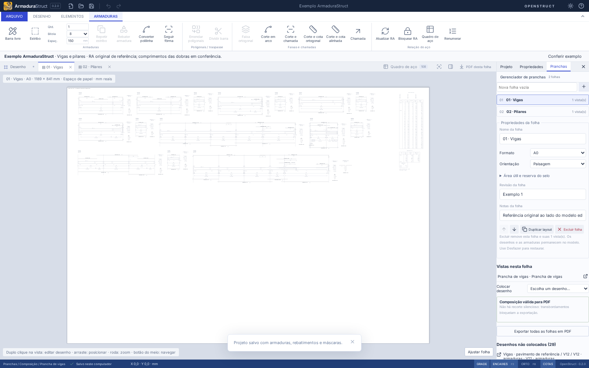
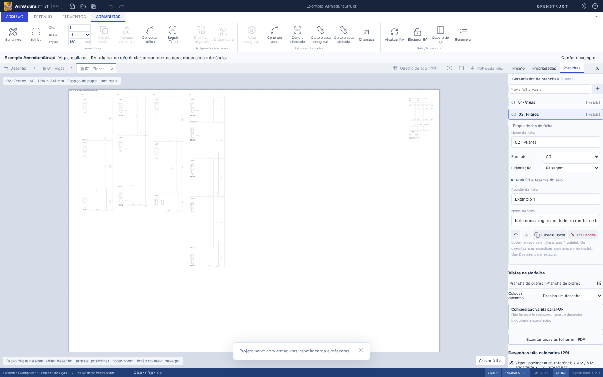
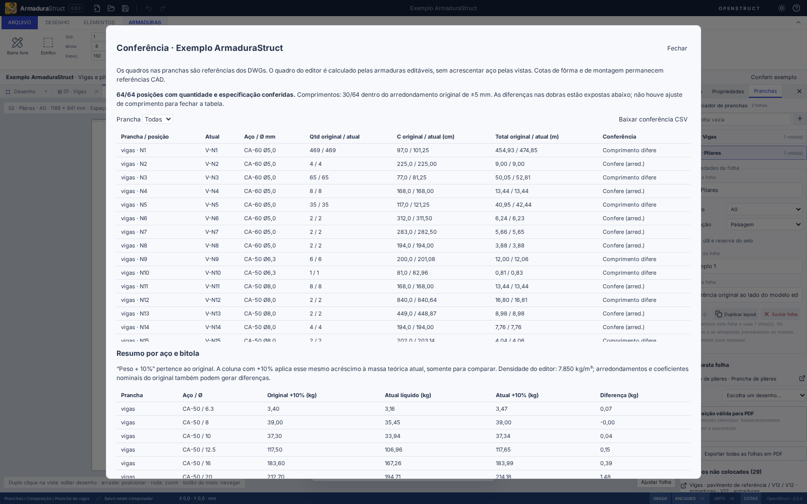

# Exemplo ArmaduraStruct

Projeto inicial reconstruído das pranchas **Exemplo.dwg** e **Exemplo - Pilar.dwg** fornecidas por Ricardo Corsini. São **duas folhas A0**, **15 vigas (V12–V26)**, **quatro pilares (P1, P7, P17 e P13) em 14 lances**, **108 ocorrências físicas**, **64 posições de fabricação** e **1.181 peças**.





## Abrir e editar

- Sem projeto salvo para recuperar, o aplicativo abre as duas abas do exemplo, começando por **01 · Vigas**. Uma recuperação válida tem prioridade; o exemplo não substitui esse projeto.
- **Projeto → Carregar projeto de exemplo** carrega uma cópia independente e pode ser desfeito. **Novo projeto** continua criando um projeto vazio.
- Na folha, use a roda para aproximar e o botão do meio para navegar. Duplo clique na vista abre o desenho composto no CAD.
- Selecione o traçado de uma inserção e use **Editar armadura física**. Quantidade, bitola, mandril e vértices usam a mesma API da interface. A mudança atualiza a inserção e o quadro; uma ocorrência que deixa de ser equivalente ganha sua própria posição.
- A árvore e o seletor **Detalhamento ativo** também abrem cada viga/lance para edição. Folhas e desenhos compostos têm definições separadas das barras físicas.
- Selecione uma inserção para alterar sua escala, rotação, posição, chamada local e visibilidade de cotas. Transformações de apresentação não alteram massa ou comprimento físico.
- Use **Salvar projeto** para obter o JSON nativo editável. O [projeto incluído](../../../src/examples/initial.armstruct.json) também pode ser aberto diretamente no aplicativo.

## Conferência do aço

**Conferir exemplo**, na faixa compacta acima do CAD, compara os dados atuais com a RA original por IDs de ocorrência. Inclui filtro por prancha, quantidades, comprimentos unitários/totais, resumo por bitola e exportação CSV. Continua funcionando depois de salvar/reabrir, renumerar, agrupar ou separar ocorrências. Novos objetos fora da referência são indicados separadamente.

- **64/64 quantidades e especificações conferidas** na versão inicial.
- **30/64 comprimentos** compatíveis com o arredondamento original de ±5 mm; **34/64 divergem**, principalmente nas peças dobradas. Os traçados e seus arcos foram preservados; nenhum comprimento foi forçado a coincidir com o C impresso.
- O original informa **peso +10%**. O quadro nativo usa massa teórica líquida, densidade 7.850 kg/m³. O diálogo mostra as duas bases separadamente.
- Totais líquidos: **673,189 kg em vigas**, **394,190 kg em pilares**. Aplicando 10% apenas para a comparação: **740,508 kg / 433,609 kg**, frente a **733,8 kg / 430,3 kg** do original.

Leia a [conferência das 64 posições](CONFERENCIA.md), baixe o [CSV inicial](Conferencia-ArmaduraStruct.csv) ou o [PDF vetorial das duas folhas](Exemplo-ArmaduraStruct.pdf).



## O que é editável e o que é referência

As armaduras são definições nativas com geometria em mm, curvas e mandris, quantidades por ocorrência e posições de fabricação. Os rebatimentos são inserções vinculadas; não acrescentam aço. Os estribos e grampos do DWG foram reconstruídos como barras livres curvas para preservar seus traçados, em vez de substituí-los pela família paramétrica de estribos com ganchos de 135°.

Fôrmas, cortes, cotas e textos de montagem, tabelas da RA e resumo originais permanecem como **máscaras CAD de referência**, separadas das barras nativas. Essas cotas e tabelas estáticas não são reescritas quando a armadura muda: a chamada vinculada, o quadro nativo e **Conferir exemplo** mostram os dados atuais. Hachuras sólidas, pontos auxiliares de cotagem e WIPEOUT não são reproduzidos pelo normalizador atual; as advertências da máscara registram essas simplificações. A reprodução preserva a composição e os traçados suportados, não todos os estilos proprietários do CAD.

Os prefixos globais **V-** e **P-** distinguem as posições N1… das duas pranchas. As chamadas ocultam apenas esse prefixo conhecido, preservando a nomenclatura original no desenho. Uma renumeração que troca o prefixo passa a mostrar a nova marca. Não houve fusão de posições somente por comprimento.

A reconstrução usa escalas locais explícitas: vigas 1:50 e seções/estribos 1:25; pilares 1:25 e seções/estribos/grampos 1:20. Os cabeçalhos INSUNITS dos DWGs não são suficientes para interpretar a composição de papel. Não se trata de um importador automático genérico de armaduras ou de uma implementação de dimensionamento estrutural.

## Reproduzir e ampliar

```sh
npm ci
npm run example:initial -- /caminho/vigas.dwg /caminho/pilares.dwg
npm run check
npm run build
npm run test:e2e -- tests/e2e/initialExample.spec.ts
```

O [gerador](../../../scripts/examples/initial-project.mjs) recebe os dois DWGs locais como argumentos, confere as células da RA e os resumos, reconstrói as cadeias de linhas/arcos e envia um lote atômico à API. IDs são determinísticos a partir da prancha/handle; posições de fabricação também recebem IDs estáveis. O gerador recusa quantidades divergentes, cadeias sem atribuição, mandris variáveis, incompatibilidade de fabricação e folhas com transbordamento. Não converte aço a partir de linhas de CAD comuns sem essa reconstrução explícita.

Os DWGs fonte não são distribuídos no repositório. O projeto nativo, as referências normalizadas e a conferência são suficientes para abrir e editar o exemplo; somente a regeneração a partir dos CADs exige os originais locais.

O [manifesto](../../../src/examples/initial-reference.json) mantém hashes SHA-256, handles da RA/chamadas/traçados e as contribuições de cada viga/lance. O carregador usa importação sob demanda: usuários com projeto recuperável não carregam o arquivo do exemplo. O formato nativo é **armadurastruct/12** (leitura de 1–11); o pacote é **openstruct.detail/6** (leitura de 1–5). As versões novas preservam chamadas posicionadas e alinhamento dos textos CAD.

Para acrescentar uma prancha, amplie as fontes, o manifesto, as identidades e o carregador, mantendo a separação entre referência CAD e armaduras físicas. Os testes verificam as quantidades da RA, desenvolvimento analítico, persistência, pacotes com conversão de unidades, duplicação/exclusão de folhas, exportação e o fluxo real da interface.
